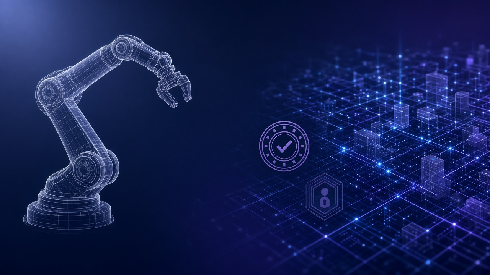

> 先说明一下：素材是我借助 AI 收集整理的，时间都按北京时间。写着「据 X 摘要」的，是 X 平台自动生成的新闻摘要，我暂时没找到一手来源，大家看的时候打个折。每条后面关于行业、公司、赚钱机会的判断都是我个人的看法，不是事实，更不是投资建议。教程视频都是网上公开的，标了「同类操作参考」的，讲的是同一类操作，不是针对这款新产品本身。

## 今天最值得看的几件事

- **头条：OpenAI 物理世界工程 + Google×Mercor PLE**——一边是 CAD/硬件团队用 frontier 模加速设计，一边是 **85** 题物理工程 Agent 硬门，隐藏测最高约 **48.3%**。
- LiberAI **Liber-0**：World Action Model，约 **220** 万小时人类经验，自测 **60** 任务 overall 约 **36.0%**。
- 百度 **Apollo World** + 魔芯 **MoWorld 2.0**：自动驾驶与昇腾 4D 世界模型同日升温。
- 腾讯混元 **Hy4** 正式版：视觉 + Computer Use，API 同价升效果；腾讯云限时约 **50%**，WorkBuddy 限免至 **11-15**。
- 乌镇：智能体身份注册与解析平台；蚂蚁 **APASS** / **ASL** 首批接入。
- Fal Series F：估值约 **$16B**；旁证 Fireworks 欧洲算力扩容。
- 大陆 **Apple 智能**随 iOS **27.3** 开发者 Beta 开放测试；另 Apple 开放 Siri AI 给全体第三方 App。
- DeepMind Antigravity：化学信息学 Skills；招商局狮子山 **驭物 Lion-ER-35B-A3B** 开源具身 VLM。
- FT/Reuters：Oracle 取消与腾讯约 **$7B** 东南亚先进芯租赁（三方未回应，Reuters 称未能即时核实）。
- Menlo：企业生成式 AI 部署侧支出约 **$177B**；YC W27 逾期仍审，F26 Demo Day **12-02**。
- 观点：**能动、能过审、能托付**——Agent 进物理层的三道门。

## 最佳实践

### 1. OpenAI 物理世界工程 + Google×Mercor PLE：能动不等于能盖章（头条）

OpenAI Research 署 **November 3, 2026**：内部硬件与基建团队用 Codex / ChatGPT 做 CAD、制图、仿真与评审，自 **2** 月起硬件团队 token 用量约 **23×**；侧项目用 GPT-6 定需求、Astra 做外观/外壳/PCB/固件并连 Codex，两人约一周出「对讲 Codex」样机，代工厂约一个月小批量——官方承认量产公差/装配细节仍需多轮人工。BenchCAD **2.0** 上内部更新模均分约 **0.875**（对照 GPT-6 Astra 最高推理约 **0.594**）；扩与 Chip Ganassi Racing、新与 Mazda 合作；面向工程公司征集合作。

同窗 Google Cloud Blog × Mercor 署 **November 3, 2026** 发 Physical-Engineering's Last Exam（**PLE**）：**85** 长程任务（机械 **30** / 电气 **27** / 土木 **18** / 结构 **10**），容器化项目夹平均约 **61** 文件/任务，无外网、单任务限约 **6** 小时，须产出执业审图可收的交付物。约 **14** 个 frontier 模 × **7** 套公开 harness；隐藏测全部 **<50%**，最高约 **48.3%**（Mercor 写 Claude Opus **5.5**×Claude Code；次为 GPT-6 Astra 约 **45.8%**、Gemini 4 Argon 约 **40.6%**）；顶尖配置单项约束满足率约 **91%**，整包硬安全/可行性全过仅约 **41.3%**。公开 **29** 题 + 评分工具 + 评测容器；另约 **13** 个 Google 赞助模可免费跑。

来源：[OpenAI·Accelerating engineering for the physical world](https://openai.com/index/accelerating-engineering-for-the-physical-world/)、[Google Cloud Blog·PLE](https://cloud.google.com/blog/products/ai-machine-learning/introducing-physical-engineerings-last-exam-for-agents)、[Mercor·PLE](https://www.mercor.com/blog/introducing-physical-engineering-s-last-exam-ple-with-google-cloud-ai-research/)、[PLE 竞赛站](https://ple-bench.com/)

一边是「一周出样机」的产品叙事，一边是「隐藏测过半都过不了」的执业尺子——物理层今天同时加速和踩刹车。受益的是 CAD/PLM 集成商、工程审图质检工具、做 harness 与容器化评测的供应商；付钱的是把 BenchCAD 自测写成「可无人盖章出厂」、或把 **48.3%** 写成「已达执业可签核」的人。标「侧项目样机 ≠ 已量产商品；BenchCAD 自测 ≠ 第三方盲测；隐藏测公司基线 ≠ 公开榜终局；过硬门才计成本分 ≠ 已可无人盖章出图」。

- 机械 / 电气 / 土木工程负责人：选型时先问供应商过没过 PLE 式硬安全门，再听「小时级出图」演示。
- 硬件创业：OpenAI 自己也写量产公差要人工——合同里留「人工签核节点」。
- 评测工程：模选择分差可达约 **50** 分，换 harness 中位约 **3** 分——先锁模再比工具链。

教程：以 [OpenAI 官方页](https://openai.com/index/accelerating-engineering-for-the-physical-world/) 与 [PLE 竞赛站](https://ple-bench.com/) 为准；本条未核到针对 PLE 的成熟 Bilibili/YouTube 操作片。同类可搜「Claude Code agent harness 评测」「CAD AI 辅助审图」公开教程作流程参考（非本产品）。

## 模型发布

### 2. LiberAI Liber-0：World Action Model，自测 overall 约 36%

官方 Blog + Access Newswire 约 **09:00 PM · 11-03**（雷锋网约 **11:53 · 11-04** 等跟进）：面向通用机器人操作的 World Action Model，预训练逾约 **220** 万小时人类经验。三件套：Unified Embodiment Representation；LiberSense Glove（约 **0.3 mm** / **131 g**）同步人手位姿与第一人称+腕部视频；自研平台 LEO。架构为 language/vision/action 专家的 Mixture-of-Transformers，联合预测未来帧与动作；可选接 GPT-6 Astra 做多步规划。GPT-6 另拟 **60** 任务、每任务 **10** 次共 **600** 试——未用目标任务专用机器人示范，成功率约 **63.5% / 34.0% / 10.5%**（PnP / 短 Non-PnP / 挑战多步）、总体约 **36.0%**；对照 Astra-only 同套约 **8.3% / 5.0% / 1.7%**。

来源：[LiberAI·Liber-0](https://www.liberai.com/blog/liber0/)、[Access Newswire](https://www.accessnewswire.com/newsroom/en/computers-technology-and-internet/liberai-introduces-liber-0-for-zero-shot-robot-manipulation-1245768)、[雷锋网](https://www.leiphone.com/category/industrynews/I4UTbsrR2AN9ZfWk.html)

手套数据把「人手怎么干活」压进机器人动作条件——叙事强，多步仍只有约一成。受益的是具身数据采集商、手套/腕视同步方案、仓配与餐饮轻操作集成；付钱的是把 **36%** 写成「已可无人值守量产奶茶」、或把 zero-shot 理解成「从未见过机器人」的人。标「公司自测 ≠ 第三方盲测/产线验收；zero-shot 定义含预训练见过机器人数据；多步约 **10.5%** ≠ 已可无人值守长程产线；手套数据 ≠ 已含力觉/触觉」。

- 机器人集成商：先复现公开任务子集，再谈替换遥操班组。
- 数据采集创业：手套 **10 kh** 叙事可超 Web 人类视频约 **2,000 kh**——卖「可对齐的动作锚」比卖「更多视频」好讲。
- 餐饮 / 轻制造：多步成功率最低，别把一镜 demo 写进 SLA。

教程：以 [Liber-0 官方博文](https://www.liberai.com/blog/liber0/) 为准；本条未核到成熟中文实操片。同类可搜 Bilibili「具身智能 遥操作 数据采集」「World Model 机器人」作背景参考。

### 3. 百度 Apollo World + 魔芯 MoWorld 2.0：两条世界模型叙事

百度在深圳 AI Day·Apollo 专场披露 **Apollo World**（新华网约 **14:04 · 11-04** / SCMP / Reuters·Mint）：把虚拟城市场景内交通参与者建模为可决策智能体，实时生成相机/激光雷达等观测，驾驶决策后环境随之更新；强调完整行程闭环，并提出「2+3」标尺（因果性、交互性 + 物理准确性、持久性、实时性）。行业/官媒转述「日行约 **10** 万公里」虚拟路测；已用于萝卜快跑全球化测试——官方口径落地全球约 **28** 城、累计出行逾约 **2300** 万次、自动驾驶总里程突破约 **3.5** 亿公里（全无人逾约 **2.4** 亿）。

同日乌镇论坛，魔芯科技发昇腾原生 4D 世界模型 **MoWorld 2.0**（中国经济网约 **16:33** / 一财约 **14:57**）：自述融入重力/弹力/浮力/光照/柔体/流体等十余种物理要素，输出可仿真、可实时渲染的 4D 高斯资产；实时推理自 1.0 最高约 **50** fps→约 **70** fps；资产渲染可达约 **500+** fps；消费侧举例华为手机「摸小宠」端侧约 **6** 亿参版本；媒体另记累计融资约 **20** 亿元口径。

来源：[新华网·Apollo World](http://www.news.cn/tech/20261104/38e7bae3b4094da796b3f51e2252cefe/c.html)、[SCMP·Baidu Apollo World](https://www.scmp.com/tech/big-tech/article/3373173/baidus-new-ai-simulator-gives-robotaxis-crash-course-rare-road-hazards)、[Mint / Reuters](https://www.livemint.com/technology/chinas-baidu-launches-ai-model-simulating-road-environment-for-robotaxis-11793709678345.html)、[中国经济网·MoWorld 2.0](http://www.ce.cn/cysc/newmain/yc/jsxw/202611/t20261104_3283464.shtml)、[第一财经·MoWorld 2.0](https://www.yicai.com/brief/103425442.html)

一条给 Robotaxi 补长尾，一条给具身/文旅补可交互资产——都是「先在仿真里把物理跑通」。受益的是自动驾驶仿真供应商、数字孪生与文旅沉浸内容厂、昇腾生态集成；付钱的是把虚拟「日行十万公里」写成「已等同真实路况合规签核」、或把端侧宠物 demo 写成「已开源通用 frontier 权重」的人。标「公司/官媒披露 ≠ 第三方盲测；虚拟里程 ≠ 已替代全部实车验收；「2+3」为 Apollo 提出标尺 ≠ 行业强制标准；MoWorld fps/物理要素为自述 ≠ 真机验收；融资口径 ≠ 经审计财报」。

- 自动驾驶团队：问清仿真是否闭环到「接单—送达」全行程，而不只是单路口回放。
- 文旅 / 游戏美术：4D 高斯资产「可反复调用」比单次炫片更值钱。
- 采购：昇腾原生成本叙事先要同场景对照表，别只听「约 **30%**」口号。

教程：Apollo World 本身非公开下载产品；同类操作可参考百度 Apollo 开源文档里的 Dreamview+ **Scenario_Sim** 场景仿真流程（搜「Apollo Dreamview 场景仿真」），以及 Bilibili「Apollo 自动驾驶 仿真」入门片——讲的是开源仿真栈，不是 Apollo World 专场产品。

### 4. 腾讯混元 Hy4 正式版：视觉 + Computer Use，计划开源

官方页署 **November 4, 2026**：相对 **8-28** Hy4 preview（总参约 **770B**、激活约 **49B**、上下文约 **1M**）显著扩训；**首次**引入视觉理解与电脑操作（命令行+图形界面，并对 Blender / CAD 等专项训练）。办公侧 WorkBuddy 自述平均效果约 **83.18**、任务通过率约 **96.15%**；金融侧自建测幻觉率自 preview 约 **15.76%→5.45%**。API 标价 Cached input / Input / Output 约 **$0.042 / $0.834 / $2.501** 每百万 token（相对 preview 同价升效果）；腾讯云 TokenHub 人民币目录价约 **6 / 18 / 0.3** 元；至 **2026-12-31 23:59:59**（北京时间）推理费按标价约 **50%** 结算。**计划开源权重**并配 vLLM/SGLang；另预告 HyCell / HyPDE。站长之家约 **15:55** 转述 WorkBuddy 正式接入 Hy4，限时免费体验至 **11-15 23:59**。

来源：[Tencent Hy·Introducing Hy4](https://hy.tencent.ai/research/hy4?langVersion=en)、[腾讯云·Model pricing](https://www.tencentcloud.com/document/product/1300/78937?lang=en)、[腾讯云 TokenHub·模型价格](https://cloud.tencent.com/document/product/1823/130055)、[SCMP·Hy4](https://www.scmp.com/tech/big-tech/article/3373227/tencent-unveils-hy4-open-weight-ai-race-deepseek-zai-alibaba-heats)、[站长之家·WorkBuddy 限免](https://www.chinaz.com/feed/1104/1786255.shtml)、[第一财经](https://www.yicai.com/brief/103425086.html)

国产万亿级 MoE 今天把「能看图、能点电脑」写进正式版，还挂着开源与限时半价——和物理层头条是同一天的软件臂。受益的是企微生态办公自动化、CAD/Blender 插件集成、OpenRouter/自建推理渠道；付钱的是把「计划开源」写成「权重已在 HF」、或把 WorkBuddy 自测分写成「已替代全部财务分析」的人。标「公司/媒体评测 ≠ 第三方盲测；计划开源 ≠ 权重已落仓；约 **50%** 限时 ≠ 永久半价；WorkBuddy 限免至 **11-15** ≠ API/云同免；混元自述与闭源仍有差距」。

- 办公 / 财务运营：先用限免档跑一个真实跨应用流程，再谈订阅。
- 独立开发者：Computer Use + Blender/CAD 专项，适合做垂直插件而不是通用聊天套壳。
- 云采购：人民币目录价与美元标价、折扣期截止日分开写进合同。

教程：以 [Hy4 官方页](https://hy.tencent.ai/research/hy4?langVersion=en) 与腾讯云价格文档为准；WorkBuddy 实操可在产品内跟引导。同类可搜 Bilibili「混元 WorkBuddy」「腾讯云 TokenHub API」公开教程（注意版本是否已到 Hy4）。

### 5. 招商局狮子山驭物 Lion-ER-35B-A3B：开源具身推理 VLM

量子位约 **18:08 · 11-04**：总参约 **35B**、激活约 **3B**，基座 Qwen3.6-**35B-A3B**；核心是「能力牵引」数据引擎——**8** 一级 / **39** 二级能力蓝图 + Eval-Driven Data Harness，监督集约 **312,380** 条。十项公开具身基准 avg@4 等权综合约 **65.29**（Where2Place 约 **64.28**、ERQA 约 **64.38**、SAT 约 **89.33**；ERQA 轨迹理解子类约 **68.18**）。权重上 Hugging Face（`cmriat/lion-ER-35B-A3B`），Apache **2.0**，兼容 Transformers / vLLM / SGLang。

来源：[量子位·驭物](https://www.qbitai.com/2026/11/507586.html)、[Hugging Face·cmriat/lion-ER-35B-A3B](https://huggingface.co/cmriat/lion-ER-35B-A3B)

不堆到万亿，先把「空间/轨迹/可供性」拆成可预算的数据蓝图——和 Liber-0 的手套路线是两条进物理层的路。受益的是具身评测数据服务、边缘 VLM 部署、招商系场景试点集成；付钱的是把十项 avg@4 写成「已无人值守控机」、或把开源当成训练素材可复现的人。标「公司十项分 ≠ 第三方盲测/真机验收；开源权重 ≠ 已可无人值守；能力蓝图自述 ≠ 行业强制标准」。

- 机器人视觉工程师：先在隔离环境跑 ERQA / Where2Place 子集，再接真机。
- 数据团队：错题反哺下一轮数据的 Harness 叙事，可抄作内部数据飞轮设计。
- 开源贡献者：Apache 可达，配方与原始采集未必公开——别承诺「可完整复现训练」。

教程：以 [HF 模型卡](https://huggingface.co/cmriat/lion-ER-35B-A3B) 为准；Transformers/vLLM 加载同类可搜 YouTube「vLLM Qwen MoE serve」公开片作操作参考。

## 工具与产品

### 6. 乌镇智能体身份注册与解析平台 + 蚂蚁 APASS / ASL

世界互联网大会「智能体互信互联互操作」论坛披露（中国日报网约 **15:35** / IT之家约 **17:43** / 雷锋网约 **17:44 · 11-04**）：面向智能体从对话走向办事的卡点——用户可否知悉/撤回授权；服务方确认「是谁、代表谁」；跨平台寻址与互调——共建身份注册与解析平台，并建运行平台。蚂蚁参与首批运行平台；支付宝晓政、芝麻信用等已接入并完成跨平台可信连接；用户侧提 **APASS** 统一身份账号，连接侧与约 **20** 家伙伴共建 **ASL** 协议。蚂蚁集团副总裁陈亮称上限不在「能不能干完」而在「能不能被托付」。

来源：[中国日报网](https://cn.chinadaily.com.cn/a/202611/04/WS6aeae05fe4b0e14252fc91e7.html)、[IT之家](https://www.ithome.com/1/022/298.htm)、[雷锋网](https://www.leiphone.com/category/industrynews/KStlwPyruE6hJ107.html)

昨天 CrowdStrike 卖「能关」，今天乌镇讲「能认出来、能追授权」——物理层要办事，身份层得先立住。受益的是政企 Agent 接入商、身份/授权中间件、芝麻信用类风控连接器；付钱的是把乌镇发布写成「已成全国强制统一标准」、或把 APASS 写成「已替代全部 OAuth/企业 IAM」的人。标「发布与接入演示 ≠ 已全国规模商用签核；APASS/ASL 为蚂蚁侧实践 ≠ 已覆盖全部商业 Agent；通稿未披露解析 SLA/故障责任边界」。

- 政企数字化负责人：先盘「哪些 Agent 以谁的名义办事、授权怎么撤回」。
- 支付 / 政务产品：晓政、芝麻案例说明「可验身份」比「更长上下文」更先成为采购门槛。
- 创业者：ASL 类协议位还在共建——做连接器比做又一个聊天壳更贴叙事。

教程：以三家通稿为准；本条无面向公众的「APASS 开发者」成熟教程。同类可搜「OAuth Agent 委托授权」「企业 IAM Agent 身份」公开分享作概念参考。

### 7. Fal 估值约 $16B + Fireworks 欧洲扩容：推理层继续加注

Fal 官方宣布 Series E + F（TechCrunch 约 **11:34 AM PST · 11-03** ≈ 北京 **03:34 · 11-04**）：F 轮约 **$1.3B**、估值约 **$16B**（相对 **4** 月约 **$8B** 翻倍），Bessemer 领投；两轮合计约 **$1.65B**；Bloomberg 称早前年化收入已逾约 **$800M**；叙事为图像/视频/音频推理需求暴涨。同窗 Fireworks Forge：与 NVIDIA 扩大合作，欧洲拟自 **2027** 年起部署 Vera Rubin / Grace Blackwell；推出 Ultrafast 公测，官方称 Blackwell 上逾约 **1,500** tokens/秒，并推多日 prompt caching 与 background mode。

来源：[fal·Series E & F](https://fal.ai/blog/series-e-f)、[TechCrunch·Fal $16B](https://techcrunch.com/2026/11/03/ai-inference-startup-fal-doubles-its-valuation-to-16b-as-demand-surges/)、[Fireworks·European capacity](https://fireworks.ai/news/fireworks-expands-european-capacity-nvidia-rubin-blackwell)

生成媒体与开源模推理还在按「专用化产能」定价——和物理层仿真抢的是同一类 GPU 小时。受益的是生成媒体应用、欧洲本地化合规推理买家、缓存/冷启动优化工具；付钱的是把估值写成「已审计厚毛利」、或把 **2027** 欧洲部署写成「机房已全部上线」的人。标「估值与 ARR 报道 ≠ 已审计财报；**1,500** tok/s 为公司公测口径 ≠ 第三方全模同速；**2027** 起部署 ≠ 已上线全部机房」。

- 生成媒体创业：算力限流叙事说明「能稳住延迟」本身就是产品。
- 欧洲企业 IT：本地推理合规窗口打开，先问数据驻留再问 tok/s。
- 投资者观察：对照 Baseten / Modal 等同赛道——高估值薄毛利仍是主旋律。

教程：以 Fal / Fireworks 官方页为准；API 接入同类可搜 YouTube「fal.ai image API tutorial」「Fireworks AI inference quickstart」公开片。

### 8. 大陆 Apple 智能 Beta + Siri AI 向全体开发者开放

Apple 中国新闻室 **10-31** 预告、9to5Mac / MacRumors **11-03** 确认：大陆 Apple 智能随 iOS **27.3** 开发者 Beta 自 **11 月 4 日**起开放测试——含实时翻译、写作工具、视觉智能、照片消除、邮件/通知摘要、更自然 Siri 等，并接入阿里巴巴千问；**不含** Siri AI 与 WWDC 2026 下一代能力；正式版拟随 **12** 月 iOS **27.3**。同窗 Apple Developer 署 **November 3**：随 **27.3** Developer Preview，任意 App 可用 App Intents 把内容与动作接入 Siri AI，并新增 skills；App Store 提交拟 **2027 春**；**EU** 的 iOS/iPadOS/watchOS 暂不可用；**13** 岁以下不可用。

来源：[Apple 中国新闻室](https://www.apple.com.cn/newsroom/2026/10/apple-intelligence-features-are-coming-to-users-in-china/)、[9to5Mac](https://9to5mac.com/2026/11/03/ios-27-3-brings-apple-intelligence-features-to-china/)、[Apple Developer·Siri AI open to all developers](https://developer.apple.com/news/?id=gdk2umrf)、[The Verge](https://www.theverge.com/tech/1025694/apple-siri-ai-third-party-apps)

区域合规功能开测，和系统级助手平台开闸，几乎叠在同一周——入口在手机上，能力却按市场拆。受益的是国内 iOS 效率/影像类 App、App Intents 技能开发者、千问侧端云协同集成；付钱的是把开发者 Beta 写成「全体中国用户已正式上线」、或把「开放 Siri AI」写成「中国大陆已同步同一套」的人。标「Beta ≠ 正式版全量；千问接入 ≠ 已含全部 WWDC 新能力；Developer Preview ≠ 用户侧第三方技能已默认开通；EU 暂缺；日限额未来或收费」。

- 国内 iPhone 用户：开发者账号可尝鲜，正式版看 **12** 月节奏。
- iOS 开发者：先做 App Intents / skills 原型，提交窗口盯 **2027 春**。
- 产品经理：大陆功能清单与全球 Siri AI 开放名单分开做矩阵，别混进同一张 PPT。

教程：以 Apple 新闻室与 Developer 公告为准；Beta 安装同类可搜 Bilibili「iOS 开发者预览版 安装」公开片（注意账号与备份风险，非本功能专片）。

## 论文研究

### 9. DeepMind Antigravity：化学信息学 Skills

DeepMind Blog 署 **November 3, 2026**：为 Antigravity 加 Cheminformatics Skills——以 RDKit + ChEMBL/PubChem 等确定性工具承接计算，模型负责编排/检索/推理；演示以克唑替尼→洛拉替尼式刚性化为主线，约 **1** 小时内检索成千化合物、做 MMPA、建效价模型并提出新大环与合成路线。强调设计仍是待合成验证的假说；Skills 可在 Antigravity App 装 Science 插件；另开约 **10,000** 名科学家最高用量档 **6** 个月免费申请。

来源：[DeepMind·Agentic cheminformatics with Google Antigravity](https://deepmind.google/blog/agentic-cheminformatics-with-google-antigravity/)

物理层不只是车和手臂，还有湿实验前的计算栈——和昨天 Hydrogen-1.0、今天 PLE 是同一条「先过工具与假说、再进实验室」的链。受益的是药化计算外包、RDKit 工作流集成、申请免费档的学术组；付钱的是把小时级迭代写成「已出临床候选」、或把免费名额写成「已全员开通」的人。标「演示 ≠ 已过工艺验证；模型建议路线 ≠ 可发表发现；申请 ≠ 已录取」。

- 药化 / 材料研究者：把 Skills 当检索与假设生成器，合成与活测仍走原流程。
- 科研软件商：确定性工具 + Agent 编排，比「端到端发现药」更好签合同。
- 实验室负责人：合同写清「输出须专家复核」。

教程：以 [DeepMind 博文](https://deepmind.google/blog/agentic-cheminformatics-with-google-antigravity/) 为准；RDKit 入门可搜 YouTube「RDKit beginner tutorial」公开片（同类工具参考，非 Antigravity 专片）。

## 产业与资本

### 10. Oracle 取消与腾讯约 $7B 东南亚租芯（媒体报道，未独立核实）

FT 经 Reuters / 联合早报等转述（约 **11-04**）：Oracle 在美国官员表达关切后，取消与腾讯约 **$7B**/五年、约 **10** 万枚先进 AI 芯片的东南亚租赁；同时报道广东省高级官员到访腾讯要求支持国产芯片。Oracle / 腾讯 / 白宫均未回应 Reuters 置评；Reuters 写明未能即时独立核实。背景对照同日记 Oracle 另有约 **$20B** 股债定价、腾讯刚发 Hy4。

来源：[Reuters via U.S. News](https://money.usnews.com/investing/news/articles/2026-11-04/oracle-abandons-7-billion-tencent-ai-deal-under-trump-pressure-ft-reports)、[联合早报](https://www.zaobao.com.sg/news/china/story20261104-9945155)、[Investing.com 中文](https://cn.investing.com/news/stock-market-news/article-3647175)

物理层要算力，算力有国界——和今天世界模型、Hy4 半价是同一张地图的另一面。受益的是国产算力与异构纳管（笔记另录 GPUWorks / 后摩等，篇幅所限未单开）、东南亚第三方云合规顾问；付钱的是把 FT 知情者报道写成「已审计合同取消文件」、或把「约 **10** 万枚」写成「腾讯算力已断供」的人。标「媒体知情者口径 ≠ 官方确认文件；三方未回应 ≠ 已否认；广东官员到访叙事 ≠ 已公开政策全文」。

- 云与基建采购：跨境租芯条款加「出口/制裁变更终止」与国产替代演练。
- 模型公司：训练/推理产能地图要同时标「能买到的卡」和「能合法跑的地方」。
- 读者：此条证据链弱于官方 PR，转发务必带「未核实」标签。

教程：本条无操作教程；跟踪以 Reuters/FT 后续更正与公司 IR 为准。

### 11. Menlo 企业 AI 年报约 $177B + YC 批次节奏

Menlo Ventures《2026: The State of Enterprise AI》署 **November 03, 2026**：企业生成式 AI 部署侧支出至约 **2026-09** 达约 **$176.8B / $177B**（相对 **2025** 约 **$33B** 约 **5.4×**）；称每 **$1** 训练侧投入对应约 **$1.70** 部署侧收入；OpenRouter 上 Agent 约占总 token **80%**；企业 LLM API 支出 Anthropic 约 **55%**、OpenAI 约 **31%**、Google 约 **9%**。方法含近约 **400** 名美企决策者调研。YC：W27 准时截止已过，仍收逾期；F26 Demo Day 定 **12 月 2 日**。

来源：[Menlo·2026 The State of Enterprise AI](https://menlovc.com/perspective/2026-the-state-of-enterprise-ai/)、[GlobeNewswire](https://www.globenewswire.com/news-release/2026/11/03/3394279/0/en/menlo-ventures-2026-state-of-enterprise-ai-report-enterprise-ai-spending-hits-177b-up-5-4x-in-one-year-as-agents-take-over.html)、[YC Apply](https://www.ycombinator.com/apply/)、[YC Demo Day](https://www.ycombinator.com/demoday)

钱在往「部署与 Agent」迁，申请窗却还开着逾期口——一边是大数，一边是仍可交材料的创始人。受益的是 Agent 运维/观测、企业 API 网关、仍想冲 W27 的团队；付钱的是把 Menlo 估计写成「已审计全市场」、或把逾期写成「与准时同等承诺」的人。标「调研加权 ≠ 已审计；OpenRouter 偏态 ≠ 全企业分布；逾期仍审 ≠ 保证面试」。

- 企业 AI 负责人：预算叙事从「买训练」转向「买部署与 Agent 用量」。
- 想申请 W27：还能交，别再等完美叙事。
- 读者：份额是部署/API 口径，不是「谁赢了 AGI」。

教程：报告以 [Menlo 原文](https://menlovc.com/perspective/2026-the-state-of-enterprise-ai/) 为准；申请以 [YC Apply](https://www.ycombinator.com/apply/) 为准。

## 观点洞察

### 能动、能过审、能托付：Agent 进物理层的三道门

昨天写的是合同里的三道闸——谁能用、谁能证、谁能关。今天材料换了场地：车、手臂、分子、审图章、还有「以谁的名义去办事」。

先说**能动**。OpenAI 把 frontier 模推进 CAD 与小批量样机；Liber-0 用约 **220** 万小时人类经验换操作；Apollo World / MoWorld 把仿真从「画面像不像」推到「动作之后世界怎么变」；狮子山驭物则用能力蓝图喂开源具身 VLM。能动，指的是仿真与机具真的被改写状态，不是聊天里描述一下物理。

再说**能过审**。PLE 把执业工程师的硬安全门摆上桌：隐藏测最高约 **48.3%**，单项约束可以很高，整包全过仍约四成。OpenAI 自己也承认量产公差要人工。Alignment 侧另有评测—生产缺口提醒：安全榜上的成功，未必等于线上同款决策。过审，指有人敢盖章、敢担责，不是 demo 帧率漂亮。

最后是**能托付**。乌镇把智能体身份注册与解析推到台前，蚂蚁用 APASS / ASL 讲「看得见、收得回」的委托。Hy4 的 Computer Use、大陆 Apple 智能开测、Siri 向开发者开放，都在扩大「Agent 能碰哪些真实权限」——权限一开，身份与授权就不再是附加题。

我自己读材料时会多问三句：

1. **能动：** 这个系统改的是仿真状态、机具动作，还是只生成一段像物理的视频？
2. **能过审：** 有没有类似 PLE 的硬门？失败时谁签字？公差与安全约束写进合同了吗？
3. **能托付：** Agent 以谁的身份行动？授权能否撤回？跨平台能否解析「是谁、代表谁」？

过得了这三问，再谈日行十万虚拟公里、**36%** 操作成功率、Hy4 半价或 Fal 的一百六十亿估值也不迟；过不了，再响的物理 AI 叙事，都只是还没写进验收手册的能力清单。个人观点，数字以各条原文为准，不构成投资或采购建议。

## 今日机会总结

今天的脊柱是：**物理层开跑**（OpenAI 工程叙事、Liber-0、Apollo/MoWorld、PLE、驭物）、**身份与权限**（乌镇 APASS/ASL、Apple 智能/Siri 开放、Hy4 Computer Use）、**算力与部署账本**（Fal / Fireworks、Oracle–腾讯租芯报道、Menlo **$177B**），外加 YC 逾期窗口。观点侧把能动 / 能过审 / 能托付收成三道门。

若只选三条可执行方向：

1. **物理工程 Agent 的「硬门+人工签核」包**：对标 PLE 与 OpenAI 自己的量产免责声明，帮制造/设计客户把「可演示」拆成「可过审节点」；客户是怕担责的工程负责人，不是要「一周出厂」口号的演示买家。
2. **世界模型 / 具身数据飞轮**：仿真闭环（Apollo 类）、4D 资产（MoWorld 类）、手套/能力蓝图数据（Liber / 驭物类）——卖可复现的数据与评测子集，不卖「已通用人形」。
3. **Agent 身份与委托中间件**：对标乌镇解析平台与 APASS/ASL 叙事，做「授权可见、可撤回、可跨平台验」的连接器；政企与支付场景比纯聊天壳更贴今天的采购语言。

## 普通人今天就能做的 3 件事

1. **做硬件 / 机械设计的人：** 打开 [PLE](https://ple-bench.com/) 看公开题长什么样，对照自己团队是否只有「出图速度」KPI、没有「硬安全全过」清单。
2. **用或做办公 Agent 的人：** 列一张「这个 Agent 以谁的账号办事、授权存在哪、怎么撤回」；对照乌镇今天的身份叙事，看自己是不是还在用个人主账号裸跑。
3. **国内 iPhone 开发者 / 重度用户：** 看是否值得装 iOS **27.3** 开发者 Beta 尝鲜大陆 Apple 智能；开发者另读 [Siri AI 开放公告](https://developer.apple.com/news/?id=gdk2umrf)，先试一个 App Intents 原型。

---

*草稿待审阅；确认后再发博客。有要改的直接说。*
