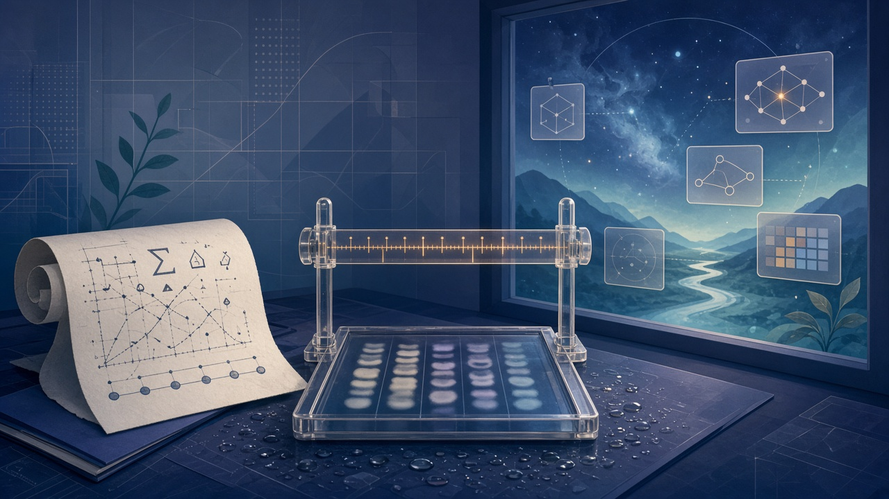

> 先说明一下：素材是我借助 AI 收集整理的，时间都按北京时间。写着「据 X 摘要」的，是 X 平台自动生成的新闻摘要，我暂时没找到一手来源，大家看的时候打个折。每条后面关于行业、公司、赚钱机会的判断都是我个人的看法，不是事实，更不是投资建议。教程视频都是网上公开的，标了「同类操作参考」的，讲的是同一类操作，不是针对这款新产品本身。

## 今天最值得看的几件事

- **头条：frontier 压假设双发**——DeepMind 在遗留 **1024-bit RSA** 上给出签名填充与批量分解两类加速；Physical Superintelligence 宣布用非公开 Anthropic 实例 + **Lean** 机检给出 **Aaronson–Ambainis** 猜想完整证明。
- OpenAI **BioBasicsBench**（与 Ligo）：约 **100** 项湿实验原始证据评测；Anthropic 客座文谈科学建模三步与「模型分布」。
- Anthropic Engineering：**agent memory / dreaming**——空闲期对照 transcript 纠错、建 wiki、预载记忆。
- Frontier Model Forum **Jailbreak Rating Framework** v1.0 + OpenAI×**Hacktron** 外援红队。
- Standard Physics **Archimedes** + 开源 **Reynolds**（OpenFOAM 可复跑 case）。
- Higgsfield **Miracle**（成片矢量化局部编辑，私测）；DesignArena **LifeArena**（真人评测个人助手，本轮自称 Muse #1）。
- YC：W27 逾期仍审，F26 Demo Day **12-02**；**Stacktrace** / **Taan AI** / **Proto** / **Cyclon** / **Trepo** / **Organizely**。
- 观点：**证明、尺子、梦境**——frontier 往理论假设、湿实验证据和长程记忆里伸手的三道账。

## 论文研究

### 1. DeepMind RSA-1024 + PSI Aaronson–Ambainis：用 frontier 压密码与量子复杂度假设（头条）

同一窗里，一边是「人类指导下、在已解基准钥上」把遗留密码体系再往前推一截，一边是「公司研究系统 + Lean 逐条机检」声称闭合一条开放约十八年的复杂度猜想。Google DeepMind 发 AI Agent 加速密码分析：在遗留 **1024-bit RSA** 上发现两类弱点——① 数字签名填充在攻击者可控签名块约一半及以上时几乎不再提供额外防护，并给出在短指纹等更难设定下自称相对既有方法约 **1,600×** 的新算法理论估计；② 同比特长度多密钥批量化分解新算法，自称相对既有 batch 方法把「再多破一把」的平均成本再降约 **30×**。强调只影响过时 **1024-bit**，现代普遍 **2048-bit+** 不受这些具体利用影响；工作在沙箱/已解基准钥上复现，未点名在用生产系统。配套两份技术 PDF（Affine Root / Fan Factories·batch NFS）。Physical Superintelligence（PSI）则宣布其内部研究系统在非公开 Anthropic 模型实例上给出 **Aaronson–Ambainis 猜想**的完整证明，并由 **Lean** 证明助手逐条机检通过：该猜想自 **2008** 年开放，关乎「无特殊结构的随机输入上，量子相对经典能否指数级加速」。公司表述的证明后含义：在问答式查询模型下，除非输入带有稀有结构（如 Shor 所依赖的周期模式），量子相对经典最多只有多项式级查询优势；系统称在自有基建上跑到第 **3** 天已有完整证明，随后又两次改进并由 Lean 接受终稿。公开人类可读手稿与 **Lean 4** 形式化仓；Stanford 相关研究者称在读全文并写专家短述。

来源：[GoogleDeepMind·X](https://x.com/GoogleDeepMind/status/2118755418675765656)、[Pushmeet·Advancing the frontier of cryptanalysis](https://x.com/pushmeet/status/2118752095859794390)、[技术 PDF·Faster Affine Root](https://storage.googleapis.com/deepmind-media/papers/Faster_Affine_Root_and_a_1024bit%20Computation.pdf)、[技术 PDF·Fan Factories / Batch NFS](https://storage.googleapis.com/deepmind-media/papers/Fan_Factories_Multiple_Number_Fields_in_Factorization_Factories_and_Batch_NFS.pdf)、[PSI·A proof of the Aaronson-Ambainis conjecture](https://psi.inc/research/aaronson-ambainis/)、[GitHub·aaronson-ambainis](https://github.com/physical-superintelligence/aaronson-ambainis)、[Unite.AI 报道](https://www.unite.ai/psi-reports-machine-checked-proof-of-aaronson-ambainis-conjecture/)

一边是密码分析沙箱，一边是形式化数学——都在问「frontier 能不能把理论假设往前推」，和昨天 Cyber Critical「过闸才能碰攻击面」是不同场地的同一种野心。受益的是遗留 RSA 迁移排期、证书与签名栈审计、形式化验证中间件、量子复杂度理论工具链；付钱的是把「**1024** 遗留」写成「现代 RSA 已破」、或把公司/仓声明写成「同行评审期刊已录用、量子计算已无用」的人。标「**1024** 遗留 ≠ **2048** 已破；约 **1,600×**/约 **30×** 为论文/团队估计须读 PDF；沙箱复现 ≠ 已对公网在用钥发动；公司/仓声明 ≠ 同行评审录用；人读论文本身未机检；Lean 内核/Mathlib/编译器仍在信任基内；『非公开 Anthropic 模』≠ 已公开可复跑同款；有结构问题（如 Shor）仍可指数优势」。

- 安全/密码工程：先盘点仍在用的 **1024-bit** 证书与签名填充路径，再谈「AI 是否已破生产钥」——后者今天没有证据。
- 形式化/理论研究者：打开 PSI 手稿与 Lean 仓，核陈述是否精确对齐原猜想，再写专家短述。
- 普通读者：把这条当「frontier 开始碰硬理论」的信号，别当「银行 App 今晚失效」的警报。

教程：密码分析以 DeepMind 两份 PDF 与 X Article 为准——无公开「如何利用生产钥」跟练片，也不应跟练攻击步骤。形式化侧以 [PSI 研究页](https://psi.inc/research/aaronson-ambainis/) 与 [GitHub 仓](https://github.com/physical-superintelligence/aaronson-ambainis) 为准；Lean 入门可参考公开片 [Theorem Proving in Lean 4（官方 playlist 同类）](https://www.youtube.com/watch?v=3enf4L_o_PE)（同类操作参考，非本证明专片）。本条未核到针对 RSA-1024 Agent 或 Aaronson–Ambainis 证明的成熟一手官方跟练片。

### 2. BioBasicsBench + Teaching AI to build scientific models：湿实验尺子与建模方法边界

OpenAI 与酶设计公司 **Ligo** 合作发 **BioBasicsBench**：用真实湿实验原始证据（凝胶/菌落/显微/仪器读数等）测 AI Agent 在约 **100** 项日常湿实验室分析上的表现——能否读原始数据、找错、并在证据不足时拒下结论。五域：蛋白方法、成像与流式、定量与 assay、核酸方法、分子克隆。xhigh 推理档：GPT‑6 Astra 均分约 **66.7%** 可用分（95% CI 约 **60.3–73.1%**），对照 GPT‑5.6 Sol 约 **43.8%**；亦报 GPT‑6.1 Sol 约 **62.0%** 等七模多档共约 **18,500** 次结果。文中同时展示 Astra 仍会把假设压过对照、忽略反例、菌落计数偏高等失败模式。同窗 Anthropic 科学博客客座文《Teaching AI to build scientific models》（ELLIS Tübingen / 图宾根大学 Jakob Macke、Daniel Gedon、Stefan Wahl）：把科学建模拆成建模→约束参数→解释三步，强调仿真贝叶斯/SBI，以及用 LLM Agent 在模型空间搜索时返回「合理解释的模型分布」而非单一最优拟合；并指出多数系统仍主要在「再发现已知模型」，未知问题上证据仍稀。

来源：[OpenAI·BioBasicsBench](https://openai.com/index/measuring-how-ai-agents-handle-wet-lab-science/)、[OpenAI·X](https://x.com/OpenAI/status/2118782708767965238)、[Anthropic·Teaching AI to build scientific models](https://www.anthropic.com/research/teaching-ai-to-build-scientific-models)、[AnthropicAI·X](https://x.com/AnthropicAI/status/2118792930211107115)

昨天 METR 在量实验室自己的加速度；今天湿实验原始图和「模型分布」在量科学 Agent 敢不敢下结论、敢不敢承认不知道。受益的是生物信息/湿实验质控中间件、酶设计与 assay 自动化、SBI/科学建模工具链、实验室 LIMS×Agent 审计层；付钱的是把均分写成「可替代 PI」、或把客座综述写成「Anthropic 已承诺可自主立新理论」的人。标「均分为公司评测 ≠ 可替代 PI 判断；原始证据 ≠ 论文精选图；Astra 领先 ≠ 已证可无人值守出实验结论；客座观点 ≠ Anthropic 产品承诺；再发现已知模型 ≠ 已可自主立新理论」。

- 实验室/生物信息：先拿一批已归档原始凝胶/菌落图跑对照，看 Agent 会不会在证据不足时拒答，再谈进 SOP。
- 科学软件创业者：卖「模型分布 + 可审计拒答」比卖「一键出最优拟合」更贴今天的尺子。
- 普通读者：看到「AI 发现新科学」标题时，先问有没有原始证据与拒答率，而不只看均分。

教程：以 [OpenAI BioBasicsBench 公告](https://openai.com/index/measuring-how-ai-agents-handle-wet-lab-science/) 与 [Anthropic 客座文](https://www.anthropic.com/research/teaching-ai-to-build-scientific-models) 为准。本条未核到针对 BioBasicsBench 的成熟 Bilibili/YouTube 专片；同类湿实验数据判读可搜公开「gel electrophoresis reading」「colony counting」教学片作流程参考（同类操作，非本基准专片）。

## 最佳实践

### 3. Anthropic agent memory / dreaming：空闲期纠错、建 wiki、预载记忆

Anthropic Engineering 发《The components of agent memory》：系统阐述 Agent 记忆笔记、显著性判断，以及用空闲期 **dreaming**（对照 Letta/UC Berkeley sleep-time compute）对照 transcript 纠错、建 wiki 式表征、把笔记提升到会话预载层、并按目标整形记忆。评测含 CL-Bench 1.0、Claude Plays Pokémon、Stainless 约 **35 万**文件语料上 wiki 扩展、Harvey LAB 等；例：错误 PokéCenter 方位经 dreaming 纠正后可穿过 Mt. Moon；wiki 从约 **2** 轮到约 **128** 轮 dreaming 后问答标准达成率约 **13%→48%**。配套 Managed Agents 有 Dreams API，Cookbook 有动态工作流配方（导出会话 → 蒸馏 wiki → 下次只读挂载）。

来源：[Anthropic·The components of agent memory](https://www.anthropic.com/research/components-of-agent-memory)、[AnthropicAI·X](https://x.com/AnthropicAI/status/2118814753154064501)、[Docs·Dreams](https://platform.claude.com/docs/en/managed-agents/dreams)、[Cookbook·Dreaming with a dynamic workflow](https://platform.claude.com/cookbook/managed-agents-cma-dreaming-with-a-dynamic-workflow)

昨天写的是谁碰钱包、谁摸终端；今天是 Agent 跨会话怎么「睡一觉再想起」——长程 harness 的基建层。受益的是 Agent 记忆中间件、会话后处理/wiki 蒸馏流水线、企业知识库与 Managed Agents 集成商；付钱的是把内部评测写成「用户侧 Memory 已默认同款 dreaming」、或把 wiki 膨胀写成「越大越好」的人。标「内部/受控评测 ≠ 用户侧 Memory 产品已默认同款；dreaming 需算力；wiki 可能膨胀到比原文更大；注入上下文须控制体积；Dreams 为 Managed Agents 能力，不是聊天框一键开关」。

- Agent 平台工程：先定「transcript 保留多久 + dreaming 多久跑一次 + 预载层 token 上限」三行，再谈「同事级记忆」。
- Claude Managed Agents 用户：读 [Dreams 文档](https://platform.claude.com/docs/en/managed-agents/dreams)，用现有 memory store + 历史 session 跑一次，人工审输出 store 再挂载。
- 普通重度用户：本地 MEMORY.md / 项目笔记先做人工去重，别指望「模型自己会记得一切」。

教程：以 [官方研究文](https://www.anthropic.com/research/components-of-agent-memory) 与 [Cookbook·Dreaming with a dynamic workflow](https://platform.claude.com/cookbook/managed-agents-cma-dreaming-with-a-dynamic-workflow) 为准；工作坊样例见 [agents-that-remember](https://github.com/anthropics/cwc-workshops/blob/main/agents-that-remember/README.md)（CwC 样例，非维护产品）。公开图文整理可参考 [max.nardit 文](https://max.nardit.com/articles/anthropic-agent-memory-components-dreaming-memory-md)（第三方，非 Anthropic 官方片）。本条未核到成熟一手官方 YouTube/Bilibili 专片。

### 4. FMF Jailbreak Rating Framework + OpenAI×Hacktron：越狱评级与外援红队

Frontier Model Forum 发 **Jailbreak Rating Framework for Frontier Cyber Threats v1.0**（初步框架）：用能力增益、能力范围、部署难度、发现难度四维给「成功的网络向越狱」定比较风险，便于开发者/安全研究/政策方统一优先级；公开征求意见至约 **2026-12-21**（comments@frontiermodelforum.org）。AWS / Anthropic / Google DeepMind / Microsoft / OpenAI 负责人均有表态；OpenAI 转发强调与成员公司合作。同窗 OpenAI 宣布与 **Hacktron** 合作，联合排查 OpenAI 自身系统漏洞，重点测与第三方服务交界；并经 Daybreak Red 扩大 Hacktron 对 frontier 模访问。叙事承接本周 Cathedral 联合安全冲刺与赏金上调；Hacktron 以赏金项目结识，产品向为代码审查/渗透/红队 Agent。

来源：[FMF·Introducing Jailbreak Rating Framework](https://www.frontiermodelforum.org/updates/introducing-the-fmf-jailbreak-rating-framework-for-frontier-cyber-threats/)、[FMF·Specification](https://www.frontiermodelforum.org/specifications/jailbreak-rating-framework-for-frontier-cyber-threats/)、[OpenAI·X](https://x.com/OpenAI/status/2118795218099253606)、[OpenAI·Partnering with Hacktron](https://openai.com/index/partnering-with-hacktron)、[Hacktron·Partnering with OpenAI](https://www.hacktron.ai/blog/openai-partnership)

昨天 Cyber 在卖能力、Clutch 在卖非人身份；今天行业论坛在卖「怎么给越狱比风险」，OpenAI 自己在扩外援红队——闸从产品侧走到共治侧。受益的是红队 Agent、越狱评级与报告中间件、第三方交界面审计、赏金与披露流程工具；付钱的是把 v1.0 初步写成「监管强制标准/已统一处罚口径」、或把合作写成「外包全部安全、公众可调 Cyber」的人。标「v1.0 初步 ≠ 监管强制标准；评级一致性仍在测试；公开征言至约 **12-21**；合作 ≠ 外包全部安全；Daybreak Red 扩权 ≠ 公众可调 Cyber；发现须走赏金/披露流程」。

- 安全研究/政策：读 FMF 规格，按四维给自家红队发现打分，再决定是否在征言窗内回信。
- 防守方采购：问清「第三方交界面谁测、发现走哪条披露」，别只买「模型会拒绝」口号。
- 普通读者：本条无攻击教程；关心的是行业开始用同一套尺子比「这次越狱有多危险」。

教程：以 [FMF 更新页](https://www.frontiermodelforum.org/updates/introducing-the-fmf-jailbreak-rating-framework-for-frontier-cyber-threats/) 与 [OpenAI×Hacktron 公告](https://openai.com/index/partnering-with-hacktron) 为准。本条无攻击/越狱跟练；防御同类可搜公开「responsible disclosure」「red team reporting」运维分享作流程参考。

## 工具与产品

### 5. Archimedes + Reynolds：自然语言进物理设计搜索，开源可复跑 CFD 环

Standard Physics（原 Inviscid AI）推 **Archimedes**（物理设计搜索 Agent）并开源 **Reynolds**（MIT）：用自然语言描述流动/工程目标，Agent 写设计为代码、在真实求解器（含 OpenFOAM）里仿真迭代；公司示例含水空两用桨叶、数据中心冷却年电费叙事、涡轮叶片 2D 损失自称约 **25.5%** 优于对照基准等，并强调细网格复验失败会写进报告。Reynolds：`pip install openreynolds`，输出可复跑的普通 OpenFOAM case；个人验证工作邮箱可免费用。

来源：[Archimedes](https://standardphysics.com/archimedes)、[Reynolds](https://standardphysics.com/reynolds)、[Snape Report](https://snapereport.com/s/standard-physics-open-sources-reynolds-agent-and-launches-archimedes)

昨天卖真机点按；今天卖「话说完，求解器里跑」——物理世界的 Agent 环从演示图走到可复跑 case。受益的是 CFD/热管理咨询、数据中心冷却设计、涡轮/桨叶前期搜索、OpenFOAM 自动化流水线；付钱的是把仿真指标写成「已量产验证」、或把开源 Reynolds 写成「Archimedes 设计搜索本身全开源」的人。标「仿真指标 ≠ 已量产验证；约 **$227k**/约 **25.5%** 等为公司示例口径须独立复现；冷流结果 ≠ 高温工况；开源 Reynolds ≠ Archimedes 全开源」。

- 机械/流体工程师：先用工作邮箱开 Reynolds，把一个已有 OpenFOAM case 对照生成结果，再谈 Archimedes 订阅。
- 数据中心/散热团队：把「年电费叙事」当销售故事，验收仍看细网格与实测。
- 学生/爱好者：不会 CFD 就先跑通一个官方 cavity/elbow case，再让 Agent 代写。

教程：Reynolds / Archimedes 以官网为准。OpenFOAM 同类入门可参考 [DD Fluids 首个仿真·Lid-driven cavity](https://www.youtube.com/c/DDFluids/) 或 Wiki 收录的 [Running your first case](https://wiki.openfoam.com/Running_your_first_case_by_Jozsef_Nagy)（同类操作参考，非 Archimedes 专片）；边界条件直播向可参考 [OpenFOAM BC & case setup](https://www.youtube.com/watch?v=yQ0iA2-m8TQ)。

### 6. Higgsfield Miracle：成片「矢量化」成可编辑图层，边播边改

Higgsfield 发 **Miracle**（私测/候补名单）：自称把成片视频「矢量化」成可编辑图层，边播边做局部像素级改动（换色、加减物体、画面内文字、换背景/调光等），强调改的是已拍好/已生成的那条而非整段重抽；并称每帧保留景深信息供后期。官网 FAQ 明确：Miracle **不是**新视频生成模；「实时」目标是播着改、无单独渲染队列，精确时延数字待正式上线公布；自有素材/格式上限/价格/公开日均未署。现为选定伙伴早期测试 + waitlist；并预告将上 Higgsfield MCP（供 Claude 等调用）。

来源：[Higgsfield·Miracle](https://higgsfield.ai/miracle)、[higgsfield·X](https://x.com/higgsfield/status/2118732716346933423)、[higgsfield_ai·演示续帖](https://x.com/higgsfield_ai/status/2118781233266381273)、[Snape Report](https://snapereport.com/s/higgsfield-miracle-realtime-video-layer-editing)

昨天 Omni / Edits 在卖「生成 + 粗剪」；今天 Miracle 想卖「已经成片了还能局部改」——后期入口从时间线挪到图层。受益的是短视频后期工具、品牌素材局部改版流水线、MCP 视频插件；付钱的是把私测写成「已对公众开放、已可替代 After Effects 全流程」的人。标「私测/候补 ≠ 已对公众开放；演示≠已证 4K/发丝/反光稳定；『cinema-grade』『world knowledge』为公司口径；MCP『即将』≠ 已可用」。

- 短视频/广告创作者：进 waitlist，自备一条有字幕+产品特写的成片，上线后先试「改包装色/换背景」窄任务。
- 工具集成商：盯 MCP 开放日，做「只改图层、不重抽整段」的 Agent 动作，而不是再包一层文生视频。
- 普通用户：现在还没有公开操作入口；别被演示 GIF 写成「今晚就能商用出片」。

教程：以 [Miracle 产品页](https://higgsfield.ai/miracle) 与官方 X 演示为准。本条未核到成熟一手官方 YouTube/Bilibili 专片；同类「AI 视频局部编辑」可搜公开 Runway/可灵局部重绘跟练作流程参考（同类操作，非 Miracle 专片）。

### 7. LifeArena：真人在真实个人上下文里评个人助手

DesignArena 推 **LifeArena**：自称「首个由真人用户评判的个人助手竞技场」——现有静态基准难捕捉日常「又乱又怪」的请求，故向选定用户开放，在真实个人上下文（公司举例：约 **3 万** 未读 Gmail、数年短信、数百联系人）里跑助手对比。用户带来过：与室友共签西雅图租约的解约、旧金山拖车争议、编排约 **$2,500** 的圣诞佛州行程等。自报本轮 **#1** 为 Meta **Muse**（全能最强、快、展示能力突出）；并强调「尚无 AI 助手达到真人私人助理水平」。方法论细节称即将公布。

来源：[DesignArena·X（LifeArena）](https://x.com/DesignArena/status/2118763090888294598)、[续帖·任务与 Muse #1](https://x.com/DesignArena/status/2118763091521589341)、[续帖·上下文与方法预告](https://x.com/DesignArena/status/2118763092054343729)、[DesignArena](https://www.designarena.ai/)

静态榜在量「会不会答」；LifeArena 想量「敢不敢在我的真实烂摊子里办事」——和个人助手入口战是同一条尺子。受益的是个人助手评测服务、隐私安全的评测沙箱、垂直场景（租约/行程/客服争议）Agent；付钱的是把「世界第一」写成第三方盲测定论、或把「尚未达到真人助理」写成「已可替代私人助理」的人。标「X 线程首发 ≠ 已有长文方法论；『世界第一』为公司自称；选样用户/任务非公开盲测全集；Muse #1 为该场本轮口径；方法『即将』≠ 已可复现」。

- 个人助手产品：别只报静态基准；准备一套可脱敏的「真实烂请求」集给外部评。
- 美区 Muse 用户：这是偏好信号，不是「已证可把邮箱全权交出」。
- 普通读者：转发时带「选样评测 + 方法未公开」，别只留一个 #1。

教程：以 DesignArena 线程与站点为准。本条无公开跟练片；关心评测设计可读各家 Arena 方法论旧文作对照（同类，非 LifeArena 专片）。

## YC 与生态

### 8. Taan AI：可时序控制的基础音乐模 v1-preview

Launch YC：**Taan AI**——多模态输入（哼唱/音符/图/MIDI/视频/剧本），按秒级英文指令改配器与情绪；强调视频配乐一次对齐切点；API/MCP 供视频工具与 Agent 调用；自称训练数据全许可、可下载分轨。公司自测 **250** 条时序提示：指令成功率约 **80.1%**（对照 ElevenLabs 约 **28.9%** / Lyria 约 **23.9%** / Suno 约 **22.0%**）；±**500** ms 内落地约 **73.2%**（对照约 **12.8%/8.6%/6.8%**）；漏事件自称 **0%**。当前偏管弦/电影向。

来源：[Launch YC·Taan AI](https://www.ycombinator.com/launches/WlG-taan-ai-the-most-controllable-foundation-music-model)、[Taan control benchmarks](https://taan.ai/research/control-benchmarks/)、[演示视频](https://youtu.be/-pt7OGoNZ7g)

昨天 ElevenMusic 在卖直发 SoundCloud；今天 Taan 在卖「按秒改、对齐切点」——配乐从「好听」进到「可交付时间码」。受益的是视频工具配乐插件、广告/预告片后期、MCP 音乐 Agent；付钱的是把自建 **250** 题写成第三方盲测、或把「全许可」写成「可无视发行条款」的人。标「自建 **250** 题与检测器 ≠ 第三方盲测；v1-preview 品类窄；『全许可』须读条款；定价页另核」。

- 视频创作者：用官方演示片看切点对齐，再决定是否申请 API。
- 工具集成商：MCP/API 比再训一个「会哼歌」的壳更贴交付。
- 音乐人：关注分轨下载与授权文本，别默认平台已替你清完版权。

教程：以 [Launch 页](https://www.ycombinator.com/launches/WlG-taan-ai-the-most-controllable-foundation-music-model) 与 [公司演示](https://youtu.be/-pt7OGoNZ7g) 为准（公司自拍）。本条未核到第三方成熟专片。

### 9. Stacktrace + Proto：Agent 运行时闸，与设计师的 Agent IDE

**Stacktrace**（Launch YC）：实时督导/转向 AI Agent——监督员工与客户侧 Agent 会话，检测安全/基建/成本风险，可拦截、要求审批或把 Agent 扳回正轨；覆盖插件/MCP/skills 策略与跨模 token 预算；并可挡在面向客户的 MCP 前，对 Muse/Instinct 等个人 Agent 做权限与后果动作确认。官网 stacktrace.ai；演示 https://youtu.be/2FCDlUCL_KE。团队叙事含 Mesos / Airtable / Databricks / AWS 等基建与安全背景。**Proto**（Launch YC）：产品设计师 IDE——自称把 Cursor/Claude Code 式 Agent 编码体验接到设计师工作流，并补上 Midjourney 式快速视觉发散；官网 prototypes.fun，目前限量 early access。投资/背书名单页上见 Soleio、Vercel 设计负责人、GitHub Design Director、Atlassian VP of Design、Paper CEO、OpenAI 产品侧人士等（个人背书 ≠ 公司产品承诺）。

来源：[Launch YC·Stacktrace](https://www.ycombinator.com/launches/Wq3-stacktrace-give-agents-autonomy-without-losing-control)、[stacktrace.ai](https://stacktrace.ai/)、[Launch YC·Proto](https://www.ycombinator.com/launches/Whf-proto-the-product-designer-s-ide)、[prototypes.fun](https://www.prototypes.fun/)

一边卖「Agent 跑起来谁刹车」，一边卖「设计师也能进 Agent IDE」——和企业闸、写码壳抢入口是同一周的不同座位。受益的是 Agent 运行时治理、MCP 前置策略、设计侧原型工具；付钱的是把 Launch 能力清单写成「已证大规模生产拦截率」、或把 early access 写成「已可替代 Figma 全流程」的人。标「Launch 页能力清单 ≠ 已证大规模生产拦截率；挡 MCP ≠ 已兼容全部 Agent 厂商；演示为公司自拍；背书名单为官网展示；early access 邀请制」。

- 平台/安全：先把 Stacktrace 类闸挡在面向客户的 MCP 前，再谈「给 Agent 更多自主」。
- 设计师：申请 Proto early access，用「一周要出的落地页」试，别一上来迁走全部 Figma 源文件。
- 创业者：运行时闸与设计师 IDE 都比「再做一个聊天壳」更好讲清楚谁付钱。

教程：Stacktrace 以 [演示视频](https://youtu.be/2FCDlUCL_KE) 与官网为准；Proto 以 Launch/官网为准。本条未核到第三方成熟专片。

### 10. Cyclon / Trepo / Organizely：手机、厨房、工厂三条垂直面；YC 日程未变

**Cyclon**（Launch YC）：AI 手机 /「超手机」——Agent 进系统层，跨 App 代操作、按描述在沙箱写并安装真 App、通知摘要与规则过滤；首批限量是预装 Cyclon 的 Pixel 8a，同时自研硬件。**Trepo**：厨房助手硬件 + 杂货采购 Agent——台面/冰箱设备用语音或拍照更新库存与食材，屏上跟菜谱，声称用「家里已有什么」驱动购物 Agent；官网 hellotrepo.com 预售。**Organizely**：面向美国制造商的 AI-native ERP——嵌入推理/机器学习做需求计划、原料追踪、设备维护与排程，叙事含自有键盘工厂 Kinetic Labs 与「已部署到美国六州工厂」。YC Apply 本轮再核：W27 准时截止已过，仍收逾期；准时申请约 **12-11** 前获决定；F26 Demo Day 仍定 **December 2**。

来源：[Launch YC·Cyclon](https://www.ycombinator.com/launches/WkD-cyclon-the-ai-phone-to-replace-your-iphone)、[演示视频](https://www.youtube.com/watch?v=no4BYVy3RmY)、[Launch YC·Trepo](https://www.ycombinator.com/launches/WhS-trepo-the-agentic-grocery-shopper-that-knows-what-you-have-and-need)、[演示视频](https://youtu.be/n8ABb6cTb1I)、[Launch YC·Organizely](https://www.ycombinator.com/launches/X0A-organizely-a-new-ai-native-erp-for-american-manufacturers)、[Launch 视频](https://www.youtube.com/watch?v=LRI5Wm_7x20)、[YC Apply](https://www.ycombinator.com/apply)、[YC Demo Day](https://www.ycombinator.com/demoday/)

个人助手进系统层、进台面、进产线——和昨天 Phone Harness / 进网闸是同一条「手往哪落」的垂直落地潮，只是场地换成手机改装、厨房库存、制造 ERP。受益的是端侧 Agent OS、家庭 IoT×采购、中小制造排程与维护预测；付钱的是把 Pixel 改装批次写成「自研机已量产替代 iPhone」、或把六州部署/降本写成「已替换 SAP/Oracle 全模块」的人。标「演示为公司自拍；Pixel 改装 ≠ 自研机已量产；预售 ≠ 已规模交付采购准确率；六州部署为公司自称须独立核验；逾期仍审 ≠ 保证面试」。

- 想申请 W27：还能交逾期，别再等完美叙事。
- 硬件/垂直创业者：手机系统层、厨房库存、厂内 ERP 都比「通用聊天助手」更好讲清楚付费方。
- 普通消费者：Cyclon/Trepo 先当演示与预售信号，隐私与跨 App 权限条款读完再排队。

教程：各条以 Launch 页与公司演示视频为准；申请以 [YC Apply](https://www.ycombinator.com/apply/) 为准。

## 观点洞察

### 证明、尺子、梦境：frontier 往理论、湿实验和长程记忆里伸手的三道账

昨天写的是钱包、终端、闸——Agent 碰到账户与设备时谁批准。今天材料换了场地：密码与复杂度猜想、湿实验原始图、空闲期 dreaming，外加越狱评级和物理求解器。

先说**证明**。DeepMind 在遗留 **1024-bit RSA** 上把 Agent 推进密码分析；PSI 用非公开 Anthropic 实例 + Lean 声称闭合 Aaronson–Ambainis。证明，指的是 frontier 敢不敢、能不能把「开放假设」推进到可机检或可复现的陈述，不是又一篇「模型又更强了」的榜单截图。

再说**尺子**。BioBasicsBench 用凝胶和菌落原始证据量「敢不敢下结论」；LifeArena 用真实烂请求量个人助手；FMF 用四维给网络向越狱比风险；Anthropic 客座文则提醒多数系统仍在再发现已知模型。尺子，指的是谁定义「过关」、证据是精选图还是原始读数、评级是论坛共治还是公司自评。

最后是**梦境**。Anthropic 把 dreaming 写进 Agent 记忆组件——对照 transcript 纠错、建 wiki、预载进下一会话；Stacktrace 要在 Agent 跑起来时拦、批、扳回；Archimedes/Reynolds 让设计在求解器里过夜迭代；Miracle 想让成片在图层里被改而不重抽。梦境，指的是跨会话、跨仿真、跨后期的「不在你盯着时仍在整理」的那一层，以及谁有权在那一层写入。

我自己读材料时会多问三句：

1. **证明：** 这个结果是沙箱/已解基准、公司仓声明，还是可独立复现的形式化/论文录用？遗留设定有没有被写成「现代体系已破」？
2. **尺子：** 评测用的是原始证据还是精选图？有没有拒答率与失败模式？是论坛征言中的初步框架，还是已被写成强制标准？
3. **梦境：** 空闲期写入谁审？预载层 token 与错误笔记如何回滚？运行时闸挡在 MCP 前了没有，还是只靠模型「会拒绝」？

过得了这三问，再谈 Taan 的切点、Proto 的设计师 IDE、或 Cyclon 的系统层也不迟；过不了，再响的「AI 已证明 / 已能量科学 / 已有同事级记忆」叙事，都只是还没写进复现说明、原始证据与记忆审计的能力清单。个人观点，数字以各条原文为准，不构成投资或采购建议。

## 今日机会总结

今天的脊柱是：**frontier 压假设**（DeepMind RSA-1024 + PSI Aaronson–Ambainis），**科学与安全尺子**（BioBasicsBench、scientific models 客座、FMF 越狱评级、Hacktron、LifeArena），**长程记忆与可验物理环**（agent memory/dreaming、Archimedes/Reynolds），**成片后期与 YC 垂直面**（Miracle、Taan、Stacktrace/Proto、Cyclon/Trepo/Organizely）。观点侧把证明 / 尺子 / 梦境收成三道账。

若只选三条可执行方向：

1. **可审计的科学/安全尺子层**：对标 BioBasicsBench 与 FMF 四维，做原始证据评测、拒答率报告、越狱风险分级与披露模板；客户是实验室质控、红队与政策团队，不是只要「更高均分」的演示买家。
2. **Agent 记忆与运行时闸**：对标 dreaming 组件与 Stacktrace，卖 transcript 保留策略、dreaming 调度、预载层预算、MCP 前置拦截与审批；客户是被「同事级 Agent」放权吓到的平台与安全组。
3. **可复跑物理/后期环**：对标 Reynolds 开源 case 与 Miracle 图层编辑，做 OpenFOAM 自动化、细网格复验报告、成片局部编辑 MCP；客户是要验收仿真/成片的工程与内容团队，不是只要「一键出最优」的口号买方。

## 普通人今天就能做的 3 件事

1. **做 Agent / 用 Managed Agents 的人：** 打开 [agent memory 研究文](https://www.anthropic.com/research/components-of-agent-memory) 与 [Dreams 文档](https://platform.claude.com/docs/en/managed-agents/dreams)，先定「笔记谁写、dreaming 谁审、预载层多大」三行，再谈长期记忆。
2. **碰 CFD / 工程仿真的人：** 打开 [Reynolds](https://standardphysics.com/reynolds)，用工作邮箱试免费档，对照一个自己熟悉的 OpenFOAM case；不会 CFD 就先看 [DD Fluids 入门向](https://www.youtube.com/c/DDFluids/) 跑通 cavity（同类操作参考）。
3. **关心安全治理的人：** 读一眼 [FMF Jailbreak Rating Framework](https://www.frontiermodelforum.org/updates/introducing-the-fmf-jailbreak-rating-framework-for-frontier-cyber-threats/)，用四维给最近看到的「越狱演示」打个分——征言窗开到约 **12-21**。
