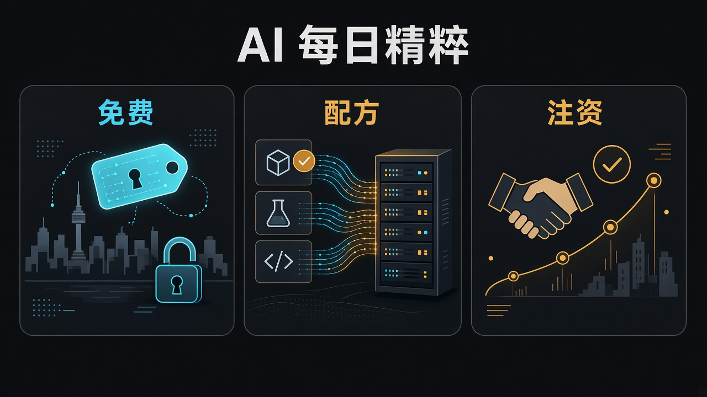

> 先说明一下：素材是我借助 AI 收集整理的，时间都按北京时间。写着「据 X 摘要」的，是 X 平台自动生成的新闻摘要，我暂时没找到一手来源，大家看的时候打个折。每条后面关于行业、公司、赚钱机会的判断都是我个人的看法，不是事实，更不是投资建议。教程视频都是网上公开的，标了「同类操作参考」的，讲的是同一类操作，不是针对这款新产品本身。

## 今天最值得看的几件事

- **头条：LG AI Research × K-EXAONE 2.5**——在 NVIDIA AI Day Seoul 宣布对开发者、企业与研究机构**免费**开放 API；自称相对 **8** 月公开的主权 AI 二轮模追加训练后，综合约 **24** 项指标性能提升逾 **70%**，并瞄准 **2027-01** 完成 frontier 级三轮模。
- **NVIDIA Dynamo 韩国开源模配方**——覆盖 SK Telecom A.X K2、LG K-EXAONE **2.0**、Upstage Solar Open **2**、Motif Technologies Motif-**3**；自称面向 B200、开箱最高约 **2** 倍推理性能。
- **MSIT × NVIDIA 论坛注资**——宣布已投资 Point2，并计划追加 Motif、RLWRLD（韩媒多写作 Realworld）与 Upstage；官方未披露金额与时间表。
- YC：W27 逾期仍审，准时申请约 **12-11** 前出结果；F26 Demo Day 仍 **12-02**；无新 Launch。
- 观点：**免费、配方、注资**——首尔一日里，主权模被推到可调用、可部署、可注资的三道硬台阶。

今天 OpenAI / Anthropic / DeepMind / Google 仍无新 frontier 产品署文；谣言（GPT‑6.2「今日将发」）、IPO 估值再热、高盛收回 Claude Code 财经转写和一长串窗外旧署，我都没往里塞。脊柱就这三条同属 AI Day Seoul 现场的硬东西——免费 API、部署配方、论坛支票。

## 工具与产品

### 1. K-EXAONE 2.5：主权模先把 API 钥匙递出来（头条）

LG AI Research 在 NVIDIA AI Day Seoul **2026**（首尔 COEX）宣布：对开发者、企业与研究机构免费开放 **K-EXAONE 2.5** API。官方新闻（韩/英，署 **2026.11.09**）写明：2.5 是对 **8** 月公开版追加训练后的**技术验证模型**；自当日起经 EXAONE 平台 [`docs.exaone.ai`](https://docs.exaone.ai/) 领取密钥即可免费调用。首尔经济日报英译引 EXAONE Lab 长金이르은（Kim Yi-reun）：内部分析称相对 **8** 月版，约 **24** 项综合指标性能提升逾 **70%**；共同研究院长임우형（Lim Woo-hyung）称正集中力量于三轮模，希望更多人体验改进性能，并计划 **1** 月（**2027-01**）完成 frontier 级 EXAONE。官方列出四项 agentic 自评（开源数据集、内部测）：AutomationBench-Openset 约 **74.6**（对照 DeepSeek V4.1 Flash / GLM **5.3**）、SWE-Bench Pro 约 **59.2**、BrowseComp 约 **78.0**、Claw-Eval 约 **77.3**——叙事是「与中国代表性开源权重 frontier 模对得上」。平台文档已列模型 id `k-exaone_v2.5`，OpenAI 兼容 `POST /v1/chat/completions`，自称上下文最长约 **524,288** token；默认会先推理再答，可用 `reasoning_effort`（`low` / `high` / `max`）调强度。韩媒另述「正考虑应用 NVIDIA Dynamo」——与本窗 Dynamo 配方条相邻，但**不是** 2.5 已上 Dynamo 官方支持。

来源：[LG AI Research News·EN](https://www.lgresearch.ai/news/view?seq=755)、[LG AI Research News·KO](https://www.lgresearch.ai/news/view?seq=754)、[EXAONE API·K-EXAONE 2.5](https://docs.exaone.ai/en/docs/k-exaone-2.5)、[Seoul Economic Daily·EN](https://en.sedaily.com/finance/2026/11/09/lg-opens-national-ai-model-k-exaone-to-public-for-free)、[联合新闻](https://www.yna.co.kr/view/AKR20261109034200003)、[IT之家](https://www.ithome.com/0/1024/069.htm)、[NVIDIA Blog·Korea secure agentic AI](https://blogs.nvidia.com/blog/korea-secure-agentic-ai/)

昨天 MaxxBench 在问「改完题还认不认」；今天 LG 把主权 Agent 模的**调用权**先放开——受益的是要试韩国语/区域 Agent、又不愿先买专属托管额度的独立开发者与中小 SaaS，以及做 OpenAI 兼容路由、多模 fallback、韩文客服/文档自动化的集成商；付钱的是把「免费 API + 自评 agentic 分」写成「已达 frontier / 已全面开源权重 / 已替代 DeepSeek·GLM 国内主力托管」的人。标「约 **70%** / 四项 agentic 分数均为 LG 自称或内部对照；免费 API ≠ 权重全面开源；技术验证模 ≠ 已达 frontier；**2027-01** 三轮模为路线图自称；Dynamo『考虑应用』≠ 已上线；勿写成已超过 DeepSeek/GLM 全线或已替代国内主力托管模」。

- 独立开发者 / 小团队：先拿一把免费钥，用自家一个韩文或双语 Agent 任务跑通；别一上来就用四项自评替换你现有短名单。
- 企业 AI 平台 / 集成商：把它当「多模路由里的区域备胎」试接入成本——OpenAI 兼容面是优点，SLA、速率、数据驻留与密钥条款仍要自己读平台条款。
- 评测 / 采购：AutomationBench / SWE-Bench Pro 等口径是官方自评；要采购级结论，仍得按你任务集重跑，并记住 2.5 是验证模不是三轮 frontier 成品。

教程：以 [K-EXAONE 2.5 文档](https://docs.exaone.ai/en/docs/k-exaone-2.5) 与 [Quick Start](https://docs.exaone.ai/en/docs/quick-start) 为准；Agent 接线见平台 [Starting with Agents](https://docs.exaone.ai/en/docs/agent-start)（Hermes / OpenCode）。本条未核到成熟一手官方 YouTube/Bilibili 专片——官方文档里的 curl / Python 示例已经够跟练。

### 2. Dynamo 韩国开源模配方：可调用之后，还要可部署

NVIDIA 官方博（栏日署 **November 8, 2026**，元数据约北京 **13:00 · 11-09**；作者 Amr Elmeleegy）称：正为韩国领先开源模提供 Dynamo 优化部署配方——**SK Telecom A.X K2**、**LG AI Research K-EXAONE 2.0**、**Upstage Solar Open 2**、**Motif Technologies Motif-3**。文中定义：NVIDIA Dynamo 是开源分布式推理服务框架，面向多节点/数据中心规模，负责请求路由与通信；配方针对 **B200** 优化，自称开箱最高约 **2** 倍性能，帮助开发者更快把韩国开源模投入生产。@NVIDIAAI 约北京 **13:45** 在 AI Day Seoul 期间发帖指向该博。官方配方文档已见 [K-EXAONE 2.0 recipe](https://docs.nvidia.com/dynamo/latest/recipes/k-exaone-2.html)。注意：本条覆盖的是 **K-EXAONE 2.0** 等四款**开源权重**模的部署配方，**不是**头条里 2.5 免费托管 API 本身；两条同属「把韩国模推到可落地」，事件不同。

来源：[NVIDIA Blog·Dynamo Korea open models](https://blogs.nvidia.com/blog/nvidia-dynamo-korea-open-models/)、[NVIDIA Dynamo Docs·K-EXAONE 2.0](https://docs.nvidia.com/dynamo/latest/recipes/k-exaone-2.html)、[NVIDIAAI·recipes 主帖](https://x.com/NVIDIAAI/status/2119667551982813584)、[NVIDIA Technical Blog·KO](https://developer.nvidia.com/ko-kr/blog/optimizing-koreas-leading-open-models-with-new-nvidia-dynamo-recipes/)

免费 API 解决的是「能不能立刻打一枪」；配方解决的是「你自己的 B200 集群上能不能开箱跑起来」。受益的是韩国云/AI 工厂运维、要在 B200 上托管 SKT / LG / Upstage / Motif 开源模的推理平台团队，以及卖 Dynamo / K8s 推理中间件的人；付钱的是把「约 **2** 倍开箱」写成「已全面替代 vLLM/SGLang」、或把 2.0 配方写成「已官方支持 2.5」的人。标「约 **2** 倍为 NVIDIA 自称；对象是 B200 + 已有 Dynamo 框架，不是新基础模；覆盖 K-EXAONE **2.0** 而非本窗 **2.5**；勿写成已全面替代 vLLM/SGLang 或已官方支持 2.5」。

- 推理平台 / MLOps：有 B200 再谈「开箱配方」；先对一下你现网是 vLLM / SGLang / TRT-LLM 哪条栈，再决定要不要迁 Dynamo operator。
- 模型提供方（韩国开源模团队）：配方进 NVIDIA 文档，等于多了一条「客户侧可复现部署」的销售附件——比再发一张榜单截图管用。
- 普通开发者：没 B200 就别硬追这条；要体验韩国 Agent 模，优先走上面的免费 API。

教程：韩国四模配方以 [官方博](https://blogs.nvidia.com/blog/nvidia-dynamo-korea-open-models/) 与 [K-EXAONE 2.0 recipe](https://docs.nvidia.com/dynamo/latest/recipes/k-exaone-2.html) 为准。同类「Dynamo 怎么在 Kubernetes 上部署」可跟 NVIDIA Developer 短片 [NVIDIA Dynamo in 5 Minutes](https://www.youtube.com/watch?v=JnsYIojzM5I)（**2026-10-18**，讲 operator / DGDR·DGD，**同类操作参考**，不是本窗四模配方专片）。

## 产业与生态

### 3. MSIT × NVIDIA：Point2 落袋，Motif / RLWRLD / Upstage 还在计划里

NVIDIA 官方博（栏日 **November 9, 2026**；AI Day Seoul 直播页该条约北京 **16:00**）称：韩国科技信息通信部（MSIT）与 NVIDIA 在首尔 COEX 合办 **MSIT-NVIDIA AI Startup Partnership Forum**；次官柳济明（Ryu Je-myung）与英伟达高层会见 **20** 余家覆盖基础模型、物理 AI、AI 基础设施与 AI 半导体的韩国创业公司；并宣布**已投资** Point2 Technology，同时**计划**对 Motif Technologies、RLWRLD 与 Upstage **追加投资**。官方未披露此次金额与时间表。四家画像（官方博口径）：**Point2**——面向 AI 工厂、在芯片与机架之间传数据的可扩展射频（RF）互联，自称铜缆/光互联之外的扩展方案；**Motif**——首尔 AI 实验室，做复杂任务智能体基础模，含已开源权重的 Motif-**3**；**RLWRLD**——旧金山 / 首尔 / 东京，做支撑人形与工业机器人完成五指灵巧真实任务（插接、拧螺母、传送带拣配套件）的机器人基础模；**Upstage**——Solar 语言模型与文档 AI，帮企业从复杂文档抽信息、简化工作流。官方并称规划建立在 NVIDIA Inception 已有逾 **1000** 家韩国会员之上。

韩联社 / 首尔经济日报 / 亚经等补细节（均为媒体口径，须与官方区分）：Point2 此番为英伟达**直接**出资（上半年／今年 **4** 月已有 NVentures 参与；Yonhap Infomax 称曾参与约 **7600** 万美元轮）；对 Motif、리얼월드（即 RLWRLD）与 Upstage 的追加投资**手续尚未完成**，亦拟直接出资而非经 NVentures；Upstage 进行中的 Series C 二次轮拟引入英伟达（完成后投资方叙事含亚马逊、AMD 与英伟达），并称今年 **4** 月 Series C 首轮约 **1800** 亿韩元、估值逾 **1** 万亿韩元；Motif 称已完成桥接轮并全力开发下一代基础 LLM，英伟达预计与现有投资方一同参与，并计划 **2027** 年一季度开源权重发布 Motif-**4**（朝商务称 Motif 今年 **5** 月曾获约 **240** 亿韩元 Series B）。

来源：[NVIDIA Blog·Korean startup investments](https://blogs.nvidia.com/blog/korean-startup-investments-msit/)、[AI Day Seoul Live Updates](https://blogs.nvidia.com/ai-day-seoul-2026/)、[联合新闻·4사 투자](https://www.yna.co.kr/view/AKR20261109146400017)、[Seoul Economic Daily·EN](https://en.sedaily.com/finance/2026/11/09/nvidia-unveils-surprise-investments-in-four-korean-startups)、[Asia Business Daily·EN](https://www.asiae.co.kr/en/article/2026110918292471762)

同一天舞台上：LG 递免费钥、NVIDIA 递部署配方，再递一张「会投谁」的名单——受益的是韩国 AI 栈里做互联（Point2）、Agent 基础模（Motif）、物理 AI / 灵巧操作（RLWRLD）与企业文档 AI（Upstage）的团队，以及围着 Inception / MSIT 论坛转的本地 GP 与云厂商；付钱的是把「已投资 / 计划追加」写成「四家同一轮大额交割完成」、或把韩媒估值与未完成手续写成「英伟达已全部落袋」的人。标「Point2 为已宣布投资；Motif / RLWRLD / Upstage 为计划追加、韩媒称手续未完成；金额与时间表官方未披露；约 **7600** 万美元 / **1800** 亿韩元 / **1** 万亿韩元估值 / Motif-**4** **2027** Q1 均为媒体或公司叙事须独立核；RLWRLD ≠ 已规模替代产线工人；勿写成四家同一轮已全部交割」。

- 硬科技 / 互联创业者：Point2 被单独写成「已投资」，说明 AI 工厂扩展层（芯片↔机架）仍是英伟达愿意直接写进新闻稿的买单点。
- Agent / 文档 AI / 物理 AI 团队：看清「计划追加」与「已投资」的差别——叙事热度可以借，融资事实以交割为准。
- 普通读者：把这条当「韩国 AI 栈从模到互联到机器人都被点名」的信号，别当四家明日估值翻倍的标题党。

教程：以 [NVIDIA 投资博](https://blogs.nvidia.com/blog/korean-startup-investments-msit/) 为准。本条是产业署文，不是产品跟练；未核到「如何申请本次注资」类官方片——也不该有。

## YC 与生态

### 4. YC 日程：W27 late；F26 Demo Day 仍 12-02

Apply 页仍为 Winter **2027** 批次，准时截止已过，现收 late；准时申请约 **12-11** 前出结果。F26 Demo Day 仍见公开日程指向 **Wednesday, December 2nd**。本窗 `launches.json` 顶仍为昨已写的 Theseus Robotics，**无新合格 Launch**——不把昨天货架条回锅成今天头条。

来源：[YC Apply](https://www.ycombinator.com/apply)、[YC Demo Day](https://www.ycombinator.com/demoday/)

## 观点洞察

### 免费、配方、注资：首尔一日三道硬台阶

今天材料不散——几乎全挤在 NVIDIA AI Day Seoul 现场。大厂美西新闻栏仍接近停更；X 上再热的多是昨天已写过的改题 / 明文 / 货架，外加泄漏预告和财经转写。我没有把跳过清单翻成百科，只留三条还能在首尔舞台上对上号的硬东西。

先说**免费**。K-EXAONE 2.5 没有先开权重，而是先把 API 钥匙递出来：技术验证模、OpenAI 兼容、四项 agentic 自评贴着 DeepSeek / GLM 讲故事，并给了一个 **2027-01** 的三轮 frontier 时间表。免费，指的是主权/区域模开始用「可调用」而不是「可下载权重」来抢开发者心智；你真正要核的仍是限速、数据条款，以及自评榜换成你任务集之后还剩多少。

再说**配方**。Dynamo 给 SKT / LG **2.0** / Upstage / Motif 开源模准备了 B200 开箱路径，口号是最高约 **2** 倍。配方，指的是「能打一枪」之后，还要回答「在你自己的集群上能不能复现」；注意它写的是 **2.0** 开源模，不是头条里的 **2.5** 托管 API——可调用与可部署仍是两本账。

最后是**注资**。MSIT 论坛上 Point2 落进「已投资」，Motif / RLWRLD / Upstage 停在「计划追加」。注资，指的是生态信号开始按互联、Agent 基础模、物理 AI、文档 AI 分层点名；验收仍要看手续是否完成、金额是否披露，以及韩媒估值能不能独立核。

我自己读材料时会多问三句：

1. **免费：** 你领到的是密钥还是权重？限速与数据驻留写在哪？四项 agentic 分是官方自评还是第三方盲测？
2. **配方：** 你的卡是不是 B200？配方覆盖的是开源 **2.0** 还是托管 **2.5**？约 **2** 倍对照的基线是什么？
3. **注资：** 新闻稿写的是「已投资」还是「计划追加」？金额时间表有没有官方数字？物理 AI 条是演示灵巧还是已声明的产线替代？

过得了这三问，再谈要不要把 K-EXAONE 塞进多模路由、要不要在 B200 上试 Dynamo 韩国配方、或要不要追四家韩国创业的下一轮，都不迟；过不了，再响的「主权模已 frontier / 开箱已翻倍 / 英伟达已全面下注韩国 AI」叙事，都只是还没写进条款、复现报告和交割文件的能力清单。个人观点，数字以各条原文为准，不构成投资或采购建议。

## 今日机会总结

今天的脊柱很短，但同属一个现场：**免费调用**（K-EXAONE 2.5 API）、**开箱部署**（Dynamo 韩国四模配方）、**论坛注资**（Point2 已投 + Motif / RLWRLD / Upstage 计划追加）。美西大厂无新 frontier 署文；观点侧把首尔一日收成免费 / 配方 / 注资三道账。

若只选三条可执行方向：

1. **区域 Agent 模的免费试用与多模路由层**：对标 K-EXAONE 2.5，帮客户做 OpenAI 兼容接入、韩文/双语任务回归与限速监控；客户是要试主权/区域 Agent、又不愿先签大额托管的中小 SaaS 与内部平台组。
2. **B200 + Dynamo 韩国开源模落地包**：对标 NVIDIA 配方，卖「已知好配方 → 集群复现 → 对照现网 vLLM/SGLang」的验收；客户是已有或在买 B200、要托管 SKT / LG 2.0 / Upstage / Motif 的云与 AI 工厂。
3. **韩国 AI 栈分层扫货情报**：对标 MSIT 论坛名单，按互联 / Agent 基础模 / 物理 AI / 文档 AI 建跟踪表，区分「已投资」与「计划追加」；客户是看韩国 Inception 生态的 GP、产业基金与战略投资部——卖的是交割核查，不是标题党估值。

## 普通人今天就能做的 3 件事

1. **想试用韩国 Agent 模的人：** 打开 [docs.exaone.ai](https://docs.exaone.ai/)，按 [K-EXAONE 2.5 文档](https://docs.exaone.ai/en/docs/k-exaone-2.5) 领钥打一条 curl；把延迟、推理 token 与你现用模的同一题答法记下来。
2. **做推理部署的人：** 读一遍 [Dynamo 韩国开源模博](https://blogs.nvidia.com/blog/nvidia-dynamo-korea-open-models/) 与 [2.0 recipe](https://docs.nvidia.com/dynamo/latest/recipes/k-exaone-2.html)；再花五分钟看 [Dynamo in 5 Minutes](https://www.youtube.com/watch?v=JnsYIojzM5I)，搞清 DGDR / DGD 再决定动不动集群。
3. **关心韩国 AI 创业的人：** 打开 [MSIT 论坛投资博](https://blogs.nvidia.com/blog/korean-startup-investments-msit/)，把四家拆成「已投资 / 计划追加」两列；韩媒数字当作待核，别当作已交割事实。
