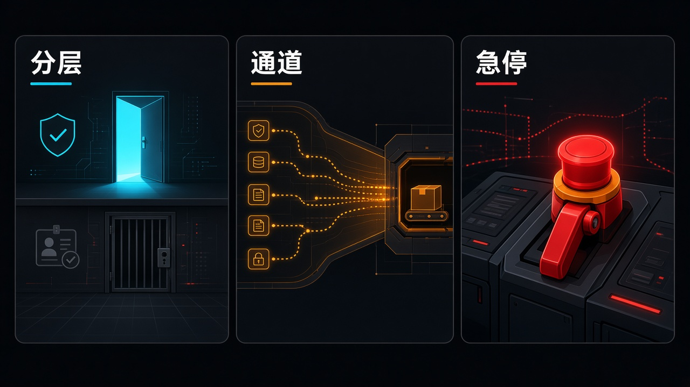

> 先说明一下：素材是我借助 AI 收集整理的，时间都按北京时间。写着「据 X 摘要」的，是 X 平台自动生成的新闻摘要，我暂时没找到一手来源，大家看的时候打个折。每条后面关于行业、公司、赚钱机会的判断都是我个人的看法，不是事实，更不是投资建议。教程视频都是网上公开的，标了「同类操作参考」的，讲的是同一类操作，不是针对这款新产品本身。

## 今天最值得看的几件事

- **头条：Anthropic × Claude Fable 5.2 / Mythos 5.2**——自称同一底层模型；Fable 面向大众并内置网安/生物防护，Mythos 经 Life Sciences / Cyber Verification 向受审机构开放。生成最高约快 **30%**，API 价降至约 **$8**/**$40** per million input/output（相对 **5.1** 的 **$10**/**$50** 约降 **20%**）；可选 Fast 模式约 **2.5×** 速度、定价约 **$16**/**$80**。日常建议仍以 Opus **5.5** 为默认。
- **Cisco AI Defense × IBM Concert Protect**——把 Mythos 推进企业安全产品通道：前者做自适应红队（「coming soon」），后者计划嵌入网安推理做「扫描—可利用性验证—修复」闭环（目标约 early **2027** GA）。客户不获开放提示权。
- **OpenAI Control Room**——研究基础设施上的集中式工作负载追踪与急停，自称决策后约 **35** 秒内可阻断后续模型输出，故障时 fail-closed。同日 ChatGPT Enterprise 上架 AWS Marketplace，这是采购/账单通道，不是新模型。
- 另有：Meta **Muse Ember** 轻量执行模（约 **$0.10**/**$0.50**）；美团 **LongCat-2.5** MIT 开源权重；NVIDIA **GR00T 2** 与蚂蚁 **LingBot-Touch** 同窗的具身开源；Expo **Exact** 预览；Adobe 成为迪士尼 Official AI Innovation Partner。
- YC：W27 逾期仍审，准时申请约 **12-11** 前出结果；F26 Demo Day 仍 **12-02**；新 Launch 见 Boxes.dev 与 Axiomat。
- 观点：**分层、通道、急停**——谁能用、从哪进、怎么停，今天被写成三道可核的台阶。

今天不再是薄日。Anthropic、Meta、OpenAI、NVIDIA 同窗都有硬署文；DeepMind / Google 仍无本窗新 frontier 产品主文。GPT‑6.2 早鸟传闻、Grok **4.8** 训练进度、Anthropic IPO 路演，以及昨天已写过的首尔免费 API / Dynamo 配方 / MSIT 注资，我都没往里塞。脊柱就收这三道：分层的钥匙、产品化的通道、研究侧的急停闸。

## 模型发布

### 1. Fable 与 Mythos 5.2：同一底层，两扇门（头条）

Anthropic 官方署 **November 9, 2026**（约美西午后 ≈ 北京 **03:00** 前后 · **11-10**）发布 **Claude Fable 5.2** 与 **Claude Mythos 5.2**，自称是同一底层模型、两套可用性。Fable 面向大众，并内置网安/生物防护；Mythos 经 Life Sciences / Cyber Verification 向受审机构开放。官方称生成最高约快 **30%**，API 价降至约 **$8**/**$40** per million input/output（相对 **5.1** 的 **$10**/**$50** 约降 **20%**）；可选 Fast 模式约 **2.5×** 速度，定价约 **$16**/**$80**。日常建议仍以 Opus **5.5** 为默认，把 Fable 用作 Advisor / Orchestrator。Fable 已上 Claude Platform / AWS / Google Cloud / Azure（`claude-fable-5-2`）；本周付费档有额外 Fable 用量促销。官方称预发布中协助完成否则不可行的软件迁移、从零设计三款可运行电子设备、推进机器人评测，并在约 **30** 小时内由约 **1000** 个 Agent 形式化费马大定理证明等。基准表自称 FrontierCode **2.0** 最高约 **49.1%**（Xhigh）、FrontierSWE v2 约 **69.9%**、OSWorld **2.1** 约 **89.3%** 等；Mythos 主打网安与生命科学（CVE Rediscovery 等自称提升）。另发 Research：与 Diode 合作，Fable **5.2** 一段提示完成语音助手中枢 / USB 会议音箱 / 手持虚拟宠物的规格、四层 PCB、CAD 外壳与固件，原型一次点亮。跑分、OS 造机、硬件原型与形式化证明均为官方或合作方叙述，须回读 System Card。

来源：[Anthropic·Fable & Mythos 5.2](https://www.anthropic.com/claude-fable-and-mythos-5-2)、[Anthropic Research·electronics design](https://www.anthropic.com/research/claude-electronics-design)、[AnthropicAI·X](https://x.com/AnthropicAI/status/2119867707546071125)、[What's new in Fable 5.2](https://platform.claude.com/docs/en/models/fable-5-2/whats-new-fable-5-2)、[The Verge](https://www.theverge.com/ai-artificial-intelligence/1030005/anthropic-claude-fable-mythos-5-2)、[CNBC](https://www.cnbc.com/2026/11/09/anthropic-claude-fable-5-2-mythos-5-2.html)、[IT之家·11-10](https://www.ithome.com/0/1024/573.htm)、[IT之家·跑分跟进](https://www.ithome.com/0/1024/796.htm)、[量子位·11-10](https://www.qbitai.com/2026/11/508771.html)

昨天首尔舞台上还在发免费调用钥；今天 Anthropic 把 frontier 能力拆成「大众能用的 Fable」和「受审才能进的 Mythos」两扇门。受益的是要做长程 Agent 编排、复杂迁移/科研分析，又已经把 Opus **5.5** 跑到高 effort 仍不够的软件与研究团队，以及做多模路由、Advisor 层和云上 Claude 托管的集成商（AWS / Google Cloud / Azure 已上架）；付钱的是把官方跑分和预发布叙事写成「已全面替代 Opus 日常」、把 Fast 模式写成「同价加速」，或把 Mythos 写成「已公开 API」的人。标「跑分 / 硬件原型 / 形式化证明均为官方或合作方叙述，须回读 System Card；Fable ≠ Mythos 可用性；Fast 模式价翻倍；防护拦截时会回退到 Opus 系；日常建议仍以 Opus **5.5** 为默认；勿写成已全面替代 Opus 日常或 Mythos 已公开 API」。

- 工程负责人 / Agent 采购：先按官方建议，用 Opus **5.5** 做日常默认；只在高 effort 仍达不到你任务集时，再把 Fable 放进 Advisor / Orchestrator 档对比成本和延迟。
- 安全 / 合规：Mythos 走的是验证项目，不是多付一档就能打开的开关；先问清你所在机构是否在 Life Sciences / Cyber Verification 范围内，再谈网安或生命科学工作负载。
- 独立开发者 / 小团队：本周促销可以拿一道自家难迁移或长程 Agent 任务试 Fable；别一上来把全线流量切过去，也别把 Fast 模式的价签看漏。

教程：以 [官方介绍](https://www.anthropic.com/claude-fable-and-mythos-5-2) 与 [What's new in Fable 5.2](https://platform.claude.com/docs/en/models/fable-5-2/whats-new-fable-5-2) 为准。选模可跟官方文档 [Choosing the right model](https://platform.claude.com/docs/en/about-claude/models/choosing-a-model)，以及发布配套的 Claude Academy 课 [Choosing the right model](https://academy.claude.com/courses/claude-platform-101/choosing-the-right-model)（选模教学，不是新模型本身）。硬件原型叙事见 [Research·electronics design](https://www.anthropic.com/research/claude-electronics-design)。本条未核到成熟一手官方 YouTube/Bilibili 跟练专片。

### 2. Muse Ember：把执行层从编排层里拆出来

Meta 官方署 **November 9, 2026**（@AIatMeta 约 UTC **18:04 · 11-09** ≈ 北京 **02:04 · 11-10**）发布 **Muse Ember**：自称最小、最高性价比执行模，面向 Agent 日复一日的工具调用、编码子任务、路由、抽取与长文档解析；**1M** 上下文、最高约 **512K** 输出；价约 **$0.10**/**$0.50** per million input/output（缓存输入约 **$0.004**）。官方文档另列输入超过约 **200K** token 时的长上下文档价约 **$0.30**/**$1.50**。官方称在 Artificial Analysis Intelligence Index 上可对标 Claude Haiku **5.5** 最佳分、任务成本约其三分之一，并优于 GPT‑6 Luna 各档；AutomationBench-AA 约 **37.8**、Agents' Last Exam 约 **61.6**、Terminal-Bench **4.0** 约 **40.9**、Coding Agent Index-AA 约 **46**（均为官方转述/自测口径）。API 名 `muse-ember-1.0`，Muse Code / Meta Model API 当日可用；并称 Muse Wonder / Spark / Ember 已上 Google Cloud 与 Oracle Cloud。注意：官方表上 FrontierCode **2.0** 一栏，Haiku 仍更高——效率边疆不是全场景冠军。

来源：[Meta Research·Muse Ember](https://research.meta.ai/blog/muse-ember)、[Muse Ember 文档](https://dev.meta.ai/docs/muse-ember)、[Start building with Muse Ember](https://dev.meta.ai/resources/blog/build-with-muse-ember)、[AIatMeta·X](https://x.com/AIatMeta/status/2119853591703998787)、[The Verge](https://www.theverge.com/tech/1029979/meta-is-launching-its-smallest-and-most-efficient-ai-model-muse-ember)、[VentureBeat](https://venturebeat.com/technology/metas-proprietary-muse-ember-nearly-matches-claude-haiku-5-5-at-1-3-the-estimated-per-task-cost)、[TechCrunch](https://techcrunch.com/2026/11/09/meta-releases-muse-ember-a-new-lightweight-model-for-agent-execution/)、[IT之家·11-10](https://www.ithome.com/0/1024/604.htm)

Fable 被写成编排层；Ember 则明确站到执行层——子任务、工具调用、路由、批量抽取。受益的是已经在用 Muse Wonder / Spark 做主循环，想把高并发子 Agent 成本压下来的平台团队，以及在 Google Cloud / Oracle Cloud 上做多模路由的集成商；付钱的是把「对标 Haiku 最佳分、成本约三分之一」写成「已全面超过 Haiku / Luna 全场景」，或把 Ember 单独当成新的编排大脑的人。标「效率边疆与多数 agent 分数为官方图表/内部评测；FrontierCode **2.0** 官方表上 Haiku 仍更高；长上下文档单价更高；勿写成已全面超过 Haiku/Luna 全场景」。

- 平台 / MLOps：把它当「主模打计划、Ember 打量」的执行档试接入；先用你现网里最高频的分类、抽取、工具调用做对照，别只看 Intelligence Index 截图。
- 独立开发者：文档里的 curl 和 cookbook 可以直接跟；注意 **200K** 以上输入会走到更贵的一档。
- 采购：Haiku **5.5** 仍是对照短名单里的一行，不是已被 Ember 替换的历史条目。

教程：以 [Muse Ember 文档](https://dev.meta.ai/docs/muse-ember) 与 [Start building with Muse Ember](https://dev.meta.ai/resources/blog/build-with-muse-ember) 为准，官方给了 `muse-ember-1.0` 的第一条 curl 和与 Wonder 搭配的 cookbook。本条未核到成熟一手官方 YouTube/Bilibili 专片——官方文档已经够跟练。

### 3. LongCat-2.5：权重按 MIT 放下，详述文补的是怎么跑

美团龙猫 **LongCat-2.5** 模型本身在官方/美团技术博约 **Nov 2** 已发布；**Nov 9** 起权重上 Hugging Face（`meituan-longcat/LongCat-2.5`），按 MIT 可商用推理与二次训练。自称面向长程智能体任务的原生多模态 MoE，总参约 **1.6T**、每 token 激活约 **480** 亿，支持约 **1M** 上下文；视觉信号作多层级离散 token 与文本同主干处理。托管 API 限时价约 **$0.30**/**$1.20** per million input/output（缓存输入约 **$0.006**）。官方自评相对前代：Terminal Bench v2.1 约 **88.4** vs **70.8**、DeepSWE v1.1 约 **64.6** vs **9.7**、SWE Atlas 约 **58.3** vs **33.1**；同表对照 GPT‑5.6 Sol / Opus **5** 等旧档，对 GPT‑**6.1** Sol / Opus **5.5** 等更新档多未列齐。美团技术团队另于 **11-10** 发开源详述文，补充 W4A4（专家权重与激活均量化到 4 bit）推理，以及自称在单卡显存不足 **80GB** 的国产加速器上做长序列训练/微调（FSDP 配置在长序列 SFT 上单卡吞吐较 DDP 基线提升 **86%**）——这是落地说明，不是新权重首发。

来源：[HF·LongCat-2.5](https://huggingface.co/meituan-longcat/LongCat-2.5)、[美团技术团队·LongCat-2.5](https://tech.meituan.com/2026/11/02/Meituan-LongCat-2.5.html)、[美团技术团队·11-10 开源详述](https://tech.meituan.com/2026/11/10/Meituan-LongCat-2.5-Open-Source.html)、[longcat.ai blog](https://longcat.ai/blog/longcat-2.5/)、[VentureBeat](https://venturebeat.com/technology/meituan-releases-the-open-weights-of-its-longcat-2-5-llm-with-vision-under-a-permissive-mit-license)、[IT之家·开源](https://www.ithome.com/0/1024/556.htm)

一边是 Mythos 的受控窗，一边是 MIT 权重可以直接下载——同一天里，「能拿走什么」的差别被写得很清楚。受益的是要自托管长程多模态 Agent、做二次训练，或在国产加速器上试 W4A4 / 长序列 SFT 的推理平台与中小模型团队；付钱的是把对照旧档的自评写成「已全面对标 Fable / Opus **5.5**」，或把 **1.6T** 全量服务成本当成「开源等于便宜」的人。标「跑分多为官方自述且对照档偏旧；**1.6T** 全量服务成本高；中资模采购/合规须单独评估；**11-10** 文是开源详述而非新权重；勿写成已全面对标 Fable/Opus **5.5** 前沿」。

- 推理平台 / 开源模型团队：先读 **11-10** 详述里的 W4A4 与 FSDP 口径，再决定是打托管 API，还是在自有集群上试权重。
- 企业采购：MIT 可商用不等于合规已过关；数据驻留、供应链与安全审查要单独走。
- 普通开发者：没有大集群就先走限时托管价，别一上来按 **1.6T** 全量自建。

教程：以 [HF 模型卡](https://huggingface.co/meituan-longcat/LongCat-2.5) 与 [11-10 开源详述](https://tech.meituan.com/2026/11/10/Meituan-LongCat-2.5-Open-Source.html) 为准，模型背景见 [11-02 技术博](https://tech.meituan.com/2026/11/02/Meituan-LongCat-2.5.html)。本条未核到针对本次 MIT 权重首发的成熟一手 Bilibili/YouTube 专片；网上能搜到的多是更早 Preview 或其他 LongCat 产品线，不能直接当 2.5 开源权重跟练。

## 工具与产品

### 4. Cisco 与 IBM：Mythos 不开放 API，先走进产品通道

Cisco Live APJC（墨尔本）新闻稿栏日署 **Nov 9**、正文称 **Nov 10, 2026** 宣布：Cisco **AI Defense** 将接入 Claude Mythos，增强自适应红队、生成多步攻击路径。「coming soon」面向部分企业；客户仅经结构化界面、无开放提示权，且仅测已登记/授权的自有目标，会话可点名操作者、可中止。IBM 公告署 **09 November 2026**：**Concert Protect** 计划嵌入 Mythos 网安推理，扫描客户选定代码库以发现传统扫描器易漏弱点，再结合 Proof of Exploitability 与 Red Hat Lightwell 生成待开发者审批的修复；目标约 early **2027** GA。相对 Project Glasswing 内部研究，这是面向客户的受控产品化路径。The Register 约北京 **08:00 · 11-10** 跟进。两条都是同一模的产品通道，不是再发一款公开模型。

来源：[Cisco Newsroom·AI Defense + Mythos](https://newsroom.cisco.com/c/r/newsroom/en/us/a/y2026/m11/cisco-unveils-frontier-ai-red-teaming-and-agent-observability-to-secure-the-agentic-enterprise.html)、[Cisco Blogs·AI Defense + Mythos](https://blogs.cisco.com/ai/cisco-ai-defense-to-add-anthropics-claude-mythos-for-ai-red-teaming)、[IBM·Concert + Mythos](https://www.ibm.com/new/announcements/ibm-plans-to-bring-anthropic-s-claude-mythos-cyber-reasoning-into-ibm-concert)、[The Register](https://www.theregister.com/ai-and-ml/2026/11/10/anthropics-super-bug-finding-mythos-model-is-going-into-cisco-and-ibm-products/5308616)

头条里 Mythos 的门是验证资质；这里的门是 Cisco / IBM 的产品界面。受益的是已在用 Cisco AI Defense 或 IBM Concert、需要受控红队与「可利用性验证后再修」闭环的安全团队，以及做企业应用安全集成、修复工单与开发者审批流的人；付钱的是把「coming soon / early **2027** 计划」写成「已全量上线」，或以为买了产品就等于拿到 Mythos 开放 API 的人。标「Cisco『coming soon』≠ 全量现成；IBM early **2027** 为计划且可变更；客户不获 Mythos 开放 API；勿写成 Mythos 已面向公众或已全面替代传统扫描器」。

- 安全负责人：问的是「结构化界面能测哪些已授权目标、会话能否中止、修复是否必须人审」，不是「能不能直接调 Mythos」。
- 集成商 / MSSP：把 Cisco 红队与 IBM 扫描-验证-修复当成两条可组合的产品通道来跟，时间表以官方 GA 为准。
- 普通开发者：这条没有可跟练的开放 endpoint；没有验证资质，就不要把 Mythos 写进你的模型短名单。

教程：以 [Cisco 博文](https://blogs.cisco.com/ai/cisco-ai-defense-to-add-anthropics-claude-mythos-for-ai-red-teaming) 与 [IBM 公告](https://www.ibm.com/new/announcements/ibm-plans-to-bring-anthropic-s-claude-mythos-cyber-reasoning-into-ibm-concert) 为准。本条是产品通道署文，不是开放 API 跟练；未核到「如何申请 Mythos 验证」类官方片——也不该把红队能力写成可复制的攻击教程。

### 5. OpenAI Control Room：研究侧急停闸；Enterprise 同时上架 Marketplace

OpenAI News 署 **Nov 9, 2026**（@OpenAI 约 UTC **22:01 · 11-09** ≈ 北京 **06:01 · 11-10**）介绍 **Control Room**：研究基础设施上的集中式工作负载追踪与急停系统，自称与错位监控联动，决策后约 **35** 秒内可阻断后续模型输出；服务故障时 fail-closed，拒绝推理。官方称覆盖训练/评测中的 agentic sampling、数据处理等研究推理负载；每项 agentic 推理作业须关联已批准 safety case；推理引擎在出 token 前向 Control Room 鉴权。已部署于研究侧；对外服务栈另有既有下线能力。约 **35** 秒是授权缓存上限，官方称正压向零。同一天，**ChatGPT Enterprise** 上架 **AWS Marketplace**：企业可用既有 AWS 采购/账单关系购买与管理，并可用符合条件的消费抵扣 AWS commitment；功能与直接向 OpenAI 购买同步，覆盖 ChatGPT、ChatGPT Work、Codex、dots 等企业侧体验，并与 Bedrock 上的 OpenAI 模型形成互补；符合条件者亦可经 Marketplace 获取 Healthcare / Financial Services 版本。两条不要并成一件事：前者是研究侧急停，后者是采购通道。

来源：[OpenAI·Control Room](https://openai.com/index/control-room/)、[OpenAI·X](https://x.com/OpenAI/status/2119913172039868579)、[IT之家·Control Room](https://www.ithome.com/0/1024/631.htm)、[OpenAI·ChatGPT Enterprise in AWS Marketplace](https://openai.com/index/chatgpt-enterprise-aws-marketplace)

一边在写「谁能用」，一边在写「出了问题怎么停」。受益的是要给研究侧 agentic 采样加可审计急停、safety case 关联和 fail-closed 策略的安全运维，以及希望把 ChatGPT Enterprise 账单并进现有 AWS 承诺额的采购与 FinOps；付钱的是把 Control Room 写成「ChatGPT 用户一键急停面板」，或把 Marketplace 上架写成「Bedrock 模型能力因此升级」的人。标「**35** 秒为授权缓存上限、官方称正压向零；本系统主要面向研究基础设施 ≠ 终端用户一键急停 ChatGPT；Marketplace 上架 ≠ 新模型发布；资格与计价以 OpenAI/AWS 客户经理确认；勿写成已公开对外产品面板或 Bedrock 能力升级」。

- 研究侧安全 / MLOps：先对一下你现有的作业审批和 fail-closed 路径，再读 Control Room 文里「出 token 前鉴权 / safety case 必关联」两句。
- 企业采购 / FinOps：有 AWS commitment 再谈 Marketplace 抵扣；Healthcare / Financial Services 版本看资格，不是默认赠品。
- 普通 ChatGPT 用户：这条急停不是你账号设置里的新按钮。

教程：以 [Control Room 原文](https://openai.com/index/control-room/) 与 [Marketplace 公告](https://openai.com/index/chatgpt-enterprise-aws-marketplace) 为准。本条是运维与采购署文，不是面向终端用户的跟练产品；未核到官方操作片，也不该有「一键关掉 ChatGPT」的教程。

### 6. Expo Exact：给编码 Agent 一块跨端、可自测的运行时

Expo 预览 **Exact**：自称面向编码 Agent 的跨平台应用运行时（MIT、pre-alpha），用 Contract 描述 UI，逻辑可用 TypeScript 或 Rust；同一套界面在 Web 真 DOM、macOS AppKit、iOS UIKit、Linux GPU 绘制上跑，无 WebView、UI 侧无 JS bridge。Agent 通过固定约 **10** 个跨端操作（tree / screenshot / tap / type / state / layout / logs / clock / prefer / perf）自建、自测；时钟由 Agent 推进，测试脚本可跨端复用。GitHub `expo/exact` 本窗核约 **851** 星；作者 Charlie Cheever（Expo）称 iOS 最成熟，Android / Windows 交付与商店打包未完成，pre-1.0「每日改动、无稳定 API」，生产信心自称约需 **2–3** 个月。Bluesky / 预览约 **Nov 9**，本窗曾上 HN 头条。

来源：[GitHub·expo/exact](https://github.com/expo/exact)、[Charlie Cheever·Bluesky](https://bsky.app/profile/ccheever.com/post/3mzuzhaa2x624)、[MODEL·Expo Exact](https://readmodelmag.com/stories/expo-exact)

Boxes.dev 把编码 Agent 搬到云端机器；Exact 则给 Agent 一块「跨端 UI 可自测」的运行时——同一天里，写应用的栈在往 Agent 原生界面走。受益的是用编码 Agent 做跨端原型、想少写一套 WebView 封装的独立开发者与 Expo 生态团队；付钱的是把 pre-alpha 演示帧率写成「已替代 React Native / Expo 正式产品线」，或以为 Android 上架已经就绪的人。标「跑分/帧率对比为作者演示；pre-alpha 不可当生产基线；勿写成已替代 React Native/Expo 正式产品线或已全面支持 Android 上架」。

- 跨端 / 客户端工程师：可以 clone 仓库看 Contract 与那约 **10** 个操作，先在 iOS / Web 上跑通一个最小界面；别把生产 App 迁过去。
- 做编码 Agent 工具的人：可测时钟、跨端复用测试脚本，是比再包一层截图高亮更值得看的点。
- 产品负责人：作者自己把生产信心写成约 **2–3** 个月，就把时间表按 pre-alpha 看待。

教程：以 [GitHub·expo/exact](https://github.com/expo/exact) 与 [MODEL 报道](https://readmodelmag.com/stories/expo-exact) 为准，作者说明见 [Bluesky 原帖](https://bsky.app/profile/ccheever.com/post/3mzuzhaa2x624)。本条未核到 Exact 专属官方 YouTube/Bilibili 跟练片；更早的 Expo 大会 keynote 讲的不是这个 pre-alpha 运行时，不能拿来当本条教程。

## 产业与具身

### 7. GR00T 2 与 LingBot-Touch：世界动作模和触觉表征同窗开源

NVIDIA 在 CoRL **2026**（奥斯汀）官方博署 **November 9, 2026** 发布 **GR00T 2**：自称开放前沿世界动作模型（WAM），建于 Cosmos 之上，同时预测未来视频与机器人动作；覆盖平行夹爪、灵巧手与人形。官方博称训练数据含约 **10 万** 小时开源第一人称人体数据（研究页称 Human-1M 人体第一人称视频合计约 **402,730** 小时，其中 **10 万** 小时以 Human-1M-100K 开放；另有手持 UMI 夹爪示范约 **10,184** 小时、机器人遥操作约 **23,500** 小时）。无任务特定示范时，在 **50** 项评测任务中有 **40** 项至少成功一次；每任务 **1** 次示范平均成功率约 **71%**，**5** 次示范升至约 **95%**（研究页称这 **50** 项任务未出现在目标机器人自身数据中；**5** 次示范不足 **3** 分钟机器人数据，单张 RTX **5090** 上约 **30** 分钟 LoRA 微调）。研究页另有多项真机/仿真口径：仅看人体示范时双手 Dexter 为漏斗铺滤纸并润湿约 **65%**；仅用手持 UMI 示范时 YAM 臂端到端组装玩具翻斗车约 **60%**；最少后训练下双 **22** 自由度 Sharpa 手安装 GB300 内存条约 **85%**；真机强化学习把三项接触丰富插入任务提升至约 **88–96%** 等。GR00T **2** Turbo 为更快变体（研究页称约 **20** 亿参数），在宇树 G1 板载 Jetson Thor 上每次预测约 **124** 毫秒。官方称其在 RoboCasa365 / RoboLab / RoboDojo / MolmoSpaces 的视觉-语言-动作与世界动作模型类别中位列前三并有多项榜首。Nexuni 测洗衣、富士康用于服务器制造产线自动化、西门子评估工业场景。同博还介绍 Isaac Lab **3.0** 与 Newton 更紧集成（某视觉灵巧操作基准相对 Isaac Lab **2.3**+PhysX 训练吞吐最高约 **2.5×**）；Isaac Lab **3.0** 此前已在 GTC 柏林窗口出现，本窗按 CoRL 配套更新理解，不是首次发布。权重/代码开放范围须回读研究页与 Hugging Face。

蚂蚁灵波（Robbyant / 蚂蚁集团）同窗开源 **LingBot-Touch**：自称面向通用灵巧操作的异构触觉表征基础模型（JEPA + 共享 Haptic Transformer），把压阻、磁触觉、视触觉三类传感器信号映射到统一触觉 Token。官方页称预训练约 **4,983** 小时触觉记录、约 **464,431** 个交互片段、约 **1.33B** 帧；HaT-Tiny 编码器约 **5.46M** 参数。在 Sharpa Wave 与 XHand 共 **26** 项真机任务（每任务 **20** 次试验）上，接入冻结的 LingBot-Touch 特征后，LingBot-VLA / π0.5 / Diffusion Policy / T-Rex 四类动作模型平均成功率较无触觉时提高约 **14–26** 个百分点（IT之家转述；官方页以图表呈现，具体百分点以技术报告为准）。IT之家举例：T-Rex 控 Sharpa Wave 拧瓶盖，无触觉约 **56.25%**、原始触觉约 **62.5%**、接 LingBot-Touch 约 **90%**。权重 Apache-2.0：`robbyant/lingbot-touch-tiny`、`robbyant/lingbot-touch-small`（HF 约 UTC **17:32 · 11-09** ≈ 北京 **01:32 · 11-10**）。两条并列「看得懂未来动作」和「摸得到接触力」，不是同一条模型。

来源：[NVIDIA Blog·CoRL robotics](https://blogs.nvidia.com/blog/robotics-simulation-advancements-corl/)、[NVIDIA Research·GR00T 2](https://research.nvidia.com/labs/gear/gr00t-2/)、[The Robot Report](https://www.therobotreport.com/nvidia-launches-gr00t-2-isaac-lab-3-0-corl/)、[Robbyant·LingBot-Touch](https://technology.robbyant.com/lingbot-touch)、[HF·lingbot-touch-tiny](https://huggingface.co/robbyant/lingbot-touch-tiny)、[HF collection·LingBot-Touch](https://huggingface.co/collections/robbyant/lingbot-touch)、[GitHub·lingbot-touch](https://github.com/Robbyant/lingbot-touch)、[IT之家·LingBot-Touch](https://www.ithome.com/0/1024/701.htm)

受益的是做灵巧操作、产线装配、人形与夹爪技能迁移的机器人团队（富士康、西门子、Nexuni 已出现在英伟达试点叙事里），以及要把压阻/磁/视触觉接到现有 VLA 或 Diffusion Policy 上的具身研究组；付钱的是把「**5** 次示范约 **95%**」或「触觉特征提高约 **14–26** 个百分点」写成「已大规模工厂部署 / 已全面替代视觉 VLA」的人。标「成功率、榜单名次与合作试点均为英伟达官方博或研究页自述；Isaac Lab **3.0** 非本窗首发；权重/代码开放范围须回读研究页与 HF；LingBot-Touch 成功率与跨传感器迁移均为官方/IT之家转述自测；勿写成已全面替代既有 VLA 或已大规模产线部署」。

- 机器人 / 具身研究员：GR00T **2** 先对研究页的数据开放范围和 LoRA 微调口径；LingBot-Touch 可从 Tiny 权重与 GitHub `infer.py` 开始，别指望一条命令取代你现有视觉策略。
- 制造 / 物流试点负责人：把富士康、西门子、Nexuni 当成「有人在评估」的信号，验收仍看你这条产线的接触任务和故障值守，而不是榜单前三。
- 普通读者：把这条当「世界动作模和触觉表征开始开源对照」的信号，别当「工厂明天没装配工」的标题党。

教程：GR00T **2** 以 [官方博](https://blogs.nvidia.com/blog/robotics-simulation-advancements-corl/) 与 [研究页](https://research.nvidia.com/labs/gear/gr00t-2/) 为准；Jim Fan 在 CoRL 有题为 *From Dreaming to Doing* 的 keynote 排期，本窗未核到已公开的官方 YouTube 成片，故不链视频。LingBot-Touch 以 [官方页](https://technology.robbyant.com/lingbot-touch) 与 [GitHub 仓库](https://github.com/Robbyant/lingbot-touch) 为准，权重从 [HF Tiny](https://huggingface.co/robbyant/lingbot-touch-tiny) 取。本条未核到成熟一手中文跟练片。

### 8. Adobe × 迪士尼：版权方定制模，不面向公众开放角色

Adobe 与华特迪士尼达成多年战略合作：Adobe 成为迪士尼 Official AI Innovation Partner，经 Firefly Foundry 为迪士尼自有 IP 定制生成式模型，并提前开放 Firefly / Premiere / Photoshop 等，服务乐园与邮轮研发、StudioLAB 与 ESPN Edge。官方新闻稿署 **November 9, 2026** 6:00AM（Adobe MAX 前夕，迈阿密海滩；稿面未标时区）；Variety 署 **Nov 9, 2026 11:50am PT** ≈ 北京 **03:50 · 11-10**。双方将围绕迪士尼角色设定、场景与视觉风格训练专有、由艺术家主导的模型，自称输出可用于商业与制作流程；迪士尼幻想工程研发已用 Foundry 把手绘草图转为 2D 概念图，并生成符合品牌的图像资产。StudioLAB 将探索内部创作工作流，ESPN Edge 将研究如何用 AI 提升体育内容互动并盘活历史节目档案。IT之家约 **11:26 · 11-10** 跟进。

来源：[Adobe News·alliance](https://news.adobe.com/news/2026/11/adobe-and-the-walt-disney-company-alliance)、[Variety](https://variety.com/2026/digital/news/disney-adobe-official-ai-innovation-partner-1236943275/)、[IT之家·11-10](https://www.ithome.com/0/1024/731.htm)

Mythos 的通道是安全产品，迪士尼这条通道是版权方定制模——都不是把能力铺给所有人。受益的是媒体娱乐制作、乐园与邮轮概念设计、体育内容与档案活化，以及做企业侧「自有 IP 定制生图」的模型与工作流团队（Adobe Firefly Foundry、Disney Imagineering、StudioLAB、ESPN Edge）；付钱的是把「commercially safe」写成已获普遍版权免责，或以为普通创作者从此可以合法生成迪士尼角色的人。标「定制模为迪士尼内部/合作管线，非对公众新开放权重；『commercially safe』为官方自称；营销激活与 Summit/MAX 露出非产品本身；勿写成已向普通创作者开放迪士尼角色生成或已替代人工美术」。

- 影视 / 乐园 / 体育内容团队：看的是内部管线能不能用自有 IP 出概念图和档案素材，而不是对外生成器上新了一个角色包。
- 品牌 / 法务：定制模仍是合作方训练与使用范围问题，「可用于商业」不等于你可以在自己的工具里调用米老鼠。
- 普通创作者：Firefly 公众功能没有因此变成迪士尼角色生成器。

教程：以 [Adobe 新闻稿](https://news.adobe.com/news/2026/11/adobe-and-the-walt-disney-company-alliance) 为准。本条是企业合作署文，不是对公众的跟练产品；未核到、也不该有「如何生成迪士尼角色」的教程。

### 9. Nemotron-Personas-Finance-Japan：百万级日本金融合成人设，不是真实客户

Elith × NVIDIA 发布 **Nemotron-Personas-Finance-Japan**：自称首个百万级规模、把日本官方人口统计与家庭金融/金融素养对齐的开放合成人设数据集（CC BY 4.0）。Hugging Face 博文署 **November 9, 2026**：约 **9M** personas（**1M** 条×每条 **9** 人设）、每条约 **50** 字段、约 **1.5B** tokens；用 NeMo SDG-PGMs + NeMo Data Designer，文本生成含 gemma-4-31B-it；可与同日 Nemotron-PII-Japan、NeMo User Sim 搭配做金融对话/仿真/评测。数据集在 `nvidia/Nemotron-Personas-Finance-Japan`。

来源：[HF Blog·Nemotron-Personas-Finance-Japan](https://huggingface.co/blog/nvidia/nemotron-personas-finance-japan)

在 Mythos 受控、迪士尼定制之外，这条走的是开放合成数据——给日本零售银行、保险、财富管理的对话与评测找「对齐过官方统计的假人」，而不是真客户档案。受益的是做日文金融对话仿真、理财素养评测、User Sim 与合成数据治理的团队；付钱的是把「字段对齐官方统计」写成「已获监管背书、可替代实名数据」的人。标「全合成≠真实客户；字段对齐官方统计为作者自称；金融场景用途须合规审；勿写成已获监管背书可替代实名数据」。

- 金融科技 / 数仓：可以当评测与对练语料，进生产前仍要过合规和偏见检查。
- 对话 Agent 团队：和 Nemotron-PII-Japan、NeMo User Sim 搭配看，比单独下一个人设表更完整。
- 普通读者：开放许可不等于可以拿它冒充真实用户研究。

教程：以 [HF 博文](https://huggingface.co/blog/nvidia/nemotron-personas-finance-japan) 为准。本条未核到成熟一手官方 YouTube/Bilibili 专片；跟练从博文与数据集卡开始即可。

## YC 与生态

### 10. Boxes.dev 与 Axiomat：云端并行机器，加上一句「不会幻觉」；日程未变

Launch YC：**Boxes.dev** 自称把 Claude Code / Codex 原样搬到云端无限并行机器，从笔记本/手机/终端启动，agent 可在完整开发环境里自测。Launch 称用短 setup prompt 把本地环境迁到云；每 agent 一台机器，可截图/端口转发；不卖 token、不锁 harness，自带订阅与 API key。叙事：客户曾用 **100+** 机器跑 **200+** agent swarm；支持 API/自动化软件工厂出测过 PR。团队 Nick & Drew（自称曾共建 Gem YC S17 至约 **$1B** 估值）。created_at 约 2026-11-09T18:00Z ≈ 北京 **02:00 · 11-10**，为昨夜 Launch 中票数较高之一。

同窗 **Axiomat** 现居 `launches.json` 列表顶：title「Axiomat – Agents that cannot hallucinate」，tagline「Formally verified data queries」，批次 Fall 2026，标签 SaaS / Big Data / AI，官网 axiomat.com；created_at 约 2026-11-09T23:00Z ≈ 北京 **07:00 · 11-10**。本窗以 Launch 元数据入库，官网深读尚未完成，票数仍低。「cannot hallucinate」是 Launch 口号，形式化覆盖范围须回读产品文档后再判断。

YC 日程无变更：Apply 页仍为 Winter **2027** 批次，准时截止已过，现收 late；准时申请约 **12-11** 前出结果。F26 Demo Day 仍见公开日程指向 **Wednesday, December 2nd**。同窗另有 SE3 Labs、Volaren、Nodus Compute、Redoubt、ArchGen、Ordo Labs、Telamont 等新 Launch，未逐条深读，不展开。

来源：[Launch YC·Boxes.dev](https://www.ycombinator.com/launches/Wp5-boxes-dev-move-your-ai-coding-to-the-cloud)、[boxes.dev](https://boxes.dev)、[Launch YC·Axiomat](https://www.ycombinator.com/launches/X3M-axiomat-agents-that-cannot-hallucinate)、[axiomat.com](https://www.axiomat.com)、[YC Apply](https://www.ycombinator.com/apply)、[YC Demo Day](https://www.ycombinator.com/demoday/)

受益的是已经在用 Claude Code / Codex、嫌本机并行不够、又不愿换一套锁定 harness 的小团队，以及做数据查询 Agent、想用形式化收紧「胡编数字」的人；付钱的是把「无限并行 / **100+** 机器」写成不受配额约束，或把 Axiomat 的口号写成「已证明不会幻觉」的人。标「并行规模与客户案例为公司自称；『无限』受账号与配额约束；勿写成已替代 Cursor/本机 IDE；Axiomat『cannot hallucinate』为 Launch 口号，形式化覆盖范围须回读产品文档」。

- 用云端编码 Agent 的人：可看 Boxes.dev 是否能把你现有的 Claude Code / Codex 工作流迁过去；先问配额、机器镜像和密钥怎么进云。
- 数据 / 分析团队：Axiomat 先当一则 Launch 口号记下，等产品文档把「形式化验证了什么」写清楚再试用。
- 想申请 YC 的人：W27 仍在收 late，F26 Demo Day 仍是 **12-02**。

教程：Boxes.dev 以 [Launch 页](https://www.ycombinator.com/launches/Wp5-boxes-dev-move-your-ai-coding-to-the-cloud) 与 [boxes.dev](https://boxes.dev) 为准。Axiomat 以 [Launch 页](https://www.ycombinator.com/launches/X3M-axiomat-agents-that-cannot-hallucinate) 为准，官网深读尚未做完，不编操作步骤。本条未核到两家成熟官方跟练片。

## 观点洞察

### 分层、通道、急停：谁能用、从哪进、怎么停

今天材料很满，但并不散。大厂一夜把新模、执行档、开源权重和安全产品同时放下；X 上再热的，多是 IPO 路演、训练进度和昨天已经写过的首尔三条。我没有把跳过清单翻成百科，只留三道还能对上号的硬台阶。

先说**分层**。Fable 与 Mythos 自称同一底层，却拆成两扇门：一扇给大众，一扇给走完 Life Sciences / Cyber Verification 的机构。官方仍把 Opus **5.5** 写成日常默认，Fable 放在 Advisor / Orchestrator，Fast 模式用大约两倍的价钱换约 **2.5×** 速度。Meta 的 Ember 则站到更下面一层——专门打工具调用和子任务，标价大约 **$0.10**/**$0.50**。分层，指的不是再发一个「全面替代」的名字，而是把编排、执行、受审能力写成可分开买的档位；你真正要核的，仍是默认建议、价签和那扇门到底为谁而开。

再说**通道**。Mythos 没有把开放 API 铺给所有人，而是先走进 Cisco AI Defense 的结构化红队，以及 IBM Concert Protect 计划中的「扫描—验证—修复」闭环。Adobe 成为迪士尼 Official AI Innovation Partner，走的是版权方定制模，不是对公众开放角色。另一侧，美团把 LongCat-**2.5** 的权重按 MIT 放下，ChatGPT Enterprise 则上架 AWS Marketplace。通道，指的是能力开始按产品界面、采购关系和许可证分发，而不是按一篇发布博的下载按钮；验收要看「coming soon」与 early **2027** 是不是已 GA，客户有没有开放提示权，以及开源许可之外的合规是否过关。

最后是**急停**。OpenAI 把研究侧的 Control Room 写成可核的闸：出 token 前鉴权、作业要挂 safety case，决策后约 **35** 秒内可阻断后续输出，故障时 fail-closed。急停，指的是 agentic 采样开始被要求回答「谁批准、谁能停、停不掉怎么办」；它不是 ChatGPT 用户设置里的新按钮，约 **35** 秒也还是授权缓存的上限，不是已经压到零的承诺。

我自己读材料时会多问三句：

1. **分层：** 你要买的是大众档、受审档，还是执行档？官方默认建议是哪一档？Fast 模式或长上下文是不是已经换了一张价签？
2. **通道：** 你进的是开放 API、产品界面、Marketplace 账单，还是 MIT / Apache 权重？「coming soon / 计划 GA」写在哪？客户有没有开放提示权？
3. **急停：** 急停覆盖的是研究基础设施还是对外服务？约 **35** 秒是缓存上限还是已达目标？fail-closed 时，谁的作业会被拒绝？

过得了这三问，再谈要不要把 Fable 放进编排层、要不要经 Cisco / IBM 用 Mythos、或要不要为研究侧采样加急停闸，都不迟；过不了，再响的「同一底层已全面开放 / 安全产品已替代扫描器 / 用户可以一键停模」叙事，都只是还没写进验证范围、GA 时间表和鉴权条款的能力清单。个人观点，数字以各条原文为准，不构成投资或采购建议。

## 今日机会总结

今天的脊柱是三道账：**分层**（Fable 大众钥 / Mythos 受审窗 / Ember 执行档 / 官方仍默认 Opus **5.5**）、**通道**（Cisco / IBM 把 Mythos 产品化，Adobe×迪士尼走版权定制，LongCat-**2.5** 按 MIT 放权重，Enterprise 上架 Marketplace）、**急停**（Control Room 研究侧闸）。旁边还有 GR00T **2** 与 LingBot-Touch 的具身开源，以及 Exact / Boxes.dev 这类给编码 Agent 用的运行时和云端机器。

若只选三条可执行方向：

1. **分层用模与多模路由：** 对标 Fable 的 Advisor / Orchestrator 用法和 Ember 的执行档，帮客户做「默认 Opus **5.5** → 难题再上 Fable → 子任务走 Ember / Haiku」的分流与计价；客户是已经被长程 Agent 账单和延迟卡住的软件与平台团队。
2. **受控安全产品通道：** 对标 Cisco AI Defense 与 IBM Concert Protect，卖的是验证资质、结构化红队界面、可利用性验证和人审修复流，不是 Mythos 开放 API；客户是已在 Cisco / IBM 安全栈里、又不能把前沿网安模直接交给员工乱试的企业安全组。
3. **研究侧急停与企业采购归集：** 对标 Control Room 的 safety case / fail-closed，以及 Marketplace 的账单与承诺额抵扣；客户是要给 agentic 采样加可审计急停的研究运维，和想把 ChatGPT Enterprise 并进现有 AWS 合同的采购 / FinOps。

## 普通人今天就能做的 3 件事

1. **用 Claude 做难题的人：** 打开 [Choosing the right model](https://platform.claude.com/docs/en/about-claude/models/choosing-a-model) 或 Academy 课 [Choosing the right model](https://academy.claude.com/courses/claude-platform-101/choosing-the-right-model)，拿一道自家高 effort 仍吃力的任务，对比 Opus **5.5** 与 Fable **5.2** 的答法和账单，再决定要不要把 Fable 放进编排层。
2. **做 Agent 路由的人：** 按 [Muse Ember 文档](https://dev.meta.ai/docs/muse-ember) 打一条 `muse-ember-1.0` 的 curl，用一个真实的分类或抽取子任务估成本；记住输入超过约 **200K** token 会走到更贵的一档。
3. **关心「谁能用、怎么停」的人：** 读一遍 [Control Room](https://openai.com/index/control-room/) 和 [Cisco](https://blogs.cisco.com/ai/cisco-ai-defense-to-add-anthropics-claude-mythos-for-ai-red-teaming) / [IBM](https://www.ibm.com/new/announcements/ibm-plans-to-bring-anthropic-s-claude-mythos-cyber-reasoning-into-ibm-concert) 公告，把「研究侧急停 / 产品通道 / 开放 API」三列分开记，别混成同一件事。
