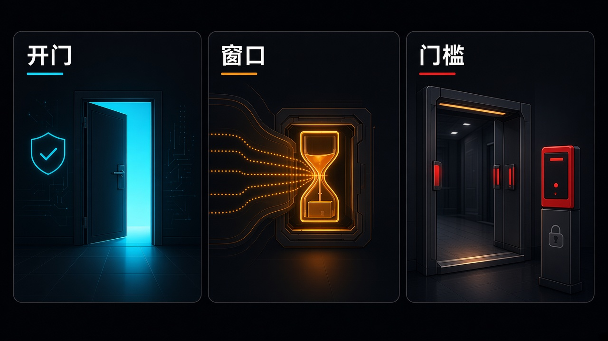

> 先说明一下：素材是我借助 AI 收集整理的，时间都按北京时间。写着「据 X 摘要」的，是 X 平台自动生成的新闻摘要，我暂时没找到一手来源，大家看的时候打个折。每条后面关于行业、公司、赚钱机会的判断都是我个人的看法，不是事实，更不是投资建议。教程视频都是网上公开的，标了「同类操作参考」的，讲的是同一类操作，不是针对这款新产品本身。

## 今天最值得看的几件事

- **头条：Google × Gemini 4 Carbon GA**——现已向付费开发者、企业、科学家与消费者开放，并面向 Google AI Ultra 用户在 Antigravity、Gemini 应用与 Search 的 AI Mode 推送。官方仍把 **Argon** 定位为大多数软件工程与知识工作的首选；Carbon 用比 Argon 更多的 token 做深探、推理与加长验证。Antigravity 预览 `/swarm`。付费 API 首发体验价与 Argon 相同，约 **$2**/**$10** per million input/output，**11-30** 后改为约 **$4**/**$20**。
- **通义 Qwen4-Max 预览 + Qwen Code 1.0 Preview**——官方称 Qwen4 即将发布，本窗先上旗舰预览 `qwen4-max-preview`，仅 Token Plan 可调用，预览期 **11-11 10:00 至 11-25 24:00（UTC+8）**，结束后下线。同日开源终端编程 Agent **Qwen Code 1.0 Preview**（Apache **2.0**，仍为 Preview，**2026 年 12 月之后**再考虑开放社区 PR）。
- 另有：MiniMax **H3-Image** 开源权重生图（社区许可排除美/欧/英/韩）；百度 **ERNIE 5.5 Flash Preview**（Flash Base 的首个后训练版，权重「**11-25** 前」开源，英文页写 Apache **2.0**）；OpenAI **Businesses in ChatGPT** 测试版；Anthropic **Claude Whiteboards / Sheets**（测试版）与 **Claude Data**（GA）；Google Cloud **Gemini for healthcare** 美国预览；Adobe MAX 的 Creative Agent 与本地 MCP 预览（官方称 **2027** 年初面向 Creative Cloud 用户）；腾讯面向普通人的「元宝搜索」；Cursor **Projects** 多人协作测试版。
- 产业与具身：DeepMind **Gemini Robotics 2.5** 向机器人合作伙伴滚动开放；NVIDIA **Alpamayo 2 Edge** 约 **20** 亿参数车端 VLA，目标平台为 DRIVE AGX Thor。
- YC：新 Launch 见 Perfectly、Kino、Petrichor；W27 仍收 late，准时申请约 **12-11** 前出结果；F26 Demo Day 仍 **12-02**。
- 观点：**开门、窗口、门槛**——门是开了，但许多能力还写在限时窗口、地域、许可和档位门槛后面。

今天也不薄。Google 把 Carbon 从 Fairwind 预览推到更广的付费与 Ultra 可用；通义、文心、MiniMax 同日给出预览或开源权重；办公套件、商家入驻、医疗预览和创意云 MCP 则把「能进谁的门」写得很具体。Fable / Mythos **5.2**、Muse Ember、LongCat-**2.5**、Control Room、GR00T **2**、Adobe×迪士尼这些昨天已经写过的，以及 Grok **4.8** 训练进度、Anthropic IPO 路演、ChatGPT 语音档下线、Claris Harbor 等，我都没往里塞。脊柱就收这三道：门开了没、窗口还开多久、进去还要过哪道槛。

## 模型发布

### 1. Carbon：门开了，默认仍是 Argon（头条）

Google 官方博署 **November 10, 2026**（`datePublished` UTC **16:00 · 11-10** ≈ 北京 **00:00 · 11-11**；@Google 约 UTC **16:05**）宣布 **Gemini 4 Carbon** 现已向付费开发者、企业、科学家与消费者开放。官方称其为目前最强模，主打网络安全能力与长周期智能体工作流（复杂知识工作、软件工程、科学推理）。约两周前 Carbon 经 Fairwind 计划向部分网络安全防御者开放，本窗是更广的可用，不是本日才首次亮相。官方仍把 **Argon** 定位为大多数软件工程与知识工作的首选；Carbon 则用比 Argon 更多的 token 做深探、推理与加长验证循环。官方称在面向真实工作流的独立基准上，Carbon 在 CursorBench **4.0**、Perplexity 的 WANDR、Zapier 的 AutomationBench 上排名第一，且单任务成本较「次优外部模型」低 **2** 倍以上——这是谷歌官方表述，不是我核实过的评测。为把能力用到更大项目，官方在 Google Antigravity 预览 `/swarm`：一条提示变成可实时追踪的协同智能体团队，可将 Carbon 分配给架构设计、协调与审计等深层角色，并与更快的轻量模、隔离工作区及对抗验证器搭配。定价：Google AI Studio / Gemini for business 的付费 API 首发体验价与 Gemini 4 Argon 相同，约 **$2**/**$10** per million input/output；introductory period 于 **November 30, 2026** 结束后改为约 **$4**/**$20**（官方脚注写明此价仅适用于面向公众开放的 Carbon）。并称正向所有 Google AI Ultra 订阅者在 Antigravity、Gemini 应用与 Search 的 AI Mode 推送。另与 Artificial Analysis 推出 Multimodal Knowledge Agent（MKA）基准，官方称 Carbon 排名第 **2**，平均单任务成本较第一名低 **6** 倍以上。网络安全向的 Carbon for cyber 仍经 Fairwind 计划申请。科学家计划：四周前开放 **1** 万名科学家免费使用 Argon（Antigravity 最高用量档、六个月），本窗把 Carbon 纳入该计划，申请仍滚动审核。安全报告称模拟攻击中拦截约 **99%** 攻击轨迹、单次突破率约 **0.8%**（Argon 约 **3.1%**），Gray Swan 测试中自动化网攻查询成功率约 **2.17%**（Argon 约 **9.86%**），并对 Gray Swan IPI 基准称提示注入攻击成功率为 **0%**（同时写明复杂分布上仍需继续改进）。榜单名次、成本倍数、Fortify / Wiz / CVR 案例与安全百分比均为谷歌官方或合作评测自述。

来源：[blog.google·Gemini 4 Carbon is now available](https://blog.google/innovation-and-ai/models-and-research/gemini-models/gemini-4-carbon-now-available/)、[Google·开发者向介绍](https://blog.google/innovation-and-ai/technology/developers-tools/gemini-4-carbon-developers/)、[Google·X](https://x.com/Google/status/2120186185423159331)、[GoogleDeepMind·X](https://x.com/GoogleDeepMind/status/2120219371473617099)、[IT之家·Carbon](https://www.ithome.com/1/025/203.htm)、[IT之家·MKA](https://www.ithome.com/1/025/205.htm)

门是开了，但官方把日常默认仍写在 Argon 上——Carbon 吃更多 token，换的是更深的探索和验证循环。受益的是已经在付费 API 或 AI Ultra 里跑长周期 Agent、复杂迁移和科研分析，觉得 Argon 还不够用的团队，以及要在 Antigravity 里试 `/swarm` 分工的人；付钱的是把官方榜单和「低 **2** 倍以上成本」写成「已全面替代 Argon 日常」，或以为普通 API 已经等价开放完整网安利用能力的人。标「榜单名次、成本倍数、Fortify/Wiz/CVR 案例与安全百分比均为谷歌官方或合作评测自述；`/swarm` 为 Antigravity 预览；Fairwind 网安能力≠普通 API 已等价开放；**11-30** 后标价翻倍；勿写成已全面替代 Argon 日常或已对公众开放完整网安利用能力」。

- 工程负责人 / Agent 采购：先按官方建议，用 Argon 做大多数软件工程与知识工作的默认；只在多步调试、长验证或开放式科研这类「把智力用到极限」的任务上，再把 Carbon 放进对照，并盯住 token 账单。
- 安全 / 合规：Carbon for cyber 仍走 Fairwind 申请，不是付费档打开就能用的开关；别把安全报告里的拦截率写成「已可对外做攻击演练」。
- 有 AI Ultra 或付费 API 的个人开发者：可以在 Antigravity、Gemini 应用或 AI Studio 里拿一道自家难题试 Carbon；记住 **11-30** 后体验价结束，标价大约翻倍。

教程：以 [官方介绍](https://blog.google/innovation-and-ai/models-and-research/gemini-models/gemini-4-carbon-now-available/) 与 [开发者向介绍](https://blog.google/innovation-and-ai/technology/developers-tools/gemini-4-carbon-developers/) 为准，跟练可看 [Gemini 4 Carbon developer guide](https://aistudio.google.com/learn/gemini-4-carbon-developer-guide) 和 [What's new in Gemini 4 Carbon](https://aistudio.google.com/docs/whats-new-gemini-4-carbon)；`/swarm` 见 [Antigravity 博文](https://antigravity.google/blog/gemini-4-carbon-in-google-antigravity/)，网安申请见 [Fairwind Program](https://deepmind.google/fairwind-program/)。本条未核到成熟一手官方 YouTube/Bilibili 跟练专片——网上能搜到的多是 Carbon 预告期评测，不能直接当本次 GA 的操作片。

### 2. 通义：Qwen4-Max 预览窗，加上 Qwen Code 1.0 Preview

阿里通义宣布全新一代千问大模型 Qwen4 即将发布，并率先上线旗舰预览版 **Qwen4-Max**。官方称知识更深、世界理解更丰富，编程与智能体能力更强，面向复杂编程、知识工作、前端搭建与专业软件工作流；现已在阿里 Token Plan 开放预览，亦可在千问办公（QwenWork）、Qoder、千问 App 与 QwenStudio 提前体验。@Alibaba_Qwen 约 UTC **02:01 · 11-11** ≈ 北京 **10:01**。官方 X 未公布基准分数、上下文长度或开源权重时间表。阿里云百炼 Token Plan 个人版文档将模型 ID 列为 `qwen4-max-preview`（别名 `qwen4.0-max-preview`，账单统一显示后者），能力写为推理、视觉理解与文本生成；深度思考文档称其为千问 4-Max 系列预览版，混合思考模式且默认开启思考，并写明仅 Token Plan 可调用。预览权益以我此刻核对的百炼文档为准：预览期为 **2026 年 11 月 11 日 10:00 至 11 月 25 日 24:00（UTC+8）**，期间不做变更，预览结束后下线；限时活动期间 Credits 消耗低至 **2** 折（官方称相当于增加 **5** 倍用量），每晚 **22:00–次日 08:00** 再享 **4** 折（即原标准的 **0.8** 折）。个人版目前仅支持华北 **2**（北京）地域。套餐档位（官方现行价，非本窗新定价）：Lite **39** 元/月（新用户限时价 **19.5** 元/月，有效期至 **11 月 30 日 23:59:59** UTC+8，仅限从未购买过个人版的账号），Essential **79** / 新用户 **39.5**，Standard **139**，Pro **312**。订阅条款限制在编程/智能体工具中交互式使用，并写明输入与输出可用于改进模型。

同日，通义发布 **Qwen Code 1.0 Preview**：官方称把 Qoder 与 Qwen Code 的 Agent 运行框架（Harness）能力融合并以开源形式发布；定位为终端中的编程 Agent，可用自然语言理解代码、实现功能、排查问题并运行测试。GitHub 预发布标签 `v1.0.0-preview`（`published_at` UTC **03:55:44 · 11-11** ≈ 北京 **11:55**，标记为 pre-release）。官方发布说明称：支持 Qwen / Qoder 账号、多家模型服务商与自定义兼容接口；提供 macOS / Linux / Windows 原生安装包，无需单独安装 Node.js；支持会话恢复与非交互执行。官方 README 写明 1.0 仍为 Preview，稳定前部分接口、配置与行为可能调整；为集中迭代，现阶段暂不接受社区 Pull Request，预计 **2026 年 12 月之后**再开放，具体安排将在本仓库公布；期间欢迎提 Issue。代码以 Apache License **2.0** 分发（含第三方组件，须回读 NOTICE 与依赖许可清单）；项目最初基于 Google Gemini CLI **v0.8.2**，官方称自 Qwen Code **v0.1** 起停止与上游同步并独立开发。稳定线同日仍有 **v0.27.2**，1.0 是独立预览标签，不是把稳定线直接改名。两条要分开看：一个是有截止日的旗舰预览模型，一个是开源的编程 Agent 内核。

来源：[Alibaba_Qwen·X](https://x.com/Alibaba_Qwen/status/2120335993643684315)、[阿里云百炼·Token Plan 个人版](https://help.aliyun.com/zh/model-studio/token-plan-personal-overview)、[阿里云百炼·模型](https://help.aliyun.com/zh/model-studio/models)、[阿里云百炼·深度思考](https://help.aliyun.com/zh/model-studio/deep-thinking)、[QwenCloud·Token Plan](https://www.qwencloud.com/pricing/token-plan)、[IT之家·Qwen4-Max](https://www.ithome.com/1/025/301.htm)、[钛媒体](https://www.tmtpost.com/nictation/8200816.html)、[GitHub Release·v1.0.0-preview](https://github.com/QwenLM/qwen-code/releases/tag/v1.0.0-preview)、[GitHub·QwenLM/qwen-code](https://github.com/QwenLM/qwen-code)、[README.zh-CN·v1.0.0-preview](https://github.com/QwenLM/qwen-code/blob/v1.0.0-preview/README.zh-CN.md)、[Qwen Code 文档·概述](https://qwenlm.github.io/qwen-code-docs/zh/users/overview/)、[Qwen Code 1.0 Preview 文档](https://qwenlm.github.io/qwen-code-docs/1.x/zh/users/overview/)、[IT之家·Qwen Code](https://www.ithome.com/1/025/393.htm)

受益的是已经在用 Token Plan / Qoder / 千问办公，想在两周窗口里试下一代旗舰预览的开发者，以及希望把终端编程 Agent 换成可自托管、Apache **2.0** 内核的团队；付钱的是把「Qwen4 即将发布」写成「全家桶或开源权重已经出来」，或把预览 ID 当成可以长期锁定的正式 GA，以及把更早的 Qwen Code 教程直接拿来当 1.0 Preview 跟练的人。标「Qwen4 官方表述为即将发布，本窗仅 Max 预览而非全家桶或开源权重已出；预览期结束后将下线，勿写成已正式 GA 或可长期锁定该预览 ID；**2** 折 / 夜间再享 **4** 折（即原标准 **0.8** 折）与套餐价以此刻百炼文档为准，勿转述媒体『最低 1 折』或过时的『夜间再 2 折即原标准 0.4 折』约写；未公布独立基准与上下文长度，勿写入社区流传的未核数字；个人版仅北京地域；Qwen Code 1.0 为 Preview，接口可能变，社区 PR 尚未重新开放；IT之家对架构演进的转述未在本条写成 GitHub 发布说明原文」。

- 已有 Token Plan 的开发者：在预览窗内用 `qwen4-max-preview` 跑一道自家编程或知识工作任务，先看 Credits 消耗和夜间折扣，别把预览期结束后的可用性默认成「还会留着」。
- 用终端编程 Agent 的人：从官方 `v1.0.0-preview` 安装包和 1.x 文档起步，不要拿需要单独装 Node.js 的旧版教程硬套；Issue 可以提，PR 暂时不会被接收。
- 企业采购：个人版条款写的是交互式使用，输入输出可用于改进模型；要进生产或做批量调用，先把订阅范围和数据条款读完。

教程：Qwen4-Max 以 [Token Plan 个人版文档](https://help.aliyun.com/zh/model-studio/token-plan-personal-overview) 与 [深度思考](https://help.aliyun.com/zh/model-studio/deep-thinking) 为准。Qwen Code 1.0 Preview 以 [GitHub 预发布说明](https://github.com/QwenLM/qwen-code/releases/tag/v1.0.0-preview)、[中文 README](https://github.com/QwenLM/qwen-code/blob/v1.0.0-preview/README.zh-CN.md) 和 [1.0 Preview 文档](https://qwenlm.github.io/qwen-code-docs/1.x/zh/users/overview/) 为准。本条未核到针对 Qwen4-Max 或 Qwen Code **1.0 Preview** 的成熟一手官方 YouTube/Bilibili 专片；网上能搜到的多是更早的 Qwen Code / Qwen3-Coder 教程，安装方式和产品形态已经对不上，不能当本条跟练。

### 3. MiniMax H3-Image：开源权重能拿，许可先看排除地

MiniMax 发布 **H3-Image**：自称基于 H3 的开源权重图像生成模，支持文生图、参考图生成与图像编辑。官方称可在 **10** 秒内生成一张 4K（4096×4096，约 16MP）图，最多理解并使用 **16** 张参考图，并经 API、MiniMax Code 与海螺 AI（Hailuo AI）提供服务。官方博栏日 **2026-11-11**，`datePublished` UTC **16:23:20 · 11-10** ≈ 北京 **00:23 · 11-11**；@MiniMax_AI 约 UTC **15:40 · 11-10** ≈ 北京 **23:40 · 11-10**。官方博称相对更常见的 1K/2K 输出，4K 全分辨率生成速度最高可达「主流方案」的约 **5** 倍；还称在开源权重模中提示遵循为 state-of-the-art。平台侧：Standard 模式自称较主流方案快约 **1.5–2** 倍，Highspeed 约 **3–4** 倍；定价自称约为同类主流方案的 **50%–70%**，上线周对 **4K** 及以上生图请求提供标准价 **5** 折。权重在 Hugging Face 仓库 `MiniMaxAI/MiniMax-H3-Image`；许可为 MiniMax-H3-Image Community License，许可页写明适用地域为全球但排除欧盟、英国、韩国与美国，许可日为 **November 10, 2026**（须回读许可，勿写成可在上述排除地或按 Apache 式条款随意商用）。摩尔线程称其 MTT S5000 与 MUSA 软件栈已在开源当日（**11-10**）完成 Day-0 适配，见 IT之家跟进。本窗 @MiniMax_AI 另发帖感谢 fal 与 Runware 的 Day-0 支持，并回复 @EvoLinkAi，确认「MiniMax-H3-Image on EvoLink」；EvoLink 原帖中的品质与速度对比为合作方自称，不按 MiniMax 官方基准来写。

来源：[MiniMax·H3-Image](https://www.minimax.io/blog/minimax-h3-image)、[MiniMax_AI·X](https://x.com/MiniMax_AI/status/2120179737695826420)、[HF·MiniMaxAI/MiniMax-H3-Image](https://huggingface.co/MiniMaxAI/MiniMax-H3-Image)、[HF·Community License](https://huggingface.co/MiniMaxAI/MiniMax-H3-Image/blob/main/LICENSE)、[IT之家·摩尔线程适配](https://www.ithome.com/1/025/296.htm)、[MiniMax_AI·X·fal](https://x.com/MiniMax_AI/status/2120361550825541815)、[MiniMax_AI·X·Runware](https://x.com/MiniMax_AI/status/2120361706086175116)、[MiniMax_AI·X·EvoLink](https://x.com/MiniMax_AI/status/2120417116935577908)

开源权重是一扇门，许可上的排除地是另一道槛。受益的是在许可适用地域内做 4K 生图、多参考图生成或图像编辑，并打算走 API、海螺或自有推理栈的团队，以及要在摩尔线程 S5000 / fal / Runware / EvoLink 上做 Day-0 接入的平台；付钱的是把「**10** 秒 4K / 开源 SOTA」写成独立评测结论，或把社区许可当成全球可随意商用、已替代 Midjourney / Flux 等闭源头部的人。标「**10** 秒、**5** 倍、Standard/Highspeed 倍数、定价折扣与开源权重 SOTA 提示遵循均为 MiniMax 官方自称，非独立第三方评测；社区许可排除美/欧/英/韩，勿写成全球可随意商用；摩尔线程适配为官方/IT之家转述的 Day-0 支持；fal / Runware / EvoLink 以 MiniMax 官方致谢或『已上线』表述为准，合作方品质与速度对比勿写成 MiniMax 官方基准」。

- 图像 / 设计工程：先读 Community License 的适用地域和商用限制，再决定是下载权重还是走官方 API / 海螺。
- 推理平台 / 硬件团队：Day-0 适配可以当作「有人已经在对接」的信号，验收仍看你这条链路的 4K 延迟和失败重试，而不是开源当日的声明。
- 在美、欧、英、韩落地的产品负责人：这条开源权重默认不覆盖你所在市场，别把「开源」直接写进全球商用方案。

教程：以 [官方博](https://www.minimax.io/blog/minimax-h3-image)、[HF 模型卡](https://huggingface.co/MiniMaxAI/MiniMax-H3-Image) 与 [Community License](https://huggingface.co/MiniMaxAI/MiniMax-H3-Image/blob/main/LICENSE) 为准。本条未核到针对 **H3-Image** 的成熟一手官方 YouTube/Bilibili 专片；B 站上大量「MiniMax H3」本地部署视频讲的是今年更早的 H3 视频生成线，不能拿来当本条生图权重的跟练。

### 4. 文心 ERNIE 5.5 Flash Preview：后训练中间版，权重还没放下

百度发布文心 **ERNIE 5.5 Flash Preview**：官方称这是此前已发布的 ERNIE 5.5 Flash Base 的首个后训练版本；总参数 **280B**、每 token 激活 **14B**，支持 **1M** 上下文，面向编程、3D 建模、知识工作与内容创作。官方中文署文栏日 **2026 年 11 月 11 日**；英文页同署 November 11, 2026。API 已在百度智能云千帆上线，模型 ID 为 `ernie-5.5-flash-preview`，上下文 / 最大输入 / 最大输出均为 **1M**，默认流控 RPM = **60**、TPM = **1000000**。中文署文写「权重将于 **11 月 25 日**前开源」，未在中文页写明协议名；英文署文写权重将以 Apache **2.0** 开源，用的是 soon，英文页未写 **11 月 25 日**这一截止日期——两页不要合成一句。千帆按量计费（官方单位为元/千 tokens）：高峰时段 **8:00–22:00** 输入原价 **0.002** / 活动价 **0.001**，输出原价 **0.008** / 活动价 **0.004**；空闲时段 **22:00–次日 8:00** 输入原价 **0.001** / 活动价 **0.0005**，输出原价 **0.004** / 活动价 **0.002**；另列缓存命中价（高峰活动价 **0.0001** / 原价 **0.0002**，空闲活动价 **0.00005** / 原价 **0.0001**）。官方称在多项基准上取得「具有竞争力的得分」，并保持解码速度；展示作品称均由该 Preview 在 Agent 框架中端到端完成，并写面向科普/漫剧等场景「超过 **15** 万个创作环境、适配上千个创作 skill、累计成片约 **5300** 分钟」（均为官方自述）。官方同时写明：这是后训练过程中的中间版本，仍可能存在因训练不充分导致的能力缺陷，后训练仍在进行，将根据真实场景表现与用户反馈在后续正式版本中优化。@Baidu_Inc 约 UTC **05:42** ≈ 北京 **13:42** 发英文宣布，约 UTC **08:27** ≈ 北京 **16:27** 回复称可在 OpenRouter 免费试用（官方原文「Try ERNIE 5.5 Flash Preview for free on OpenRouter」；OpenRouter 模型页 slug 为 `baidu/ernie-5.5-flash-preview:free`，标 Price Free，栏日 Released **Nov 10, 2026**）。这是 OpenRouter 的免费试用档，不是百度官方长期免费 API，也不能替代千帆计费。

来源：[文心·ERNIE 5.5 Flash Preview（中文署文）](https://ernie.baidu.com/zh/release/ernie-5-5-flash-preview/)、[ERNIE·Introducing ERNIE 5.5 Flash Preview](https://ernie.baidu.com/release/ernie-5-5-flash-preview/)、[千帆·模型列表](https://cloud.baidu.com/doc/qianfan/s/rmh4stp0j)、[千帆·模型服务计费](https://cloud.baidu.com/doc/qianfan/s/wmh4sv6ya)、[IT之家·11-11](https://www.ithome.com/1/025/451.htm)、[新浪科技](https://finance.sina.com.cn/roll/2026-11-11/doc-iniyixxy2037558.shtml)、[Baidu_Inc·X·英文宣布](https://x.com/Baidu_Inc/status/2120391732248637734)、[Baidu_Inc·X·OpenRouter](https://x.com/Baidu_Inc/status/2120433240288952749)、[OpenRouter·ernie-5.5-flash-preview:free](https://openrouter.ai/baidu/ernie-5.5-flash-preview:free)

Preview 能调，不等于正式版已经放下，更不等于权重已经开源。受益的是要在千帆上试编程、3D 建模或内容创作工作流，并打算把 OpenRouter 免费档当作短期对照的团队；付钱的是把「**11-25** 前开源」写成「本日已放权重」，把英文页的 Apache **2.0** 和中文页的截止日期合成一句官方已落地的许可，或把 OpenRouter 试用写成「百度官方长期免费 API」的人。标「**280B** / **14B**、基准『竞争力』、演示时长与成片分钟数均为百度官方自述；Preview 是后训练中间版本，可能有能力缺陷；权重『**11-25** 前』开源见中文页，Apache **2.0** 见英文页，勿把两页表述折叠成同一句；活动价为千帆文档所列限时价，勿写成长期一口价；OpenRouter 免费档是试用，不是百度官方长期免费 API；勿把官方演示写成已在任意生产环境稳定替代 Claude / GPT 编程或专业 CAD 流程」。

- 已在用千帆的开发者：用 `ernie-5.5-flash-preview` 跑一道真实任务，对照高峰/空闲活动价，别把它当成已经定稿的正式版。
- 等开源权重的人：把中文页的 **11-25** 和英文页的 Apache **2.0** 分开记，等权重真正放出后再核对许可全文。
- 想先免费试的人：走 OpenRouter 的 `:free` 试用页可以，但要清楚这是第三方试用档，配额和稳定性以该页当时标注为准。

教程：以 [中文署文](https://ernie.baidu.com/zh/release/ernie-5-5-flash-preview/)、[英文署文](https://ernie.baidu.com/release/ernie-5-5-flash-preview/) 与 [千帆模型列表](https://cloud.baidu.com/doc/qianfan/s/rmh4stp0j)、[计费说明](https://cloud.baidu.com/doc/qianfan/s/wmh4sv6ya) 为准；OpenRouter 试用见 [模型页](https://openrouter.ai/baidu/ernie-5.5-flash-preview:free)。本条未核到成熟一手官方 YouTube/Bilibili 专片。

## 工具与产品

### 5. Businesses in ChatGPT：认领资料，不等于保证排序

OpenAI 推出 **Businesses in ChatGPT** 测试版。官方栏日 **November 10, 2026**；@OpenAI 约 UTC **18:06 · 11-10** ≈ 北京 **02:06 · 11-11**，按夜间放出理解。官方称 ChatGPT 全球每周约有 **12** 亿使用者。企业可经 Business Hub 认领商家资料、更新信息并添加含价格与库存的商品数据源，查看汇总互动洞察；符合条件的美国电商与在线服务企业还可创建、测试并发布 Business Agent，用于回答用户问题、介绍产品，并可把智能体设为 ChatGPT 广告的赞助落地。认领并完成验证后可更新关键资料；既有 OpenAI Enterprise 客户与广告客户可走客户代表；Shopify 商家可通过 Business Hub 或 Shopify 后台连接店铺以简化验证，符合条件的 Shopify 商品此前已经 Shopify Catalog 接入。洞察包括提及次数、网站点击，以及用户发现该企业的常见话题；官方称不向企业分享用户与 ChatGPT 或与 Business Agent 的对话内容，且须达到一定互动门槛才提供汇总。Agent 对话会明确标注、与用户原对话及 ChatGPT 独立回答分开；赞助展示同样需标注。官方产品页写明：ChatGPT 仍会作出独立的推荐与比较，认领不保证更高排序或销量。Business Agent 目前面向美国符合条件的电商与在线服务企业，并计划扩到更多市场与行业。

来源：[OpenAI·Introducing Businesses in ChatGPT](https://openai.com/index/introducing-businesses-chatgpt)、[OpenAI·Businesses in ChatGPT](https://openai.com/business/businesses-in-chatgpt/)、[OpenAI·X](https://x.com/OpenAI/status/2120216592395174382)、[gdb·X](https://x.com/gdb/status/2120222471412666562)、[IT之家·11-11](https://www.ithome.com/1/025/206.htm)

这是商家进对话平台的一扇门，不是买了认领就能排到前面。受益的是已经在 ChatGPT 里被用户问到、尤其是美国电商 / 在线服务和 Shopify 商家，想把资料、库存和 Agent 对话收进官方通道的人；付钱的是把「**12** 亿周活」和认领写成「已对全球所有商家或中国卖家全面开放 Agent/广告」，或以为认领等于置顶、保证成交的人。标「**12** 亿周活为官方自称；测试版、美国品类与验证门槛以政策页为准；认领≠置顶或保证成交；洞察为过门槛的汇总、不提供原对话；勿写成已对全球所有商家或中国卖家全面开放 Agent/广告」。

- 美国电商 / Shopify 运营：先走 Business Hub 认领和验证，再决定要不要做 Business Agent；把「认领不保证更高排序或销量」写进预期，而不是写进投放承诺。
- 品牌 / 法务：看清对话不会回传给商家、洞察要过门槛，以及赞助展示必须标注。
- 中国卖家或非美国品类：这条 Agent / 广告通道目前还没写成对你全面开放，先别按「已经能在 ChatGPT 里卖货」去排期。

教程：以 [官方介绍](https://openai.com/index/introducing-businesses-chatgpt) 与 [Businesses in ChatGPT 产品页](https://openai.com/business/businesses-in-chatgpt/) 为准。本条未核到成熟一手官方 YouTube/Bilibili 专片；跟练从认领入口和产品页 FAQ 开始即可。

### 6. Claude Whiteboards、Sheets 与 Data：办公工件进付费档；Meetings 仍是媒体报道

Anthropic 推出 **Claude Whiteboards**、**Claude Sheets**（测试版）以及 **Claude Data**（由 **10** 月测试版 Claude Dashboards 正式更名并 GA）。官方资源文栏日 **Nov 10, 2026**；TechCrunch 署 **9:30 AM PST · 11-10** ≈ 北京 **01:30 · 11-11**。官方称可在 Claude 内与团队一起做白板头脑风暴、生成并共同编辑表格，以及把仓库/CRM 数据做成看板、数据故事或解说视频；面向所有付费计划，支持网页、桌面与移动端。Whiteboards：可把口头计划整理成带时间线、负责人与日期的白板，团队实时共编；复盘时按主题归类并起草行动项；结束后可变成文档或演示，或导入 Lucid、Miro、Vani by Zoho。Sheets：可用一句提示生成含多标签页、公式、格式与下拉菜单的表格，并在单元格内改、标注每次 AI 修改；可导出 `.xlsx` / CSV，或转到 Airtable、Asana、monday.com、Smartsheet；官方写明目前表格功能仍较简单，完整 Excel 能力需导出或使用既有 Claude for Excel。Claude Data：可连接 Amazon Redshift、BigQuery、ClickHouse 等；官方写明认证查询（certified queries）与实时分享仍为测试版；合作方包括 Amplitude、Mixpanel、Omni、PostHog、Sigma。管理端：Team 计划三项默认打开；Enterprise 上 Whiteboards 与 Sheets 默认关闭，Claude Data 将于 **November 19, 2026** 默认打开，可在组织设置里更改。同文还称即日起交互式连接器可在对话旁或全屏打开完整应用，举例 Adobe、Atlassian、Box、Notion。官方另有专文补充：该能力在网页与桌面端、面向所有计划逐步推出，需账号已更新或由组织打开后才能看到；开发者侧称交互式连接器跑在 MCP Apps 这一 MCP 开放扩展上，目前为公开预览。The Verge / TechCrunch 同日另报道 Claude Meetings（把 Claude 拉进会议、边谈边整理；Verge 称 Whiteboards/Sheets/Meetings 均为测试版，前两者面向所有付费计划，Meetings 面向 Teams 与 Enterprise）——我核过官方 Whiteboards / Sheets / Data 主文和交互式连接器专文，均未出现 Meetings 这一产品名，故只按媒体报道写下，不当成已与前三项并列核过的官方产品。

来源：[Claude·Whiteboards, Sheets, and Data](https://claude.com/resources/articles/sheets-whiteboards-data)、[Claude·Product updates](https://claude.com/resources/product-updates)、[Claude·交互式连接器可全屏打开应用](https://claude.com/resources/articles/interactive-connectors-full-tool)、[The Verge](https://www.theverge.com/ai-artificial-intelligence/1030709/anthropic-has-its-own-ai-powered-office-suite-now)、[TechCrunch](https://techcrunch.com/2026/11/10/anthropic-launches-claude-meetings-to-turn-workplace-discussions-into-plans-and-tasks/)、[HN 50443716](https://news.ycombinator.com/item?id=50443716)、[IT之家·11-11](https://www.ithome.com/1/025/204.htm)、[IT之家·MCP Apps](https://www.ithome.com/1/025/292.htm)

受益的是已经在付费档用 Claude 做策划、表格和数据复盘，嫌来回拷贝到别处的团队；付钱的是把测试版 Sheets 写成「已全面替代 Google Workspace / Microsoft 365」，或把媒体报道里的 Meetings 写成「已对所有免费用户开放的官方主功能」的人。标「Sheets/Whiteboards 为测试版，Data 的认证查询与直播分享仍 beta；Enterprise 默认关闭项与 **11-19** 开关以官方为准；Meetings 为媒体报道，未在官网主文逐条核过；连接器为逐步推出、视账号或组织开关而定，MCP Apps 开发者能力为公开预览，勿写成任意第三方应用今日起已可在 Claude 里全功能编辑」。

- 付费档团队协作：先在网页或桌面端打开 Whiteboards / Sheets 试一道真实复盘或预算表；需要完整 Excel 就导出，或继续用既有的 Claude for Excel。
- 企业管理员：Team 与 Enterprise 的默认开关不一样；Enterprise 要先看组织设置，别等 **11-19** Data 默认打开才发现权限已经铺开。
- 普通免费用户：这条办公套件写的是付费计划；Meetings 先当媒体报道记下，别按「已经全员可用」去通知同事。

教程：以 [官方资源文](https://claude.com/resources/articles/sheets-whiteboards-data) 与 [交互式连接器专文](https://claude.com/resources/articles/interactive-connectors-full-tool) 为准。本条未核到成熟一手官方 YouTube/Bilibili 专片。

### 7. Gemini for healthcare：美国预览，连接器多是只读

Google Cloud 发布 **Gemini for healthcare**：自称面向医疗机构与医保支付方的行业智能体方案，把上个月 Gemini at Work 推出的通用 Gemini agent 接到病历、理赔、护理管理与行政系统上，在人工监督下编排多步临床/运营流程；即日起在美国预览。blog.google 署 `datePublished` UTC **13:00:00 · 11-10** ≈ 北京 **21:00 · 11-10**，落在昨稿冻结窗边，昨天那篇没有写入。官方称临床人员每周约花 **28** 小时手工对账信息。方案含：由领域专家编写的可复用 Skills（病历综合、诊前准备、保险政策审核、给付判定等）、在保留原系统身份与权限前提下查询 EHR/理赔等的连接器、实施与数字健康合作伙伴生态，以及统一的治理与模型选择。连接器举例包括 Epic、Oracle Health（官方均写明只读、不写回病历）、InterSystems FHIR、Verato、Keragon 等；另有 Optum、TriZetto、GoodRx、CMS Coverage、IMO Health 等给付/编码/指南接口。合作与试点引言来自 HCA Healthcare、Highmark Health、Northwell Health、Optum Insight、Blue Cross Blue Shield of Massachusetts、ASCO 等（均为对方表态）。官方称支持按 HIPAA 设计的合规能力，临床数据、提示与生成结果留在客户治理环境内，不用来训练或微调谷歌基础模型，输出需可追溯引用并有审计日志。这是云上行业方案，不是又发了一款面向公众的新模型，更不是已经在全球或中国医院一般可用。

来源：[blog.google·Gemini for healthcare](https://blog.google/innovation-and-ai/infrastructure-and-cloud/google-cloud/gemini-for-healthcare/)、[Google Cloud Blog](https://cloud.google.com/blog/products/ai-machine-learning/gemini-for-healthcare)

受益的是美国医疗机构、医保支付方，以及已经在 Epic / Oracle Health 等系统上做只读查询、希望把病历综合和理赔审核做成人工监督下的多步流程的信息化团队；付钱的是把美国预览写成「已全球 GA / 已可写回病历 / 已替代医生决策」，或以为中国医院今天就能直接上线的人。标「**28** 小时为官方叙述；美国预览≠全球或已写入病历；Epic/Oracle 为只读、无写回；HIPAA 为『built to support』表述而非替客户完成认证；引言为合作机构表态；须人工监督；勿写成已全面替代医生决策或已在中国医院可直接上线」。

- 医院 / 医保信息化负责人：先问清预览范围、只读边界和人工监督怎么落在现有 EHR 权限上，而不是先问「能不能自动写回医嘱」。
- 医疗科技集成商：把 Epic、Oracle Health 的只读连接器和 Skills 当成可组合的预览能力来跟，验收看审计日志和引用，而不是演示文案。
- 普通读者：这不是面向个人患者的消费级应用，也还不是全球已开通的正式服务。

教程：以 [blog.google](https://blog.google/innovation-and-ai/infrastructure-and-cloud/google-cloud/gemini-for-healthcare/) 与 [Google Cloud 博文](https://cloud.google.com/blog/products/ai-machine-learning/gemini-for-healthcare) 为准。本条是美国行业预览署文，不是对公众的跟练产品；未核到、也不该有「如何在病历系统里自动写回」的教程。

### 8. Adobe Creative Agent 与本地 MCP：预览要等到 2027 年初

Adobe 在 MAX 宣布把 **Adobe Creative Agent** 扩到 Creative Cloud 与 Firefly，并预览本地 MCP 集成：第三方智能体可在本机直接改 Photoshop、Illustrator、Premiere、After Effects 的原生工程文件，图层、序列与合成仍可编辑；官方称将于 **2027** 年初向 Creative Cloud 用户推出，现可登记了解进展。新闻稿栏日 **November 10, 2026 9:00 AM**（Adobe MAX，迈阿密海滩；IT之家约 **22:27 · 11-10** 跟进，与美东上午发布相符），落在昨稿采集截止之后。新闻稿称 AI Assistant（测试版）进入 Illustrator、Premiere、InDesign、After Effects 与 Frame.io，用于用自然语言执行多步任务；Photoshop 侧另有 AI Assisted Editor，可在简化 AI 编辑与专业编辑器之间切换。Firefly 被定位为把视频、音频、图像、设计工具与多家模型（官方列举 Adobe、Topaz Labs，以及 ByteDance、Google、Kling、OpenAI、ElevenLabs 等合作方）和 Creative Agent 放在同一处；并预览常驻后台的 always-on agents，以及 Firefly Video、Firefly Design（测试版）、Firefly Image、Quick Actions、Firefly Graph（测试版）、Firefly Builder（私人测试版）等。同场还提到与 Google、微软的合作扩展，以及已在昨稿写过的迪士尼多年战略联盟，这里不重开。创意云产品更新还包括 Photoshop 的 Relight 与 Generative Restyle、Premiere 的 Color Mode 正式可用、Lightroom 的 Open Eyes（公开测试版）、InDesign 的 Co-editing（公开测试版）等。

来源：[Adobe Newsroom](https://news.adobe.com/news/2026/11/adobe-powers-new-era-of-creativity)、[Adobe Blog·Creative Cloud and Firefly](https://blog.adobe.com/en/publish/2026/11/10/explore-new-ways-create-across-creative-cloud-adobe-firefly-while-advancing-craft-precision-choice-control)、[The Verge](https://www.theverge.com/tech/1030593/adobe-max-ai-agents-mcp-firefly-assistant-updates)、[TechCrunch](https://techcrunch.com/2026/11/10/adobe-adds-more-ai-to-its-products-and-launches-an-mcp/)、[IT之家·11-10](https://www.ithome.com/1/025/177.htm)

本地 MCP 是一扇正在打开的门，时间表却写在 **2027** 年初。受益的是已经在用 Photoshop / Illustrator / Premiere / After Effects，希望让第三方智能体改原生工程而不是导出一份扁平稿的团队，以及做创意云工作流集成的人；付钱的是把 MCP 预览写成「今日起任意第三方智能体已可随便改本地工程」，或以为全部 Firefly 新能力已在中国区同步正式上线的人。标「MCP 为预览、官方称 **2027** 年初面向 Creative Cloud 用户，现可登记关注；AI Assistant 与多项 Firefly、InDesign 共编、Lightroom Open Eyes 等为测试或预览；合作方模型清单以官方列举为准；勿写成已全面替代剪辑/修图人工，或已在中国区同步上线全部能力」。

- 创意云用户 / 后期：现在可以登记 MCP 进展，并试用已标明测试版的 AI Assistant；别把正在剪的商业工程交出去给预览智能体自动改。
- 做第三方 Agent / MCP 的开发者：官方时间表是 **2027** 年初面向 Creative Cloud 用户，先按预览和登记名单跟，不要对外承诺「今天就能改客户的 psd / aep」。
- 工作室负责人：Firefly 里出现的合作方模型是官方点名的接入，不等于每一项都已在你所在区域、你的座位许可里可用。

教程：以 [Adobe 新闻稿](https://news.adobe.com/news/2026/11/adobe-powers-new-era-of-creativity) 与 [Creative Cloud / Firefly 博文](https://blog.adobe.com/en/publish/2026/11/10/explore-new-ways-create-across-creative-cloud-adobe-firefly-while-advancing-craft-precision-choice-control) 为准。本条未核到针对本次本地 MCP 预览的成熟一手官方 YouTube/Bilibili 专片；MCP 尚未向 Creative Cloud 用户一般推出，也不该写成可立即跟练的生产流程。

### 9. 腾讯「元宝搜索」：普通人能打开的入口，不是把 10 月的 API 重开一遍

腾讯面向普通用户上线搜索产品「元宝搜索」：可在浏览器打开 [so.qq.com](https://so.qq.com/)，或将 QQ 浏览器升级至最新版后在引擎设置中切换；官方产品页自称「腾讯旗下新一代 AI 搜索」。本窗核到该站点已可打开。IT之家（约 **14:47 · 11-11**）、新浪科技、钛媒体均报道称今日上线，并转述腾讯介绍：基于元宝大模型能力重建检索与答案组织链路，依托「千亿级索引」，覆盖全网网页、微信公众号、视频号等腾讯生态内容及学术文献；结果优先展示权威/官方来源，广告与答案明确区分，并支持「收起广告」。IT之家与新浪另转述「接入 **157** 个权威信源」、支持打字/语音/拍照搜索；IT之家还转述会通过「递归自我进化」（RSI）机制改进体验——上述数字与 RSI 机制，我未在腾讯云「元宝搜索」产品动态页或 so.qq.com 公开文案中核到逐条对照，按媒体转述写下。注意：腾讯云面向大模型/Agent 的「元宝搜索」联网检索 API 已于 **10 月**更名并对外开放（产品动态最近一条仍为 **2026-10-09** 的更名，本窗未见 **11-11** 更新条目），与本日 C 端网页/浏览器入口不是同一条「今日才诞生的 API 产品」。新浪科技（约 **15:12**；IT之家约 **15:49** 跟进）另转述腾讯元宝搜索网页版产品负责人李锐章谈商业模式，称「我们不排斥广告，但用户不应该在广告里找答案」，并谈到广告单独模块、标明「相关广告」、支持「收起广告」——这是媒体转述，不是我核到的腾讯官方新闻稿原文。

来源：[元宝搜索](https://so.qq.com/)、[IT之家·11-11](https://www.ithome.com/1/025/471.htm)、[新浪科技](https://finance.sina.com.cn/roll/2026-11-11/doc-iniyixxw5252798.shtml)、[钛媒体](https://www.tmtpost.com/nictation/8201154.html)、[腾讯云·元宝搜索产品动态](https://cloud.tencent.com/document/product/1806/121792)、[新浪科技·李锐章谈商业模式](https://finance.sina.com.cn/jjxw/2026-11-11/doc-iniyixxw5276250.shtml)、[IT之家·李锐章](https://www.ithome.com/1/025/555.htm)

受益的是想换一个带腾讯生态内容的 AI 搜索入口、或要在 QQ 浏览器里切换引擎的普通用户；付钱的是把 C 端上线写成「腾讯云检索 API 今日才开放」，或把「**157** 信源 / 千亿级索引 / RSI」写成已在官方产品页逐条核对，以及把「不排斥广告」理解成「结果里已经没有广告」的人。标「本窗未见腾讯云产品动态页的 **11-11** 更新条目，亦未核到可对读的腾讯新闻稿全文；**157** 信源、千亿级索引与 RSI 为媒体转述；李锐章表态与『相关广告』模块为新浪科技转述、IT之家跟进；勿写成已全面替代百度搜索 / Google，或广告已从结果中完全消失」。

- 普通用户：直接打开 so.qq.com，或在最新版 QQ 浏览器里切换引擎，自己看答案和广告是不是分开、能不能收起。
- 做联网检索接入的开发者：腾讯云那条「元宝搜索」API 是 **10 月**已开放的产品，不要和今天的 C 端入口混成同一条新品。
- 内容 / 广告从业者：媒体转述里的态度是「不回避商业、但用户不该在广告里找答案」；实际样式以页面当时展示为准。

教程：以可打开的 [so.qq.com](https://so.qq.com/) 为准，产品动态对照见 [腾讯云文档](https://cloud.tencent.com/document/product/1806/121792)。本条未核到官方操作专片；入口本身就是跟练处。

### 10. Cursor Projects 多人协作：测试版，档位以文档为准

Cursor 宣布把 **Projects** 升级为多人协作（multiplayer）：可邀请同事进入同一个 Project，与各自的智能体在共享工作区里一起规划、开发与交付。官方博 `datePublished` 写 UTC **12:00:00 · 11-10**（整点，或为栏日归一）；@cursor_ai 约 UTC **23:20:27 · 11-10** ≈ 北京 **07:20 · 11-11** 宣布「Launching in beta today」，落在昨稿截止之后，故写入今天。官方称今年 **9** 月推出的 Projects，原本是一个人通过协调者调度一队智能体做大规模任务；现升级为面向整支团队的多智能体工作区：共享任务板可看到谁在做什么、各人的智能体在忙什么，以及每项任务对应的 PR；每人仍与自己的协调者、工作智能体一对一对话并保留本地上下文，同时新增共享上下文层，用于存放需求文档、示意图、技术说明与设计稿等。官方还称多个内部团队已用共享 Project 做 on-call 轮值。博文写「即日起以测试版向 Cursor 的所有用户推出」，从左侧栏创建 Project 后邀请同事加入。文档则写明：Projects 面向含 Cloud Agents 的档位（Premium 及以上、Teams、Enterprise 及旧的付费方案），Free / Plus / 旧 Hobby 不可用；因跑在 Cloud Agents 上，使用 Privacy Mode（Legacy）也不可用；Enterprise 需 Cursor **3.21.9** 或更高；**分享** Project 需要团队账号，且 Cursor **3.26.13** 或更高。分享与可用范围以文档为准，不以博文里较松的「所有用户」一句为准。

来源：[Cursor Blog·Projects is now multiplayer](https://cursor.com/blog/projects-multiplayer)、[Cursor Docs·Projects](https://cursor.com/docs/agent/projects)、[cursor_ai·X](https://x.com/cursor_ai/status/2120295553309565139)、[cursor_ai·X 续帖](https://x.com/cursor_ai/status/2120295565305282658)

受益的是已经在 Premium / Teams / Enterprise 里用 Cloud Agents 做长任务，想把任务板、共享上下文和交接写进同一个 Project 的团队；付钱的是看到博文「所有用户」就把免费档或个人账号当成已经能开共享，或以为从此可以无人值守替代代码评审的人。标「测试版；博文『所有用户』与文档的档位、团队账号及版本门槛并不完全一致，分享与可用范围以文档为准；勿写成已对免费档或个人账号开放共享，或已可无人值守替代团队协作与代码评审」。

- 已在用 Cloud Agents 的团队：先核对自己的档位、Cursor 版本和是否开着 Privacy Mode（Legacy），再从左侧栏建 Project 并邀请同事。
- 工程负责人：共享上下文和 on-call 交接是这条更值得看的点；评审和合并仍然要人看。
- Free / Plus 用户：按文档，这条还进不去；先别按「所有用户都已开放」去改团队工作流。

教程：以 [官方博](https://cursor.com/blog/projects-multiplayer) 与 [Projects 文档](https://cursor.com/docs/agent/projects) 为准，档位和版本门槛以文档为准。本条未核到成熟一手官方 YouTube/Bilibili 专片。

## 产业与具身

### 11. Gemini Robotics 2.5 与 Alpamayo 2 Edge：产线试点和车端 VLA

Google DeepMind 发布 **Gemini Robotics 2.5**：自称迄今最强视觉-语言-动作（VLA）模，扩大机器人可学技能的广度与习得速度，并增强灵巧、可靠性与安全，面向更非结构化的真实环境；正向机器人合作伙伴滚动开放，不是面向普通消费者的通用产品。DeepMind 博 `datePublished` UTC **15:00:00 · 11-10** ≈ 北京 **23:00 · 11-10**。官方称在逾 **200** 项不同任务上做了评测（举例：用夹钳上餐、给礼盒系蝴蝶结、移液），相对此前基线，成功率按任务类型提高约 **30%–100%**，完成速度快约 **20%–30%**。原生支持多种本体，包括 Apptronik Apollo **2** 人形（五指、**22** 自由度 SharpaWave 手）与 Franka Duo 双指平行夹爪。与 Apptronik、梅赛德斯-奔驰在匈牙利 Kecskemét 与德国 Sindelfingen 的在产生产线上做概念验证：Apollo **2** 做汽车配料/分拣（kitting），把金属支架从料箱按装配顺序放入托盘，官方称成功率约 **96%**；工作流由具身推理模 Gemini Robotics ER 跟踪、由 **2.5** 动作模控制手脚。安全方面：推理时安全引导使绕障碍物的安全完成率提高约 **33%**、绕近旁人员约 **43%**；并开源机器人越狱基准 ASIMOV-Jailbreak。官方写明在智能体机器人评测上目前领先的是 Gemini 4 Argon（拒执行不安全任务、消除不确定性、近人作业等），Argon 在该越狱基准上抵抗率约 **99.5%**，相对此前基线 Gemini Robotics ER **2** 的约 **82%**——这 **99.5%** 写的是 Argon，不是 **2.5** 本身，不要张冠李戴。

NVIDIA 同窗发布 **Alpamayo 2 Edge**：自称约 **20** 亿参数、面向车端实时运行的自适应推理视觉-语言-动作模，目标平台为 NVIDIA DRIVE AGX Thor；只在需要时生成 Chain-of-Causation 推理，以节省常规路段的推理算力。NVIDIA Developer Blog 署 UTC **16:00:00 · 11-10** ≈ 北京 **00:00 · 11-11**。官方技术博称其建于 Cosmos **3** Edge 的 2B Nemotron 推理主干，并配扩散动作专家，输入环视相机、时间上下文与导航信息，输出推理与未来行驶轨迹。在 AlpaGym 中做闭环强化学习后训练，官方称闭环驾驶表现较「未做闭环 RL 的最佳检查点」提升 **48.9%**。在 AlpaSim 上，官方图注称其相对 Qwen-Drive-**1.0**（约 **4B**）在「两次有责事故之间的距离」约高 **60** 倍。部署配方称在 DRIVE AGX Thor 上经 TensorRT 与 DFlash2 等优化后，像素到轨迹推理延迟约 **160–190** 毫秒（随推理量变化）。权重默认 BF16、可以 PyTorch 在受支持的 NVIDIA GPU 上跑；HF 仓库 `nvidia/Alpamayo2-Edge`，许可页见 openmdw-**1.1**（须回读许可，勿写成 Apache 式可随意商用）。同博介绍评测/奖励模 AlpaJudge。合作方引言（均为对方自称）：PORT、Niulinx、Embedl 等给出了各自的保持车道、位移误差和部署耗时数字。两条并列「工业产线概念验证中的机器人 VLA」和「车端实时驾驶 VLA」，不是同一条模型。

来源：[DeepMind·Gemini Robotics 2.5](https://deepmind.google/blog/gemini-robotics-2-5-accelerates-real-world-physical-intelligence/)、[GoogleDeepMind·X](https://x.com/GoogleDeepMind/status/2120169796184478162)、[The Verge](https://www.theverge.com/tech/1030134/google-deepminds-new-ai-model-gives-robots-improved-dexterity)、[Ars Technica](https://arstechnica.com/google/2026/11/deepmind-reveals-gemini-robotics-2-5-and-open-safety-benchmark-asimov-jailbreak/)、[IT之家·Robotics 2.5](https://www.ithome.com/1/025/188.htm)、[NVIDIA Developer Blog·Alpamayo 2 Edge](https://developer.nvidia.com/blog/running-av-reasoning-models-within-onboard-compute-and-latency-limits/)、[HF·nvidia/Alpamayo2-Edge](https://huggingface.co/nvidia/Alpamayo2-Edge)、[nvidia·X](https://x.com/nvidia/status/2120186778384499073)

受益的是 Apptronik、奔驰这类已在产线做概念验证的机器人与制造团队，以及在 DRIVE AGX Thor 上做车端推理、想评估开放权重驾驶 VLA 的自动驾驶研发组；付钱的是把「约 **96%** 产线试点」或「**160–190** 毫秒 / **60** 倍」写成「已大规模量产部署 / 已获监管认证可上路」，或把 Argon 的越狱抵抗率安到 **2.5** 头上的人。标「成功率、加速比、**96%** 产线试点与安全百分点均为 DeepMind 官方自述或概念验证，非大规模量产部署；**2.5** 目前向合作伙伴滚动开放，勿写成消费级/通用 API 已可下载控任意机器人；ASIMOV 上 **99.5%** 写的是 Argon 而非 **2.5** 本身；Alpamayo 的 **48.9%**、**60×**、延迟与合作方百分比均为英伟达官方博或合作方引言；HF 许可为 OpenMDW，商用条款须回读；勿写成已获监管认证可上路的量产自动驾驶系统，亦勿转述未经官方博核对的『两次事故间隔公里数』流传数字」。

- 机器人 / 制造试点负责人：把 Kecskemét 与 Sindelfingen 的约 **96%** 当成「有人在产线上做概念验证」的信号，验收仍看你这条配料任务的故障值守，而不是新闻稿里的成功率。
- 自动驾驶 / 车载计算团队：Alpamayo **2 Edge** 可从 HF 权重和官方延迟口径起步，先核对 OpenMDW 许可和 Thor 上的 **160–190** 毫秒配方，别把它写成已经能合法上路的系统。
- 普通读者：把这条当「工业机器人 VLA 和车端开放权重开始同窗对照」的信号，别当「工厂和马路明天都不用人」的标题党。

教程：Robotics **2.5** 以 [DeepMind 官方博](https://deepmind.google/blog/gemini-robotics-2-5-accelerates-real-world-physical-intelligence/) 为准；Alpamayo **2 Edge** 以 [NVIDIA 技术博](https://developer.nvidia.com/blog/running-av-reasoning-models-within-onboard-compute-and-latency-limits/) 与 [HF 模型卡](https://huggingface.co/nvidia/Alpamayo2-Edge) 为准。本条未核到成熟一手官方 YouTube/Bilibili 跟练专片；两条都不是面向普通消费者的可下载控车/控机器人产品。

## YC 与生态

### 12. Perfectly、Kino、Petrichor：三则新 Launch；日程未变

Launch YC：**Perfectly** 现居 `launches.json` 列表顶（created_at 2026-11-11T08:12:09.536Z ≈ 北京 **16:12**，最近一次采集时约 **0** 票）。Launch 口号是「自称全球首个自主招聘团队」——「全球首个」是营销表述，不当事实写。公司自称只需说明要招什么样的人，系统就会持续送来合格候选人直到职位招满，而无需招聘方自己管理流程；并自称已与逾 **50** 家初创与企业合作，**3** 个月或更短时间内的填补率约 **60%**，寻源精确率自称 **98%**。流程仍包括配对专职人才顾问，帮助系统学习判断、做背景调研并协调面试。创始人 Victor、Gary、Huimin，批次 Winter **2026**，官网 perfectly.so。官网另写按搜索次数计费等口径，须回读官网，Launch 文未逐条写出全部价目。

同窗 **Kino**（created_at 2026-11-11T00:41:20.248Z ≈ 北京 **08:41**，最近一次采集时约 **19** 票）上轮曾居列表顶，现排在 Perfectly 之后。自称把素材存储、完整视频编辑器和审片链接做在一起，让团队与智能体在同一时间线上协作；编辑、动态图形、时间线拖拽与同事评论都表示为基于 Remotion 的代码。定价按 Launch 页所称：完整编辑器免费（含不限量导入导出、实时协作，以及自有智能体的 MCP 接入）；Pro 为每位编辑者每月 **$25**。目前为桌面应用，称浏览器版即将推出。官网 kino.ai，团队 Luke Igel，批次 Summer **2023**。

**Petrichor**（created_at 2026-11-10T23:00:00.152Z ≈ 北京 **07:00 · 11-11**，晨间曾短暂居顶，最近一次采集时约 **2** 票）自称替前沿 AI 实验室跑生物学实验、并行返回每一步数据，使模型能直接经 Python 库提交实验任务。安全上称每项实验现仍由团队人工执行，确认安全前不会把执行交给机器人。团队 Wille、Elias、Jesper，自称三名 **19** 岁创始人，来自瑞典哥德堡，批次 Fall **2026**，官网 petrichorbio.com。

YC 日程无变更：Apply 仍为 Winter **2027** 批次，准时截止已过，现收 late；准时申请约 **12-11** 前出结果。F26 Demo Day 仍见公开日程指向 **Wednesday, December 2nd**。Axiomat、HillStar 等昨已写过的 Launch 仍在列表里，票数不高，不写成「现居顶」，也不单开。

来源：[Launch YC·Perfectly](https://www.ycombinator.com/launches/XKY-meet-perfectly-the-world-s-first-autonomous-recruiting-team)、[perfectly.so](https://www.perfectly.so/)、[Launch YC·Kino](https://www.ycombinator.com/launches/XIx-kino-store-edit-and-review-video-with-claude-code-and-codex)、[kino.ai](https://kino.ai/)、[Launch YC·Petrichor](https://www.ycombinator.com/launches/XG9-petrichor-a-wet-lab-for-frontier-ai-labs)、[petrichorbio.com](https://petrichorbio.com/)、[YC Apply](https://www.ycombinator.com/apply)、[YC Demo Day](https://www.ycombinator.com/demoday/)、[launches.json](https://www.ycombinator.com/launches.json)

受益的是缺人又想把寻源流程外包出去的早期团队、已经在用 Claude Code / Codex 做视频时间线的小工作室，以及需要把湿实验通量接到模型训练循环里的实验室；付钱的是把 Perfectly 的填补率和「全球首个」写成独立评测或已完全无人值守，把 Kino 写成已替代 Premiere / Final Cut，或把 Petrichor 写成已签下具名前沿实验室大单、已实现全自动湿实验的人。标「Perfectly 的客户数、填补率、精确率等均为公司自称，流程仍含专职人才顾问；Kino 的免费档范围与专业编码为公司自称，桌面先行、浏览器未上；Petrichor 的代跑规模、数据所有权与『暂不交给机器人』均为公司自称；『全球首个』为营销表述；勿写成已保证任意职位招满、已替代行业标准剪辑器，或已实现全自动湿实验」。

- 创业公司招聘负责人：可以看 Perfectly 是否能把寻源和面试协调接进去；先问顾问怎么介入、费用按什么计，别只看「**98%** 精确率」。
- 视频团队：Kino 可从免费桌面编辑器试起，Pro 档按 Launch 页是每位编辑者每月 **$25**；浏览器版尚未上线。
- 想申请 YC 的人：W27 仍在收 late，F26 Demo Day 仍是 **12-02**。

教程：三家均以各自 [Perfectly](https://www.ycombinator.com/launches/XKY-meet-perfectly-the-world-s-first-autonomous-recruiting-team)、[Kino](https://www.ycombinator.com/launches/XIx-kino-store-edit-and-review-video-with-claude-code-and-codex)、[Petrichor](https://www.ycombinator.com/launches/XG9-petrichor-a-wet-lab-for-frontier-ai-labs) 的 Launch 页和官网为准。本条未核到三家成熟官方跟练片。

## 观点洞察

### 开门、窗口、门槛：门开了，窗还短，槛还在

今天材料也不少，但并不散。大厂把昨日还停在预览、计划或窗边的东西，推成了「可以进去试试」；真正写进正文的，却几乎都带着截止日期、地域、许可或档位。X 上再热的，多是昨天已经写过的 Fable / Mythos，或还没变成产品主文的训练进度和路演。我没有把跳过清单翻成百科，只留三道还能对上号的台阶。

先说**开门**。Carbon 不再只是 Fairwind 里一部分网安防御者的预览，官方把它写成向付费开发者、企业、科学家与消费者开放，也在向 AI Ultra 用户推送。通义把 Qwen4-Max 放进 Token Plan，文心把 Flash Preview 放进千帆，MiniMax 把 H3-Image 的权重放到 Hugging Face，普通人也能打开 so.qq.com。开门，指的不是再发一个「已经全面替代」的名字，而是昨天还要申请、还没对到官方主文的能力，今天有了一扇能推开的门；你真正要核的，仍是这扇门为谁而开。官方把大多数软件工程与知识工作的首选，仍写在 Argon 上。

再说**窗口**。Qwen4-Max 的预览期写得很硬：**11-11 10:00 到 11-25 24:00**，期间不做变更，结束就下线。文心中文页把开源时点写在 **11-25** 前，英文页则写 Apache **2.0**、soon，两页还对不齐成一句。Carbon 的体验价窗口到 **11-30**，过后大约翻倍。OpenRouter 上的 ERNIE 免费档是试用窗口，不是百度官方长期免费 API。窗口，指的是今天能用，不等于明天还能用同样的 ID、同样的价、同样的许可；验收要看窗口哪一天关上，关上之后还剩什么。

最后是**门槛**。Carbon for cyber 仍走 Fairwind；Gemini for healthcare 是美国预览，Epic / Oracle 连接器还写着只读、不写回；Adobe 的本地 MCP 要到 **2027** 年初才面向 Creative Cloud 用户；Cursor 博文写「所有用户」，文档却把档位、团队账号、版本和 Privacy Mode 写在前面；H3-Image 的社区许可直接排除了美、欧、英、韩；Business Agent 目前只面向美国符合条件的电商与在线服务。门槛，指的是门开了你也不一定进得去，进去也不等于拿到开放提示权、写回权或全球商用权。

我自己读材料时会多问三句：

1. **开门：** 这是正式 GA、付费/Ultra 可用，还是只对合作伙伴、只对某一计划开放？官方默认建议仍是哪一档？
2. **窗口：** 预览或体验价哪一天结束？结束是下线、改价，还是换成正式 ID？免费试用是官方 API，还是第三方平台上的限时档？
3. **门槛：** 要过的是地域、许可排除地、档位、版本，还是「只读 / 须人监督 / 须申请」？博文里的「所有用户」和文档里的资格，是不是同一句话？

过得了这三问，再谈要不要把流量切到 Carbon、要不要在两周窗口里试 Qwen4-Max，或要不要为医疗、创意云、多人协作排期，都不迟；过不了，再响的「已全面开放 / 已长期免费 / 已可在生产里无人值守」叙事，都只是还没写进窗口截止日期和资格条款的能力清单。个人观点，数字以各条原文为准，不构成投资或采购建议。

## 今日机会总结

今天的脊柱是三道账：**开门**（Carbon 向付费与 Ultra 开放，但仍默认 Argon；通义、文心、MiniMax 给出预览或开源权重）、**窗口**（Qwen4-Max 预览至 **11-25** 即下线，Carbon 体验价至 **11-30**，OpenRouter 试用≠官方长期免费 API）、**门槛**（Fairwind、美国医疗预览、Adobe MCP 待 **2027** 年初、Cursor 档位与版本、H3-Image 许可排除地、Business Agent 的美国品类）。旁边还有 Robotics **2.5** 与 Alpamayo **2 Edge** 的具身和车端对照，以及 Perfectly / Kino / Petrichor 三则新 Launch。

若只选三条可执行方向：

1. **分层用模与限时预览：** 对标 Carbon 与 Argon 的官方默认分工，以及 Qwen4-Max / ERNIE Flash Preview 的短窗口；帮客户做「日常仍走默认档，难题再上 Carbon 或国产预览，并记下窗口关闭日和价签变化」的分流。客户是已经被长周期 Agent 账单和截止日卡住的软件与平台团队。
2. **带门槛的产品通道：** 对标 Business Hub 认领、Claude 付费档办公工件、Cursor 多人协作的文档资格，以及 healthcare 的只读预览和 Adobe MCP 的登记名单；卖的是资格核对、默认开关和人工监督，不是「今天起全面开放」。客户是已经在这些产品栈里、又不能把预览能力直接写成生产承诺的团队。
3. **开源权重与许可落地：** 对标 H3-Image 的社区许可排除地、Qwen Code 1.0 Preview 的 Apache **2.0** 与暂不开放 PR，以及 Alpamayo 的 OpenMDW；客户是要自托管或做 Day-0 接入、但必须先过许可和地域门槛的推理平台与工具团队。

## 普通人今天就能做的 3 件事

1. **有 Gemini 付费 API 或 AI Ultra 的人：** 打开 [Gemini 4 Carbon developer guide](https://aistudio.google.com/learn/gemini-4-carbon-developer-guide) 或 [官方介绍](https://blog.google/innovation-and-ai/models-and-research/gemini-models/gemini-4-carbon-now-available/)，拿一道自家 Argon 还吃力的长任务对比 Carbon，同时看 token 账单；记住 **11-30** 后体验价大约翻倍，也别把全部日常流量一刀切过去。
2. **已有阿里 Token Plan，或想试国产编程 Agent 的人：** 在 **11-25 24:00** 前用 `qwen4-max-preview` 跑一道真实任务，折扣以 [百炼文档](https://help.aliyun.com/zh/model-studio/token-plan-personal-overview) 此刻的 **2** 折、夜间再享 **4** 折（即原标准 **0.8** 折）为准；或按 [Qwen Code 1.0 Preview 发布说明](https://github.com/QwenLM/qwen-code/releases/tag/v1.0.0-preview) 装官方预览包，不要拿旧版 Qwen Code 教程硬套。
3. **做商家、用 Claude 付费档，或已经在 Cursor 付费团队里的人：** 美国电商可以先读 [Businesses in ChatGPT](https://openai.com/business/businesses-in-chatgpt/)，记住认领不保证更高排序或销量；Claude 付费用户可按 [官方资源文](https://claude.com/resources/articles/sheets-whiteboards-data) 试 Whiteboards / Sheets；Cursor 用户先对 [Projects 文档](https://cursor.com/docs/agent/projects) 里的档位和版本，再决定能不能开共享，别只看博文里的「所有用户」。

