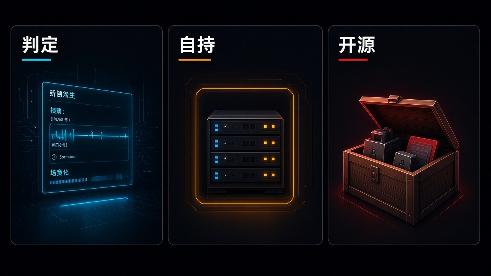

> 先说明一下：素材是我借助 AI 收集整理的，时间都按北京时间。写着「据 X 摘要」的，是 X 平台自动生成的新闻摘要，我暂时没找到一手来源，大家看的时候打个折。每条后面关于行业、公司、赚钱机会的判断都是我个人的看法，不是事实，更不是投资建议。教程视频都是网上公开的，标了「同类操作参考」的，讲的是同一类操作，不是针对这款新产品本身。

## 今天最值得看的几件事

- **头条：Google × Gemini Decisions API / Gemini Decision 1**——由新模 `gemini-decision-1` 驱动，面向工具选择、策略检查、模型路由、上下文打分等「封闭选项」决策。一次前向最多评估 **1,000** 道彼此独立的问题，返回概率与置信度，而不按 token 逐个生成答案文本。官方称输入支持文本、图像、音频、视频与 PDF（合计最多约 **256K** tokens），端到端延迟约 **150–250** 毫秒，定价为每百万输入 token **$0.10**、输出 token **$0**。现已通过 Google AI Studio 的 Gemini API 提供，并有可在 AI Studio 试用的免费档；Gemini in Google Cloud 的支持官方写为即将到来。
- **本机与自托管运行时**——AWS 宣布 **AWS Emulator** 正式可用：可在本机用同一套 AWS API 做本地仿真，无额外服务费，源码以 **CC0 1.0** 公共领域奉献发布。Gemini API 的 Managed Agents 则支持接入自托管沙箱，在自有基础设施里执行工具；Environments 与 managed agents 仍为预览。
- **开源权重与协议**——Runway 将世界动作模型 **Praxis-1** 按 Apache **2.0**（含商用）开放权重及推理、微调代码。Google 发布生成式 UI 协议 **A2UI 1.0** 首个稳定版（Apache **2.0**）；Jetpack Compose 与 Gemini 目前仍为 **0.9.1**，字节跳动 Lynx 仍支持 **0.9**、正在适配 **1.0**，不要写成所有渲染器都已到 **1.0**。
- 另有：DeepMind **AlphaGenome 2**（研究用途、非临床诊断）；字节 **Seedance 2.5 Flash**（美元与人民币分属不同平台，不换算对照）；百度世界的文心闪电深度思考 / 文心一镜微表情、**词元所**，以及天池超节点与昆仑芯路线图；Gemini 应用登陆 Apple **CarPlay**；Google Labs **Tabletop**（美国 **18** 岁及以上候补）；Databricks 新一代 **Genie**（Genie 与 Ontology 已 GA，always-on 等仍为即将预览）；ElevenLabs 纽约峰会与 NVIDIA 扩围；Adobe MAX **2026** Sneaks 十项实验预览；补录澳大利亚 **Agentaus 1**；Apex **ANR** 帧生成公测。库库 / KOOKO、豆包工作接入三方模型目前仍以媒体报道为主。
- YC：新 Launch **Agent37** 自称「最便宜的 AI 沙箱」，本稿核时仍居 `launches.json` 顶（约 **6** 票）。W27 仍收 late，准时申请约 **12-11** 前出结果；F26 Demo Day 仍 **12-02**。
- 观点：**判定、自持、开源**——今天更清楚的，是封闭题怎么判定、能力能不能留在自己的机器或主权环境里跑，以及权重、协议和交易入口开没开。

今天也不薄。Google 一夜放下决策专用 API、细胞级基因组模型、车机、自托管沙箱、Labs 实验和生成式 UI 协议；AWS 把本机仿真器写成正式可用；Runway 把机器人策略的权重按 Apache **2.0** 放开；百度世界则同时摆出应用模型、模型交易所和芯片路线。昨天已经写过的 Carbon / Qwen4-Max，以及本窗再热的 Fable / Mythos、Anthropic IPO、gemini-4-hydrogen 传闻、奥尔特曼相关八卦和英伟达人事传闻，我都没往里塞。脊柱就收这三道：封闭题如何判定、能不能自持着跑、权重和协议开没开。

## 模型发布

### 1. Decision 1：一次前向，上千道封闭题（头条）

Google 官方博署 **November 11, 2026**（`datePublished` UTC **18:00 · 11-11** ≈ 北京 **02:00 · 11-12**；@GoogleAIStudio 约 UTC **18:15**，@Google 约 UTC **18:26**）宣布推出 **Gemini Decisions API**，由新模 **Gemini Decision 1**（官方型号 `gemini-decision-1`）驱动，现已通过 Google AI Studio 的 Gemini API 提供。它面向工具选择、策略检查、模型路由、上下文打分这类「封闭选项」决策：你给出一份多模态输入，再附上最多 **1,000** 道彼此独立的问题；模型在一次前向计算里给候选选项打分，返回概率与置信度，而不是按 token 逐个生成答案文本。官方称输入支持文本、图像、音频、视频与 PDF，合计最多约 **256K** tokens（模型卡将输入上限写作 **262,144**，即 **256×1024**）。端到端延迟约 **150–250** 毫秒；在最多约 **16K** tokens 的上下文上，模型计算中位延迟约 **50–100** 毫秒，且从 **1** 道到 **100** 道问题几乎持平。定价为每百万输入 token **$0.10**、输出 token **$0**，共享 `input` 按请求只计费一次，每道问题只额外计入自己的指令和标准 tokens；官方还写明没有输出 token 费用、可变 thinking-token 账单，也不再单独收取音频转写和 OCR 费用。免费档可在 AI Studio 试用。官方称，在其共享基准套件上，Decision 1 + Decisions API 的费用约为使用 Interactions API 调用 Gemini 3.5 Flash-Lite 的五分之一。问题类型为 `noul`（是/否）、`choice`（**2** 至 **255** 项单选）与 `score`（有序量表）。官方列举的内部用例包括 Gemini Notebook 的实时路由（称日常查询延迟最多可降约 **40%**）、Stitch 的快速画布实验、Google Labs CC 的表情选择，以及 Search 中 MCP 工具的对抗行为检测。生态集成称正在 OpenRouter、LangChain、Vercel、LiteLLM、Pydantic AI、Pipecat、LiveKit、OpenCode 及 `google-genai` SDK 推进，并写明 Gemini in Google Cloud 的支持即将到来。延迟、价格、约 **5** 倍成本差与 Notebook 延迟降幅均为谷歌官方自述；官方博正文未给出媒体转述里的分项基准分数，我也不另补二手榜单。

来源：[blog.google·Gemini Decisions API](https://blog.google/innovation-and-ai/technology/developers-tools/gemini-decisions-api/)、[Gemini API 文档·Decisions API](https://aistudio.google.com/docs/decisions-api)、[模型卡·gemini-decision-1](https://aistudio.google.com/docs/models/gemini-decision-1)、[定价页](https://aistudio.google.com/docs/pricing)、[X·@GoogleAIStudio](https://x.com/GoogleAIStudio/status/2120581284690801060)、[X·@Google](https://x.com/Google/status/2120583966272983331)、[IT之家](https://www.ithome.com/1/025/858.htm)

这是把「选哪个工具、走哪条策略、这句话过不过规则」从生成式回答里拆出来的专用判定层，不是又发了一款聊天模。受益的是已经在做模型路由、内容审核、客服分流、保险理赔初筛或质检打分，希望一次请求打完多道封闭题、并按置信度决定是否人工复核的平台与工具团队，以及 OpenRouter / LangChain / LiteLLM 这类正在对接的生态方；付钱的是把 **150–250** 毫秒和「约五分之一成本」写成独立评测，或以为 Cloud 已经同步可用、可以拿它生成长文案的人。标「延迟、价格、成本倍数与 Notebook 降幅为官方自述；Cloud 支持尚未到位；免费档与付费档的数据用途以定价页为准；勿写成已替代生成式模型，或已在 Google Cloud 全面 GA」。

- 做 Agent 路由 / 策略引擎的人：先在 AI Studio 用官方文档跑一道真实的分流或合规检查，看概率和置信度够不够当作分支条件，低置信度仍要留人工或退回生成式模型。
- 客服、风控、质检负责人：适合「是/否、单选、量表」这种封闭题，不适合要模型写理由、写回复的场景。
- 普通聊天用户：这条没有新的对话入口，不必把它当成又一个 Gemini 聊天模。

教程：以 [Decisions API 文档](https://aistudio.google.com/docs/decisions-api) 和 [官方介绍](https://blog.google/innovation-and-ai/technology/developers-tools/gemini-decisions-api/) 为准，需 `google-genai` **3.2** 或更新，并指定 `v1beta`。官方还提供 Doorstep Parcels、Speed Sketch、Find the Zoo Keeper 演示，以及 Gemini cookbook 里的 [Get_started_decisions 笔记](https://github.com/google-gemini/cookbook)。本条未核到成熟一手官方 YouTube / Bilibili 专片，跟练从文档和官方演示开始即可。

### 2. AlphaGenome 2：按细胞类型读 DNA，仍只供研究

Google DeepMind 官方博署 UTC **15:00 · 11-11** ≈ 北京 **23:00 · 11-11**（落在昨 **21:38** 档后；@GoogleDeepMind 约 UTC **15:03**）发布 **AlphaGenome 2**。官方称这是下一代 DNA 序列模型，可预测 DNA 序列及其变异如何影响特定人体细胞类型与细胞状态，帮助科研人员寻找疾病的细胞驱动因素。相对初代按组织块并行预测，官方称 **2** 代改为条件式模型，一次针对一种组织、细胞类型或状态，并在架构各阶段同时输入目标生物条件与约百万字母的 DNA 序列。训练数据官方写为覆盖 **68** 类组织、超过 **1** 亿个单细胞图谱，文中另写纳入超过 **1.07** 亿个单细胞图谱，并同时使用人类与小鼠的组织块和单细胞数据——两处都是官方原文，并不互相替代。官方称，相较此前最优模型，它能识别出近两倍「会改变细胞内基因表达」的变异；在 TenK10K（**28** 类原代免疫细胞）上，识别因果变异约 **30%**、基因效应方向约 **43%**，对比经单细胞数据微调的初代 AlphaGenome 及其他专用工具的约 **16%** / **23%**。除基因表达、组蛋白修饰、染色质可及性外，还新增 DNA 甲基化预测；官方称无需重新训练即可根据数十个细胞的单细胞 RNA-seq 快照泛化到未见过的细胞状态，并可以跨模态补全未测属性。现已通过 AlphaGenome API 向非商业研究开放，商业研究为私密预览；官方还预告将在 Google Antigravity 中推出 AlphaGenome 2 Skills。官方明确：仅供研究使用，尚未经过临床或诊断用途的验证与批准。@GoogleDeepMind 约北京 **19:31 · 11-12** 另发播客解说，属同一发布的官方讨论，不另开条。

来源：[DeepMind Blog·AlphaGenome 2](https://deepmind.google/blog/alphagenome-2-deciphering-how-cells-read-dna-to-better-understand-disease/)、[X·@GoogleDeepMind](https://x.com/GoogleDeepMind/status/2120532824465805749)、[官方教程](https://www.alphagenomedocs.com/tutorials/index.html)、[X·播客主帖](https://x.com/GoogleDeepMind/status/2120841923237683462)、[YouTube·官方播客](https://www.youtube.com/watch?v=uND6iY2qp_c)、[IT之家](https://www.ithome.com/1/025/822.htm)

受益的是做人类遗传学、单细胞生物学、药物发现前置的科研与生物技术团队，希望把 GWAS 信号对到具体细胞类型；付钱的是把「近两倍」「**30%** / **43%**」写成已可临床诊断，或以为今天就能在医院里用它出报告的人。标「超过 **1** 亿与超过 **1.07** 亿均为官方原文，并存不合并；百分比为官方基准自述；仅供研究、非临床或诊断用途；商业研究仍为私密预览」。

- 计算生物学 / 遗传学研究人员：可按非商业研究条款申请 API，用官方 Colab 从选条件、选区间做到变异评分；不要拿它出诊断结论。
- 药企计算团队：商业使用先走私密预览，别把研究 API 直接写进临床流程。
- 普通读者：这条没有面向公众的健康检测产品。

教程：以官方 [AlphaGenome 2 教程](https://www.alphagenomedocs.com/tutorials/index.html) 和博文里的 expression conditioning Colab 为准。官方播客是发布解说，不是跟练。未核到针对 **2** 代的成熟第三方专片；请不要拿初代 AlphaGenome 101 视频硬套。

### 3. Praxis-1：开源权重的世界动作模型

Runway 官方新闻稿署 UTC **15:00 · 11-11** ≈ 北京 **23:00 · 11-11**，宣布 **Praxis-1** 向所有人开放权重。官方称这是其世界动作模型（world action model），以 Apache **2.0** 开源（含商用），涵盖权重以及推理与微调代码，并支持全量微调与 LoRA。该模型今年 **9** 月作为首个世界动作模型发布，官方称已由 Noble Machines、Standard Bots、Ultra 等合作方在自有硬件上运行；本窗是开放权重，不是全新首次亮相。官方称其为 **27B** 参数的混合专家扩散 Transformer，同时预测视频与动作；在 NVIDIA RoboLab-120 榜上成功率为 **46.2%**（**1,200** 条 episode），并列出 FLUX 3 Action **42.9%**、Cosmos3 Nano **36.8%**、π0.5 **28.0%**（数据官方写为 as of November 2026）。可在 GitHub、Hugging Face（原生支持 LeRobot）和 vLLM-Omni 获取，并在 Reactor 提供托管推理；官方称可在 H100、B200、RTX 5090、RTX PRO 6000 以及机器人端的 Jetson Thor 上直接运行。另称在从未出现于训练数据的 Google RT-1 上微调后，SimplerEnv 成功率达 **80.0%**，高于原 RT-1 策略的 **52.4%**。官方研究博还给出一组与 GPT-6 Astra 的自测对照：在同一台 YAM 遥操作工位、同一控制台、相同三项任务上，Praxis-1 完成任务的平均耗时约为 Astra 的 **1/15.6**（即 Astra 约慢 **15.6** 倍），每个完成任务的平均成本约为其 **1/51**；成本口径为 Praxis-1 按一台 H100 **$3.95**/小时计、Astra 按 API 账单计，数据采集于 **2026-11-09**。三项任务官方分项为摘笔帽（平均 **0:15** vs **7:48**，约 **31** 倍；成本约 **$0.08** vs **$3.47**）、海绵入袋（**0:22** vs **2:46**，约 **7.4** 倍；约 **$0.03** vs **$1.20**）、骰子入袋（**0:11** vs **2:04**，约 **11.5** 倍；约 **$0.01** vs **$0.93**），三项合计平均 **0:16** vs **4:13**、约 **$0.04** vs **$1.87**。官方同时写明，前沿多模态 LLM agent 在 RoboLab-120 总榜上仍排在前面（文中举例 **86.0%** 与 **57.1%**），该对照比的是时延与成本，不是总榜第一。榜单、微调数字与 Astra 对照均为 Runway 官方自述。

来源：[Runway·Praxis-1 Is Now Available](https://runway.com/news/company-news/praxis-1-is-now-available)、[Runway Research](https://runway.com/research/praxis-1-video-pretraining-to-robot-control)、[Hugging Face·praxis-1](https://huggingface.co/collections/runwayml/praxis-1)、[GitHub·praxis-1-oss](https://github.com/runwayml/praxis-1-oss)、[IT之家](https://www.ithome.com/1/026/104.htm)

受益的是工业机械臂、仓内双臂、人形机器人等硬件团队，希望在自有机器上微调一个可商用的世界动作模型；付钱的是把「完胜 Astra」或总榜第一写进宣传，或把 **9** 月已发布的模型当成今天才首次亮相的人。标「RoboLab-120 与 Astra 对照均为官方自测，仅限所述任务与口径；总榜前两名仍是 LLM agent；Apache **2.0** 含商用，但部署仍要过自家安全与现场验收」。

- 机器人算法工程师：可从官方 GitHub 与 Hugging Face 装权重，先在仿真或单臂上做 LoRA，再决定要不要全量微调。
- 工厂 / 仓储自动化负责人：先看合作方已跑过的本体类型，别把三项任务的时延比直接写成产线节拍。
- 普通开发者：这条需要机器人和相应算力，不是消费级生视频模型。

教程：以 [GitHub 仓库](https://github.com/runwayml/praxis-1-oss)、[Hugging Face 集合](https://huggingface.co/collections/runwayml/praxis-1) 和 [发布博](https://runway.com/news/company-news/praxis-1-is-now-available) 为准。官方提到可用 NVIDIA NeMo Automodel 做域内后训练，但本条未核到针对本次开源权重的成熟 YouTube / Bilibili 专片，也不宜拿 **9** 月预览期评测视频硬套。

### 4. Agentaus 1：澳大利亚主权模补录

澳大利亚 Trellis Data 官方新闻稿栏日为 **10 Nov 2026**（正文电头亦写 Canberra, 10 November 2026）。前几轮因未核到已上线的官方发布文而未单列；Australian Cyber Security Magazine 跟进文 `published_time` UTC **02:21 · 11-12** ≈ 北京 **10:21**，本窗补录。官方称 **Agentaus 1** 参数规模约 **2200** 亿，较其前一代大约 **50%**，并称在基础模型的全球排名中位列第 **43**；可提供更高准确度、更深的多步推理，以及更长、更连贯的输出，同时仍能在较小算力集群上规模化运行。官方称面向澳大利亚企业与政府，把数据与投资留在澳大利亚，并已通过 [agentaus.com.au](https://agentaus.com.au/) 提供免费、订阅、企业与 API 档位。官方新闻稿未点名「第 **43** 名」所依据的具体榜单；ACSM 转述为 MMLU-Pro，成稿只把这一归属记为媒体转述。

来源：[Trellis Data 官方新闻稿](https://trellisdata.com/newsroom/trellis-data-launches-agentaus-1)、[agentaus.com.au](https://agentaus.com.au/)、[Australian Cyber Security Magazine](https://www.australiancybersecuritymagazine.com.au/trellis-data-launches-near-frontier-model-agentaus-1/)

受益的是必须把数据留在澳大利亚的政府、金融和防务相关机构，以及做本地交付的集成商；付钱的是把「全球第 **43**」写成已核实的独立总榜，或以为这是对标前沿闭源模的全面替代的人。标「排名为官方自称，具体榜单官方新闻稿未点名；补录条，新闻稿日期为 **11-10**」。

教程：以 [官方新闻稿](https://trellisdata.com/newsroom/trellis-data-launches-agentaus-1) 和 [产品站](https://agentaus.com.au/) 为准。本条未核到成熟官方跟练片。

### 5. 文心两款应用模型：闪电深度思考与一镜微表情

百度在百度世界 **2026** 开幕式上正式发布两款文心应用模型——文心闪电深度思考模型与文心一镜微表情大模型，并称同步上线百度智能云千帆平台，面向企业客户及合作伙伴开放 API。@Baidu_Inc 约 UTC **09:21 · 11-12** ≈ 北京 **17:21** 发出英文主帖，将两款模型分别写作 **ERNIE Light Deep Thinking** 与 **ERNIE Wizshot Micro-Expression**，并复述李彦宏在会上的路线：在继续投入前沿基础模型的同时平行发展模型与智能体，由应用需求引导模型如何优化。该官方帖未给出接入点 ID 或价格。千帆「模型列表」与「模型服务计费」文档更新日期均为 **2026-11-11**：列表在「视频生成」类下列出 ERNIE-Wizshot-ME（文心一镜微表情大模型），接入点 ID 为 `ernie-wizshot-me`，并发数与排队数均为 **1**；计费文件以视频时长 **1** 秒对应调用价格 **0.7** 元列出该模型，未另行列出其他时长价目。同一份公开模型列表未以「文心闪电深度思考模型」为名列出独立条目（列表「深度思考」类另有 ERNIE-Light-DT-1.0，接入点 `ernie-light-dt-1.0`），官方文档也未写明它与本场发布名称的对应关系，故不把该英文名与刊例价写成「文心闪电深度思考模型」的官方参数。本轮未检索到可公开抓取的百度新闻稿专页，中文侧最早见每经、第一财经与界面新闻的开幕式转述。

来源：[X·@Baidu_Inc](https://x.com/Baidu_Inc/status/2120809179094913099)、[千帆模型列表](https://cloud.baidu.com/doc/qianfan/s/rmh4stp0j)、[千帆模型服务计费](https://cloud.baidu.com/doc/qianfan/s/wmh4sv6ya)、[每日经济新闻](https://www.nbd.com.cn/articles/2026-11-12/4645732.html)、[第一财经](https://www.yicai.com/news/103437760.html)

受益的是已经在千帆上做企业应用、需要「深度思考」或人物微表情口播视频的团队，以及百度生态里的集成商；付钱的是把 ERNIE-Light-DT-1.0 的刊例价直接写成闪电深度思考的官方价，或以为今天就对个人免费开放的人。标「两款英文名为官方 X 主帖用语；Wizshot-ME 的 **0.7** 元/秒以千帆计费文档为准；闪电深度思考的接入点与价格官方尚未对照写明；面向企业与合作伙伴」。

- 已有千帆企业账号的人：可在模型列表里核 `ernie-wizshot-me` 的并发与计价，先用短视频试一镜微表情。
- 要接「闪电深度思考」的企业：先向官方或客户经理确认接入点 ID，不要自行把 Light-DT-1.0 的价格抄进合同。
- 个人开发者：这条目前按官方口径是企业与合作伙伴 API，不是面向公众的免费聊天入口。

教程：以 [千帆模型列表](https://cloud.baidu.com/doc/qianfan/s/rmh4stp0j) 和 [计费文档](https://cloud.baidu.com/doc/qianfan/s/wmh4sv6ya) 为准。本条未核到针对这两款新应用模型的成熟官方跟练片。

### 6. Seedance 2.5 Flash：高频预览档，美元和人民币分开记

@BytePlusGlobal 约 UTC **06:09 · 11-12** ≈ 北京 **14:09** 宣布推出 Dreamina **Seedance 2.5 Flash**，官方称效果接近旗舰 Seedance **2.5**，生成速度约提升一倍，价格更低，面向高频迭代与批量内容生产。海外官方帖称，**720p** 文生视频与图生视频定价为每秒 **0.152** 美元，较 Seedance **2.5** 约低 **34%**；单次最多可用 **10** 张图片、**5** 段视频与 **5** 段音频作参考，单段最长 **30** 秒，分辨率提供 **480p** 与 **720p**；并称 API 将于周日 **11 月 15 日** 登陆 BytePlus 的 ModelArk。[Dreamina 产品页](https://dreamina.capcut.com/seedance/seedance-2-5-flash) 写明可在 AI Video、Canvas 与 Agent 工作流中选择 Flash，用于 **480P/720P** 快速预览后再用旗舰出片。国内侧，火山方舟官方文档现已写明：Doubao Seedance **2.5 flash** 模型信息已公开，北京时间 **2026 年 11 月 15 日 14:00** 起正式开放在线体验与 API 调用；官方模型价格页给出不含输入视频、**16:9**、**5** 秒样例：Flash 在 **480p** 约 **0.44** 元/秒（约 **2.21** 元/条），**720p** 约 **0.99** 元/秒（约 **4.97** 元/条），**1080p** 不支持；同口径下旗舰 **2.5** 的 **720p** 约为 **1.51** 元/秒。IT之家约北京 **14:33** 亦转述 **720P** 约 **0.99** 元/秒、较 **2.5** 降低约 **34%**，并称即日起将陆续登陆即梦、LibTV、Updream、Creao AI、TapNow 等平台。美元与人民币单价分属海外 ModelArk 与国内火山方舟的不同报价，不自行换算对照。旗舰 Seedance **2.5** 仍面向对视听品质要求更高、以及 **1080P** 及 **4K** 的制作。

来源：[X·@BytePlusGlobal](https://x.com/BytePlusGlobal/status/2120760891344036304)、[Dreamina·Seedance 2.5 Flash](https://dreamina.capcut.com/seedance/seedance-2-5-flash)、[火山方舟·Seedance 2.5 使用前必读](https://docs.volcengine.com/docs/ark/seedance-2-5?lang=zh)、[火山方舟·模型价格](https://docs.volcengine.com/docs/ark/model-pricing)、[IT之家](https://www.ithome.com/1/026/069.htm)

受益的是广告、短剧、预演和营销团队，需要先用较低分辨率快速试镜头，再把选中的方案交给旗舰出片；付钱的是把 Flash 写成已经替代 **2.5**、已经支持 **1080P/4K**，或把美元单价和人民币单价直接换算比较的人。标「美元价来自 BytePlus 官方 X，人民币示例价来自火山方舟价格页；API 以 **11-15 14:00**（北京时间）为准；两国平台报价不换算；Flash 官方价格表示例不支持 **1080p**」。

- 出海内容团队：可在 Dreamina 里先选 Flash 做 **480P/720P** 预览，API 等到 ModelArk 的 **11-15** 窗口。
- 国内用即梦 / 火山方舟的人：先读官方「使用前必读」，记住在线体验与 API 从 **11-15 14:00** 起开放，定价以方舟价格页为准。
- 要出 **1080P/4K** 的人：仍应走旗舰 **2.5**，不要指望 Flash 覆盖这一档。

教程：海外以 [Dreamina 产品页](https://dreamina.capcut.com/seedance/seedance-2-5-flash) 和 BytePlus 官方帖为准；国内以 [火山方舟文档](https://docs.volcengine.com/docs/ark/seedance-2-5?lang=zh) 为准。本条未核到针对 Flash 的成熟官方 YouTube / Bilibili 专片，不要拿旗舰 **2.5** 或更早版本的评测视频硬套。

## 工具与产品

### 7. AWS Emulator：本机跑同一套 API，现已正式可用

AWS News Blog 由 Daniel Abib 撰写，`article:published_time` **2026-11-11T11:00:44-08:00** ≈ 北京 **03:00 · 11-12**，宣布 **AWS Emulator** 正式可用。这是可在本机运行的 AWS API 本地仿真器：AWS CLI、AWS SDK 和编程智能体可通过本机 HTTPS 端点调用与云上相同的 API，无需先部署到 AWS 区域，也无需为此支付额外服务费（仅在实际部署到 AWS 时才为云上资源付费）。源码在 GitHub，以 **CC0 1.0** 公共领域奉献发布；Linux 可装 RPM/Debian 包，macOS 与 Windows 需按文档用 Docker 运行，官方不发布现成镜像。官方称默认监听 `127.0.0.1:9297`，启动后在 `~/.aws/emulator/9297/` 写入自签证书与密钥（访问密钥 ID 以 `EMULATOR` 开头），用环境变量把 SDK/CLI 指到本机即可，应用代码不必改；未实现的操作返回 HTTP **501**。官方写明它不按 AWS 的方式评估 IAM 与基于资源的策略，每个实例视为单一账号，也没有跨账号或跨区域行为，因此不能用来测试应用是否安全。实现语言为 Rust，还提供面向 AWS SDK for Rust 测试的进程内 embedded 模式。官方称该仿真器由智能体基于公开的 AWS API 模型，使用 Amazon Bedrock AgentCore Runtime Instances、AWS CodePipeline 与 AWS CodeCommit 构建并维护；About Amazon 技术博进一步写明「团队尚未撰写或审查其中任何代码」。Werner Vogels 同窗博文讨论的是智能体写代码时工程师的职责，不是另一款产品。

来源：[AWS News Blog](https://aws.amazon.com/blogs/aws/test-your-applications-against-aws-locally-with-aws-emulator/)、[AWS What's New](https://aws.amazon.com/about-aws/whats-new/2026/11/aws-emulator-now-available/)、[官方文档](https://docs.aws.amazon.com/emulator/latest/userguide/what-is-service.html)、[入门指南](https://docs.aws.amazon.com/emulator/latest/userguide/getting-started.html)、[GitHub·aws/aws-emulator](https://github.com/aws/aws-emulator)

这是把云上 API 的开发闭环拉回本机，不是新的云区域，也不是可以拿来做安全验收的替身。受益的是日常用 AWS SDK/CLI、又希望编码智能体在本机快速试错的开发与平台团队；付钱的是把它写成「已完整等价于 AWS」或「可替代 IAM / 安全测试」的人。标「正式可用、无额外服务费；IAM 与跨账号/跨区域行为不能用来测安全；保真度按服务而异，未实现操作返回 **501**；源码为 **CC0 1.0**」。

- AWS 应用开发者：按官方入门在 Linux 安装，或在 macOS/Windows 用文档中的 Docker 方式启动，拿一个现有的建表或传对象测试指到 `127.0.0.1:9297`。
- 平台 / 安全负责人：明确告诉团队「本地绿了不等于生产策略也过了」，安全测试仍要在真实 AWS 上做。
- 用编码 Agent 的人：可以把仿真器当成本机回环，避免每次改一行就部署到区域。

教程：以 [Getting started](https://docs.aws.amazon.com/emulator/latest/userguide/getting-started.html) 和 [News Blog](https://aws.amazon.com/blogs/aws/test-your-applications-against-aws-locally-with-aws-emulator/) 为准。本条未核到针对 AWS Emulator 的成熟官方视频；网上有些「本地云仿真」视频讲的是其他产品，不要拿来跟练。

### 8. Managed Agents：可以把沙箱接到自己的机器上

@GoogleAIStudio 约 UTC **20:10 · 11-11** ≈ 北京 **04:10 · 11-12** 宣布：在 Gemini API 的 Managed Agents 中，开发者可接入自托管沙箱（self-hosted environments），在自有基础设施里执行工具。官方文档称环境是与交互上下文解耦的 Linux 沙箱，默认可由谷歌托管，也可改为自托管；自托管经出站 HTTPS 与开源 Gemini API CLI 连接，不要求开放入站防火墙端口。官方回复中列出同期合作方 Vercel、Modal、Daytona、Fly.io、Google Cloud、Cloudflare、E2B。文档写明 Environments 与 managed agents 仍为预览，功能与 schema 可能变化；预览期内谷歌托管环境的计算不单独计费（智能体 token 费用见定价页）。托管沙箱的 `sources`、`network`、`env` 和 `/files` 快照不适用于自托管，传入会返回 `400`。这是已有 Managed Agents 的运行时扩展，不是新开一模。

来源：[X·@GoogleAIStudio](https://x.com/GoogleAIStudio/status/2120610219235660183)、[Gemini API 文档·Environments](https://aistudio.google.com/docs/agent-environment)

受益的是已经在用 Managed Agents、但必须让工具跑在自家 VPC、机房或指定沙箱供应商里的团队；付钱的是把预览期「托管计算不单独计费」写成长期免费算力，或以为这是一个新的开放模型的人。标「仍为预览；自托管只走出站 HTTPS；托管选项与自托管不混用」。

- Agent 平台工程师：先读官方 Environments 文档，按自托管指南把运行时接到现有机器，再决定用谷歌托管还是 Vercel / Modal / E2B 等合作方。
- 安全与合规：重点核出站域名、密钥是否进入沙箱，以及过期环境 ID 的 TTL。
- 普通 API 用户：如果只用托管沙箱，这条不是必须马上切的新模。

教程：以 [Environments in managed agents](https://aistudio.google.com/docs/agent-environment) 为准。本条未核到成熟官方跟练片。

### 9. A2UI 1.0：生成式界面协议的首个稳定版

Google Developers Blog 栏日 **NOV. 11, 2026**（@GoogleCloudTech 约 UTC **17:03 · 11-11** ≈ 北京 **01:03 · 11-12**）发布 **A2UI 1.0**，官方称之为生成式 UI 开放协议的首个稳定版：智能体描述要显示的界面（如表单、图表），各应用再用自己的原生组件绘制。**1.0** 新增双向功能调用、无障碍支持，以及对额外元数据的扩展。官方称开发者可立即使用开源的网页、Android、iOS 渲染器 SDK，以及 Python、TypeScript、Dart 的智能体 SDK。开源渲染器覆盖网页端 React / Angular / Lit，Flutter（移动、网页、桌面），以及 iOS 的 SwiftUI；Android 的 Jetpack Compose 官方写明目前为 **v0.9.1**，**1.0**「即将到来」。网页与 Flutter 渲染器也可在 MCP Apps 内运行（官方举例 Claude 与 Gemini）。官方列举已在使用的公司包括 Atlassian、Alation、Bloomberg 与字节跳动：Atlassian 在 Jira 工作项里用交互卡片追问缺失细节；Alation 把指标卡和图表渲到对话和自有应用；字节跳动的 Lynx 渲染器于 **2026 年 6 月**发布，官方写明 Lynx 目前支持 A2UI **0.9**、正与 A2UI 团队适配 **1.0**。谷歌内部，Gemini Notebook 用卡片确认幻灯片格式与主题；企业可在 Gemini 中注册以 A2UI 作答的自有智能体，官方写明 Gemini 目前支持 A2UI **0.9.1**，并称 Gemini Enterprise 已可使用 A2UI、同时正推进升级到 **1.0**。@GoogleOSS 称这是 Apache **2.0** 开放协议，GitHub 仓库 `a2ui-project/a2ui` 的 license 亦为 Apache-2.0。这是既有协议的首个稳定版，不是 **2025** 年底那次首次公布的新项目起步。

来源：[Google Developers Blog](https://developers.googleblog.com/en/a2ui-10-build-delightful-fast-reliable-agentic-experiences/)、[a2ui.org](https://a2ui.org/)、[GitHub·a2ui](https://github.com/a2ui-project/a2ui)、[@GoogleCloudTech](https://x.com/GoogleCloudTech/status/2120563165557571629)、[@GoogleOSS](https://x.com/GoogleOSS/status/2120637695990858013)、[IT之家](https://www.ithome.com/1/025/862.htm)

受益的是要在自有 App、Jira 或助手里用原生组件呈现 Agent 界面的产品与前端团队，以及已经在 MCP Apps 里做对话内界面的人；付钱的是把「**1.0** 稳定」写成 Jetpack Compose、Lynx、Gemini 渲染器也已全部升到 **1.0** 的人。标「协议 **1.0** ≠ 所有渲染器 **1.0**；Compose 与 Gemini 现为 **0.9.1**，Lynx 现为 **0.9**；Apache **2.0**」。

- 前端 / 客户端工程师：可从 a2ui.org 的 quickstart 选 React、Angular、Lit、Flutter 或 SwiftUI；做 Android 先按 **0.9.1** 评估，不要写「Compose 已随 **1.0** 一起稳定」。
- 企业 Agent 负责人：在 Gemini 里注册自有智能体前，先确认当前是 **0.9.1** 还是已升级到 **1.0**。
- 字节 Lynx 开发者：官方仍写支持 **0.9**、正在适配 **1.0**，先对文档再升级。

教程：以 [a2ui.org](https://a2ui.org/) 和 [官方博](https://developers.googleblog.com/en/a2ui-10-build-delightful-fast-reliable-agentic-experiences/) 为准。今年早些时候的 A2UI 视频多针对 **0.9** 阶段，不宜当作 **1.0** 专片。

### 10. Gemini 应用登陆 Apple CarPlay

Google 官方博署 UTC **17:00 · 11-11** ≈ 北京 **01:00 · 11-12**（@Google 约 UTC **19:14**）宣布 Gemini 应用登陆 Apple **CarPlay**。iOS 用户可在车机屏幕上用 Gemini Live 免提对话，官方称对话会自动同步回 iPhone 上的 Gemini 应用。这是继 Android Auto 与带 Google built-in 的车机之后，把 Gemini 应用直接带到 CarPlay；可从主界面或侧边栏点开，接着最近一次聊天或新开对话，过程中可打断、换题或在需要看路时暂停。功能包括查看日程、每日简报、梳理未读邮件与长邮件摘要并用语音讨论回复，以及询问目的地附近餐厅或地标、练习演讲与会议准备等。官方称即日起向全球 iOS 端 Gemini 用户逐步推送，覆盖 Gemini Live 已支持的全部语言；使用前需将 Gemini 应用更新到最新版、开启麦克风权限，并至少在手机上使用过一次 Gemini Live。脚注写明 Daily Brief 需先开启，且包括 Daily Brief 在内的部分个性化功能不向 **18** 岁以下用户以及欧洲经济区（EEA）和尼日利亚提供。

来源：[blog.google·Gemini is now available on Apple CarPlay](https://blog.google/innovation-and-ai/products/gemini-app/gemini-on-apple-carplay/)、[X·@Google](https://x.com/Google/status/2120596045960790486)、[IT之家](https://www.ithome.com/1/025/831.htm)

受益的是已经在用 Gemini Live 的 iPhone 车主，想在通勤里听日程、邮件摘要或排练发言；付钱的是把「全球推送」写成所有个性化功能已在 EEA / 尼日利亚可用，或在开车时低头看屏幕的人。标「逐步推送；须先在手机上用过 Gemini Live；Daily Brief 等个性化功能有年龄与地区限制；开车时仍应免提、眼看路」。

- iPhone 车主：更新 Gemini 应用，打开麦克风，先在手机上完成一次 Gemini Live，再连上 CarPlay 点图标。
- 在 EEA 或尼日利亚的用户：可以对话，但不要默认 Daily Brief 等个性化功能已经开放。
- 车企 / 车机集成商：这是 Gemini 应用上到 CarPlay，不是新的车厂内置助手 SDK。

教程：以 [官方介绍](https://blog.google/innovation-and-ai/products/gemini-app/gemini-on-apple-carplay/) 为准。本条未核到成熟官方跟练片，按博文里的准备步骤即可。

### 11. Tabletop：美国候补的小组协作空间

Google Labs 设计与工程负责人 Roman Nurik 撰文，`datePublished` UTC **16:00 · 11-11** ≈ 北京 **00:00 · 11-12**，推出实验产品 **Tabletop**。官方称这是面向小组实时协作的共享空间：把链接、文件和想法放进同一处后，可用 `@tabletop` 提示或选起始模板，生成可交互的旅行行程、聚餐投票、分账工具和赛事对阵图；空间就绪后把邀请链接发到群聊，所有人可像在 Google 文档里那样同时使用。目前以候补名单形式在美国向 **18** 岁及以上用户推出，登记入口为 [labs.google/tabletop](https://labs.google/tabletop)。官方未公布所用模型名称、定价或向其他地区开放的时间表。属过夜窗补录，不是已经全球开放的正式产品。

来源：[官方博·Try Tabletop](https://blog.google/innovation-and-ai/models-and-research/google-labs/tabletop/)、[labs.google/tabletop](https://labs.google/tabletop)、[@GoogleLabs](https://x.com/GoogleLabs/status/2120549258692882702)、[官方介绍视频](https://www.youtube.com/watch?v=8upa4JZir3I)

受益的是在美国、已满 **18** 岁、需要给旅行或聚会搭一个可共同编辑的小工具的人；付钱的是把候补实验写成全球 GA 或已向中国用户开放的人。标「美国、**18+**、候补名单；未公布模型与定价」。

教程：先看 [官方介绍视频](https://www.youtube.com/watch?v=8upa4JZir3I)，再在 [labs.google/tabletop](https://labs.google/tabletop) 登记。不符合地区或年龄条件的，目前没有可跟练的正式入口。

### 12. Databricks 新 Genie：常驻同事还没全部 GA

Databricks 产品博 `datePublished` UTC **16:00 · 11-11** ≈ 北京 **00:00 · 11-12**，新闻稿栏日 November 11, 2026，发布新一代 **Genie**。官方称之为可在企业护栏内、针对长周期工作保持在线的自治 AI 同事，并能结合 Genie Ontology（业务上下文）与 Genie Search（跨 lakehouse 与业务系统检索）。官方称可通过 Genie One、电子邮件、Slack 与 Microsoft Teams 把工作交给 Genie，由它跟踪进度、追问缺失输入，并在需要时找人拍板；还提到子智能体、优先收件箱、邮件提醒，以及由 Unity Catalog / Unity Gateway 做权限、工具审批、预算与审计。可用性须按官方新闻稿口径：**Genie 与 Genie Ontology 已对所有客户一般可用；Genie Search、Ontology Manager 以及新的 always-on Genie 仍为即将面向预览和测试项目提供。** 不要把整套新能力写成已经对全部客户全面开放。

来源：[Databricks Blog·The new Genie](https://www.databricks.com/blog/new-genie-autonomous-ai-complex-enterprise-work)、[Databricks 新闻稿](https://www.databricks.com/company/newsroom/press-releases/databricks-launches-new-always-genie-autonomous-ai-complex)

受益的是已经在 Databricks 上管数据、希望把周期预报、理赔初筛或营销监测交给有治理边界的同事式 Agent 的企业团队；付钱的是把 always-on、Search、Ontology Manager 写成已对所有客户 GA 的人。标「仅 Genie 与 Ontology 已 GA；always-on / Search / Ontology Manager 仍为即将预览；须人拍板与审计」。

- 已是 Databricks 客户的数据负责人：先核本工作区里哪些能力已 GA，再决定要不要把常驻任务交给它。
- 管理员：重点看 Unity Gateway 的工具审批、预算和审计，而不是先开自动执行。
- 还没上 Databricks 的人：这条不是可单独开通的消费级助手。

教程：以 [产品博](https://www.databricks.com/blog/new-genie-autonomous-ai-complex-enterprise-work) 和新闻稿为准。本条未核到专门讲解本次 always-on 新能力且已发布的官方跟练片；既有 Genie 旧教程也不宜直接套到尚未 GA 的部分。

### 13. ElevenLabs 纽约峰会与 NVIDIA 扩围

ElevenLabs 两篇官方博的 `datePublished` 均写 UTC **12:00 · 11-11** ≈ 北京 **20:00 · 11-11**，落在昨 **21:38** 档前已可扫到，因未列入常扫官方号而本窗补录；随后 @nvidia 约北京 **05:17 · 11-12** 署帖。峰会综述称：面向企业员工的会议笔记 / 听写应用 **ElevenAI**（由 Scribe v3 驱动）免费早期访问「于今日开放」；正式推出 ElevenLabs Partner Program，并宣布与 McKinsey / QuantumBlack 结盟；同时推出 ElevenLabs Marketplace，称明年起企业可用现有承诺在市场上购买伙伴应用。为企业微调部分开源语言模型及 ElevenLabs 语音模型写为「未来数月」；Interaction Engine、Memory、Routines 多为预览或「将」支持，不宜写成已经全量上线。与 NVIDIA 扩大合作的官方口径是：NVIDIA **Nemotron 3.5 Super VL** 现已进入 ElevenAgents；ElevenLabs 计划在现有 Blackwell Ultra 之外再增加 **15 MW** 的 Vera Rubin 算力；双方正用 NVIDIA 基础设施为波兰国家电子健康平台的语音智能体做主权化部署。NVIDIA 合作文称，在 ElevenAgents 面向真实客服任务的基准上，Nemotron 3.5 Super VL 取得领先的端到端任务完成准确率，成本较「其他领先开源模」低 **70%**，并在关闭推理时可进入该平台最快的三款模型之列（均为官方自述）。波兰案例官方写为 Centralna e-Rejestracja，由 EasyCall 协助交付，面向只有座机的患者做预约提醒与改约，并称该平台年预约约 **4,000** 万、爽约率约 **10–20%**，部署使用 NVIDIA Confidential Computing、数据不出政府基础设施。官网页面另有 Eleven v4 宣传条，但 Eleven v4 为今年 **9** 月已发布模型，本条不要写成新模首发。

来源：[ElevenLabs·Summit NYC 综述](https://elevenlabs.io/blog/nyc-summit)、[ElevenLabs·与 NVIDIA 扩大合作](https://elevenlabs.io/blog/nvidia)、[X·@nvidia](https://x.com/nvidia/status/2120627069952340361)

受益的是已经在用 ElevenAgents 做客服或语音坐席的企业，以及需要主权部署、数据不出本国基础设施的公共服务项目；付钱的是把 Memory / Routines / 微调写成已经全量上线，把 **15 MW** 写成已经投产，或把 Eleven v4 当成今天首发的人。标「多项为预览或未来数月；基准数字为官方自述；波兰案例数字为官方叙述；**15 MW** 为计划扩容」。

- 企业语音 / 客服负责人：可先看 Nemotron 是否已出现在 ElevenAgents 的可选模里，并分清哪些是今天能用、哪些还是预览。
- 做政务或医疗语音的人：波兰案例的参考价值在「机密计算 + 数据不出境」，不是一套可直接复制的上线包。
- 普通创作者：ElevenAI 的免费早期访问面向企业员工场景，先读官方说明再登记，不要把它当成 v4 新模发布。

教程：以两篇 [峰会综述](https://elevenlabs.io/blog/nyc-summit) 和 [NVIDIA 合作文](https://elevenlabs.io/blog/nvidia) 为准。本条未核到覆盖本次峰会全部更新的成熟官方跟练片。

### 14. Adobe MAX 2026 Sneaks：十项实验预览，不是已经出货

Adobe 官方博 `publication-date` **11-11-2026**（页面未提供精确到时的 ISO；IT之家约 **22:32 · 11-11** 跟进）发布 MAX **2026** Sneaks，由 Terry Crews 主持，预览 **10** 项研究创新，覆盖视频、音频、摄影、三维、影像与设计，并称部分项目可在新的 Adobe Labs Playground 上手试用。十项为：Project Scene Sweep、Project Screen Test、Project Live Set、Project On Cue、Project Sound Bender、Project Deep Brush、Project Sight Span、Project Hands On、Project Rinse Repeat、Project Link Up。官方称 Playground 目前可试用其中两项——Deep Brush 与 Hands On，并预览面向 Photoshop 的 Project Custom Filters。这些均为研究 / 实验预览，官方未承诺都会产品化。不要与昨已录的 Creative Agent 扩到 Creative Cloud / Firefly 及本地 MCP 预览写成同一条产品 GA。

来源：[Adobe Blog·MAX 2026 Sneaks](https://blog.adobe.com/en/publish/2026/11/11/adobe-max-sneaks)、[Adobe Labs Sneaks](https://labs.adobe.com/sneaks/)、[IT之家](https://www.ithome.com/1/025/815.htm)

受益的是已经在用 Photoshop / Premiere 的创意人，想先摸摸下一代编辑方式；付钱的是把 Sneaks 写成已经随 Creative Cloud 出货的人。标「实验预览，不承诺产品化；Playground 目前可试 Deep Brush 与 Hands On」。

教程：以 [官方博](https://blog.adobe.com/en/publish/2026/11/11/adobe-max-sneaks) 和 [Adobe Labs Playground](https://labs.adobe.com/sneaks/) 为准，可先试 [Project Deep Brush](https://labs.adobe.com/sneaks/deep-brush)。本条未把尚未产品化的预览写成可跟练的正式教程片。

### 15. 词元所：模型交易所，数字先分开记

百度在百度世界 **2026** 开幕式上正式发布大模型交易平台「词元所」。@Baidu_Inc 约 UTC **07:01 · 11-12** ≈ 北京 **15:01** 发出英文产品主帖，称之为 Token Exchange：中立、透明且可信的市场，连接模型服务提供方与客户；客户可在同一处并排比较模型、查看定价与性能数据并直接使用，合格提供方则多了一条触达客户的渠道。上架前会核验提供方资质并比对模型指纹，以帮助发现换模与夸大规格；上架后会定期抽查与持续监测，并为每个提供方维护公开信用档案。官方帖称，上线一个月以来，平台已有超过 **100** 个模型资源，日均超过 **50M** 次调用、**700B** tokens（即 **7000** 亿）。IT之家现场转述的资源数与日均 **7000** 亿 tokens 与官方帖一致。但百度智能云产品页本窗抓取时展示的公开数字仍为 **70+** 模型资源、日均 Token 调用 **200B+**、日均调用次数 **6 千万+**。日均调用次数上，官方帖「超过 **50M**」与产品页「**6** 千万+」也不完全相同。三处数字并存，不以官方帖改写产品页，也不把它们收成一个数。该官方帖仅配图，未另附官方博链。

来源：[X·@Baidu_Inc](https://x.com/Baidu_Inc/status/2120773996698546653)、[百度智能云·词元所产品页](https://cloud.baidu.cn/product-s/token_exchange.html)、[IT之家](https://www.ithome.com/1/025/903.htm)

受益的是要在一个入口比较、采购多家模型的企业，以及希望多一条分发渠道的合格模型提供方；付钱的是把尚未对齐的调用次数和资源数写成单一官方总量，或把「中立交易所」写成已经过独立审计的人。标「官方帖、产品页、现场报道三处数字并存；上线一个月为官方叙述；未见单独官方博」。

- 企业采购 / 算法平台：可以上产品页看比较和信用档案怎么展示，下单前以当时页面和合同为准，不要只抄一篇报道里的日均数字。
- 模型提供方：先问清准入测试、指纹比对和抽查规则，再决定要不要上架。
- 个人开发者：先确认账号和结算是不是对个人开放，别把它当成又一个免费模型广场。

教程：以 [产品页](https://cloud.baidu.cn/product-s/token_exchange.html) 和 [官方 X 主帖](https://x.com/Baidu_Inc/status/2120773996698546653) 为准。本条未核到成熟官方跟练片。

### 16. 天池超节点与昆仑芯路线图

IT之家与新浪科技报道，百度在百度世界 **2026** 开幕式上由沈抖发布天池 **1024** 卡超节点，并称这套算力集群将于明年推向市场；同场还公布昆仑芯产品规划。IT之家现场报道称，天池 **1024** 卡超节点搭载光引擎技术，卡间互联带宽提升 **3** 倍，对比上一代产品训练性能提升 **2.5** 倍、推理性能提升 **3** 倍；并配套 G3.5 KV Cache 显存加速柜，称长上下文推理性能提升 **2** 倍，在多轮对话缓存命中场景下 TTFT 降低 **90%**、整体吞吐提升 **7** 倍；单套可支撑 **5** 万亿参数大模型训练，可横向扩展至万卡规模集群。报道并称，百度曾在去年百度世界宣布天池千卡级超节点 **2028** 年上市，如今节奏加快了一年。昆仑芯方面，中文报道写 M100 已上市、主打极致性价比，旗舰款 M300 将于明年推出，基于全新「N 架构」的多颗芯片则计划 **2028** 年推向市场。@Baidu_Inc 约 UTC **10:35 · 11-12** ≈ 北京 **18:35** 发出英文长帖，引李彦宏称推理将成为 AI 芯片长期增长的主要推动力，并写昆仑芯 M100 已按计划上市、主打高性价比推理；路线图为旗舰 M300 预计 **2027** 年出货，另有基于新架构、面向不同应用需求的芯片预计 **2028** 年推出。该官方英文帖未提及天池 **1024** 卡超节点，也未写出「N 架构」这一中文报道用名，故天池规格与「N 架构」仍以中文现场报道为来源，英文官方表述只用于它所实际写到的昆仑芯规划。本轮未检索到可公开抓取的官方博文专页。

来源：[IT之家·天池 1024 卡超节点](https://www.ithome.com/1/026/026.htm)、[IT之家·昆仑芯](https://www.ithome.com/1/025/971.htm)、[X·@Baidu_Inc](https://x.com/Baidu_Inc/status/2120827709807051075)

受益的是已经在百度智能云上规划大规模训练 / 推理集群、或在看国产算力替代的基础设施团队；付钱的是把「明年推向市场 / **2027** 出货 / **2028** 新架构」写成已经可下单的现货，或把现场倍数写成独立评测的人。标「天池规格与『N 架构』来自中文报道；官方英文帖只写到昆仑芯 M100 / M300 / 2028 新架构芯片；倍数为现场转述」。

教程：目前没有可公开跟练的上线文档，先读上述报道和官方 X 帖，等待正式产品页。不要把既有天池介绍页写成这次 **1024** 卡明年上市的公告。

### 17. ANR 帧生成公测：跨 NVIDIA / AMD / Intel / Apple，但是开发商自测

Apex Compute 推出 Apex Neural Rendering（**ANR**），并开放帧生成（ANR FG）测试版。官方称之为可在英伟达、AMD、英特尔以及苹果芯片上使用的 AI 渲染套件，包含帧生成、超分辨率与光线重建，目前仅帧生成进入公测，后两项官方写为即将推出测试版。官方支持列表包括 NVIDIA GeForce RTX **20** 系及更新型号与 GTX **16** 系、AMD Radeon RX **5000** 系及更新型号与 Steam Deck、Intel Arc A / B 系，以及 Apple silicon **M1** 及后续芯片；系统面写 Windows **10/11**、Linux 与 SteamOS（经 Proton），以及 macOS **26** 或更新。官方自测称，在 NVIDIA RTX **5090**、**3840×2160** 下，**2** 倍模式每生成一帧约 **1.01** 毫秒（对照 NVIDIA DLSS Frame Generation 约 **1.26** 毫秒），**4** 倍模式平均约 **0.61** 毫秒（对照约 **0.82** 毫秒），显存占用约 **214** MB（对照约 **562** MB）；另给出 Apple M2 Max 上的帧生成耗时。GitHub 仓库 `apex-compute/ANR` 本窗可见发布 **FG-V.B14**（`published_at` UTC **06:04 · 11-12** ≈ 北京 **14:04**）；安装需按游戏目录部署，并依赖 OptiScaler，官方 README 写明无 OptiScaler 的游戏用 `anr-fg-full`、已使用 OptiScaler 的用 `anr-fg-addon`，源码尚为 coming soon。耗时、显存与画质对照均为开发商自测；安装方式不同于在游戏设置里开关 DLSS。不宜把「挑战 / 全面超越 DLSS」写成已证实结论。属小厂公测补录。

来源：[Apex Compute·ANR](https://apexcompute.com/neural-rendering)、[GitHub·apex-compute/ANR](https://github.com/apex-compute/ANR)、[Release FG-V.B14](https://github.com/apex-compute/ANR/releases/tag/FG-V.B14)、[IT之家](https://www.ithome.com/1/026/108.htm)

受益的是使用较旧或非英伟达显卡、又想试帧生成的 PC 和 macOS 玩家、以及游戏兼容层作者；付钱的是把官方对照写成独立评测、或以为超分辨率和光线重建也已公测的人。

教程：以 [官方页](https://apexcompute.com/neural-rendering) 和 [GitHub README](https://github.com/apex-compute/ANR) 为准，先看清自己的游戏有没有 OptiScaler。本条未核到成熟官方跟练片。

### 18. 豆包工作接入三方模型：目前仍是媒体报道

IT之家与凤凰网科技均称，豆包工作于 **11-12** 宣布：在自研豆包 **2.1** Lite、豆包 **2.1** Pro 之外，将 Kimi K3.1 Pro、GLM **5.3**、DeepSeek V4.1 Flash 作为首批第三方模型纳入可选列表，并同步在模型选择页标注额度消耗倍率、上线限时优惠。报道称，**10 月 29 日** 豆包工作已先向团队订阅版与企业订阅版客户开放三方模型配置；本次更新将这一能力扩展至更广泛的用户范围。限时优惠分两块：指定时段内使用参与活动的模型可享受额度消耗折扣；以及针对豆包 **2.1** Lite 与 DeepSeek V4.1 Flash 直接下调倍率。倍率的具体数值、折扣幅度，以及「更广泛的用户范围」是否包含免费个人用户，报道未给出，本窗也未检索到可公开抓取的官方博文或已更新的帮助中心条目，故不编造数字。

来源：[IT之家](https://www.ithome.com/1/025/926.htm)、[凤凰网科技](https://original.ifeng.com/c/8xzK2tN8X1V)

受益的是已经在用豆包工作、希望在同一套额度里换用 Kimi / GLM / DeepSeek 的团队；付钱的是把尚未公布的倍率和「已对所有免费用户开放」写成事实的人。标「媒体报道，未见可公开抓取的官方博；倍率与折扣以产品页当时展示为准」。

教程：打开豆包工作的模型选择页，看当时标出的倍率和活动说明。本条没有可引用的官方专文或专片。

### 19. 库库企业版与 KOOKO：媒体报道，未见官方主帖

据 TechWeb 报道（核自富途转载页），百度世界 **2026** 下午场「超级智能 全球上岗」产品分享中，百度文库与百度网盘联合的库库再次升级，构建库库日常、库库办公、库库企业版和库库海外版 **KOOKO** 在内的全球产品矩阵；报道称截至目前库库全球月活用户已达 **5000** 万。报道称 KOOKO 上线一年多以来已累计服务 **1200** 万海外用户，覆盖全球超 **200** 个国家和地区，并在本场宣布全面升级应用开发能力。库库企业版方面，报道称上线三个月以来能力已覆盖超过 **60** 万个组织，并给出金融投研、教育、创意生产等场景及若干客户侧百分比。议程里这两场分享分别列在约 **14:30–14:50** 与 **14:50–15:10**。至本稿核时，仍未检索到百度官方博或官方 X 产品主帖，数字与功能点均按媒体报道转述，月活、覆盖国家与客户侧百分比尤其不要写成官方或独立审计结果。

来源：[富途转载 TechWeb](https://news.futunn.com/post/1004275721)、[百度世界 2026 议程](https://baiduworld2026.events.net.cn/)

受益的是已经在用百度文库 / 网盘 / 库库、想了解企业版和海外版动向的团队；付钱的是把媒体报道里的 **5000** 万月活和客户效率百分比写成官方财报口径的人。标「媒体报道，未见官方博或官方 X 主帖」。

教程：在官方主帖或产品帮助更新前，先不要按转载稿操作企业开通；以百度后续官方说明为准。

## YC 与生态

### 20. Agent37 仍居 Launch 顶，日程没有变

Launch YC **Agent37** 自称「最便宜的 AI 沙箱」，面向智能体跑代码、harness、computer use、浏览器与 Android 模拟器等场景。`launches.json` `created_at` 2026-11-11T23:30:00.128Z ≈ 北京 **07:30 · 11-12**，本稿核时仍居列表顶，约 **6** 票；批次 Fall **2026**。启动文自称：同样 **2** vCPU / **4** GB 内存的沙箱若连续运行整月，Vercel **$249**、Cloudflare **$145**、Daytona **$121**、Agent37 **$4.76**；并称平均成本较多数沙箱提供商低约 **94%**。官网还写「若找到更便宜的沙箱可退还差价」。数字均为其启动文和官网自述，本稿未做第三方核价。

YC 申请与 Demo Day 本窗无变更：Apply 仍 Winter **2027** late（准时截止仍为 **November 2** 晚上 **8** 点 PT，已过；若在截止前递交，结果仍约 **December 11** 前；其后仍接受迟到申请，但不承诺回复时间）。F26 Demo Day 仍 **Wednesday, December 2nd**。昨稿写过的 Launch 作为状态更新、不作为新头条：Perfectly 现约 **2** 票，Kino 现约 **25** 票，Petrichor 仍约 **2** 票；昨顶 Epsilab 现约 **41** 票，已不在列表顶（本稿核时约第 **11** 位）。另，Launch HN: Pomerado（YC F26）仍未出现在 `launches.json` 近 **20** 条，本稿继续不单列。

来源：[Launch YC·Agent37](https://www.ycombinator.com/launches/XNf-agent37-the-cheapest-ai-sandbox)、[agent37.com](https://www.agent37.com/)、[launches.json](https://www.ycombinator.com/launches.json)、[YC Apply](https://www.ycombinator.com/apply)、[YC Demo Day](https://www.ycombinator.com/demoday/)

受益的是已经在为 Agent 付沙箱账单、想对比单价的开发者；付钱的是把「最便宜」和 **94%** 写成已核实的独立评测，或把已退到第 **11** 位的 Epsilab 仍写成「现居顶」的人。标「票数以本稿核时 `launches.json` 为准；比价为公司自述」。

- 正在给 Agent 选沙箱的人：可把 Agent37 的单价放进对照表，同时问清磁盘、闲置休眠和模型 token 是否另计。
- 想申请 YC 的人：W27 仍在收 late，F26 Demo Day 仍是 **12-02**。

教程：以 [Launch 页](https://www.ycombinator.com/launches/XNf-agent37-the-cheapest-ai-sandbox) 和 [agent37.com](https://www.agent37.com/) 为准。本条未核到成熟官方跟练片。

## 观点洞察

### 判定、自持、开源：先问怎么判、在哪跑、开没开

今天材料很满，但并不散。一边是 Google 把「选哪个、过不过、打几分」从生成式回答里拆成专用 API；一边是 AWS 和 Gemini 把运行时拉回本机或自有机房；再一边是权重、协议和模型交易入口被写成可下载、可对接、可上架。X 上再热的，多是昨天已经写过的模型，或还没有变成产品主文的传闻。我没有把跳过清单翻成百科，只留三道还能对上号的台阶。

先说**判定**。Decision 1 不做长文，只对封闭选项给出概率和置信度。官方把它写给工具选择、策略检查、模型路由和上下文打分，一次前向最多 **1,000** 道题，输出 token 计 **0**。判定，指的不是模型变得更会聊天，而是把「代码要分支」的那一类问题，从生成后再解析，改成一次可核对的打分；你真正要核的，仍是延迟和成本是否为官方自述、低置信度要不要退回人工，以及 Cloud 支持是不是还没到。Databricks 把 always-on 同事写成「缺输入就追问、该拍板再找人」，A2UI 则让界面本身变成可确认的表单和卡片——它们跟 Decisions API 不是同一条产品，但都在把「先判定、再行动」写进接口。

再说**自持**。AWS Emulator 让 CLI 和 SDK 在 `127.0.0.1` 上说同一套 API，还不另收服务费；官方也写明，它不能拿来测 IAM 和跨账号安全。Gemini Managed Agents 允许沙箱走出站 HTTPS 接到你自己的机器，不必开放入站端口，但这仍是预览。自持，指的是能力开始被允许留在本机、VPC 或主权环境里跑，而不是只能把数据和工具交回云上托管；验收要看「正式可用」覆盖的是仿真还是安全策略，预览期免费算力会不会变成账单，以及波兰电子健康、Agentaus 这类「数据不出境」叙事有没有对应的部署边界。昆仑芯的路线图和天池超节点，说的是更长周期的自持算力，还不是今天就能下单的现货。

最后是**开源**。Praxis-1 把权重和微调代码按 Apache **2.0** 放下，A2UI **1.0** 把协议按同一类许可稳定下来，AWS Emulator 甚至用了 **CC0 1.0**。百度的词元所则想做模型的交易入口：比较、上架、指纹和信用档案。开源，指的不只是仓库能 clone，还包括许可是否含商用、渲染器是不是真的都到了 **1.0**、交易所页面上的数字和官方帖是不是同一套账。Seedance Flash 的美元价和人民币价分属不同平台，也属于同一类要分开记的开放：入口开了，价签和窗口仍要各自核对。

我自己读材料时会多问三句：

1. **判定：** 这是封闭选项的打分，还是仍要模型生成一段话？概率和置信度够不够当作分支？官方延迟和成本差是自述还是独立评测？
2. **自持：** 跑在本机、自托管还是主权机房？正式可用的边界写到哪——API 仿真、安全策略，还是只是预览沙箱？数据出不出境？
3. **开源：** 许可是 Apache **2.0**、CC0 还是仅可研究？协议稳定是不是等于所有 SDK 都已到位？产品页、官方帖和现场报道的数字有没有对上？

过得了这三问，再谈要不要把路由切到 Decisions API、要不要在本机拉起 AWS Emulator，或要不要把 Praxis-1 微调到自家机械臂上，都不迟；过不了，再响的「已全面替代生成式模型 / 本地仿真等于云上安全 / 开源协议已在所有端上就绪」叙事，都只是还没写进预览范围、许可和数字口径的能力清单。个人观点，数字以各条原文为准，不构成投资或采购建议。

## 今日机会总结

今天的脊柱是三道账：**判定**（Decisions API 把封闭题做成一次前向打分，输出 token 为 **0**）、**自持**（AWS Emulator 本机正式可用，Managed Agents 可自托管但仍为预览，主权模与芯片路线图是更长的一条线）、**开源**（Praxis-1 与 A2UI 的 Apache **2.0**，Emulator 的 **CC0 1.0**，词元所作为交易入口）。旁边还有 AlphaGenome **2** 的研究 API、Seedance Flash 的双平台价签、CarPlay / Tabletop 这类面向普通人的入口，以及 Agent37 这则仍居 Launch 顶的沙箱。

若只选三条可执行方向：

1. **封闭判定与人工回退：** 对标 Decisions API 的 `noul` / `choice` / `score` 和置信度，帮客户把路由、审核、质检里能写成封闭题的部分拆出来，低置信度仍回生成式模型或人工。客户是已经被工具选择和策略检查的延迟、账单卡住的平台团队。
2. **本机与自托管运行时：** 对标 AWS Emulator 的本地回环，以及 Managed Agents / Agent37 的沙箱账单；卖的是「代码不用改、先在本机或自有基础设施里试」，不是「本地绿了就等于生产安全过关」。客户是已在用 AWS SDK 或托管 Agent、又必须把执行环境留在自己这边的团队。
3. **开源权重、协议与模型交易落地：** 对标 Praxis-1 的 Apache **2.0** 微调、A2UI **1.0** 与各端渲染器版本差，以及词元所的准入和信用档案；客户是要自托管机器人策略、做生成式 UI，或在一个入口比较多家模型、但必须先核对许可和数字口径的团队。

## 普通人今天就能做的 3 件事

1. **有 Gemini API 密钥的人：** 按 [Decisions API 文档](https://aistudio.google.com/docs/decisions-api) 升级 `google-genai` 到 **3.2** 或更新，拿一道自家真实的分流、质检或合规封闭题跑 `gemini-decision-1`，记下概率、置信度和账单；Cloud 还没到，也别把全部生成式流量一刀切过去。
2. **日常写 AWS 应用，或已经在用编码 Agent 的人：** 按 [AWS Emulator 入门](https://docs.aws.amazon.com/emulator/latest/userguide/getting-started.html) 在本机拉起仿真器，用现有的建表或传对象测试走 `127.0.0.1:9297`；记住它不能用来测 IAM 和安全策略。若必须让 Agent 工具跑在自己机器上，再读 [Managed Agents Environments](https://aistudio.google.com/docs/agent-environment)。
3. **做机器人、做视频预览，或已在百度 / 豆包生态里的人：** 机器人算法可从 [Praxis-1 仓库](https://github.com/runwayml/praxis-1-oss) 拉开源权重，先分清这是官方自测不是总榜第一；做短视频预览的，先看 [Dreamina Flash](https://dreamina.capcut.com/seedance/seedance-2-5-flash) 或等火山方舟 **11-15 14:00** 的 API，美元和人民币价不要换算。已有千帆企业账号的，可核 `ernie-wizshot-me` 的 **0.7** 元/秒；用豆包工作的人，以产品页当时标出的倍率为准，不要引用尚未公布的折扣数字。
