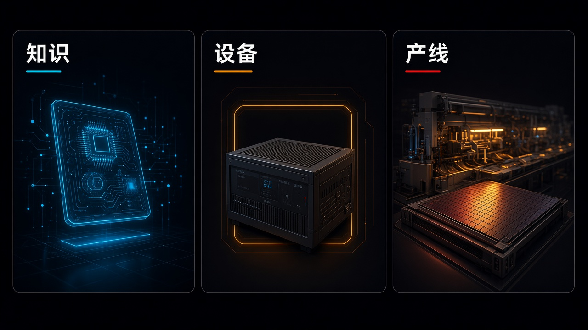

> 先说明一下：素材是我借助 AI 收集整理的，时间都按北京时间。写着「据 X 摘要」的，是 X 平台自动生成的新闻摘要，我暂时没找到一手来源，大家看的时候打个折。每条后面关于行业、公司、赚钱机会的判断都是我个人的看法，不是事实，更不是投资建议。教程视频都是网上公开的，标了「同类操作参考」的，讲的是同一类操作，不是针对这款新产品本身。

## 今天最值得看的几件事

- **头条：Google × Gemini 4 Hydrogen**——官方称之为面向日常编程与智能体工作流的高速执行模型；Gemini 4 Carbon 与 Gemini 4 Argon 仍面向更难、更长程的推理。定价为整个 **100 万** token 上下文窗口统一价：每百万输入 **$1.50**、每百万输出 **$7.50**。官方自述默认 high 思考档在 Artificial Analysis Intelligence Index 上为 **51**（高于 Argon 的 **50**），最高 xhigh 档可达 **54**；对比 Gemini 3.8 Flash，默认 high 档完成任务快 **2.5** 倍，Terminal-Bench **4.1** 为 **57%** 对 **18.2%**。Search 官方称之为迄今最大的模型升级，并称 Hydrogen 已向全球所有用户推出。Antigravity 同场推出 Orchestrator，可在同一会话里动态调度前沿模型与 Hydrogen；官方写明 Orchestrator（Carbon）与 Orchestrator（Argon）面向 Google AI Ultra，付费 Pro 为 Orchestrator（Argon）。基准、安全降幅与编排效率数字均为谷歌官方自述。
- **开放权重与决策模型**——Thinking Machines Lab 将 **Inkling 2 Small**（官方自述 MoE，总参数 **594B**、激活 **17B**）按 Apache **2.0** 开放完整权重，这是 **11-05** 先以封闭权重在 Tinker 提供之后的下一步。SpeakLeash **Bielik-One** 四个规格如期上线，主打分类与评估而非长文生成，许可 Apache **2.0**。Perplexity 推出 **pplx-decider-v1.3**（**27B**）与 **pplx-decider-flash-v1.3**（**4B**），新增 locate 抽取，输入价与 v1.2 相同（每百万 token **$0.02** / **$0.01**），输出 token 仍免费，权重 Apache **2.0**。补录 Edge0 **145B** / **120B** 端侧模型，权重许可是 **Edge0 Community Model License 1.0**，不要写成 Apache 或 MIT；Higurashi **Haru-4B** 全双工语音基座按 Apache **2.0** 开源。
- **制造与芯片，仍是设计侧消息**——Anthropic 推出 **Claude for Manufacturing** 插件（**17** 项技能与四个连接器），官方写明它不操控设备。荷兰 Axelera AI 公布第三代 AIPU 架构 **Titania**，面向数据中心推理，官方称预计 **2027** 年第三季度量产。这两条更适合用来想「AI 能帮工厂写什么、芯片公司在宣布什么架构」，而不是「模型已经替代了晶圆厂」。
- 另有：Google Flow 五项由视觉艺术家设计的新工具；Google 智能眼镜开启预购（Gentle Monster 起 **$449**、Warby Parker 起 **$395**，目前面向美国与韩国的符合条件账号，**12-10** 到店）；World Labs **Atlas** 向所有人开放应用与开发者 API；Anthropic **self-hosted Claude Managed Agents** 私有测试版；OpenAI **Daybreak Defense Factory** 与 **Daybreak Red Team**（OpenAI News RSS 至本稿核时仍无对应新闻主文）；LMSYS **SGLang Consortium**、**SGLang v1.0** 与 **SGLang-Neuron v0.1.0** 公测；Expo **Simulators** 在所有付费方案上线；补录 Databricks **Genie plugins**。国内侧：世界中文大会发布**语飞**国际中文教育垂直大模型（新华社未写研发机构、参数与产品入口）；腾讯混元 **Hy Realtime** 已在元宝语音通话与腾讯客服上线，腾讯云 API 官方写为近期提供；阿里「快乐虾米」上线 iOS / Android，这是移动端上线，网页 Beta 已于 **8-17** 首发。
- YC：Apply 仍 Winter **2027** late（准时截止 **November 2** 晚上 8 点 PT 已过，截止前递交约 **December 11** 前出结果，其后仍接受迟到申请但不承诺回复时间）。F26 Demo Day 仍 **Wednesday, December 2nd**。本稿约北京时间 **20:28**（Asia/Shanghai）再核 `launches.json`，顶仍为 **Caveman**（约 **4** 票），**Acyclic Labs** 约 **18** 票居近 20 条第 2，**Agent37** 约 **9** 票、现为第 15 位，票数均低，不单列新 Launch 头条。

## 模型发布

### 1. Gemini 4 Hydrogen：把日常执行这一档放到更广的入口（头条）

Google 官方博 `datePublished` UTC **18:00:00 · 11-12** ≈ 北京 **02:00 · 11-13**（DeepMind 博客条目 `pubDate` UTC **18:00:50**，实际链至同一篇 blog.google 文）宣布推出 **Gemini 4 Hydrogen**。官方称：Gemini 4 Carbon 与 Gemini 4 Argon 仍面向更难、更长程的推理，Hydrogen 则强调快速执行，并把 Gemini 4 能力下放到更广的用户层。可用范围包括所有档位的 Google AI Studio、Gemini API、Gemini for business、Gemini 应用、Google Search，以及付费 Google AI Pro / Ultra 订阅者的 Google Antigravity；Gemini 应用里，免费用户会在自动模型选择认为合适时用到 Hydrogen；Google Sheets 中的 Gemini 从 AI Pro / Ultra 及符合条件的企业订阅开始提供。开发者侧型号可见 `gemini-4-hydrogen`。思考档为 low、medium、high（默认）以及新的 xhigh。官方称原生 **100 万** token 输入、最高 **100 万** token 输出；定价为整个 **100 万** token 上下文窗口统一定价，每百万输入 **$1.50**、每百万输出 **$7.50**。

官方自述的能力数字需要按「谷歌自己的评测」来读：在 Artificial Analysis Intelligence Index 上，Hydrogen 默认 high 档为 **51**、高于 Argon 的 **50**，最高 xhigh 档可达 **54**；对比 Gemini 3.8 Flash，默认 high 档完成任务快 **2.5** 倍，Terminal-Bench **4.1** 得分 **57%** 对 **18.2%**，并称虚构陈述减少 **5** 倍以上。安全数字同为官方自述，包括智能体越权最多降约 **81%**、服务不足最多降约 **79%**、工具使用与编码评测中的失准/走捷径降约 **12** 倍、内部诚实度评测 **96.7%**、思维链可读性保留 **99.9%**，以及 Gray Swan IPI 基准上对间接提示注入的韧性提高 **2.3** 倍以上，细节以[官方模型卡 PDF](https://storage.googleapis.com/deepmind-media/Model-Cards/Gemini-4-Hydrogen-Model-Card.pdf)为准。@cursor_ai 约 UTC **18:19:41** 称 Hydrogen 即日可在 Cursor 使用，并自述默认 effort 下 CursorBench 为 **54.3%**、高于 Gemini 3.8 Flash 的 **39.6%**；@databricks 约 UTC **22:48:18** ≈ 北京 **06:48** 称 Day 0 可在 Databricks 使用。这两项是生态方自述，不是谷歌官方榜单。IT之家约北京 **02:17:17 · 11-13** 跟进。HN **50471431** 在笔记采集时约 **439** 点，本稿约北京时间 **20:28**（Asia/Shanghai）再核约为 **541** 点。

同一发布里还有两件不要写成三条重复长文的事。其一，Search 官方博标题与正文均写 This is the biggest model upgrade to Search yet（中文即「Search 迄今最大的模型升级」），并称 Hydrogen 现已在 Google Search 向全球所有用户提供，官方列举了更好的意图理解、强化的 query fan-out 与更视觉化的结果。其二，Google Antigravity 推出 **Orchestrator**：官方称不必把整段任务交给单一模型，可在同一会话里动态调度 Carbon / Argon 与 Hydrogen。Antigravity 官方博写：在 Terminal-Bench **4.1** 上，Orchestrator 达到接近 Carbon 的任务成功率，同时平均少消耗约 **24%** 配额、完成速度快约 **19%**；Hydrogen 主博把同一组「少约 **24%** 配额、快约 **19%**」写在 Terminal-Bench **4.0** 上。两处口径不一致，我并记，不以其中一篇覆盖另一篇。可用性要看官方分档：Hydrogen 向付费 Google AI Pro 与 Ultra 订阅者推出；Orchestrator 以 Orchestrator（Carbon）和 Orchestrator（Argon）面向 Ultra，付费 Pro 为 Orchestrator（Argon），企业可在 Gemini for business 使用，并写明后续还会支持更多模型和方案。

来源：[blog.google·Introducing Gemini 4 Hydrogen](https://blog.google/innovation-and-ai/models-and-research/gemini-models/introducing-gemini-4-hydrogen/)、[开发者博·everyday coding and agentic workflows](https://blog.google/innovation-and-ai/technology/developers-tools/build-with-gemini-4-hydrogen/)、[Search 升级博](https://blog.google/products-and-platforms/products/search/gemini-4-hydrogen-search-upgrade/)、[Antigravity 博·Hydrogen 与 Orchestrator](https://antigravity.google/blog/gemini-4-hydrogen-in-google-antigravity/)、[DeepMind Blog 条目](https://deepmind.google/blog/introducing-gemini-4-hydrogen/)、[Gemini 4 Hydrogen 模型卡 PDF](https://storage.googleapis.com/deepmind-media/Model-Cards/Gemini-4-Hydrogen-Model-Card.pdf)、[Gemini API 文档·What's new in Gemini 4 Hydrogen](https://aistudio.google.com/docs/whats-new-gemini-4-hydrogen)、[X·@GoogleDeepMind](https://x.com/GoogleDeepMind/status/2120940338869055788)、[X·@GoogleAIStudio](https://x.com/GoogleAIStudio/status/2120940825240797641)、[X·@Google](https://x.com/Google/status/2120941982004523367)、[X·@cursor_ai](https://x.com/cursor_ai/status/2120944639633211619)、[X·@databricks](https://x.com/databricks/status/2121012236189585836)、[IT之家](https://www.ithome.com/1/026/446.htm)、[HN 50471431](https://news.ycombinator.com/item?id=50471431)

这是把「日常写代码、跑测试、改一处就验证一处」从最贵的长程推理模型里拆出来的执行档，不是 Carbon 的替代品，也不是又发了一款只能聊天的模。受益的是已经在用 Gemini API / AI Studio / Antigravity、希望把仓库迭代、调试和多模型工作流里的执行段换成更快一档的团队，以及 Search 和 Gemini 应用里只是想把日常问题问得更顺的普通人；付钱的是把 **51 / 54**、**2.5** 倍和 **57%** 写成独立总榜第一，或以为免费用户已经能在所有入口手动锁定 Hydrogen、Pro 用户已经能用上 Orchestrator（Carbon）的人。标「指数、延迟倍数、Terminal-Bench 分数与安全降幅为官方自述；Orchestrator 的 **24% / 19%** 在主博与 Antigravity 博分属 **4.0** 与 **4.1**，并记不合并；Cursor / Databricks 数字为生态方自述；Search『迄今最大的模型升级』是官方用词」。

- 有 Gemini API 密钥、或已在 AI Studio / Antigravity 里写代码的人：按[开发者博](https://blog.google/innovation-and-ai/technology/developers-tools/build-with-gemini-4-hydrogen/)和 [What's new 文档](https://aistudio.google.com/docs/whats-new-gemini-4-hydrogen) 用 `gemini-4-hydrogen` 跑一段自己的仓库任务，记下思考档、账单和要不要再交给 Carbon；Pro 不要默认自己已经有 Orchestrator（Carbon）。
- 只是用 Search 或 Gemini 应用的人：直接在 Search 里用自然语言问多段问题即可，这是全球用户都能碰到的入口；Gemini 应用的免费用户走的是自动选择，不一定每次都是 Hydrogen。
- 做企业采购或云迁移的人：先核自己的档位和 Gemini for business / Sheets 是否在「符合条件的订阅」里，不要把消费面已经铺开写成 Cloud 上的每一项都已同步 GA。

教程：以[官方介绍](https://blog.google/innovation-and-ai/models-and-research/gemini-models/introducing-gemini-4-hydrogen/)、[开发者博](https://blog.google/innovation-and-ai/technology/developers-tools/build-with-gemini-4-hydrogen/)和 [AI Studio 文档](https://aistudio.google.com/docs/whats-new-gemini-4-hydrogen)为准。YouTube 上有 [Gemini 4 Hydrogen Just Dropped (Personally Tested)](https://www.youtube.com/watch?v=bm8x0hopWTU) 这类当天实测，属评测演示，不是官方跟练。本稿未核到针对 Hydrogen 的成熟中文官方跟练片。

### 2. Inkling 2 Small：11-05 的封闭权重，今天按 Apache 2.0 放下了

Thinking Machines Lab 官方新闻页置顶「Nov 12, 2026 Update」：Inkling 2 Small 的权重现已可在 Hugging Face 下载，并已接入 Unsloth、SGLang、vLLM、TokenSpeed，也可经 Miles、SkyRL、Snowflake Cortex Training 做后训练，以及经 NVIDIA、Fireworks、Together、Baseten、Nebius、Modal、Cloudflare 的 API 使用。该模型于 **11-05** 先以封闭权重在 Tinker 提供，官方当时写明将在外部安全测试与红队完成后于次周以 Apache **2.0** 开放完整权重。Hugging Face 仓库 `thinkingmachines/Inkling-2-Small` 标记 `license:apache-2.0`，`lastModified` UTC **21:35:28 · 11-12** ≈ 北京 **05:35 · 11-13**。这是开放权重这一步的新进展，不是 **11-05** 发布会再热一遍。

模型规格仍为官方自述：混合专家模型，总参数 **594B**、激活 **17B**，支持图像输入与可变 effort；官方称其 Artificial Analysis Intelligence Index 得分为 **31**。官方也写了限制：不支持音频，对聊天呈现和工具选择仍有不足。@sgl_project 约 UTC **21:13:09 · 11-12** ≈ 北京 **05:13 · 11-13** 发 Day 0 服务帖，自述在 NVIDIA Vera Rubin 上 batch 1 时每用户 **576** tok/s、batch **192** 时每用户 **123** tok/s，并称可用 Miles 在 **8** 张 Blackwell GPU 上做文本与视觉强化学习；服务侧还提到 Vera Rubin / Blackwell / Hopper、AMD MI350X / MI355X 与 Google TPU v7x。这些吞吐数字是 SGLang 项目方自述，不是 Thinking Machines 官方模型卡里的独立总榜。

来源：[Thinking Machines 新闻页·Inkling 2 Small](https://thinkingmachines.ai/news/inkling-2-small/)、[模型卡](https://thinkingmachines.ai/model-card/inkling-2-small/)、[Hugging Face·Inkling-2-Small](https://huggingface.co/thinkingmachines/Inkling-2-Small)、[X·@sgl_project](https://x.com/sgl_project/status/2120988290144969009)

受益的是已经在 Tinker 上试用、现在要把权重拉到自有推理栈或做后训练的研究与工程团队，以及 Unsloth / vLLM / SGLang 这类已经接上的运行时；付钱的是把 AA 指数 **31** 或 SGLang 的 tok/s 写成已超越所有前沿闭源模、或忽略「不支持音频、并非主打聊天」这些官方限制的人。标「**594B / 17B**、指数 **31** 为官方自述；吞吐数字为 SGLang 项目方自述」。

- 推理与后训练工程师：从 [HF 仓库](https://huggingface.co/thinkingmachines/Inkling-2-Small) 拉权重，按自己的栈选 vLLM、SGLang 或 Unsloth，先在许可为 Apache **2.0** 的前提下做小规模复现。
- 已在 Tinker 上微调过的人：可以把原先的 checkpoint 路径接到开放权重这一步，不必把今天当成一次全新发布会。
- 普通聊天用户：这条没有新的消费级对话入口，官方也提醒它不是为聊天体验优化的。

教程：以[官方新闻页](https://thinkingmachines.ai/news/inkling-2-small/)、[模型卡](https://thinkingmachines.ai/model-card/inkling-2-small/)和 HF 仓库说明为准。本条未核到成熟官方跟练片。

### 3. Bielik-One：四个规格的决策模型，主打分类而不是写长文

SpeakLeash 官方博客在 **11-10** 就公布了三日日程，其中 **11-12**（周四）为 **Bielik-One**。Hugging Face 合集 `speakleash/Bielik-One` 标题为 Decision models，`lastUpdated` UTC **15:40:43 · 11-12** ≈ 北京 **23:40 · 11-12**；四个合并权重及对应 Adapter 的 `lastModified` 约在 UTC **16:39:12–16:39:33 · 11-12** ≈ 北京 **00:39 · 11-13**。规格为 Bielik-One-11B-v3.1-r1、11B-v3.0-r1、7B-v3.0-r1、4B-r1，许可证 Apache **2.0**。官方称这类模型不是用来生成文本，而是按你预先设定的标准做分类或评估，例如工单分派、内容审核、申请和文件初筛、合规检查、情绪分析，以及评估其他 AI 系统的回答。模型卡示例一次请求可覆盖 `choice`、`noul`（是否）、`score`、`labels` 四种问题类型。11B-v3.1 合并权重模型卡称面向现成 vLLM **0.32.0**，bfloat16 下 GPU 内存约 **30** GB（含配置的 KV cache）。这与昨天已写过的 Gemini Decisions API、以及下面的 Perplexity Decider v1.3，同属「决策模型」这一类，但不是同一条产品。

来源：[官方博客·Bielik 11B v3.1、DFlash 与 Bielik-One](https://www.bielik.ai/en/blog/launching-bielik-11b-v31-dflash-and-the-bielik-one-family)、[HF 合集·Bielik-One](https://huggingface.co/collections/speakleash/bielik-one-6af4e1e95cedaf8a73aede3d)、[HF·Bielik-One-11B-v3.1-r1](https://huggingface.co/speakleash/Bielik-One-11B-v3.1-r1)、[HF·Bielik-One-4B-r1](https://huggingface.co/speakleash/Bielik-One-4B-r1)

受益的是需要在欧洲语言、尤其是波兰语场景里做工单路由、审核或初筛，又希望把「判定」从生成式模型里拆出来的团队，以及已经在跑 vLLM 的推理工程师；付钱的是把它当成又一个会写长文的聊天模，或以为四个规格已经在所有云上托管就绪的人。标「约 **30** GB 显存为模型卡自述；这是分类/评估模型，不是生成模型」。

- 做客服分流、内容审核或文档初筛的人：先在 HF 上选一个规格，用自己的真实工单或邮件跑 `choice` / `noul` / `score`，看输出能不能当成自动化阈值。
- 已有 vLLM 环境的推理工程师：按 11B-v3.1 模型卡核显存和版本，不要直接拿生成式聊天模板去套。
- 普通写作者：这条没有面向公众的写作入口。

教程：以[官方博客](https://www.bielik.ai/en/blog/launching-bielik-11b-v31-dflash-and-the-bielik-one-family)和 HF 模型卡为准。本条未核到成熟官方跟练片。

### 4. Edge0-145B / 120B：端侧大模型开源了，但许可不是 Apache

Edge0 官方博 `article:published_time` UTC **18:00:00 · 11-12** ≈ 北京 **02:00 · 11-13**，宣布开源 **Edge0-145B** 与 **Edge0-120B**，并提供统一推理框架和部署工具。官方称之为其首批面向设备的 **100B** 级基础模型。创始人 @SamuelZengML、官方号 @Edge0_AI 约 UTC **18:00–18:01** 发主帖。因未列入常扫官方号，落在过夜窗内，本条按补录写。HF 模型卡称 Edge0-145B 派生自 Qwen3.8-Flash-Next，为 latent MoE；创始人主帖称每层 **512** 专家、每 token 激活 **10** 个，约 **6.6B** 激活参数，并称原生 **4 bit** 训练。

许可必须单独记：**权重**用的是 **Edge0 Community Model License 1.0**（文本署 12 November 2026，HF 标记 `license:other` / `edge0-community-model-1.0`），不是 Apache **2.0**，也不是 MIT。该许可允许个人使用、研究、社区分享，以及不构成「Commercial Model Offering」的组织内部使用；但对出售或出租权重、向第三方提供按量或订阅的通用模型推理/微调服务，以及以该模型为主要能力的独立编程或办公助手产品，需另向 Edge0 取得书面商用许可，且须同时遵守上游 Qwen 许可。GitHub 上的推理框架代码另有 Apache **2.0** 文本，不要和模型权重量许可混为一谈。

官方自述的性能数字口径并不完全一致，只能分开记：官方博称峰值内存 **29GB**、decode 超过 **80** tok/s、prefill 超过 **1,100** tok/s、典型功耗约 **120W**、上下文 **128K–256K**；创始人主帖则写 **29G** 内存、decode **75+** tok/s、prefill **1050+** tok/s（称在 RTX Spark 与 Mac 上测得）。HF 模型卡在 RTX **5090 D 24 GB**、Q3_K 上报 **121.2** tok/s agent decode、**3554.9** tok/s **16K** prefill。关于能否在 Mac 上运行，官方博与主帖提到 Mac / Apple M 系列，但 GitHub 与 HF 模型卡写明 **145B / 120B** 的构建说明面向 Linux 或 Windows 上的 NVIDIA GPU 与 CUDA **13**，并写 The Apple M2 Ultra measurements use Metal; they do not establish macOS release availability。本条并存这两处表述，不以博文单方面写成「已可在 MacBook 上正式运行」。创始人主帖还称 `edge0-infer` 可提供 OpenAI / Anthropic 兼容的本地 API。

来源：[官方博·Introducing Edge0-145B](https://edge0.ai/blog/introducing-edge0-145b-frontier-ai-capabilities-on-your-own-computer)、[HF·Edge0-145B-q3k](https://huggingface.co/Edge0/Edge0-145B-q3k)、[HF·Edge0-145B-NVFP4](https://huggingface.co/Edge0/Edge0-145B-NVFP4)、[GitHub·Edge0-AI/Edge0](https://github.com/Edge0-AI/Edge0)、[X·@SamuelZengML](https://x.com/SamuelZengML/status/2120939739431972922)、[X·@Edge0_AI](https://x.com/Edge0_AI/status/2120940049391100394)、[HN 50475713](https://news.ycombinator.com/item?id=50475713)

受益的是希望把较大模型放到自有电脑或本地 API 上做编码、推理实验，并且能接受「社区许可 + 上游 Qwen 条款」的个人开发者和研究团队；付钱的是把官方博里的 tok/s 写成已在所有 MacBook 上 GA，或把权重量许可误写成 Apache、据此直接对外卖托管推理的人。标「性能数字为官方或创始人自述，口径不完全同一；Mac 测量不等于 macOS 已正式提供；商用托管与独立编程助手需另谈书面许可」。

- 本地推理爱好者 / 有 NVIDIA GPU 的工程师：先读 [LICENSE](https://huggingface.co/Edge0/Edge0-145B-NVFP4/raw/main/LICENSE) 和上游 Qwen 条款，再按 GitHub 的 Linux / Windows + CUDA **13** 说明拉 `edge0-infer`，不要先假设自己的 Mac 已经在支持名单里。
- 想做产品化托管或办公助手的团队：先向 Edge0 问清 Commercial Model Offering 的边界，同时核对 Qwen 侧是否还要单独授权。
- 普通笔记本用户：没有 **29GB** 量级内存预算，就不要把它当成「下完就能在普通电脑上流畅用」的消费级应用。

教程：以[官方博](https://edge0.ai/blog/introducing-edge0-145b-frontier-ai-capabilities-on-your-own-computer)和 [GitHub 仓库](https://github.com/Edge0-AI/Edge0)为准。本条未核到成熟官方跟练片。

### 5. Perplexity Decider v1.3：开放权重的决策模型更新，并加了 locate

Perplexity 开发者账号 @perplexitydevs 约 UTC **18:33:50 · 11-12** ≈ 北京 **02:33 · 11-13** 宣布推出 **pplx-decider-v1.3** 与 **pplx-decider-flash-v1.3**，称这是其开放权重决策模型的最新版；v1.3 新增 locate，可按类型或指令抽取文本片段；现已在 Decisions API、Hugging Face 与 OpenRouter 提供。官方博署 Nov 12, 2026。因未把该账号与 Hub 博列入常扫，本条按补录写。官方文档变更日志写明：`pplx-decider-v1.3` 为 **27B**、`pplx-decider-flash-v1.3` 为 **4B**，输入定价与 v1.2 相同，分别为每百万 token **$0.02** 与 **$0.01**，输出 token 仍免费；两者接受文本与图像（locate 只读文本）；`pplx-decider-latest` / `pplx-decider-flash-latest` 别名现指向 v1.3，v1.2 仍可按版本号调用。官方博称较大模型基于 Qwen3.8-27B，再蒸馏到较小的 Qwen3.5-4B。HF 仓库均标记 Apache **2.0**。官方自述在多项域外抽取与内部分类任务上优于对照模型，并称在 **100 万** 条真实 Decisions API 请求上，v1.3 与前沿 LLM 评委的一致性为 **93.98%**；@perplexitydevs 称两款模型在 OpenRouter 上免费至 **November 19**。一致性百分比与「所测模型中最高」是官方自述。这与 Bielik-One、以及更早的 Decider v1.2 是同一类里的版本更新，不是同一条。

来源：[X·@perplexitydevs](https://x.com/perplexitydevs/status/2120948200232419356)、[官方博·Perplexity Decider](https://www.perplexity.ai/hub/blog/perplexity-decider)、[社区公告](https://community.perplexity.ai/t/were-rolling-out-pplx-decider-v1-3-and-pplx-decider-flash-v1-3-the-latest-version-of-our-open-weight-decision-models/6606)、[官方 changelog](https://docs.perplexity.ai/docs/resources/changelog)、[HF·pplx-decider-v1.3](https://huggingface.co/perplexity-ai/pplx-decider-v1.3)、[HF·pplx-decider-flash-v1.3](https://huggingface.co/perplexity-ai/pplx-decider-flash-v1.3)、[OpenRouter](https://openrouter.ai/perplexity/pplx-decider-v1.3)

受益的是已经在用 Perplexity Decisions API 做分类、抽取或路由，希望把 v1.2 升到 v1.3、或试用 locate 的平台团队；付钱的是把 **93.98%** 写成独立总榜、或以为 OpenRouter 免费会一直保留的人。标「价格以 changelog 为准；输出 token 仍免费；OpenRouter 免费期官方写到 **11-19**；一致性为官方自述」。

- 已接 Decisions API 的人：把别名切到 `pplx-decider-latest` 前，先用版本号对比 v1.2 / v1.3 在自己任务上的一致性和账单。
- 做信息抽取的人：重点试 locate，记住它只读文本，不要拿图像当 locate 的输入来源。
- 想免费试用的人：OpenRouter 的免费窗口以官方帖当时写的 **November 19** 为准，过期后按各平台价签走。

教程：以[官方 changelog](https://docs.perplexity.ai/docs/resources/changelog)、[官方博](https://www.perplexity.ai/hub/blog/perplexity-decider)和 HF 模型卡为准。本条未核到成熟官方跟练片。

### 6. Haru-4B：开源的全双工语音基座，不是现成助手

Higurashi 官方博客日期为 **2026.11.13**，介绍 **Haru-4B**：官方称之为低延迟、多语言的全双工连续语音对话基础模型，可同时听和说。Hugging Face 模型页 `lastModified` UTC **01:22:38 · 11-13** ≈ 北京 **09:22**，PyPI 软件包 `haru-speech` **0.1.0** 上传时间为 UTC **01:42:46 · 11-13** ≈ 北京 **09:42**。官方称它是供继续微调与研究的预训练基座，而不是现成的指令助手；权重在 Hugging Face，代码在 GitHub，许可为 Apache **2.0**。官方自述还包括：在 MacBook 上端到端延迟约 **65** 毫秒；以 **7.5** Hz（每 **133** 毫秒一帧）做原生全双工语音到语音；预训练使用约 **4000** 万小时真实语音、覆盖 **160** 余种语言，并重点面向英、西、葡、德、法、中、日、俄、韩九种语言；模型基于 Qwen3.5-4B，并可用文本提示和参考音频控制角色与音色。延迟、数据规模均为官方自述。

来源：[官方博·Haru-4B](https://blog.higurashi.ai/melte/haru4b/)、[HF·Haru-4B](https://huggingface.co/higurashi-ai/Haru-4B)、[GitHub·higurashi-ai/Haru](https://github.com/higurashi-ai/Haru)、[PyPI·haru-speech](https://pypi.org/project/haru-speech/)

受益的是做实时语音交互、想在开源基座上继续微调全双工能力的研究与语音产品团队；付钱的是把它当成已经对齐好的消费级语音助手、或把约 **65** 毫秒写成自己机器上的保证延迟的人。标「延迟与 **4000** 万小时为官方自述；这是预训练基座，不是现成助手」。

- 语音研究 / 对话系统工程师：按官方博和 GitHub 拉权重，先搞清它是基座，再决定要不要做指令微调。
- Python 环境使用者：可用 PyPI 上的 `haru-speech` **0.1.0** 做安装试验，版本以当时页面为准。
- 普通用户：这条没有面向公众的一键通话 App。

教程：以[官方博](https://blog.higurashi.ai/melte/haru4b/)和 [GitHub README](https://github.com/higurashi-ai/Haru)为准。本条未核到成熟官方跟练片。

### 7. 语飞：世界中文大会发布的教育垂直模型，稿件没写开发者和入口

新华社「权威快报」稿件时间北京 **15:50:43 · 11-13**，称 **2026** 世界中文大会当天在北京开幕，会上发布**语飞国际中文教育垂直大模型**，为全球中文学习者、教师和教育机构提供智能化服务。面向学习者，可做即时反馈的学习评测与随问随答的个性化辅导；面向教师，可在多轮对话中生成覆盖课前备课、课堂互动与课后巩固的教学素材；面向教育机构，提供标准化接口。IT之家约北京 **16:01:08** 转述央视新闻跟进，表述与新华社同稿一致。大会官网写明主办为教育部，承办为中外语言交流合作中心、中国国际中文教育基金会与世界汉语教学学会。新华社稿未写明研发机构、参数规模、开放方式、产品入口或上线时间，本条只记录发布事实，不补充未见来源的开发者或下载地址。中新网、人民网亦转载新华社同稿。

来源：[新华社权威快报](https://www.news.cn/20261113/57241b04cf974861a9d9df993999b77b/c.html)（北京 **15:50:43**）、[IT之家](https://www.ithome.com/1/026/801.htm)（北京 **16:01:08**）、[大会官网](https://wclc2026.chinese.cn/conference/)、[中新网转载](https://www.chinanews.com.cn/gn/2026/11-13/10731519.shtml)、[人民网转载](http://finance.people.com.cn/n1/2026/1113/c1004-40833526.html)

受益的是关注国际中文教育数字化、等待后续产品入口的学校和机构；付钱的是把尚未公布的开发者、参数或「已经可以下载试用」写成事实的人。标「权威来源是新华社快报与大会主办信息；目前没有可核对的官方模型卡或产品 URL」。

- 中文教师 / 教育机构：先记住发布事实，等主办方或研发方给出真正的试用入口，再谈接入。
- 普通学习者：今天还没有能打开的官方产品页可跟练。

教程：目前没有可引用的官方产品入口或跟练片，以[新华社稿](https://www.news.cn/20261113/57241b04cf974861a9d9df993999b77b/c.html)为准。

### 8. 腾讯混元 Hy Realtime：元宝和客服先用上，云 API 还是「近期」

第一财经稿件时间北京 **16:38:55 · 11-13**，IT之家约北京 **16:41:34** 跟进并附录官方介绍，均写腾讯混元当日发布实时语音模型 **Hy Realtime**。官方称：在语音理解、指令遵循与拟人化表达之外，新增 Agentic 工具调用和唱歌能力；已在元宝语音通话、腾讯客服等产品上线，近期也将上线腾讯云，对外提供 API。官方介绍还称：模型可结合上下文还原口齿含糊、话说半截或中途改口等不完整输入的意图；能判断是否执行联网搜索，把搜索决策、工具调用与回答生成放在同一流程里；唱歌能力由混元与腾讯音乐 TME 灵音 AI 团队共同设计，用户可按歌手、专辑、曲风、语种、发行年份和热度组合点歌。官方称模型仍在迭代，下一步重点是双工交互、长期个性化记忆和前后台 Agent 交互。IT之家转述体验入口：可在最新版元宝 App 的语音通话中选择「初语」音色，也可使用网页 Demo。Demo 位于腾讯云 TRTC 的混元语音页。本稿核时，混元官网模型列表页仍未见单独列出该型号，故不以未见页面发明 API 价格或模型卡条目；内部 A/B、盲评和公开 Benchmark 结论也未给出可独立核对的数字，这里不转写具体得分。

来源：[第一财经](https://www.yicai.com/news/103440081.html)（北京 **16:38:55**）、[IT之家](https://www.ithome.com/1/026/825.htm)（北京 **16:41:34**）、[腾讯云 TRTC 混元语音 Demo](https://rtcube.cloud.tencent.com/component/hunyuan/index.html)

受益的是已经在用元宝语音通话、或关注腾讯客服语音能力的产品团队，以及等待腾讯云 API 的语音应用开发者；付钱的是把「近期上线腾讯云」写成已经可下单的正式 API、或编造调用价格的人。标「目前依据是媒体转述的官方介绍与 TRTC Demo；官方模型列表尚未单独列出该 SKU；不要发明刊例价」。

- 元宝用户：更新到最新版，在语音通话里选「初语」音色即可体验，先当产品能力看，不要当成已经开放的开发者 API。
- 想接 API 的开发者：等腾讯云正式列出该型号和价签，再做评估；现在只有演示页。
- 做客服语音的人：先看腾讯客服侧是否已对你的业务开放，不要默认所有租户同步上线。

教程：以元宝 App 语音通话和 [TRTC Demo](https://rtcube.cloud.tencent.com/component/hunyuan/index.html) 为准。本条未核到成熟官方跟练片，也还没有公开的 API 文档专页。

## 工具与产品

### 9. Google Flow：五项由视觉艺术家设计的新工具

Google Labs 官方博 `datePublished` UTC **20:30 · 11-12** ≈ 北京 **04:30 · 11-13**，宣布为 Google Flow 发布五项由视觉艺术家设计的新工具：Character Poster（James Gerde），把故事概念做成风格统一的海报式视觉；Character Arc（Anurag Tiwari），在不同年龄和人生阶段保持同一角色的可识别外观；Pixel Machine（同样由 Anurag Tiwari），把画面转成 bitmap、ASCII、CRT、像素和故障风格；Lucid Glass（Ezra Paulekas），模拟光线穿过玻璃的棱镜、光晕与折射；Pocket Studio（Ryan McCoy），从一段手机拍摄生成多个机位，并提升画面完成度、同时保留演员原有表演。官方把 Flow 称为其 AI 创意工作室，并邀请用户直接在工作室里试用。

来源：[blog.google·5 new Google Flow Tools designed by visual artists](https://blog.google/innovation-and-ai/models-and-research/google-labs/new-google-flow-tools/)

受益的是已经在用 Google Flow 做短片、角色设定或社交媒体视觉的创作者，以及需要从手机素材快速出多机位预览的独立导演；付钱的是把这五项写成已经替代整套专业拍摄与调色流程的人。标「工具名称与作者以官方博为准；可用性以 Flow 产品内当时开放范围为准」。

- 已有 Flow 权限的创作者：按官方博逐项试 Character Poster / Character Arc / Pixel Machine / Lucid Glass / Pocket Studio，先用来做风格探索和预可视化，不要直接当成片输出。
- 还没有 Flow 权限的人：先看官方博和产品排队说明，不要假设五项工具已对所有账号开放。

教程：以[官方博](https://blog.google/innovation-and-ai/models-and-research/google-labs/new-google-flow-tools/)为准，在 Flow 工作室里对照试用。本条未核到成熟官方跟练片。

### 10. Google 智能眼镜开启预购：Warby Parker 与 Gentle Monster，三星参与工程

Google 官方博 `datePublished` UTC **14:00 · 11-12** ≈ 北京 **22:00 · 11-12**，宣布 Intelligent Eyewear 产品线开启预购。官方称与 Warby Parker、Gentle Monster 合作设计，三星参与工程，可在出行时免提使用 Gemini。预购现已开放，官方写明眼镜将于 **December 10** 到店并也可在线上购买。Gentle Monster 系列官方写起售价 **$449**，提供六款设计，将在美国和韩国供应；Warby Parker 系列官方写起售价 **$395**，三款造型为 Alden、Reid、Wren，可在 warbyparker.com 购买，并可在超过 **360** 家门店预约演示。官方还称镜架约 **41** 克、电池最长约 **9** 小时，充电盒最多可为镜架充电约 **7** 次——这些是官方自述，并注明因使用情况而异。关键限制写在脚注里：目前仅供美国和韩国的 Google 账号使用，且需要符合条件的 **18** 岁及以上账号；支持的手机包括 Pixel **7** 系列及以上、部分 Galaxy 机型，以及 iPhone **13** Pro 及以上。隐私方面官方另有专文，包括拍摄指示灯、关闭开关等。不要发明未见的 SKU 或未写出的地区。

来源：[blog.google·intelligent eyewear pre-order](https://blog.google/innovation-and-ai/technology/xr-ar/google-intelligent-eyewear-collections-pre-order/)、[隐私保护博](https://blog.google/innovation-and-ai/technology/safety-security/intelligent-eyewear-privacy-protections/)、[IT之家·预售跟进](https://www.ithome.com/1/026/422.htm)、[IT之家·隐私措施](https://www.ithome.com/1/026/430.htm)

受益的是人在美国或韩国、已有兼容手机、想先体验免提 Gemini 和导航/翻译的消费者，以及做眼镜零售演示的门店；付钱的是把 **$449 / $395** 当成全球统一价、或以为国内账号现在就能预购并配对使用的人。标「起售价、到店日、地区与年龄限制均以官方博为准；续航和重量为官方自述；美元与其他货币不换算」。

- 在美国或韩国、且账号符合 **18+** 条件的人：可到 Gentle Monster、Warby Parker 或 Google Store 相关页面看预购与演示，先核对手机型号。
- 其他地区的人：目前官方没有把使用权写到美国和韩国之外，先不要按代购想象去配对账号。
- 关心隐私的人：先读[官方隐私博](https://blog.google/innovation-and-ai/technology/safety-security/intelligent-eyewear-privacy-protections/)，再决定要不要戴着摄像头出门。

教程：以[官方预购博](https://blog.google/innovation-and-ai/technology/xr-ar/google-intelligent-eyewear-collections-pre-order/)和 glasses.google 当时页面为准。本条未核到成熟官方跟练片。

### 11. Runway：Tripo H3.1 的 3D 支持，以及 Seedance 2.5 Flash 登上该平台

两条都是 Runway 的产品可用性更新，不是新模型首发，放在一起写清楚即可。@runwayml 约 UTC **14:15:57 · 11-12** ≈ 北京 **22:15 · 11-12** 宣布现已支持 3D：可用 Tripo **H3.1** 从文本或图像生成 3D 模型，也可自行上传，选角度后作为后续图像或视频的参考，并可导出到其他 3D 工具。这与昨已写的 Praxis-1 开源权重不是同一件事。同账号约 UTC **01:23:06 · 11-13** ≈ 北京 **09:23 · 11-13** 宣布 **Seedance 2.5 Flash** 现已在 Runway 可用，官方称可更快、更低成本地生成视频。Seedance 2.5 Flash 已在 **11-12** 的稿子里按 BytePlus / 即梦与火山引擎侧写过，今天只记它登上了 Runway；本稿未检索到 Runway 官网 changelog 或独立产品文给出该平台自己的价签，因此不把昨天的美元或人民币价表改写成 Runway 刊例，也不做汇率换算。

来源：[X·@runwayml·3D / Tripo H3.1](https://x.com/runwayml/status/2120883301833400668)、[X·@runwayml·Seedance 2.5 Flash](https://x.com/runwayml/status/2121051193921118712)

受益的是已经在用 Runway 做图像或视频、希望把 3D 参考或 Flash 预览接到同一工作流里的创作者；付钱的是把「登上 Runway」写成一次全新模型发布、或拿其他平台的价签直接套到 Runway 账单上的人。标「3D 与 Flash 都是平台能力更新；Runway 侧价格以产品内当时标出的为准，不转写、不换算」。

- 已有 Runway 账号的人：在产品里分别试 Tripo H3.1 的 3D 参考，以及 Seedance 2.5 Flash 是否已出现在自己的模型列表里，价格只看该平台当前页。
- 昨天已经在即梦或火山引擎用过 Flash 的人：不必把今天当成一次新发布，只需决定要不要换入口。

教程：以上述官方帖和 Runway 产品内说明为准。本条未核到成熟官方跟练片。

### 12. Databricks Genie plugins：把企业上下文接到常用智能体（补录）

Databricks 官方博 `datePublished` UTC **15:00 · 11-11** ≈ 北京 **23:00 · 11-11**，宣布推出 **Genie plugins**，官方称可把受治理的企业上下文接到 ChatGPT、Claude、Microsoft Copilot Cowork 和 Grok Bot；没有原生插件的智能体还可以通过 MCP 服务器访问 Genie。官方称智能体可使用 Genie Ontology 理解指标与关系，查找表格和文档、编写并运行 SQL，并带来源引用；需要专项分析时，还可把任务路由给领域向的 Genie Agents。这是补录，不是把昨天已经写过的新一代 Genie 再发布一次；Genie 与 Ontology 的 GA / 预览边界仍以既有官方说明为准。落在更早过夜窗内，因未常扫该博而漏记。

来源：[Databricks 官方博](https://www.databricks.com/blog/bring-your-business-context-chatgpt-claude-microsoft-copilot-cowork-and-grok-bot)

受益的是已经把指标定义放在 Databricks、同时又在 ChatGPT / Claude / Copilot Cowork / Grok Bot 里办公的数据与业务团队；付钱的是以为任意智能体不经权限就能看到全部表、或把这篇补录写成 Genie 首次发布的人。标「插件覆盖的是官方点名的四个原生入口，其余走 MCP；补录条，官方博日期为 **11-11**」。

- 已有 Databricks 与上述智能体权限的分析师：按官方博在自己的工作区启用插件，用一条已有认证口径的业务问题试引用和权限边界。
- 还在评估 MCP 的团队：先看没有原生插件时如何经 MCP 访问，不要默认所有客户端都能显示交互图表。

教程：以[官方博](https://www.databricks.com/blog/bring-your-business-context-chatgpt-claude-microsoft-copilot-cowork-and-grok-bot)及文内的 Genie MCP 文档链接为准。本条未核到成熟官方跟练片。

### 13. SGLang Consortium、v1.0，以及 Trainium 上的 SGLang-Neuron 公测

LMSYS 在首届 SGLang Summit 宣布成立 **SGLang Consortium**，创始成员为 NVIDIA、AMD、Intel、Google、Meta、Cloudflare、Modal 与 RadixArk，与 SGLang 维护者一起讨论推理路线图；官方写明维护者仍保留技术决策和代码接受权。@sgl_project 同场宣布 **SGLang v1.0**。当晚还开源 **SGLang-Neuron v0.1.0** 公测：这是面向 AWS Trainium 的 PyTorch 原生插件，由 SGLang 团队（RadixArk）与 Amazon Annapurna Labs 共同开发，预览期通过 AWS Deep Learning Container for SGLang-Neuron 提供。官方 Neuron 博称可在 Trainium 上服务 LLM 与扩散模型，并介绍了异步运行时、megakernel、EFA 上的 prefill-decode 分离、HiCache 等；这些性能路径是官方技术说明，不把文中的具体机型实验写成已对所有客户 GA 的承诺。AWS 机器学习博亦有对应介绍，`article:published_time` 为 2026-11-12T14:03:34-08:00。三条是同一天、同一项目上的组织、主版本与硬件后端，合并为一条。

来源：[LMSYS 博·SGLang Consortium](https://www.lmsys.org/blog/2026-11-12-sglang-consortium/)、[LMSYS 博·SGLang-Neuron v0.1.0](https://www.lmsys.org/blog/2026-11-12-sglang-neuron-v0.1.0)、[AWS 机器学习博](https://aws.amazon.com/blogs/machine-learning/deploy-frontier-ai-models-on-aws-trainium-with-sglang-neuron/)、[GitHub·sglang-neuron](https://github.com/sgl-project/sglang-neuron)、[X·@sgl_project](https://x.com/sgl_project/status/2120944999416377762)、[X·@lmsysorg](https://x.com/lmsysorg/status/2120953440595755305)

受益的是已经在生产里跑 SGLang、或计划在 Trainium 上做推理的平台团队，以及关注开源推理引擎与芯片软件栈怎么对齐的基础设施工程师；付钱的是把 Consortium 写成某家芯片已经垄断该项目、或把公测插件写成所有 Trainium 实例默认可用的人。标「Consortium 是路线图论坛，维护者仍做技术决策；Neuron 插件是公测」。

- 已在用 SGLang 的推理工程师：先看 v1.0 的发布说明和自己的部署版本差，再决定要不要在测试环境升级。
- 已有 Trainium 资源的人：按 [SGLang-Neuron 博](https://www.lmsys.org/blog/2026-11-12-sglang-neuron-v0.1.0) 和仓库配方做公测，注意预览期的支持路径是 AWS DLC。
- 普通开发者：没有相应硬件和集群，不必把这条当成今天就能在笔记本上复现的教程。

教程：以两篇 LMSYS 官方博、[AWS 文](https://aws.amazon.com/blogs/machine-learning/deploy-frontier-ai-models-on-aws-trainium-with-sglang-neuron/)和 [GitHub 仓库](https://github.com/sgl-project/sglang-neuron)为准。本条未核到成熟中文官方跟练片。

### 14. World Labs Atlas：向所有人开放应用和开发者 API

World Labs 官方账号 @theworldlabs 约 UTC **18:09:20 · 11-12** ≈ 北京 **02:09 · 11-13** 宣布，即日向所有人开放其世界模型 **Atlas**，并提供应用与开发者 API，可从构建 3D 世界的想法得到关键帧、视频片段或 3D Gaussian splats。联合创始人李飞飞 @drfeifei 约 UTC **18:11:14** 转发确认。官方产品页与博客「November 12, 2026 / Atlas: Releasing our next generation world model」列举随 Atlas 推出的 Viewfinder、Chisel、Splats to Mesh、Relight，以及包含 Blender 在内的开发者 API。Atlas 本身于 **9-1** 以早期访问形式发布，本条记录的是向所有人开放使用与 API 这一步，不是把发布会再写一遍。

来源：[X·@theworldlabs](https://x.com/theworldlabs/status/2120942033401717108)、[X·@drfeifei](https://x.com/drfeifei/status/2120942509786558671)、[官方博·Atlas](https://worldlabs.ai/blog/atlas)、[产品页](https://worldlabs.ai/atlas)

受益的是做空间智能、三维内容、预可视化或机器人仿真、希望把世界模型接到自己工作流里的创作者和开发者；付钱的是把「向所有人开放」写成完全免费无限用量、或以为这是 **9-1** 的首次发布再热的人。标「开放的是应用与开发者 API；配额和价格以产品页当时为准」。

- 三维创作者：先从[产品页](https://worldlabs.ai/atlas)进入应用，试关键帧、视频片段或 splat 导出，再决定要不要接到 Blender。
- 开发者：按官方博提供的 API 说明申请或试用，先跑通一次生成与导入。
- 普通观众：没有三维工作需求，不必把这条当成必装 App。

教程：以[官方博](https://worldlabs.ai/blog/atlas)和[产品页](https://worldlabs.ai/atlas)为准。本条未核到成熟官方跟练片。

### 15. Anthropic：self-hosted Claude Managed Agents 进入私有测试版

Anthropic 官方文 `datePublished` 标 **2026-11-12**，宣布 **self-hosted Claude Managed Agents** 私有测试版：官方称可在自有云或本地环境中运行智能体的控制面、沙箱、凭证与会话记录。你托管 Managed Agents 服务器、数据库，以及运行 shell 与文件工具的 worker；模型请求可发往 Anthropic、Amazon Bedrock、Google 的 Agent Platform、Microsoft Foundry，或自建网关。会话历史存在客户自己的数据库；若已与 Anthropic 约定零数据保留（ZDR），对发往 Claude 的请求按与 Messages API 相同方式适用。官方回顾：Managed Agents 最初由 Anthropic 托管，随后已支持自托管沙箱；现在可以选择把整套服务放到自己的环境。私有测试版需通过 Anthropic 客户团队申请。这与昨天已写的 Gemini API Managed Agents 自托管沙箱不是同一件事。

来源：[官方文·self-hosted Claude Managed Agents](https://claude.com/resources/articles/self-hosted-claude-managed-agents)、[平台文档](https://platform.claude.com/docs/en/managed-agents/self-hosted)、[产品介绍页](https://claude.com/platform/claude-managed-agents)

受益的是已经在用或评估 Claude Managed Agents、又必须把控制面、凭证和会话记录留在自己边界里的安全与平台团队；付钱的是把私有测试版写成已经对所有账号 GA、或以为自托管就等于模型本身也在离线运行、不必再发请求的人。标「私测，需向客户团队申请；模型请求仍要发到你选择的后端」。

- 已有 Anthropic 企业关系的平台工程师：向客户团队申请私测，并先读[自托管文档](https://platform.claude.com/docs/en/managed-agents/self-hosted)，核清服务器、数据库、worker 和模型路由分别落在哪。
- 还在用托管版的人：先分清「只自托管沙箱」和「整套控制面自托管」不是同一档。
- 个人开发者：这条目前不是自助开通的消费级功能。

教程：以[官方文](https://claude.com/resources/articles/self-hosted-claude-managed-agents)和平台文档为准。本条未核到成熟官方跟练片。

### 16. OpenAI Daybreak：Defense Factory 与 Red Team，面向授权的网络安全工作

OpenAI 总裁 @gdb 约 UTC **22:16:31 · 11-12** ≈ 北京 **06:16 · 11-13** 宣布两项网络安全产品：**Daybreak Defense Factory** 与 **Daybreak Red Team**，并分别链到官方产品页。官方 Daybreak 项目页称需申请 Daybreak Access，会审核申请人和计划用途。Defense Factory 官方页写的是：把安全工具与 Red Team 的发现接入后，由智能体调查漏洞并准备供工程师审查、测试后再合并的补丁，也可对新增提交做扫描或定期复查，工程师仍负责审查和测试。Red Team 官方页写的是：用一组智能体对 Web 应用做授权渗透测试、核验已报告漏洞，并检查补丁是否挡住利用；以隔离环境和 Guardian review 控制智能体可触达的范围。本稿按官方页转述这些能力，不补充未见的攻击细节或效果数字。OpenAI News RSS 至本稿核时（栏顶仍为 Amplitude、Gondola 等客户故事，`lastBuildDate` UTC **11:52:07 · 11-13** ≈ 北京 **19:52**）仍无对应新闻主文；Learn / 文档侧也不是这次的主入口。The Register 有跟进报道，但产品事实以官方页为准。

来源：[Daybreak 项目页](https://openai.com/daybreak/)、[Defense Factory](https://openai.com/daybreak/defense-factory/)、[Red Team](https://openai.com/daybreak/red-team/)、[X·@gdb](https://x.com/gdb/status/2121004237413142656)

受益的是已有授权安全测试需求、希望把漏洞验证和补丁起草接到仓库工作流里的安全工程团队；付钱的是把「Red Team」理解成可以未经授权地扫描任意网站、或以为 RSS 没有主文就等于产品页不存在的人。标「需申请 Daybreak Access；官方明确是授权测试与人工审查后的补丁；不展开未经验证的能力声称」。

- 安全工程师 / 授权红队：先读官方两页产品说明和 access guide，按申请流程提交用途，不要在范围外做测试。
- 应用负责人：可把这条当作「发现到补丁」的工作流选项来评估，补丁仍要人审和回归。
- 普通人：这条没有面向个人用户的消费级入口，也不应拿它去扫别人的网站。

教程：以[官方项目页](https://openai.com/daybreak/)和两份产品页为准。本条未核到成熟官方跟练片。

### 17. Claude for Manufacturing：17 项技能帮工厂写材料，官方写明不操控设备

Anthropic 官方文 `datePublished` 标 **2026-11-12**，推出 **Claude for Manufacturing** 插件：官方称含 **17** 项技能与四个连接器（Autodesk Fusion、Infor、Microsoft 365、Oracle NetSuite），供工厂团队起草报价、质量报告与供应商请求等。技能覆盖销售、质量、运营、供应链、设计与设置；官方举例包括根据客户请求起草报价、根据失效检查起草纠正措施报告、根据传感器导出和维修记录给技术员排序可能原因、为采购准备询价并比较回标、在 Fusion 里比较设计方案，以及汇总产量与停机。官方写明技能设计为在用户审查后结束，数字和主张可链回底层数据。更关键的一句是：Claude for Manufacturing doesn’t operate equipment。官方还提到正在开发 Model Hardware Standard 研究预览，给可编程设备一种描述测量、设置和安全限制的标准方式——这是研究预览，不是今天就能让模型开动机台。插件在 Team 或 Enterprise 方案上安装；官方还将于 **November 17** 上午 **11:00** ET（北京时间 **11-18 00:00**）举办技术研讨会。这篇可以轻轻接到后面的观点：AI 帮工厂写流程和报告，并不等于 AI 已经在经营晶圆厂。

来源：[官方文·Claude for Manufacturing](https://claude.com/resources/articles/claude-for-manufacturing)、[解决方案页](https://claude.com/solutions/manufacturing)、[Marketplace 插件页](https://claude.com/marketplace/plugins/claude-for-manufacturing)

受益的是已经在用 Infor / NetSuite / Fusion / Microsoft 365 的离散制造团队，希望把报价、质量和采购文书先起草再人工签发的人；付钱的是把「**17** 项技能」写成已经能自动开机床、改工艺配方，或以为所有工厂系统都已有连接器的人。标「官方明确不操控设备；连接器目前是四个具名系统；无连接器的系统需先把导出放到 Microsoft 365」。

- 估价、质量或采购人员：在 Team / Enterprise 账号里安装插件，用一句真实的询价或不合格报告试起草，签发前必须人审。
- 工艺或设备工程师：把它当文书和排查辅助，不要当成机台控制系统。
- 还没有这些企业软件的人：这条没有面向个人的免费制造套件。

教程：以[官方文](https://claude.com/resources/articles/claude-for-manufacturing)和插件页为准，可用官方 **11-17** 研讨会报名页作说明会，而不是操作跟练。本条未核到成熟官方跟练片。

### 18. ChatGPT Dots：可以写自定义指令了（短）

@ChatGPT 约 UTC **20:04:24 · 11-12** ≈ 北京 **04:04 · 11-13** 宣布，Dots 现可遵循自定义指令，并称回复更快、少套话、跟进更好。OpenAI 的 ChatGPT Learn「What's new」在 November 9–13 一周摘要里已写上「Set custom instructions for your dot」，可在对话里让它更新指令，或到 Customize → Behavior 里编辑。OpenAI News RSS 至本稿核时仍无以此为主题的新闻主文，栏顶仍是客户故事。短记即可。

来源：[X·@ChatGPT](https://x.com/ChatGPT/status/2120970988796170275)、[ChatGPT Learn·What's new](https://learn.chatgpt.com/docs/whats-new)、[自定义指令文档](https://learn.chatgpt.com/docs/dots/controls)

受益的是已经开通 Dot、希望它少说套话、按自己的格式跟进的个人和团队用户；付钱的是把这条写成一次全新产品发布、或以为所有账号都已看到该入口的人。标「RSS 仍无主文；以官方账号和 Learn 文档为准」。

- 已有 Dot 的人：按[文档](https://learn.chatgpt.com/docs/dots/controls)写几条自己的回复习惯，看它是否还在说空话。
- 还没有 Dot 的人：不必为这条单独注册。

教程：以 Learn 文档为准。本条未核到成熟官方跟练片。

### 19. 快乐虾米 App 上线：移动端来了，不是今天才诞生的新产品

快乐虾米（HappyShrimp）官方页面现在把产品写成面向音乐爱好者与创作者的 AI 音乐创作应用，支持 Android 与 iOS，可通过文字描述、哼唱或参考音频把灵感做成完整歌曲，并在应用内发现、管理、播放和分享作品。官网展示的运营主体为上海视界不眠科技有限公司。IT之家约北京 **10:57:33 · 11-13** 报道称，阿里巴巴旗下该平台正式上线 iOS 与 Android，登陆 App Store 及各大安卓应用商店，并写明它由阿里巴巴 ATH（TokenHub）事业群研发，此前已于 **2026 年 8 月 17 日** 以 PC 网页端 Beta 首发。也就是说，今天记的是移动应用上线，不要写成一款今天才出现的全新产品。IT之家还列出了国内标准会员约每月 **30** 元（可生成 **150** 首）以及海外会员起售价 **14.90** 美元 / 月等数字，并附录一组 App Store 内购公示；这些价签出自报道和商店公示，官网当前页并未写出同一套价目，美元与人民币也不换算对照，使用时以应用内和商店当时标出的为准。

来源：[官方 App 页](https://www.happyshrimp.cn/happyshrimp-app-official)、[IT之家](https://www.ithome.com/1/026/551.htm)（北京 **10:57:33**）

受益的是想用自然语言或哼唱在手机上做整曲生成的音乐爱好者和创作者；付钱的是把网页 Beta 已存在半年的产品写成今日首发、或把报道里的会员价当成官网永久刊例的人。标「官方页确认的是 iOS / Android 与功能描述；阿里归属、**8-17** 网页首发和具体价签目前主要来自 IT之家与商店公示，分开记」。

- 想试 AI 做歌的人：从[官网](https://www.happyshrimp.cn/happyshrimp-app-official)进移动应用，先看清用户协议、AI 生成内容说明和当时的会员/积分价。
- 已经用过网页版的人：把今天当成多了一个手机入口，不必重新理解成新产品。
- 音乐版权相关从业者：先看平台规则与合作说明，不要默认生成结果可任意商用。

教程：以官网和商店页为准。本条未核到成熟官方跟练片。

### 20. Axelera AI Titania：第三代 AIPU 架构公布，量产写的是 2027 年第三季度

Axelera AI 官方新闻稿 `datePublished` UTC **14:01:49 · 11-12**，荷兰埃因霍温电头为 November 12, 2026，公布第三代 AIPU 架构 **Titania**。官方称这是面向数据中心推理的芯粒设计，目标是在现有机房的功耗和散热条件里提供交互速度的推理，而不是依赖当今最高密度 GPU 系统那种超 **100** 千瓦液冷机架。官方称预计 **2027** 年第三季度量产，并已有客户部署承诺延伸到 **2028** 年初。文中还有多项「设计目标 / 预期」数字，例如每瓦吞吐量最多约 **7** 倍、TCO 最多约 **20** 倍改善、每封装 **128 GB** LPDDR6、八封装参考服务器等，均为厂商口径，本稿只点到架构定位和量产时间，不把这些预期写成已经交货的实测。Titania 是芯片架构与路线图宣布，不是代工厂或光刻机被替代的故事；它最终仍要被制造出来，才能进机房。

来源：[官方新闻稿](https://axelera.ai/news/axelera-ai-unveils-titania-architecture-hpc-class-ai-responsiveness-without-liquid-cooled-racks-targeting-110b-underserved-market)、[架构页](https://axelera.ai/aipu/titania)

受益的是关注数据中心推理加速、现有机架功耗墙，以及欧洲芯片设计公司路线图的基础设施和半导体从业者；付钱的是把「**2027 Q3** 量产」写成已经可以下单到货，或把官方预期的倍数当成独立评测的人。标「量产时间与承诺为官方自称；性能倍数是预期，不是已交付实测；不要发明对照表」。

- 做推理基础设施或采购评估的人：把这条放进 **2027–2028** 的观察名单，等可订购形态和独立评测，再谈替换现有服务器。
- 芯片设计 / 架构从业者：可关注官方提到的 SC26（**11-15** 至 **11-19**，芝加哥）技术介绍，把它当架构发布而不是晶圆厂新闻。
- 软件和模型人员：不要从「又一家 AIPU 公布架构」推出「做芯片已经可以被模型替代」。

教程：以[官方新闻稿](https://axelera.ai/news/axelera-ai-unveils-titania-architecture-hpc-class-ai-responsiveness-without-liquid-cooled-racks-targeting-110b-underserved-market)为准。本条未核到成熟官方跟练片，目前也还没有可下载的量产芯片供普通开发者上手。

### 21. Meta Muse：可代美国付费用户向美国商家打电话（短）

Meta 首席 AI 官 @alexandr_wang 约 UTC **17:23:51 · 11-12** ≈ 北京 **01:23 · 11-13** 宣布，Muse 现已可代用户向美国商家打电话，并称该功能向美国付费订阅用户开放。地理范围和付费档限制都要写清楚，不要扩成全球或免费用户已可用。

来源：[X·@alexandr_wang](https://x.com/alexandr_wang/status/2120930586827391350)

受益的是人在美国、已付费订阅 Muse、希望把预约或咨询类电话交给助手的用户；付钱的是以为国内账号或免费档也能用的人。标「官方宣布的范围是美国付费订阅用户、代打美国商家电话」。

- 符合条件的美国付费用户：在 Muse 里按产品提示试用，并确认对方商家确实接到的是代打电话。
- 其他地区用户：这条与你目前的账号可能无关。

教程：以该官方宣布和产品内说明为准。本条未核到成熟官方跟练片。

### 22. Expo Simulators：给智能体用的云端 iOS / Android 模拟器，付费方案已上线

Expo 官方博署 Nov 12，@expo 约 UTC **17:01:34 · 11-12** 宣布推出 **Expo Simulators**：官方称之为专为智能体打造的云端 iOS 模拟器与 Android 模拟器，并称现已在所有付费方案上线。官方称无需本地 Mac 或嵌套虚拟化，即可为智能体、CI 和同事启动独立会话；会话会记录操作、录屏、截图、日志和网络流量等，可在浏览器里观看。定价为按模拟器分钟计费，iOS 与 Android 均为每分钟 **$0.10**；Starter、Production 和 Enterprise 方案在 **2027** 年前每月含 **60** 分钟，细节以定价页为准。入门可用 `npx skills@latest add expo/skills --skill eas-simulator`，或 `npx eas-cli@latest simulator --platform ios`。PR Newswire 亦有通稿。官方博里提到入门视频，但本稿以博文和文档为跟练入口，不另填未见独立核对的视频地址。

来源：[官方博](https://expo.dev/blog/introducing-expo-simulators-cloud-simulators-built-for-agents)、[X·@expo](https://x.com/expo/status/2120924979898601506)、[PR Newswire](https://www.prnewswire.com/news-releases/expo-launches-cloud-ios-simulators-and-android-emulators-for-ai-coding-agents-302937712.html)

受益的是用 Expo / React Native 或任何可跑在模拟器里的应用、并且已经让编码智能体写移动端代码的团队，尤其是没有人人配 Mac 的环境；付钱的是把「所有付费方案上线」写成免费档也包含、或忽略按分钟计费的人。标「每分钟 **$0.10** 与每月 **60** 分钟额度为官方博所述，完整档位以定价页为准；会话最长 **2** 小时等限制见官方博」。

- 已有 Expo 付费方案的移动端工程师：按官方博给智能体加上 `eas-simulator` skill，先用一个现有构建跑通一次云模拟器，并看清分钟账单。
- CI / QA：可以把「每个 PR 起一个会话、把录屏贴回 PR」当成验证闭环来试，注意超时和空闲停止。
- 免费档或纯网页开发者：先核自己的方案里有没有这项，再动手。

教程：以[官方博](https://expo.dev/blog/introducing-expo-simulators-cloud-simulators-built-for-agents)和文内文档链接为准。本条未把未独立打开的入门视频写成跟练片。

### 23. LlamaIndex ParseBench-2 与 OCRia-1.5：文档解析基准和解析模型家族一起更新

LlamaIndex 官方博署 Nov 12，@jerryjliu0 约 UTC **16:46:42 · 11-12** 宣布发布文档解析基准 **ParseBench-2**，并推出解析模型家族 **OCRia-1.5**，官方称其已用于 LlamaParse 的 Cost Effective、Agentic 与 Agentic Plus 模式。官方称 ParseBench-2 引入按严重程度加权的评分，语料从约 **2.1k** 扩到约 **4.3k** 条，并新增完整图表核验与表单作为第六维。官方同时给出一组准确率与每页处理成本的对照，例如 LlamaParse Agentic 得分 **83.4**、每页 **$0.0125** 等，这些是官方基准自述，不是独立总榜。数据集、评测代码和评分标准官方称开放。GitHub 仓库可按官方示例跑 `parse-bench`。

来源：[官方博·Introducing ParseBench-2](https://www.llamaindex.ai/blog/introducing-parsebench-v2)、[X·@jerryjliu0](https://x.com/jerryjliu0/status/2120921239619612921)、[GitHub·ParseBench](https://github.com/run-llama/ParseBench)、[HF dataset](https://huggingface.co/datasets/llamaindex/ParseBench-2)、[parsebench.ai](https://www.parsebench.ai/)

受益的是做 RAG、保单、财报和表格解析、需要比较不同解析器「错得有多致命」的平台团队；付钱的是把官方成本-准确率表写成已击败所有竞品的独立评测的人。标「分数与每页价格为官方基准自述；OCRia-1.5 是 LlamaParse 各模式背后的模型家族」。

- 文档解析工程师：按官方博克隆仓库，用自己的解析管线跑 ParseBench-2，重点看严重错误而不是格式分。
- 已在用 LlamaParse 的人：对照 Cost Effective / Agentic / Agentic Plus 与官方给出的每页成本，再决定档位。
- 普通办公用户：这条没有新的消费级扫描 App。

教程：以[官方博](https://www.llamaindex.ai/blog/introducing-parsebench-v2)和 [GitHub 说明](https://github.com/run-llama/ParseBench)为准。本条未核到成熟官方跟练片。

### 24. Vercel UI SDK：给智能体用的 TypeScript 界面行为库

Vercel 官方文档 changelog 署 November 12，@vercel 约 UTC **18:41:04 · 11-12** 宣布发布 **UI SDK**，官方称之为面向智能体的 TypeScript 界面行为库，提供键盘导航、焦点、选择、弹出层、拖拽及相应 ARIA 属性等行为积木，也可在 React、Vue、Svelte、Solid 和 Web Components 上使用现成组件。npm 包 `@ui-sdk/core` 当时可见 **0.1.0-beta.1**；GitHub 仓库 `vercel-labs/ui` 许可为 Apache **2.0**。HN **50472545** 在笔记采集时点数仍低，本稿约北京时间 **20:28**（Asia/Shanghai）再核约为 **6** 点，仍不构成热帖。这是给开发者和编码智能体搭界面用的库，不是又一个聊天产品。

来源：[官方 changelog](https://ui-sdk.dev/docs/core/changelog/introducing-ui-sdk)、[X·@vercel](https://x.com/vercel/status/2120950020249895314)、[npm·@ui-sdk/core](https://www.npmjs.com/package/@ui-sdk/core)、[GitHub·vercel-labs/ui](https://github.com/vercel-labs/ui)、[HN 50472545](https://news.ycombinator.com/item?id=50472545)

受益的是要用编码智能体生成无障碍、可组合组件，或希望页面也能被智能体按权限操作的前端团队；付钱的是把 beta 库写成已经替代所有现成组件体系、或把 HN 低点写成热门发布的人。标「当前是 beta；许可为 Apache **2.0**」。

- 前端工程师：按[官方入门](https://ui-sdk.dev/docs/core/changelog/introducing-ui-sdk)用 `@ui-sdk/core` 搭一个自己的弹出层或选择器，先在测试项目里看行为层和样式层怎么拆。
- 已经在用编码智能体写界面的人：可以把官方的 setup prompt 交给智能体，但生成结果仍要人审无障碍和交互。

教程：以官方文档和仓库 README 为准。本条未核到成熟官方跟练片。

### 25. Cognition：Devin Teams 升级，全员可用 Desktop，并加上 SWE-2 的 Free 模式

Cognition 官方博署 **2026-11-12**，@cognition 约 UTC **22:22:04 · 11-12** 宣布升级 **Devin Teams** 方案。官方称：全员可使用 Devin Desktop，不必再为 Desktop 席位单独付费；新增由 SWE-2 驱动的 Free 模式，每名用户有 **2** 个并发免费会话，也可付费增加；并称会把 Desktop 与 CLI 里的免费 SWE-2 作为 Teams、Pro、Max 方案的长期组成部分。官方还提到 SSO、分档用量上限，以及向 Teams 客户提供标准 BAA。变更方面：将在 **30** 天内取消 Teams 方案上的 quota seats；Teams 席位上限从 **200** 调整为 **100**。初创企业可申请最多 **$65k** 积分的 startup program，这是官方项目说明，不是人人自动到账。各档月费以[定价页](https://devin.ai/pricing)当时标出的为准，本稿不以页面脚本里不完整的价签写成刊例。

来源：[官方博·Devin's new Teams plan](https://devin.ai/blog/devin-teams-plan)、[定价页](https://devin.ai/pricing)、[X·@cognition](https://x.com/cognition/status/2121005637371146355)

受益的是已经在用或评估 Devin Teams、希望全员用上 Desktop、并用 SWE-2 免费会话做轻量任务的工程团队；付钱的是忽略席位上限从 **200** 降到 **100**、或把 **$65k** 积分理解成无条件赠送的人。标「Free 模式每用户 **2** 个并发会话为官方原文；价格看定价页；quota seats 将在 **30** 天内退场」。

- Teams 管理员：先读官方博，核 Desktop 是否已对全员开放，同时看清席位上限和 quota seats 的退场时间。
- 一线工程师：用 Free 模式跑两个轻量会话，感受 SWE-2 和付费会话的差别，再决定要不要申请加配额。
- 个人开发者：先看自己是否在 Free / Pro / Max / Teams 的哪一档，不要把 Teams 的新规则套到个人档上。

教程：以[官方博](https://devin.ai/blog/devin-teams-plan)和定价页为准。本条未核到成熟官方跟练片。

### 26. Krea Bots 公测：带角色和记忆的创意智能体（短）

@krea_ai 约 UTC **16:30:01 · 11-12** ≈ 北京 **00:30 · 11-13** 宣布 **Krea Bots** 公测，官方称之为「新的创意团队」，并称这些智能体可承接整段创意项目、随团队合作调整口味。产品页标题为「Krea Bots: AI agents with a face, a job and a memory」，列出 North（Creative director）、Lumen（Image maker）、Snip（Video editor）等具名角色；页面按钮写 Join waitlist · Get $1000，后续官方帖称加入 beta 的团队可获 **$1,000** 积分。官方博客栏顶至采集时仍为更早的技术报告，本窗未见对应博客专文，事实以产品页和官方帖为准。积分活动以页面当时规则为准，不把它写成无条件现金。

来源：[X·@krea_ai](https://x.com/krea_ai/status/2120917039435198863)、[产品页](https://www.krea.ai/bots-beta)、[Krea 首页](https://www.krea.ai/)

受益的是已经在用 Krea 做图像或视频、希望把整段创意项目交给一组有分工的智能体、并愿意走公测等待名单的团队；付钱的是把「Get $1000」理解成已经到账的现金，或以为这是正式 GA 的人。标「公测 / 等待名单；积分额度以页面当时为准」。

- Krea 用户：到[公测页](https://www.krea.ai/bots-beta)看等待名单和积分规则，先当 beta 用。
- 还没账号的人：先确认自己是否需要这类创意工作流，再排队。

教程：以产品页为准。本条未核到成熟官方跟练片。

### 27. DomoAI InkoAI Agent：一句话到可发布视频，每一步要你确认（短）

@DomoAI_ 约 UTC **03:00:01 · 11-13** ≈ 北京 **11:00** 宣布推出 **InkoAI Agent**，官方称之为创意助手，可用一句话生成可发布的视频，并在同一对话里完成短剧、动画与角色设计等流程，每一步需用户确认。产品页位于 [domoai.app/agent](https://www.domoai.app/agent)。英文通稿署 Nov 13, 2026, 00:00 ET；日本 PR Times 称提供开始日为 **2026 年 11 月 12 日**。通稿称可调用 Short Drama、Anime Video、Cartoon Style 与 General Story 等技能，并列举可使用的多种图像与视频模型；日文通稿写明聊天与策划免费，图像与视频生成按网站既有积分计价，有料生成前会先出示费用卡，确认后才扣费。不要把「一句话出片」理解成无需确认、无需积分。

来源：[X·@DomoAI_](https://x.com/DomoAI_/status/2121075584038306213)、[产品页](https://www.domoai.app/agent)、[PR Newswire](https://www.prnewswire.com/news-releases/domoai-launches-inkoai-agent---one-sentence-to-ready-to-post-video-302938705.html)、[PR Times](https://prtimes.jp/main/html/rd/p/000000005.000174374.html)

受益的是做短剧、动画或角色设计、希望在同一对话里走完分镜但必须逐步确认的创作者；付钱的是忽略积分扣费和「每步需确认」、把通稿里的模型名单当成全部免费无限生成的人。标「服务开始日通稿写 **11-12**；费用以产品内积分为准」。

- 创作者：打开产品页，先走免费的策划步骤，看清费用卡再生成。
- 想做自动发布流水线的人：官方强调每一步要用户批准，这条不是无人值守出片工具。

教程：以[产品页](https://www.domoai.app/agent)为准。本条未核到成熟官方跟练片。

### 28. openEuler：在北京会上宣布面向 Agentic Infra 的系统升级，并发布 24.03 LTS SP5

官方峰会页写明，Agentic Infra 操作系统大会暨 openEuler Summit **2026** 于 **11 月 13 日–14 日** 在北京中关村国际创新中心举行。DoNews 稿件时间北京 **17:58:22 · 11-13**（凤凰网转载），IT之家约北京 **18:47:18** 跟进：报道称开源欧拉将系统升级为面向 Agentic Infra 的操作系统，提供沙箱、KV Cache、记忆系统与 Agent 安全等能力，并在会上发布 **openEuler 24.03 LTS SP5**。报道还转述了现场关于装机量、CVE 由 AI 辅助处理等数字，以及巴基斯坦 HECOS **1.0** 等海外衍生系统——这些是报道转述，不是本稿在官方下载页上核对到的发布说明。本稿约北京时间 **20:28**（Asia/Shanghai）再次打开官方下载页：页面仍列出 **24.03 LTS SP4**（并写明该版本发布于 **2026 年 6 月 30 日**），未见 **SP5** 下载条目；官网新闻列表此前亦曾返回 403，故不写成「已经可下载」。

来源：[官方峰会页](https://www.openeuler.org/zh/interaction/summit-list/summit2026/)、[凤凰网转载·DoNews](https://feng.ifeng.com/c/8y1UhlEJa6W)、[IT之家](https://www.ithome.com/1/026/911.htm)、[官方下载页](https://www.openeuler.org/zh/download/)

受益的是已经在用 openEuler、关注智算和 Agent 基础设施的操作系统与云团队；付钱的是把会上宣布的 SP5 写成下载页已经提供 ISO，或把报道里的装机量和 CVE 比例写成已审计官方财报的人。标「大会和媒体报道写明发布了 SP5；本稿核时官方下载页仍只有到 SP4，未写成可下载」。

- openEuler 用户 / 运维：先看峰会信息和后续官方发布说明，下载仍以官方下载页当时实际条目为准。
- 想试 Agentic Infra 能力的人：等官方文档和镜像出现后再做环境验证，不要按通稿自行推断已经 GA 的安装包。

教程：以[峰会页](https://www.openeuler.org/zh/interaction/summit-list/summit2026/)和[下载页](https://www.openeuler.org/zh/download/)为准。本条未核到针对 SP5 的官方安装跟练，因为下载条目尚未出现。

## YC 与生态

### 29. YC 日程未变，launches.json 仍无需要单列的新头条

Apply 仍为 Winter **2027** late：准时截止仍是 **November 2** 晚上 8 点 PT，已过；若在截止前递交，结果仍约 **December 11** 前给出；其后仍接受迟到申请，但不承诺回复时间。F26 Demo Day 仍是 **Wednesday, December 2nd**。这两点已对照 YC Apply 与 Demo Day 页面。本稿约北京时间 **20:28**（Asia/Shanghai）再取 `launches.json`：顶仍为 **Caveman**（created_at 2026-11-13T01:00:00.429Z，约 **4** 票）；近 20 条第 2 为 **Acyclic Labs**（约 **18** 票）；**Agent37** 约 **9** 票，现为第 15 位。票数均低，不单列新 Launch，也不把票数最高但未居列表顶部的条目写成「现居顶」。Launch HN Pomerado 仍不单独作为本日产品头条。

来源：[YC Apply](https://www.ycombinator.com/apply)、[YC Demo Day](https://www.ycombinator.com/demoday)、[launches.json](https://www.ycombinator.com/launches.json)

- 想申请 W27 的人：晚交仍会被考虑，但不保证何时收到回复；准时提交的仍看 **12-11** 前。
- 关注 Demo Day 的投资人或媒体：日期仍是 **12-02**，以官方页为准。
- 看 Launch 榜的人：今天没有需要写成头条的高票新产品。

教程：直接看 Apply 与 Demo Day 官方页。无需跟练片。

## 观点洞察

### 护城河还在厂里：AI 为什么还没有危及「做芯片」

今天材料很满，主轴却清楚：更多模型要跑起来，更多智能体要连上工具，更多入口被铺到搜索、眼镜、工厂文书和本地权重上。它们有一个共同点——最后都还是要落在已经制造出来的硅上。Hydrogen 再快，也是在已有加速器和数据中心里执行；Edge0 把大模型往个人电脑上搬，用的仍然是已经出货的 GPU 或内存；SGLang 在 Trainium、NVIDIA、AMD 上做推理软件，前提是这些芯片已经存在。我没有去写芯片公司的人事新闻，也不去编造黄仁勋的新讲话；只想借这个行业里最常被问到的职场问题，把「设计」和「制造」分开看一眼：模型已经这么能写代码、看图纸、做判定了，为什么「制作芯片」这件事本身，还没有被 AI 替代？护城河到底在知识、设备，还是别处？

先把边界说清楚。AI 已经在进入芯片的**设计**侧：架构探索、EDA、验证、布线、检测算法、排产、良率分析，这些地方模型可以加速，而且会继续加速。今天的 Titania 就是一例——Axelera AI 公布的是第三代 AIPU **架构**，面向数据中心推理，官方把量产写在 **2027** 年第三季度。这是设计公司在宣布下一代怎么算得更省电，不是在宣布它已经取代了晶圆厂。Claude for Manufacturing 同样不要看过：它能帮工厂起草报价、质量报告和供应商请求，官方自己写了 doesn’t operate equipment。帮你写工艺说明、整理不合格报告，和在洁净室里把一层光刻做稳、把百万级芯片良率拉起来，不是同一件事。

真正卡住「做芯片」、尤其是先进制程量产的，不是一句「系统很复杂」就能打发。我看至少有几层，而且往往是叠在一起，而不是单选。

第一层是**产线上的隐性工艺知识和良率学习**。会画架构、会跑仿真，不等于会把一张晶圆做成可以出货的百万颗芯片。光刻、刻蚀、薄膜、注入、化学机械平坦化，每一步的配方、漂移、缺陷模式，很多写不进公开论文，是在厂里用批次、失败、复盘一点点积累下来的。工艺集成工程师、良率工程师、设备工程师在现场的判断，本身就是护城河。模型可以辅助看检测图、做统计分析、建议下一步实验，但把一条新制程从风险导入拉到稳定量产，仍然要人在厂里把良率曲线跑出来。

第二层是**设备生态**。先进逻辑芯片走到极紫外（EUV）光刻之后，关键工具并不是谁都能造、谁都能按时买到。ASML 在 EUV 光刻机上的位置，是这个行业里几乎没有争议的事实；薄膜和刻蚀等工艺设备则长期集中在 Applied Materials、东京电子、Lam Research 这些厂商的工具和工艺包上。没有这些设备和配套的工艺支持，再强的设计也只是文件。设备要安装、标定、保养、改机，还有原厂和驻厂工程师的服务体系。这不是下载一套权重就能复制的。

第三层是**材料与供应链**：硅片、光刻胶、特种气体和化学品、靶材、掩模，以及后段封装所用的基板和先进封装能力。设计软件再聪明，也要有合格的材料进厂，并且通过已经认证的供应链。再往外，是**资本开支和多年才能爬坡的晶圆厂本身**——一座先进晶圆厂从决定投资、建厂、搬入设备到稳定出货，是以年计的项目，不是一次模型迭代的周期。台积电、三星晶圆代工、英特尔以及受出口管制约束的中芯国际等，比拼的都包括这座厂能不能建起来、爬起来、通过客户认证。我不会在这里编造任何产能或节点数字，只强调周期和资本密度本身就是门槛。

还有两层常常被做软件的人忽略。一层是**工艺集成和封装**：即使前段做出了裸片，还要把芯片封装、互连、散热、测试做到系统可用，先进封装同样是一条要排队、要认证的产线。另一层是**出口管制和合格供应链**：哪些设备、材料和软件可以卖到哪里、客户会不会认你的 fab 和工艺认证，会直接决定「能不能做、能为谁做」。开放权重和智能体再热闹，也溶解不了这条制度与认证的河。

所以，护城河不是「只在知识」或「只在设备」里单选。知识（尤其是写不进手册的工艺与良率经验）和设备（光刻机、工艺工具及其生态）都在，但它们要嵌进**能稳定量产的产线、材料和认证体系**里才算数。设计已经被 AI 加速，并不等于制造被 AI 替代；中间隔着的，是把「做出一颗能跑的芯片」变成「良率可接受地做出一百万颗」的那条厂。

落到职场上，我自己会这样看。做芯片设计、EDA、架构和软件定义芯片的人，AI 会继续改变日常：写 RTL、跑验证、做探索的速度会变快， Titania 这类新架构、Hydrogen 这类更快的执行模型，都会先作用在这一侧。做工艺、设备、良率、封装和供应链的人，短期更真实的变化，是多了一些辅助看数据、写报告、做排产和供应商沟通的工具——类似今天的 Manufacturing 插件——而不是岗位被模型整个撤掉。对做软件和模型、心里默念「模型一强就能替代晶圆厂」的人，今天的材料其实是反例：模型还在消耗芯片，新的推理芯片还在排 **2027** 年的量产，开源权重和智能体也没有把 fab 的门槛抹平。谁能把设计侧的加速，翻译成对制造约束的尊重——知道自己的模型要跑在谁的硅上，知道硅从哪条产线来——谁在接下来的协作里会更不容易说空话。

个人观点，不构成投资或求职建议。数字以各条原文为准。

## 今日机会总结

今天的脊柱有三件事：**执行模型被铺到更广的入口**（Hydrogen 进了 API、应用和全球 Search，Orchestrator 则是付费档里的多模型调度）、**开放权重和决策模型继续往可下载、可自托管走**（Inkling 2 Small 的 Apache **2.0**，Bielik-One 和 Perplexity Decider v1.3，以及许可更严的 Edge0 Community Model License）、**设计和制造不要混为一谈**（Titania 是 **2027 Q3** 的架构量产路线，Manufacturing 插件帮工厂写材料但不操纵设备，模型仍然要跑在已经造出来的芯片上）。旁边还有眼镜预购、Flow 新工具、自托管智能体、Daybreak 的授权安全产品，以及语飞、Hy Realtime、快乐虾米这些国内入口。

若只选三条可执行方向：

1. **把日常执行从最贵的长程推理里拆出来：** 对标 Hydrogen 的思考档和账单，以及 Orchestrator 的分档可用性，帮团队把「写代码、跑测试、改完就验证」接到更快一档，难的再交给 Carbon / Argon。客户是已经在用 Gemini / Antigravity、被延迟和配额卡住的工程团队。
2. **开放权重落地，但先读许可：** 对标 Inkling 2 Small、Bielik-One、Decider v1.3 的 Apache **2.0**，以及 Edge0 必须另谈的商用边界；决策模型适合分类和抽取，不适合冒充生成式长文。客户是要自托管或做后训练、又必须把许可和上游条款写进评审的团队。
3. **制造与芯片相关的辅助，而不是替代晶圆厂：** 对标 Manufacturing 插件的报价和质量报告，以及 Titania 这类仍要等到 **2027** 年才量产的推理芯片路线。卖的是「帮产线写材料、做分析、做设计」，不是「模型已经能开 fab」。客户是工厂文书与良率分析团队，以及做推理基础设施规划、但必须把到货时间放进多年周期里的人。

## 普通人今天就能做的 3 件事

1. **已经有 Gemini API 或 Antigravity 的人：** 按 [What's new 文档](https://aistudio.google.com/docs/whats-new-gemini-4-hydrogen) 和[开发者博](https://blog.google/innovation-and-ai/technology/developers-tools/build-with-gemini-4-hydrogen/) 用 `gemini-4-hydrogen` 跑一段自己的真实仓库任务，记下思考档和账单；Pro 用户不要默认自己已经有 Orchestrator（Carbon）。只用 Search 的人，直接用自然语言问一段多问题的查询即可。
2. **想自己拉开放权重的人：** Inkling 2 Small 可从 [Hugging Face](https://huggingface.co/thinkingmachines/Inkling-2-Small) 按 Apache **2.0** 下载；若看 Edge0，先读 [Community Model License 1.0](https://huggingface.co/Edge0/Edge0-145B-NVFP4/raw/main/LICENSE)，不要把它当成 Apache。做分类或抽取的，可以用 [Perplexity changelog](https://docs.perplexity.ai/docs/resources/changelog) 里的 v1.3 或 Bielik-One 的模型卡，拿一道自己的封闭题试。
3. **在工厂、芯片或只是想把「设计和制造」分开看的人：** 制造团队若已有 Claude Team / Enterprise，可按[官方文](https://claude.com/resources/articles/claude-for-manufacturing)试起草一份报价或质量报告，签发前必须人审，也别指望它去开机台。关心芯片的人，把 Titania 只当成 **2027 Q3** 的架构路线来读官方新闻稿，不要当成已经到货的替代方案。元宝用户若想听今天的国内语音更新，用最新版语音通话里的「初语」音色即可，云 API 仍要等正式上架。
