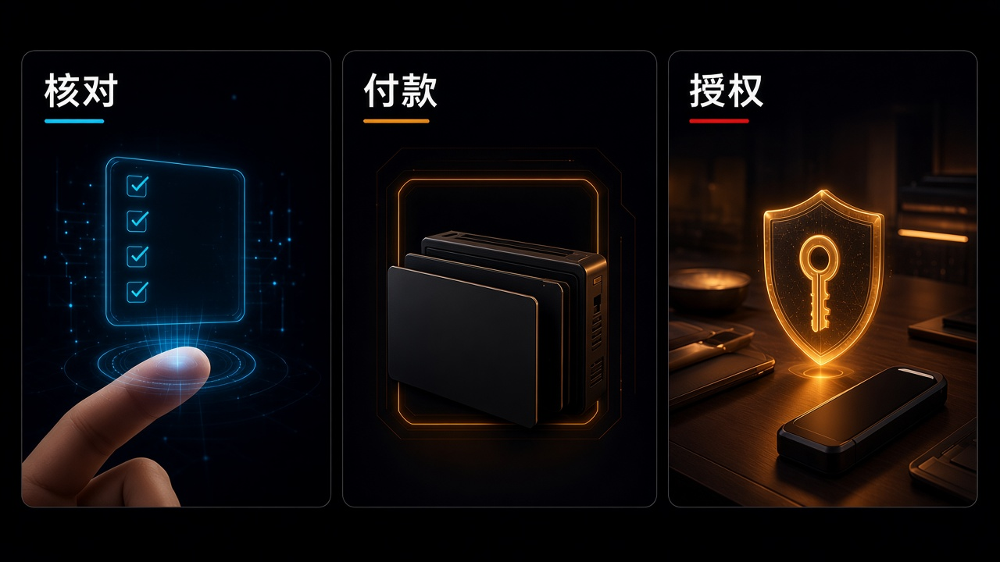

> 先说明一下：素材是我借助 AI 收集整理的，时间都按北京时间。写着「据 X 摘要」的，是 X 平台自动生成的新闻摘要，我暂时没找到一手来源，大家看的时候打个折。每条后面关于行业、公司、赚钱机会的判断都是我个人的看法，不是事实，更不是投资建议。教程视频都是网上公开的，标了「同类操作参考」的，讲的是同一类操作，不是针对这款新产品本身。

## 今天最值得看的几件事

- **头条：OpenAI × ChatGPT Wallet**——官方称之为首个让智能体付款时不必拿到用户真实卡号、且每笔都要安全校验的钱包，并保留符合条件的卡片奖励与争议保护。与 American Express、Mastercard、Visa 合作搭建。用户先添加一张卡，每笔购买前核对商品、金额和所用卡，再用 Face ID 或指纹等完成校验，随后由支付网络出具支付 token（含卡号、安全码与有效期）完成扣款；官方称不会把真实卡号交给商家或智能体。即日起在 dots 中开始滚动推出，初期面向美国 **18** 岁及以上、持符合条件美国发卡的 ChatGPT Pro 订阅者。帮助中心补充：目前用在与 dot 的对话里，不在 Chat、Work 或独立 Codex 线程中提供；借记卡与虚拟卡在上线时不受支持。同期发布 Commerce Partner Playbook，面向商家的商品馈送、Web Bot Auth 和风控协作。
- **紧随其后：Google Wallet 接入 Gemini 应用**——官方称面向美国境内所有 Gemini 应用用户，在 Personal Intelligence 的 Connected Apps 下连接 Wallet，也可选择通过 Plaid 关联银行或卡片，对话里用 @Google Wallet 调用。官方举例包括现金流与资产配置图表、可能被忘掉的订阅，以及按去年礼品与出行做节日预算；网页与移动端、Android 与 iOS 均可。官方明确：Gemini 只能读取账户信息，不能转移、管理或投资资金；需主动开启，也可随时关闭。同一篇官方博还介绍 Memory Summary，可在 Profile > Personal Intelligence > Memory Summary 查看和编辑 Gemini 记住的内容。这是只读的财务洞察，不要和上面的 ChatGPT Wallet 混成同一款付款产品。
- **协议与隐私轨，都还要看清边界**——Sierra 发布 Personal Agent Protocol（简称 Poppy）v1.0，官方称协议现已可用，Shopify 已为平台上每一家商户启用（官方称 Shopify 在 **175** 个以上国家/地区开展业务，店铺会自动发布 Poppy 文件），Meta 的 Muse 会在访问网站时优先查找 Poppy；规范站仍标注为 Draft **1.0**，不要写成已冻结的最终标准。Solana Foundation 与 Nito 推出 Solana Confidential Compute，在链上核验机密计算硬件证明，官方写明目前只在开发网提供未审计测试版，NVIDIA GPU 证明尚在开发，不要写成已上主网或已通过审计的隐私方案。
- 另有：DeepSeek 把 App 背后的搜索、文件、链接、安全检查与语音等能力经 API 开放，面向公众的应用必须打开安全检查；ggml-org 发布 llama.cpp v1.0.0 与 ggml v1.0.0，这是公共 C API / ABI 稳定性里程碑，GitHub Release 已在昨窗出现、今天按官方博补录；GitHub 宣布 Gemini 4 Hydrogen 已在 GitHub Copilot 正式可用，这是新的官方分发渠道，不是 GitHub 自研新模型；Cloudflare 以 Apache **2.0** 开源实验性、面向智能体的无状态浏览器引擎 Kitesurf；Google AI Pro / Ultra 订阅者可在 Google AI Studio 内领取 Cloud Credits 用于 Gemini API；Bland 放出面向高风险通话的全双工语音到语音模型 Tofu-1 研究预览，只向有限数量企业客户开放申请。论文与实践侧：Google Research 介绍 Antigravity /teamwork 进展，并开放约 **1 万**名学术研究者申请最高用量档六个月免费使用；Anthropic 发布安全评测实践指南，强调安全评测测的是造成或加剧伤害的倾向，而不是能力得分。
- YC：Apply 仍 Winter **2027** late（准时截止 **November 2** 晚上 8 点 PT 已过，截止前递交约 **December 11** 前出结果，其后仍接受迟到申请但不承诺回复时间）。F26 Demo Day 仍 **Wednesday, December 2nd**。笔记末轮核验约北京时间 **17:15**（Asia/Shanghai），`launches.json` 过夜新上架票数仍低于既有单列门槛，不写成新产品头条。

## 模型发布

### 1. Bland Tofu-1：面向高风险通话的全双工语音到语音，还是研究预览

@usebland 主帖 UTC **18:03:38 · 11-13** ≈ 北京 **02:03 · 11-14**，创始人 @zaygranet 同窗跟发。Bland 在产品页发布 **Tofu-1**，官方称之为面向高风险通话的全双工语音到语音模型，并开放面向有限数量企业客户的研究预览申请。官方称这是 Bland 语音到语音模型系列的首个版本。

产品页称 Tofu-1 直接听音频，而不是先转成文本；可一边听一边说，也可一边说一边做查找等事务，并尝试区分通话对象与电视、哭闹儿童、车内乘客等其他声源。官方把「电视里清晰的 Yes 会不会被当成呼叫人的确认」称作 TV Test，并写明该情景是示意，而不是实测录音。研究预览面向处理银行、医疗、保险和政府等高风险通话的团队，表单收集工作邮箱与月通话量档，官方称会在名额可用时发邮件。页面没有写公开自助接口，也没有给出延迟、字错率或合规认证。

来源：[Bland·Tofu-1](https://www.bland.ai/speech-to-speech)、[X·@usebland](https://x.com/usebland/status/2121302984802152941)（UTC 2026-11-13 18:03:38 ≈ 北京 02:03）、[X·@zaygranet](https://x.com/zaygranet/status/2121304474178429220)（UTC 2026-11-13 18:09:33 ≈ 北京 02:09）

这不是已经全面开放的电话坐席产品，更像是把「在嘈杂、多人、信号不好的真实通话里听清楚、说清楚」单独拿出来做的一档模型。受益的首先是银行、保险、医疗和政务里已经在用语音坐席、又被误听和误确认折磨过的团队——他们可以按官方表单申请研究预览，用自己的高风险通话场景去试模型在哪能用、在哪会破。付钱的是把示意中的 TV Test 写成已经测过的指标，或以为自己明天就能在生产环境里换上自助接口的人。标「研究预览、名额有限；页面未提供评测数字或合规认证」。

- 银行 / 保险 / 医疗 / 政务里负责语音坐席的人：先读[产品页](https://www.bland.ai/speech-to-speech)和申请表，用工作邮箱按月通话量档提交，等官方发名额邮件，不要默认已经有公开 API。
- 语音或客服产品经理：把「先转写再理解」和「直接听音频」分开看，重点评估它如何区分通话对象与背景人声，而不是先看演示里的语气有多像人。
- 普通用户：这不是面向个人的新语音助手，今天没有可以自己开通的入口。

教程：以[官方产品页](https://www.bland.ai/speech-to-speech)为准。页面有官方示意说明和样例音频，但 TV Test 被写明不是实测录音。本条未核到成熟官方跟练片。

## 工具与产品

### 2. OpenAI ChatGPT Wallet：智能体可以代付，但每笔仍要你先核对（头条）

OpenAI 官方博 `pubDate` UTC **15:00:00 · 11-13** ≈ 北京 **23:00 · 11-13**（OpenAI News RSS `lastBuildDate` 同步改为 UTC **23:17:24**）宣布推出 **ChatGPT Wallet**。官方称之为首个让智能体付款时不必拿到用户真实卡号、且每笔都要安全校验的钱包，并保留符合条件的卡片奖励与争议保护。官方称与 American Express、Mastercard、Visa 合作搭建。

购买流程按官方博是这样走的：用户先添加一张卡；每笔购买前核对商品、金额和所用卡，再用 Face ID 或指纹等完成安全校验；随后由支付网络出具支付 token（含卡号、安全码与有效期）完成扣款。官方称不会把真实卡号交给商家或智能体。官方同时写明，用户仍与商家直接交易，商家保留客户关系以及对定价、履约、退货和客服的控制；银行卡组织则继续参与交易评估。官方还提到，未来希望用户可以按支出限额、品类或时间段预先授权智能体代购，并在今天的生物识别和授权记录之上再加保护——这是官方对后续的设想，不是现在已经开放的能力。

可用性要按官方口径来读，不要写成全球或已经进入普通 Chat 会话。官方博写：即日起在 dots 中开始滚动推出，初期面向美国 **18** 岁及以上、持符合条件美国发卡的 ChatGPT Pro 订阅者，以便从真实使用中学习并改进兼容性。帮助中心补充：Wallet 目前用在与 dot 的对话里，使用前先设置好 dot；不在 Chat、Work 或独立 Codex 线程中提供；校验需在受支持设备上做 Face ID 或 Touch ID 等生物识别；符合条件的卡包括美国发行的 American Express、Chase、Mastercard 与 Visa，须年满 **18** 岁、居住在美国且卡片为美国账单地址；Chase 卡须为主卡持有人而非附属卡；银行可能在绑卡时要求验证。帮助中心还写明：借记卡不受支持，上线时虚拟卡也不受支持（这与批准后 Wallet 用来完成结账的支付 token / 虚拟卡号不是一回事）；Wallet 里保存的卡，和 ChatGPT 订阅支付方式、礼品卡或预付余额不是同一套东西。帮助中心提醒：即便你是符合条件的美国 Pro 用户，也可能还没轮到；「Ready to check out」只表示你的批准已完成，并不确认商家已经下单。窗内 `from:OpenAI` 原帖为 **0**，以官网博为准。IT之家约 UTC **15:49:08** ≈ 北京 **23:49 · 11-13** 跟进。昨已录 dots 自定义指令，本条是新的支付产品，不并入该条。

同期发布 [Commerce Partner Playbook](https://developers.openai.com/commerce/guides/overview)，覆盖三件事：在 ChatGPT 认领商家并上传含现价与库存的商品馈送；用 Web Bot Auth 让 CDN 或防火墙识别已签名的 ChatGPT 请求；以及与风控、支付服务商协作减少误拒。官方点名反欺诈合作方 Forter、Riskified、Sardine、Signifyd，支付服务商 Adyen、Checkout.com、Stripe；商家也可构建插件，或在网站加入 WebMCP 工具。官方博没有写 Wallet 对用户的手续费或卡组织分成，本稿也不发明这些数字。

来源：[OpenAI·Introducing ChatGPT Wallet](https://openai.com/index/introducing-chatgpt-wallet/)（RSS `pubDate` UTC 2026-11-13 15:00:00）、[Developers·Partner Playbook Overview](https://developers.openai.com/commerce/guides/overview)、[Help Center·Making purchases with ChatGPT Wallet](https://help.openai.com/en/articles/20001654-making-purchases-with-chatgpt-wallet)、[ChatGPT Wallet terms](https://openai.com/policies/chatgpt-wallet-terms/)、[IT之家](https://www.ithome.com/1/026/994.htm)（`pubDate` UTC 15:49:08）、[HN 50484640](https://news.ycombinator.com/item?id=50484640)

这是把「智能体帮你找商品、比方案」往前推到「在你点头之后，用支付 token 替你完成扣款」的一步，不是一张新的储值账户，也不是已经铺开的全球结账入口。受益的是已经在用 dots、符合美国 Pro 与符合条件发卡条件、愿意逐笔核对的人，以及需要让自己的网站和风控系统识别智能体下单的商家——Playbook 里的商品馈送、Web Bot Auth 和 Forter / Riskified / Stripe 这类合作，比再写一句「AI 能买东西了」更具体。付钱的是以为普通 Chat 会话里已经能代付、把官方设想中的预先授权当成现在就能用的功能，或把卡号直接打进对话里的人。帮助中心把订单问题指向商家，把拒付、未识别扣款指向发卡行，把 Wallet 流程故障指向 OpenAI Support，这个责任切分值得先看清楚。标「初期仅美国 Pro + 符合条件美国信用卡 + dots；借记卡与虚拟卡不受支持；官方未公布对用户的手续费；『Ready to check out』不等于商家已下单」。

- 符合条件的美国 ChatGPT Pro 用户：先读[官方博](https://openai.com/index/introducing-chatgpt-wallet/)和[帮助中心](https://help.openai.com/en/articles/20001654-making-purchases-with-chatgpt-wallet)，确认自己已经有 dot、卡片是否在支持名单里（Chase 须为主卡持有人），再在安全表单里绑卡，卡号、安全码不要打进聊天；每笔都核商家、商品、总额、所用卡以及是否有循环扣款条款，再用生物识别批准。
- 商家 / 支付与风控团队：按 [Partner Playbook](https://developers.openai.com/commerce/guides/overview) 检查商品馈送、CDN / 防火墙是否误拦已签名的 ChatGPT 请求，以及现有风控会不会把合法的智能体购买直接拒掉；可与官方点名的 Forter、Riskified、Sardine、Signifyd，或 Adyen、Checkout.com、Stripe 核对他们如何识别这类交易。
- 还不符合条件，或人在美国以外的人：先把官方流程和责任切分看明白即可，不要为了试用去改账单地址或找非官方「开通教程」。条款也写了，批准前要核对细节，因为 AI 系统可能出错。

教程：以[官方介绍](https://openai.com/index/introducing-chatgpt-wallet/)、[帮助中心](https://help.openai.com/en/articles/20001654-making-purchases-with-chatgpt-wallet)和 [Wallet 条款](https://openai.com/policies/chatgpt-wallet-terms/)为准。帮助中心就是官方操作说明：可对 dot 说 “Help me add a card to Wallet”，或在移动端 Settings > Wallet > Add Card，只在安全表单里填卡号。本条未核到成熟官方跟练片。

### 3. Google Wallet 接入 Gemini 应用：美国用户可只读看账单，同一篇还发布了 Memory Summary

Google 官方博 `datePublished` UTC **17:00:00 · 11-13** ≈ 北京 **01:00 · 11-14** 宣布，把 Google Wallet 接入 Gemini 应用，供用户查看现金流、资产配置和预算，并可按去年礼品与出行记录做节日预算。@Google 主帖 UTC **17:27:13** ≈ 北京 **01:27**，并另发隐私说明帖。IT之家北京 **14:57:17 · 11-14** 跟进同一官方能力，并入本条。

官方称面向美国境内所有 Gemini 应用用户，当天起滚动推出；在 Personal Intelligence 的 Connected Apps 下连接 Wallet，也可选择通过 Plaid 把信用卡或银行账户关联到 Wallet，以获得更细的洞察。对话里用 @Google Wallet 调用。官方举例包括：让 Gemini 在聊天里生成现金流、资产配置和预算的动态图表；查找可能被忘掉的订阅并标出涨价；按去年礼品与出行推今年的节日预算。网页与移动端、Android 与 iOS 均可。官方明确：如果你选择连接 Wallet，Gemini 只能读取账户信息，不能转移、管理或投资资金；功能需主动开启，也可随时关闭。不要把这条写成全球上线，更不要写成 Gemini 已经能代为付款或操盘。它和同窗的 ChatGPT Wallet 是两家公司、两套账户、两种能力，不能混成同一产品。

同一篇官方博还介绍 **Memory Summary**：可在 Profile > Personal Intelligence > Memory Summary 查看和编辑 Gemini 记住的偏好、兴趣和进行中的目标，官方称在网页与移动端、在 Personal Intelligence 可用的地区向 Gemini 应用用户提供。它不是一条独立的产品发布，所以放在本条里一起记。

来源：[blog.google·Google Wallet in the Gemini app](https://blog.google/innovation-and-ai/products/gemini-app/google-wallet-gemini-app/)（`datePublished` 2026-11-13T17:00:00+00:00）、[X·@Google](https://x.com/Google/status/2121293823837921433)（UTC 2026-11-13 17:27:13 ≈ 北京 01:27）、[X·@Google 隐私说明](https://x.com/Google/status/2121293826908197347)、[IT之家](https://www.ithome.com/1/027/141.htm)（北京 **14:57:17 · 11-14** ≈ UTC **06:57:17**）

这是「让模型看你的消费记录，帮你做预算和找订阅」，不是「让模型动你的钱」。对已经在用 Gemini、人在美国、愿意把 Wallet 或经 Plaid 关联的账户只读授权出去的人，它可能先有用在对账、找忘记取消的订阅、做一季预算这些事上；对财务、订阅管理和个人理财工具来说，竞争点会从「再做一个记账 App」转到「你是否愿意把账单上下文交给已经在用的助手」。付钱的是把它当成转账或投资入口，或默认中国和其他地区账号今天已经能打开同一开关的人。连接之前，仍要自己判断：只读不等于没有隐私取舍，官方写了可以随时关闭。标「仅美国 Gemini 应用用户；只读；Memory Summary 在 Personal Intelligence 可用地区提供」。

- 人在美国、已在用 Gemini 应用的人：若决定试用，到 Personal Intelligence 的 Connected Apps 下连接 Google Wallet，再在对话里用 @Google Wallet 按官方举例问现金流、订阅或节日预算；数字先和自己的银行或卡片账单核对一遍再做决定。不需要关联银行的，可以先只连 Wallet。
- 想看模型记住了什么的人：到 Profile > Personal Intelligence > Memory Summary 查看、修改或删除条目；这在 Personal Intelligence 可用的地区提供，不限于今天这条 Wallet 功能本身。
- 人在美国以外，或还不想授权账单数据的人：不必强行找开关。先读官方博，把「只读问答」和「代付」分开即可。

教程：以[官方博](https://blog.google/innovation-and-ai/products/gemini-app/google-wallet-gemini-app/)为准。连接路径是 Personal Intelligence 设置里的 Connected Apps，调用方式是对话里的 @Google Wallet。本条未核到成熟官方跟练片。

### 4. Google Cloud Credits 可在 AI Studio 内领取，面向 Pro 与 Ultra

Google 官方博 `datePublished` UTC **20:30:00 · 11-13** ≈ 北京 **04:30 · 11-14**，作者 Bala Muthukrishnan、Seth Odoom，宣布 Google Developer Program 的 Cloud Credits 现可在 Google AI Studio 内完成开户、领取并用于 Gemini API，不必离开该工作区。官方称面向 Google AI Pro 与 Ultra 订阅者；创建或兑换额度时，若还没有 Developer Program 档案，新流程可能会自动建立一份。官方还写明：只有主订阅者可以使用这些额度，不能在家庭成员之间分享。

具体每月额度以[官方指南](https://aistudio.google.com/learn/use-google-ai-plan-credits-in-ai-studio)为准。该指南（页内更新于 **November 3, 2026**）写明：Google AI Plus 不含此项；Google AI Pro 为每月 **$10**；Google AI Ultra 5x 为每月 **$40**；Google AI Ultra 20x 为每月 **$100**。每笔月度额度自发放起有效 **12** 个月，可按月累积。官方博与指南都写明，使用带 Cloud billing 的 Gemini API 需要至少 **$5** 的最低预付并保持余额，才能支用促销额度；指南补充，促销额度会先于预付余额被使用，但预付余额需保持高于 **$0**。不要把免费档或 Plus 写成已经包含这项额度，也不要把 Google One 面向消费者的 AI 积分当成 AI Studio 可用的同一套积分——指南写明那是另一套，不受 AI Studio 支持。

来源：[blog.google·Claim your Google Cloud Credits in Google AI Studio](https://blog.google/innovation-and-ai/technology/developers-tools/google-cloud-credits-gdp-ai-studio/)（`datePublished` 2026-11-13T20:30:00+00:00）、[官方指南·Use your Google AI plan credits in AI Studio](https://aistudio.google.com/learn/use-google-ai-plan-credits-in-ai-studio)

这是给已经在付 Pro / Ultra 的人少跑几个页面的领取流程，不是新发布了一档免费 API。受益的是已经在 AI Studio 里跑 Gemini API、配额不够时还要跳出工作区去开账单和领额度的开发者；额度按档位不同，先看自己的方案是 Pro、Ultra 5x 还是 Ultra 20x。付钱的是以为免费用户或 Plus 也有同一笔月度 Cloud Credits，或把 **$5** 预付理解成「再充一次就送很多额度」的人。标「仅 Pro / Ultra；月度数字以官方指南为准；需 **$5** 最低预付」。

- 已是 Google AI Pro 或 Ultra 主订阅者的开发者：打开 [Google AI Studio](https://aistudio.google.com/) ，按官方博在工作区内领取并绑定账单，再到 [Billing](https://aistudio.google.com/billing) 确认余额；预付至少 **$5**，并确认自己是主订阅者。
- 还在免费档或 Plus 的人：先对照[官方指南](https://aistudio.google.com/learn/use-google-ai-plan-credits-in-ai-studio)的档位表，不要按这篇博文去找一笔并不存在的月度额度。
- 做团队采购的人：额度不能在家庭成员间分享，企业或多人共用前先读官方说明，不要默认「一个人订了，全组都能花」。

教程：以[官方博](https://blog.google/innovation-and-ai/technology/developers-tools/google-cloud-credits-gdp-ai-studio/)和[官方指南](https://aistudio.google.com/learn/use-google-ai-plan-credits-in-ai-studio)为准。指南里有从注册方案、登录 AI Studio、预付 **$5** 到在 Developer Program 权益页应用额度的步骤。本条未核到成熟官方跟练片。

### 5. DeepSeek：App 背后的搜索、文件、链接、安全检查和语音，现已通过 API 提供

官方文档新闻页与 @deepseek_ai 主帖 UTC **14:24:44 · 11-13** ≈ 北京 **22:24 · 11-13**（四连帖）宣布，App 背后的搜索、文件、链接、安全检查与语音等能力现已通过 API 提供，可在请求里打开内置工具，也可单独调用 OCR、ASR、TTS。IT之家约 UTC **14:29:06** ≈ 北京 **22:29 · 11-13** 跟进。

官方称 V4.1-Flash（`deepseek-flash`）在 Messages、Responses、Chat Completions 上均支持这些能力，工具调用与上下文拼装在服务端完成。内置工具包括：Web Search（非思考模式下可检索网页或图片并带引用）、Deep Thinking Search（多步推理中检索并阅读页面）、File Input（把 PDF、Office、图片等解析进对话上下文）、URL Reading（自动抓取用户消息里的链接）、Safety Checks（筛输入与输出，发现风险时返回拒绝指示）。开启搜索用 `deepseek_web_search`，读链接用 `deepseek_read_url`。面向公众的应用必须打开安全检查，官方并称开发者仍须自行负责内容审核、适用的模型备案与 AI 生成内容标注。Search、Fetch、OCR、ASR、TTS 也可作独立 API。官方提供前端演示 https://cdn.deepseek.com/chat-demo 、代码 https://github.com/deepseek-ai/chat-demo 与指南 https://api-docs.deepseek.com/guides/build_a_chatbot 。

官方称扩展能力在常规 token 费用之外另收工具调用费，明细见[官方定价页](https://api-docs.deepseek.com/quick_start/pricing/)。新闻页价目表以页面图表呈现，本稿不转写可能看错的数字，以定价页当时展示为准。不要把「完整 App 体验」写成已经免费捆绑进基础 token 价。

来源：[DeepSeek API Docs·The full DeepSeek App experience, now via API](https://api-docs.deepseek.com/news/news261113/)、[定价页](https://api-docs.deepseek.com/quick_start/pricing/)、[X·@deepseek_ai](https://x.com/deepseek_ai/status/2121247896918253875)（UTC 2026-11-13 14:24:44 ≈ 北京 22:24；后续 2121247899699036516 / 2121247903603941471 / 2121247907076813077）、[IT之家](https://www.ithome.com/1/026/960.htm)（`pubDate` UTC 14:29:06）

这是把已经在 App 里跑通的搜索、读文件、读链接、安全检查和语音，拆成开发者可组合的接口，而不是又发了一个只能聊天的模型。受益的是要在自己的产品里复现接近 DeepSeek App 能力、又不想从零拼检索和解析流水线的团队；公众应用必须打开安全检查，这一条不要当成可选项。付钱的是忽略工具调用费、或把官方演示仓库直接上生产却关掉安全检查的人。标「公众应用必须启用 Safety Checks；工具费以官方定价页为准，本稿不转写价目表数字」。

- 已有 DeepSeek API 密钥的开发者：用 `deepseek-flash` 按[新闻页](https://api-docs.deepseek.com/news/news261113/)打开 `deepseek_web_search` 或 `deepseek_read_url`，对照[定价页](https://api-docs.deepseek.com/quick_start/pricing/)看工具调用费；若应用面向公众，先打开安全检查。
- 要做对话产品的人：可先跑官方 [chat-demo](https://cdn.deepseek.com/chat-demo) 和 [GitHub 代码](https://github.com/deepseek-ai/chat-demo)，再按[构建指南](https://api-docs.deepseek.com/guides/build_a_chatbot)改自己的前端，不要假设「完整 App 体验」已经含在基础 token 费里。
- 做合规或内容安全的人：把官方写明的安全检查、内容审核、模型备案和 AI 生成内容标注一起写进检查清单，缺一不要只靠模型自己「看起来安全」。

教程：以[官方新闻页](https://api-docs.deepseek.com/news/news261113/)、[构建指南](https://api-docs.deepseek.com/guides/build_a_chatbot)和 [chat-demo](https://github.com/deepseek-ai/chat-demo) 为准。本条未核到针对此次内置工具开放的成熟官方跟练片。

### 6. llama.cpp v1.0.0 与 ggml v1.0.0：本地推理库的稳定性里程碑（补录）

Hugging Face 博 `pubDate` UTC **14:05:22 · 11-13** ≈ 北京 **22:05 · 11-13**，ggml-org 发布 **llama.cpp v1.0.0** 与 **ggml v1.0.0**，官方称之为本地 AI 生态的更稳固基础，并承诺此后公共 C API / ABI 不兼容会走主版本号升级。GitHub Release 标签 v1.0.0 已在昨窗下午出现（`created_at` UTC **10:59:41 · 11-13** ≈ 北京 **18:59**），因未常扫 ggml-org 发版页而漏录，今天按官方博补录，仍作为本日条目来写。IT之家北京 **08:14 · 11-14** 跟进。

官方称 `libllama` 对应 llama.cpp v1.0.0（头文件在 `llama.cpp/include/`），`libggml` 对应 ggml v1.0.0（头文件在 `ggml/include/`）。语义化版本规则为：MAJOR 表示 `./include` 中公共 C API 的破坏性变更，MINOR 为向后兼容的功能、后端更新、模型支持或 API 新增，PATCH 为不改 API 的缺陷修复。官方还列出预发布构件、Docker、Debian、Homebrew、conda-forge、MacPorts、Winget、XCFramework 等分发渠道，并称目前支持 **150** 种以上架构变体及主流推测解码方法。不要把这次写成推理速度或新模型支持的一次大升级，官方强调的是 API / ABI 稳定性。官方博没有给出新的基准数字，本稿也不发明。

来源：[HF Blog·llama.cpp v1.0.0](https://huggingface.co/blog/ggml-org/llama-cpp-v1)（`pubDate` UTC 2026-11-13 14:05:22）、[GitHub Release v1.0.0](https://github.com/ggml-org/llama.cpp/releases/tag/v1.0.0)、[HN 50481715](https://news.ycombinator.com/item?id=50481715)、[IT之家](https://www.ithome.com/1/027/019.htm)（`pubDate` UTC 2026-11-14 00:14:06 ≈ 北京 08:14）

对已经把 llama.cpp 嵌进产品、安装包或内部工具链的人，这比又多支持一个模型更要紧：以后看到主版本号上涨，就该按破坏性变更来回归公共 C API。受益的是本地推理框架、桌面客户端和要做稳定打包的发行方；官方点名的 Docker、Debian、Homebrew、conda-forge、Winget 等渠道，会是下游跟版的入口。付钱的是以为 v1.0.0 保证了更快的 decode，或跳过发行说明直接把旧的私有头文件依赖搬进新大版本的人。标「稳定性里程碑；**150** 种以上架构变体为官方自述；无新的官方基准数字」。

- 已经在产品里链接 `libllama` / `libggml` 的工程师：对照[官方博](https://huggingface.co/blog/ggml-org/llama-cpp-v1)和 [Release v1.0.0](https://github.com/ggml-org/llama.cpp/releases/tag/v1.0.0) 检查自己是否只依赖 `include/` 里的公共 C API，并把版本约束改成按 MAJOR 处理不兼容。
- 用包管理器安装的人：按自己平台从 Docker、Debian、Homebrew、conda-forge、MacPorts、Winget 或 XCFramework 等官方列出的渠道更新，先看发行说明再升。
- 只是在本机跑模型的爱好者：不必为了「1.0」这个数字立刻重装；若要升，把它当成一次基础库升级来回归，而不是一次性能发布。

教程：以 [HF 官方博](https://huggingface.co/blog/ggml-org/llama-cpp-v1) 和 [GitHub Release](https://github.com/ggml-org/llama.cpp/releases/tag/v1.0.0) 为准。本条未核到针对 v1.0.0 的成熟官方跟练片。

### 7. Gemini 4 Hydrogen 已在 GitHub Copilot 正式可用：新的分发渠道，不是新模型

@github 主帖 UTC **19:10:02 · 11-13** ≈ 北京 **03:10 · 11-14**，GitHub Changelog 同日条目标题为 Gemini 4 Hydrogen in GitHub Copilot。官方称 Gemini 4 Hydrogen——GitHub 把它写作 Google 最新的 Flash 模型——已在 GitHub Copilot 正式可用（generally available），面向快速、高效的智能体编码、工具使用与多步工作流，并称指令遵循相对 Gemini 3.8 Flash 有改进。昨已录 Hydrogen 的官方可用范围（AI Studio、Gemini API、Gemini 应用、Search、Antigravity、Sheets 等）未写 Copilot，本条只记这条新的官方分发渠道，不回改 **11-13** 原帖，也不把它写成 GitHub 自研新模型。

官方 Changelog 写明：该模型在用量计费下按提供商目录价计费，明细见 [Models and pricing for GitHub Copilot](https://docs.github.com/en/copilot/reference/copilot-billing/models-and-pricing)。我核到的官方价目为每百万 token 输入 **$1.50**、缓存输入 **$0.075**、输出 **$7.50**；用量会折成 GitHub AI Credits，官方写明 **1** AI credit = **$0.01** USD。可用方案为 Copilot Pro、Pro+、Max、Business 与 Enterprise。可在模型选择器中使用的表面，官方列出 Visual Studio Code、Visual Studio、Copilot CLI、GitHub Copilot coding agent、GitHub Copilot 应用、github.com、GitHub Mobile（iOS 与 Android）、JetBrains IDE、Xcode、Eclipse 与 Copilot SDK；@github 主帖当时点名的是 Copilot 应用、CLI 与 VS Code，完整名单以 Changelog 为准。官方写明将逐步推出，若暂时看不到可稍后再查。Copilot Enterprise 与 Business 的管理员可通过 Copilot 设置中的模型策略管理访问；在默认模型启用下，新模型会自动打开，除非管理员关闭了全局默认或单独禁用该模型。不要把尚未出现在官方名单里的 Free 方案写成已经可选手动切换 Hydrogen。

来源：[GitHub Changelog·Gemini 4 Hydrogen in GitHub Copilot](https://github.blog/changelog/2026-11-13-gemini-4-hydrogen-in-github-copilot/)、[Docs·Models and pricing](https://docs.github.com/en/copilot/reference/copilot-billing/models-and-pricing)、[X·@github](https://x.com/github/status/2121319695626518823)（UTC 2026-11-13 19:10:02 ≈ 北京 03:10）

这是把昨天已经讲过的 Hydrogen，接到许多开发者每天已经打开的 Copilot 里，而不是又一次模型发布。受益的是已经在付费 Copilot 方案里写代码、希望把日常智能体编码和多步工作流换成更快一档 Google 模型的人；计费按提供商目录价走 AI Credits，先看自己的方案余额和管理员策略。付钱的是把它当成 GitHub 训练的新模型，或以为所有 Copilot 表面、所有方案今天都已经能选到的人。标「逐步推出；价目为官方文档当时数字；不回改 11-13 对 Hydrogen 本身的介绍」。

- 已有 Copilot Pro / Pro+ / Max，或所在组织为 Business / Enterprise 的开发者：在官方列出的表面打开模型选择器，看 Hydrogen 是否已经出现；若没有，按官方所说稍后再查，同时确认用量计费和 AI Credits 余额。
- Copilot Business / Enterprise 管理员：先检查模型策略是否关闭了默认启用，再决定是否对组织打开 Gemini 4 Hydrogen。
- 只用 Copilot Free，或还没有该模型入口的人：不要把这条写成一次全量免费升级；以 Changelog 和官方价目页为准。

教程：以 [Changelog](https://github.blog/changelog/2026-11-13-gemini-4-hydrogen-in-github-copilot/) 和 [Models and pricing](https://docs.github.com/en/copilot/reference/copilot-billing/models-and-pricing) 为准，在已支持的表面用模型选择器切换即可。本条未核到针对 Copilot 中 Hydrogen 的成熟官方跟练片。

### 8. Cloudflare 开源 Kitesurf：给智能体用的实验性无状态浏览器引擎

Cloudflare 官方博 `datePublished` UTC **20:20:21 · 11-13** ≈ 北京 **04:20 · 11-14** 宣布，把实验性、面向 AI 智能体的无状态浏览器引擎 **Kitesurf** 以 Apache **2.0** 开源，并可部署到开发者自己的 Cloudflare Workers 账号。IT之家北京 **18:06:01 · 11-14** 跟进，并入本条。

官方称 8 月首次介绍，9 月跟进 WebMCP、新 API 与兼容性时已承诺开源，现已把代码放到 GitHub。Kitesurf 在 Workers 上解析 HTML、应用 CSS、执行页面 JavaScript 并渲染截图，无需浏览器容器；支持 Chrome DevTools Protocol（CDP），可连接 Puppeteer 等客户端。官方目标是给智能体一个更轻的浏览器，使其 CPU 和内存占用低于完整的 Chromium，并可按需在 Workers 全球网络上扩展。仓库还用到编译为 WebAssembly 的开源 Rust 组件（Blitz、Stylo、Boa、Linebender、Krilla 等，第三方程式声明见 `NOTICE`）；Boa 仅在无法于 Dynamic Workers 中运行页面 JavaScript 时作为后备。本地可 `pnpm run dev`，由 wrangler 在 `http://127.0.0.1:8787` 起开发服务；部署到自己的账号用 `pnpm run deploy`，官方称因使用 Dynamic Workers 为页面创建隔离 Workers，需要 Workers Paid 方案。官方同时提醒项目仍在密集开发，当前重点是兼容性、可靠性与效率。不要写成已经完成的通用浏览器替代品，也不要发明具体性能数字或托管 API 定价。

来源：[Cloudflare Blog·Kitesurf is now open source](https://blog.cloudflare.com/kitesurf-open-source/)（`datePublished` UTC 2026-11-13 20:20:21）、[GitHub·cloudflare/kitesurf](https://github.com/cloudflare/kitesurf)、[IT之家](https://www.ithome.com/1/027/197.htm)（北京 **18:06:01 · 11-14** ≈ UTC **10:06:01**）

对要给智能体上网、又不想在每台机器上拉起完整 Chromium 容器的人，这是一条可以自己部署、自己改的实验轨道。受益的是已经在用 Cloudflare Workers、Puppeteer 或 CDP 的智能体基础设施团队；官方目标是更轻、可随 Workers 网络扩展，但项目仍标明在密集开发。付钱的是把它当成生产级通用浏览器、或在免费 Workers 方案上直接 `deploy` 却没注意到官方要求 Paid 的人。标「实验性；Apache **2.0**；自部署需 Workers Paid；无官方性能数字」。

- 已经在用 Workers、想给智能体接浏览器的开发者：按[官方博](https://blog.cloudflare.com/kitesurf-open-source/)和 [GitHub 仓库](https://github.com/cloudflare/kitesurf) 先在本地 `pnpm install --frozen-lockfile` 再 `pnpm run dev`，用 Puppeteer 连 `ws://127.0.0.1:8787/devtools/browser` 跑通一次截图；部署前确认自己的账号是 Workers Paid。
- 浏览器或自动化工程师：把它当成实验引擎来看 Web 平台兼容性和 CDP 行为，不要假设所有站点、所有 JS 特性已经齐。
- 还没有 Workers 账号，只是在找「更轻的无头浏览器」的人：先读官方博对「实验性、仍在密集开发」的提醒，再决定要不要为这次开源去开付费方案。

教程：以[官方博](https://blog.cloudflare.com/kitesurf-open-source/)和仓库说明为准，官方博里有本地启动和 Puppeteer 连接示例。本条未核到成熟官方跟练片。

### 9. Solana Confidential Compute：链上核验机密计算证明，目前只在开发网、且未审计

Solana Foundation 官方博署 **13 November 2026**，@SolanaFndn 主帖 UTC **16:07:24 · 11-13** ≈ 北京 **00:07 · 11-14**，宣布与 Nito 推出 **Solana Confidential Compute**：一套在 Solana 链上核验机密计算硬件证明的开源 SDK 与链上核验程序，目前在开发网提供未审计的测试版。

官方称 AI 计算在链下进行，链上只保存核验记录，不必公布对话或私有输入。测试版支持 Intel TDX 与 AMD SEV-SNP 证明，NVIDIA GPU 证明尚在开发。官方点名 Nito 把它用到私有 AI 平台（含端到端加密的 Confidential Chat），并举例预测市场或保险理赔的 AI 裁定、交易智能体下单前核验、治理决定等。工作流程按官方博是：机密虚拟机内生成只存在于该硬件中的签名密钥，硬件签署把该密钥绑定到最近 Solana 槽位的报告，链上程序核验后记录密钥、硬件类型和有效期，机器再用该密钥签署输出，接收方可以查链上记录。官方明确尚未完成安全审计，目前只适合开发用途；官方同时写了 mainnet coming soon，但没有公布具体时间。不要写成已上主网或已通过审计的隐私方案，也不要发明费用或性能数字。

来源：[Solana AI·Solana Confidential Compute: Private AI, Verified Onchain](https://solana.ai/blog/nito-solana-confidential-compute)（13 November 2026）、[X·@SolanaFndn](https://x.com/SolanaFndn/status/2121273734237475051)（UTC 2026-11-13 16:07:24 ≈ 北京 00:07）、[Solana AI·Confidential Compute 产品页](https://solana.ai/confidential-compute)

这是「证明计算发生在可信硬件里，并把核验结果放到链上可查」，不是已经做好的支付轨道，也不是把模型本身搬上了链。对预测市场、保险裁定、交易智能体和治理场景来说，方向是清楚的：不想公开对话或私有输入，又希望对手方能检查这份输出是否来自通过核验的环境。但它今天仍是未审计的开发网测试版，NVIDIA GPU 证明还在开发，不能当成已经可上生产的隐私基础设施。标「开发网、未审计；主网时间未公布；勿发明费用或性能数字」。

- 已经在 Solana 上做智能体或链下 AI 的开发者：先读[官方博](https://solana.ai/blog/nito-solana-confidential-compute)和[产品页](https://solana.ai/confidential-compute)，只在 devnet 上试 SDK 与核验程序，不要接到主网或真实资金流。
- 做预测市场、保险科技或交易系统的人：可以把「链下计算、链上保存核验记录」当成一种架构选项来评估，但要把「未审计、GPU 证明未完成」写进风险清单。
- 普通用户：没有需要今天去开通的消费产品；Confidential Chat 若出现在演示里，也按开发中的能力来看，不要存入不能损失的信息。

教程：以[官方博](https://solana.ai/blog/nito-solana-confidential-compute)和[产品页](https://solana.ai/confidential-compute)为准。本条未核到成熟官方跟练片。

### 10. Sierra Poppy v1.0：个人智能体访问商家的协议现已可用，规范站仍是 Draft 1.0

Sierra 官方博 `datePublished` UTC **17:00:00 · 11-13** ≈ 北京 **01:00 · 11-14**（作者 Bret Taylor、Clay Bavor；`dateModified` UTC **22:20:09 · 11-13**），@SierraPlatform 主帖 UTC **17:39:00** ≈ 北京 **01:39**，宣布释放 Personal Agent Protocol（简称 Poppy）v1.0。官方称该协议现已可用；Shopify 已为平台上每一家商户启用；Meta 的 Muse 会在访问网站时优先查找 Poppy；并有多家设计合作方上线。

官方称自上周与 Meta、Genesys、Instinct、NiCE、Rocket、Shopify、Stripe、Walmart 等首批设计合作方宣布该标准以来已有实质进展。v1.0 主要基于企业已有的 MCP、OpenAPI 与 UCP 等标准，并用 OAuth 让用户控制个人智能体可做与不可做的事。官方称 Shopify 在 **175** 个以上国家/地区开展业务，且每家 Shopify 店铺现会自动发布 Poppy 文件，商户不必额外实现；UCP 负责找商品、加购和结账，Poppy 负责智能体到店后表明身份并弄清被允许做什么，Shopify 还与 Sierra 共同撰写了商业扩展。官方称另有 **60** 家新公司加入设计合作，总数超过 **100** 家（名单见官方博，含 Delta Air Lines、Intuit、Salesforce——含 Fin、Commerce Cloud 与 Agentforce——以及 Twilio、Zoom 等）。

已上线能力要按正文分别记，不要把名单上的公司写成同一进度。官方点名：Mercury 可用于查询余额、近期交易、分类支出或更新预算与收据，也可按账户审批策略发起付款或转账；Turkish Airlines 可用于查询票价、航班状态、经停，以及用订票编号和姓氏调出行程，Miles&Smiles 会员还可让智能体查找商务舱升舱并在付款前由用户确认。Synchrony 虽出现在官方博开头「现在上线」的列举里，正文表述是「将把融资与奖励带入智能体购物」，并写明相关工作仍在探索如何在智能体购物中结合支付能力与优惠，不要把它写成与 Mercury、土耳其航空同等的已上线能力。

协议站点的实现套件与规范页仍标注为 Draft **1.0**，changelog 写明该草稿仍在增补、「直到 1.0 发布」。成稿须同时写明：官方博已宣布 v1.0 可用，但规范站仍为 Draft **1.0**，不要写成已冻结、不可再改的最终标准，更不要写成 IETF 标准。

来源：[Sierra·Releasing Personal Agent Protocol 1.0](https://sierra.ai/blog/releasing-poppy)（`datePublished` UTC 2026-11-13 17:00:00 ≈ 北京 01:00）、[X·@SierraPlatform](https://x.com/SierraPlatform/status/2121296788766519431)（UTC 2026-11-13 17:39:00 ≈ 北京 01:39）、[Personal Agent Protocol·specification (draft 1.0)](https://personalagentprotocol.org/docs/1.0/spec)、[Company implementation kit](https://personalagentprotocol.org/company/company)、[The Next Web](https://thenextweb.com/news/sierra-poppy-1-0-shopify-meta-muse-personal-agents)（November 13, 2026, 6:37 pm UTC ≈ 北京 02:37 · 11-14）

智能体要替人到店、查航班、看账户，缺的往往不是再聪明一点的模型，而是一套商家和用户都认的许可协议。Shopify 全量自动发布、Muse 优先查找，意味着这条协议会先出现在已经很大的购物和助手入口上；OAuth 把「智能体被允许做什么」交回用户，是这条消息里比名单更值得看的部分。受益的是 Shopify 商户（不必自己先实现一版）、已经或准备接入 Muse 的站点，以及银行、航司这类需要把查询和写操作分开授权的机构。付钱的是把 Draft **1.0** 当成不可再改的行业标准，或把 Synchrony 的探索写成已经能用的融资能力的人。标「官方博称 v1.0 可用，规范站仍为 Draft **1.0**；Shopify **175** 个以上国家/地区、**60** 家新设计合作方、总数超过 **100** 家均为官方数字」。

- Shopify 商户：先确认自己的店铺是否已自动发布 Poppy 文件，不必急着另写一套协议实现；若有特殊的下单或账户权限，再看 Shopify 与 Sierra 合写的商业扩展。
- 要让个人智能体访问自家网站或 API 的公司：按[实现套件](https://personalagentprotocol.org/company/company)和 [Draft 1.0 规范](https://personalagentprotocol.org/docs/1.0/spec)做分阶段接入，并用官方提供的校验器检查；把 OAuth 范围设计成用户可管理，而不是一次开到底。
- 已经在用 Muse，或会让智能体代查航班、账户的人：先看站点是否声明了 Poppy，以及每次写操作（转账、升舱、付款）前是否还要你确认；不要默认「协议上线了就等于已经替你办完」。

教程：以[官方博](https://sierra.ai/blog/releasing-poppy)、[规范（Draft 1.0）](https://personalagentprotocol.org/docs/1.0/spec)和[实现套件](https://personalagentprotocol.org/company/company)为准。本条未核到成熟官方跟练片。

## 论文与实践

### 11. Google Research：Antigravity /teamwork 向外部开放，约 1 万名学术研究者可申请最高用量档六个月免费

Google Research 研究博署 **November 13, 2026**，作者 Vahab Mirrokni；@GoogleResearch 主帖 UTC **20:54:34 · 11-13** ≈ 北京 **04:54 · 11-14**。官方称外部科研人员与开发者现在可在 Antigravity 与 Deep Review 中使用 Gemini 4 模型配合 /teamwork 与 /boost；同时开放约 **1 万**名学术研究者申请最高用量档六个月免费使用。申请入口见研究博「Opening these tools to the research and developer community」一节给出的[表单](https://forms.gle/WvmBbPvRbpKG1BPn9)。IT之家北京 **14:53:32 · 11-14** 跟进同一官方博，并入本条。

官方称与学术合作方一起，用 /teamwork 多智能体系统处理数学、化学、系统软件和机器学习工程中的开放问题，并把这些协作工具向外部开放。官方同时写明，形式化证明等更多专用工作流会在后续更新进入 Antigravity，并有后续教程。不要把该文写成全新产品发布，也不要发明申请录取标准，或以为每位开发者都能自动拿到最高用量档的六个月免费——官方写明这项免费最高档申请是面向学术研究者的。官方博还汇报了与合作方在开放问题上的进展，以及谷歌内部生产环境的基础设施收益，数字均为官方自述，细节以原文为准，本稿不把内部结果写成独立评测榜。

来源：[Google Research·Advancing science & engineering with Antigravity’s /teamwork](https://research.google/blog/advancing-science-engineering-with-antigravitys-teamwork-feature/)（November 13, 2026）、[X·@GoogleResearch](https://x.com/GoogleResearch/status/2121346001286083058)（UTC 2026-11-13 20:54:34 ≈ 北京 04:54）、[申请表单](https://forms.gle/WvmBbPvRbpKG1BPn9)、[IT之家](https://www.ithome.com/1/027/140.htm)（北京 **14:53:32 · 11-14** ≈ UTC **06:53:32**）

对已经在用 Antigravity 做长程研究或工程探索的人，这条更像是「工具和额度怎么向外开」，而不是又发了一个模型。学术研究者可以按官方表单申请最高用量档的六个月免费；其他开发者可以用现在已经对外开放的 /teamwork 与 /boost，但不要默认自己也在那 **1 万** 个免费名额里。形式化证明工作流和深度教程，官方写的是后续更新。标「约 **1 万**名学术研究者、六个月、最高用量档；申请标准未在博文中逐条列出；内部进展数字为官方自述」。

- 符合条件的学术研究者：打开研究博中的[申请表单](https://forms.gle/WvmBbPvRbpKG1BPn9)，按页面说明提交；不要把提交当成已经获准。
- 已在使用 Antigravity 或 Deep Review 的开发者：先在现有产品里试用 /teamwork 与 /boost，配 Gemini 4 跑自己的开放问题或代码任务；形式化证明工作流按官方所说还要等后续更新。
- 科研团队负责人：可以把这篇博文当作「谷歌如何描述长程多智能体科研工作流」来读，引用其中生产环境数字时标明为官方自述。

教程：以[研究博](https://research.google/blog/advancing-science-engineering-with-antigravitys-teamwork-feature/)为准。官方称后续会在 Antigravity 博客提供深度教程。本条未核到现成的成熟官方跟练片。

### 12. Anthropic《Building strong safety evaluations》：安全评测不是能力得分，先记住三件事

Anthropic 研究博署 **Nov 13, 2026**；@AnthropicAI 主帖 UTC **19:00:13 · 11-13** ≈ 北京 **03:00 · 11-14**，发布《Building strong safety evaluations》。官方给出设计、运行和报告 AI 安全评测的十条建议，并强调安全评测衡量的是模型造成或加剧伤害的倾向，而不是某一项能力得分。不要把该文写成新的安全产品或新模型发布。

官方十条对应的建议是：组建具备方法与领域视角的团队；安全地运行评测；让设计匹配要回答的问题；测到真正想测的构念；保证结果可推广；保持测量内部有效；预注册；完整报告统计；把流程记录清楚；负责任地披露缺陷。官方称如果只做三件事：在收集数据前写清要测量的构念，在采信评分器数字前用人类判断校验，以及报告不确定性以便区分信号与噪声。

来源：[Anthropic·Building strong safety evaluations](https://www.anthropic.com/research/building-strong-safety-evaluations)（Published Nov 13, 2026）、[X·@AnthropicAI](https://x.com/AnthropicAI/status/2121317222218340990)（UTC 2026-11-13 19:00:13 ≈ 北京 03:00）

对要发布模型、写系统卡、或采购时只看「安全分数更高」的人，这篇把测量对象说清楚了：安全评测问的是「在这个输入下，模型有没有做对的那件事」，不是它会不会做某项任务。三条起步建议很具体，不必等十条全部落地再开始改自己的评测文档。付钱的是继续把一条排行榜分数当成已经证明「更安全」，却说不清测的是什么、评分器有没有和人对过、数字有没有置信区间的人。标「实践指南，不是新产品或新模型」。

- 做模型安全或评测的人：先读[原文](https://www.anthropic.com/research/building-strong-safety-evaluations)，按官方「只做三件事」检查自己正在跑的评测——构念是否写在收数据之前，评分器是否对过人判，报告里有没有不确定性。
- 写系统卡、做发布评审的人：把「安全评测 ≠ 能力评测」写进评审口径，避免只用任务成功率代替伤害倾向的测量。
- 关注模型安全、但自己不跑评测的人：以后再看到「比上一代更安全」这类表述，可以先问这三条有没有被公开说明。

教程：直接读[官方研究博](https://www.anthropic.com/research/building-strong-safety-evaluations)。这是方法说明，不是操作跟练，无需跟练片。

## YC 与生态

### 13. YC 日程未变，launches.json 仍无需要单列的新头条

Apply 仍为 Winter **2027** late：准时截止仍是 **November 2** 晚上 8 点 PT，已过；若在截止前递交，结果仍约 **December 11** 前给出；其后仍接受迟到申请，但不承诺回复时间。F26 Demo Day 仍是 **Wednesday, December 2nd**。这两点已对照 YC Apply 与 Demo Day 页面。YC Blog 栏顶仍为 **10-30** 的员工/入职故事。笔记末轮核验约北京时间 **17:15**（Asia/Shanghai）再取 `launches.json`：栏顶及过夜新上架票数仍低于既有单列门槛，不把任何 Launch 写成今天的产品头条。

来源：[YC Apply](https://www.ycombinator.com/apply)、[YC Demo Day](https://www.ycombinator.com/demoday)、[launches.json](https://www.ycombinator.com/launches.json)

- 想申请 W27 的人：晚交仍会被考虑，但不保证何时收到回复；准时提交的人看 **12-11** 前后。
- 关注 Demo Day 的投资人或媒体：日期仍是 **12-02**，以官方页为准。
- 看 Launch 榜的人：今天没有需要写成头条的高票新产品。

教程：直接看 Apply 与 Demo Day 官方页。无需跟练片。

## 观点洞察

### 先核对，再付款：智能体开始碰钱之后，授权和责任在哪

今天最显眼的不是又一个更会写代码的模型，而是智能体开始碰到钱了。OpenAI 让符合条件的用户在 dots 里用 ChatGPT Wallet 完成购买，Google 让美国的 Gemini 用户只读连接 Google Wallet，Sierra 把个人智能体访问商家的许可写成协议，Solana 则在开发网上试着把机密计算的硬件证明记到链上。我没有去编造任何公司高管的新讲话，也不把这些消息写成已经验过的支付安全评测；只想借一个马上会碰到的问题，把授权、责任和争议保护分开看一眼：当智能体可以代你付款，或读到你的钱包时，谁在授权，出了事找谁，以及哪些步骤今天仍然必须由人点一下？

先把四条材料的边界说清楚，免得后面的讨论滑成「AI 支付已经安全了」。

ChatGPT Wallet 的官方设计，核心是「每笔都要人核，并且不把真实卡号交给商家或智能体」。用户先绑卡，购买前核对商品、金额和所用卡，再用 Face ID 或指纹等做生物识别，之后由支付网络出具支付 token 完成扣款。官方称符合条件的卡片奖励和争议保护仍然保留。这些都是官方主张，不是我替它做的安全背书。它今天的范围也很窄：美国、**18** 岁及以上、ChatGPT Pro、符合条件的美国发行信用卡、在 dots 里滚动推出，不在普通 Chat、Work 或独立 Codex 线程里；借记卡和上线时的虚拟卡都不受支持；即便符合条件，也可能还没轮到你。帮助中心把事后的责任切得很具体：订单、取消、退货找商家；拒付、未识别扣款找发卡行；Wallet 流程故障或批准内容与实际不符，再找 OpenAI Support。「Ready to check out」只说明你的批准完成了，并不等于商家已经下单。条款还写了一句不客气的话：AI 系统可能出错，细节不对就不要批准。官方博里关于未来按限额、品类或时间段预先授权的设想，是后续方向，不是现在已经交给智能体的权限。

Gemini 接入 Google Wallet，则是另一件事。它面向美国境内所有 Gemini 应用用户，官方写明只能读取账户信息，不能转移、管理或投资资金，需主动开启，也可随时关闭。这里的授权，首先是「让不让模型看见你的账单」，不是「让不让它把钱转走」。同一篇博文里的 Memory Summary，则是让你查看和编辑模型记住的内容。对人来说，这两个开关的分量不一样：只读账单仍然是在交出消费上下文，只是它还没有跨过付款那条线。

Solana Confidential Compute 提醒的是第三条边界。把计算留在链下、把硬件证明的核验记录放到链上，不必公布对话或私有输入，这个方向和今天的钱包消息是配套的——智能体一旦开始碰钱或碰敏感上下文，对手方会问「这段输出是在什么环境里算出来的」。但官方自己写了：开发网、尚未完成安全审计、只适合开发用途，NVIDIA GPU 证明还在开发，主网时间未公布。隐私和证明是方向，不是已经铺好的轨道。

Sierra 的 Poppy 则说明，光靠模型更聪明不够。商家和个人智能体之间要有一套许可协议：智能体到店先表明身份，用 OAuth 让用户控制它能做什么，购物本身仍由 UCP 处理找货、加购和结账。Shopify 为每一家商户自动发布 Poppy 文件，Muse 访问网站时优先查找它，说明这件事会先出现在已经很大的入口上。可规范站仍是 Draft **1.0**。协议可用，和协议已经冻成最终标准，不是一回事；用户点一下确认升舱或转账，仍然是设计里的一环，而不是可以被模型自行跳过的手续。

所以，授权、责任和争议保护，今天并没有被收到某一个「更聪明的钱包」里。它们是拆开的。付款这一侧，官方把每笔核对和生物识别留在人这里，把真实卡号留在支付网络的 token 机制里，把订单纠纷留给商家，把卡组织争议留给发卡行。只读账单这一侧，授权发生在你打开 Connected Apps 的时候，责任首先是你是否愿意交出这笔上下文，以及你是否会把模型给出的预算数字再对一遍账单。协议这一侧，缺的是可管理的权限，而不是再高一个档的模型。证明这一侧，方向在，轨道还没有经过审计。我自己的用法会很保守：真要碰到扣款，我仍会先核对再点批准，不会把官方设想中的预先授权提前当成已经安全的默认项；只读钱包若要开，我会当它是在授权一份消费记录，而不是在授权一次转账。这些选择都不能从今天的新闻里推出「已经可以安心把钱交给智能体」。

个人观点，不构成投资、支付或法律建议。数字和能力边界以各条原文为准。

## 今日机会总结

今天的脊柱有三件事：**智能体开始碰钱，但人的核对还在回路里**（ChatGPT Wallet 在美国 Pro 的 dots 里滚动推出，每笔要生物识别，真实卡号不交给商家或智能体；Gemini × Google Wallet 则是美国用户的只读账单洞察，官方写明不能转移、管理或投资资金）、**许可协议和证明轨道同时出现，却都还没写成最终成品**（Poppy 官方博称 v1.0 可用，规范站仍是 Draft **1.0**，Shopify 全量自动发布；Solana Confidential Compute 仍是未审计的开发网测试版）、**开发者入口在继续变宽**（DeepSeek 把 App 能力经 API 开放且公众应用必须打开安全检查，llama.cpp 走到 v1.0.0 的 API / ABI 承诺，Hydrogen 进入 GitHub Copilot，Cloud Credits 可在 AI Studio 内领取，Kitesurf 以实验性引擎的方式开源）。旁边还有 Bland Tofu-1 的高风险通话研究预览，以及 Antigravity /teamwork 对学术研究者的额度申请和 Anthropic 的安全评测实践指南。

若只选三条可执行方向：

1. **先把「代付」和「只读」分开设计：** 对标 ChatGPT Wallet 的逐笔核对、生物识别和帮助中心里的责任切分，以及 Gemini Wallet 的只读边界。客户是要做智能体购物、账单问答或支付风控的团队，卖的是「人还在回路里的授权体验」，不是「模型已经可以自行把钱付掉」。
2. **给个人智能体补上许可，而不是只补更强的模型：** 对标 Poppy 在 Shopify 上的自动发布、Muse 的优先查找，以及 OAuth 让用户管理权限。客户是商家、航司、银行和要让助手访问自家站点的公司；同时把规范站仍为 Draft **1.0** 写进对接计划。
3. **把今天真正能接进产品的开发者能力落地，并看清收费与安全要求：** 对标 DeepSeek 的内置工具和公众应用安全检查、llama.cpp v1.0.0 的公共 API 承诺、Copilot 里的 Hydrogen 目录价，以及 AI Studio 内可领取的 Pro / Ultra Cloud Credits。客户是要自建对话、本地推理或把日常编码档接到现有工具链里的团队。

## 普通人今天就能做的 3 件事

1. **符合条件、已经在用 dots 的美国 ChatGPT Pro 用户：** 先读[官方博](https://openai.com/index/introducing-chatgpt-wallet/)和[帮助中心](https://help.openai.com/en/articles/20001654-making-purchases-with-chatgpt-wallet)，确认卡片在支持名单里（Chase 须为主卡持有人），再在安全表单里绑卡，卡号不要打进聊天。若真的发起一笔购买，逐项核对商家、商品、总额、所用卡和循环扣款条款，再用生物识别批准；看到「Ready to check out」后，仍以商家确认作为是否下单的依据。还不符合条件的人，把官方流程和责任切分看完即可，不必强行试用。
2. **人在美国、已在用 Gemini 应用的人：** 若愿意让模型只读账单，到 Personal Intelligence 的 Connected Apps 下连接 Google Wallet，用 @Google Wallet 问一笔自己对得上的订阅或预算，并和银行、卡片账单核对；同时到 Profile > Personal Intelligence > Memory Summary 看一眼模型记住了什么，不需要的条目就改掉或删掉。人在美国以外的，不必找不存在的全球开关。
3. **写产品和跑模型的人：** 做面向公众的 DeepSeek 应用，先按[官方新闻页](https://api-docs.deepseek.com/news/news261113/)打开安全检查，并对照[定价页](https://api-docs.deepseek.com/quick_start/pricing/)看工具调用费；已经在用 llama.cpp 的，按 [v1.0.0 说明](https://huggingface.co/blog/ggml-org/llama-cpp-v1)检查公共 C API 依赖；已是 Google AI Pro / Ultra 主订阅者的，可在 [AI Studio](https://aistudio.google.com/) 内按[官方指南](https://aistudio.google.com/learn/use-google-ai-plan-credits-in-ai-studio)领取 Cloud Credits，预付至少 **$5**，不要把 Plus 或免费档也当成已包含此项。
