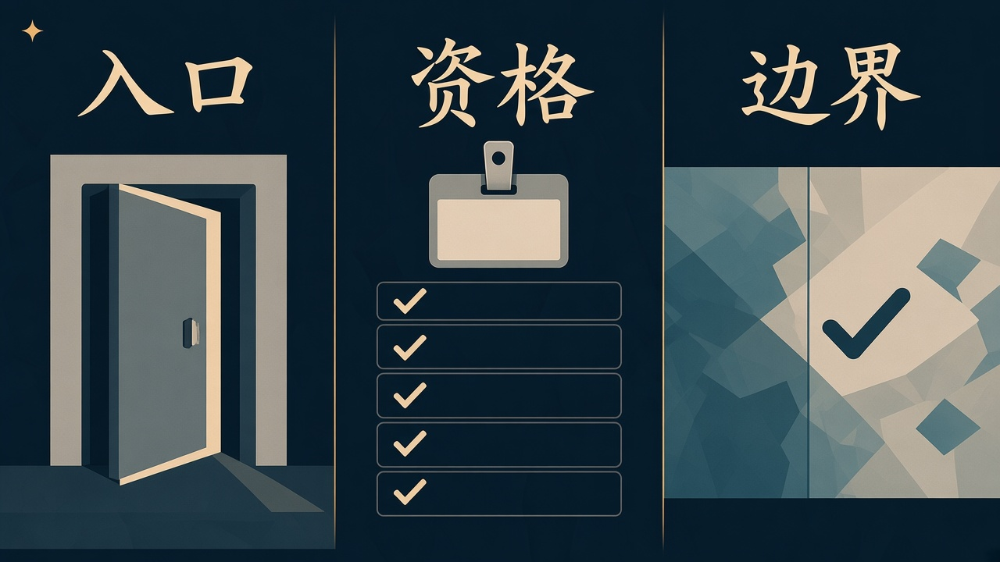

> 先说明一下：素材是我借助 AI 收集整理的，时间都按北京时间。写着「据 X 摘要」的，是 X 平台自动生成的新闻摘要，我暂时没找到一手来源，大家看的时候打个折。每条后面关于行业、公司、赚钱机会的判断都是我个人的看法，不是事实，更不是投资建议。教程视频都是网上公开的，标了「同类操作参考」的，讲的是同一类操作，不是针对这款新产品本身。

## 高风险场开了入口，先看资格和边界

今天最显眼的不是又一个谁都能点开的新按钮，而是好几件已经写上「可用」「扩大」「加强」的事，真正能走进去的人，仍要先看资格和边界。OpenAI 给医疗团队更新了计算机使用智能体，一次上线 20 余个医疗插件，并加强临床检索与引用；可面向个人免费开通的，是美国已验证临床人员的 ChatGPT for Clinicians，帮助中心写明它是为了支持、而不是取代专业判断，临床决策仍由医生负责。学术研究者项目把整体目标写成全球最多 20 万人免费使用，下一轮要到 **11 月 23 日**才开放申请，而且是先到先得的 **50,000** 份 Plus 资助，不是把试点时的 Pro 再发一轮。北约这一侧，官方稿讲的是既有 Daybreak 交给授权防守方，并给出北约用量和若干漏洞发现案例，这不是面向公众的网络工具。旁边还有 Harmonic 把 Aristotle 的形式化验证扩到 Rust，对象是智能合约和关键基础设施这类不容出错的代码。

我没有把这些写成「AI 要取代医生」，也不会把「全球」或「即日起可用」理解成每个地区、每种身份今天都能开通。资格、地区、是不是授权用户、免费的是哪一档，都要回到原页核对。

个人观点，不构成投资、采购、医疗或技术选型建议。数字和能力边界以各条原文为准。

## 今天最值得看的几件事

- **头条：OpenAI 更新 ChatGPT for Healthcare**——两则官方署文栏面日期均为 November 16, 2026。一篇公布面向医疗团队的计算机使用智能体进展，合作对象点名 Abridge、Ambience、Cigna Healthcare 与 CVS Health；另一篇称一次上线超过 **20** 个新医疗插件，并加强临床检索与引用。医疗机构走的是 ChatGPT for Healthcare；面向个人的 ChatGPT for Clinicians，官方帮助中心写明免费对象是美国已验证的临床人员。评测数字均来自 OpenAI 自述或其所引基准，不要写成普遍临床结论。
- **紧随其后：扩大 ChatGPT for Academic Researchers**——官方目标是为全球最多 **200,000** 名研究者提供免费使用。下一轮申请于 **Monday, November 23** 开放，将按先到先得向符合条件的研究者发放 **50,000** 份新资助，每份覆盖申请者及最多两名合作者的 ChatGPT Plus。试点阶段已有 **20,000** 名研究者、覆盖 **33** 个国家，当时发的是 Pro，本轮改发 Plus。配套研究分析了 **1,819** 名科学家的使用情况。今晚打开官方帮助中心时，新申请仍显示关闭，新登记进入信息等待名单。
- **OpenAI 说明与北约及盟国网络机构的合作**——官方稿栏面日期为 November 17, 2026。经既有 Daybreak 向授权防守方提供网络安全模型，并称北约每月使用最多 **3000 亿** 个原始输入与输出 token。这不是新产品发布，也不是公众可以开通的工具。
- **NVIDIA 在 SC26 推出 Nemotron for Science，并宣布预期 2028 年上市的 Rubin HPC**——Nemotron for Science 把 Nemotron 3.5 Super VL、近 **50,000** 道题的 LitmusBench v0.2 与后期训练配方收在一起。Rubin HPC 官方写明单卡超过 **50,000** 个 CUDA 核心，并带稀疏数据加速和第七代 NVLink，预期 **2028** 年上市，不是今天已经出货。同波次补录了 11-16 的 DGX Spark HPC Developer Kit；Google Cloud 与 NVIDIA 同日各自公布了 MLPerf Training v6.1 数字，两边要分列。
- **另有：** Gemini Notebook 可把笔记和来源生成交互式网站，Gemini 应用开始上线 **66** 种地区语音；Hugging Face 与 OpenRouter 合作，聊天模型的 Inference Providers 改由 OpenRouter 路由，原 token 与代码可继续用，但语言模型不能再使用自己的提供商密钥。
- **补录：** OVHcloud 宣布自研 LLM 家族 Olala，首个成员是 Olala mini 7A1B，正式发布会排在 **11 月 19 日**的 OVHcloud AI Summit，今晚仍未核到官方 Hugging Face 仓库。另有 11-16 已署、今日补进的 Harmonic Aristotle Rust 支持，以及 Answer.AI 的 SolveIt 向公众开放。Perplexity 宣布成立 Frontier Research；OpenAI 公布第一阶段 embedded assessments，与 Apollo Research、METR、Transluce、Goodfire 签约，这是流程与治理宣布，不是新产品。

## 工具与产品

### 1. OpenAI 更新 ChatGPT for Healthcare：计算机使用智能体进展，一次上线 20 余个医疗插件（头条）

官方两则署文栏面日期均为 **November 16, 2026**。“Advancing computer-use agents for healthcare teams” 写明，计算机使用智能体通过点击、键入、在应用间跳转完成多步流程，并公布在临床与行政工作流上的性能、安全与成本结果。合作对象点名 Abridge、Ambience、Cigna Healthcare 与 CVS Health，场景包括授权申请、转诊、出院规划与就诊间隔随访。官方称医疗团队、开发者与临床医生现在可通过 OpenAI API、ChatGPT for Healthcare 和 ChatGPT for Clinicians 使用这些能力；机构可配置符合 HIPAA 的工作流、审批与智能体权限，并保留审计日志。演示用的是合成患者数据。

评测方面，官方称用 GPT-6 Astra 做临床医生 EHR 收件箱类多步任务：在 **325** 项受评任务中，**99%** 被评为安全；医生在五分量表上把 **646** 次评估中的 **93%** 标为 “very helpful” 或 “extremely helpful”。行政任务上，官方援引斯坦福研究者的独立基准 HealthAdminBench：GPT-6 Astra 得到可得评分点的 **94.3%**，GPT-6 Luna 为 **91.8%**，但 Luna 每任务成本低 **98%**，为 **8.5** 美分；两模型均在最大推理力度下评测。CVS Health 部分称其在生产工作流中用智能体清掉持续数月的文件发送积压（「一个周末」），另一条工作流每天处理数万次会诊的系统步骤，并将基于 Agents SDK 的 Agent Kit 开源；稿写明生产数据不用于训练基础模型。Cigna Healthcare 部分称，个案经理以往要在 **10** 个以上的临床与行政系统间切换搜集上下文。

同期署文 “More ways to move care forward with ChatGPT for Healthcare” 称，在一次盲评中，医生就真实临床问题（含多轮对话、覆盖多个专科）做了超过 **1300** 次审阅，更新后的体验在全部八个维度（含事实正确性、安全性、可操作性与来源权威性）上得分都更高。并列出当日上线、超过 **20** 个新医疗插件，包括 Aiva、Amion、Assort Health、Availity Extend、Elation Health、Ferry、IMO Health MCP Server、Infinitus Relay、K Health、Luma Health、Metriport、Notable Integration Specs、Oracle HDI Overview、PenguinAI Medical Coding、Photon、Redox、Stedi、Subsalt、Trizetto、Turquoise、UpToDate Expert AI，可在 ChatGPT for Healthcare 中使用，也可通过 ChartGPT 进入 EHR 工作流。上述评测数字均来自 OpenAI 自述或其所引基准，不要写成普遍临床结论。

今晚对照官方帮助中心可以补上入口边界：ChatGPT for Healthcare 面向医疗机构，用于集中管理、连接机构数据和合规控制，可通过销售或 AWS Marketplace 采购，定价按 ChatGPT Enterprise、视规模与部署而定，本稿没有官方目录单价可引用。ChatGPT for Clinicians 面向个人，免费对象是美国已验证的临床人员，帮助中心目前列举的资格是医师（MD/DO）、护士执业者（NP）、医师助理（PA）和药师，注册需要 ChatGPT 账号、有效 NPI，以及可经第三方核验的执照；美国以外的临床人员，帮助中心写明目前不可注册。帮助中心并写明：该产品是为了支持、而不是取代专业判断，临床人员仍对所有诊疗决策负责，并应在适当情况下独立核对信息。ChatGPT for Healthcare 帮助中心也写明，最终决定始终由临床人员作出。这不是面向普通患者的自动问诊或自行诊断工具。

来源：[OpenAI·Advancing computer-use agents for healthcare teams](https://openai.com/index/advancing-computer-use-for-healthcare-teams)、[OpenAI·More ways to move care forward with ChatGPT for Healthcare](https://openai.com/index/more-ways-to-move-care-forward-with-chatgpt-for-healthcare)、[OpenAI 帮助中心·ChatGPT for Healthcare](https://help.openai.com/en/articles/20001046-chatgpt-for-healthcare)、[OpenAI 帮助中心·ChatGPT for Clinicians](https://help.openai.com/en/articles/20001202-chatgpt-for-clinicians)

这是给医疗机构和工作室里的医护、行政与研发团队的一次能力更新，不是普通用户今天就能打开的消费级问诊入口。受益的首先是已经在用 Abridge、Ambience，或在 CVS Health、Cigna Healthcare 这类机构里处理授权申请、转诊和出院协调的人，以及要在 EHR 和支付门户之间补上 API 到不了的步骤的健康科技公司。付钱的是把 OpenAI 自述的安全率和「非常有帮助」比例，写成已经替代医生、或已经在中国或非美国地区对个人开放的人。标「机构走 ChatGPT for Healthcare；个人 Clinicians 仅限美国已验证临床人员；评测为官方自述或其所引基准；不是替代专业判断」。

- 在美国、且属于帮助中心所列已验证临床人员的：先读两则官方署文和 [Clinicians 帮助中心](https://help.openai.com/en/articles/20001202-chatgpt-for-clinicians)，按 NPI 与执照核验决定是否注册；把它当成辅助检索、起草和行政流程的工具，而不是自动下诊断。
- 医院、保险公司、药房或健康科技公司的信息化与产品团队：走 ChatGPT for Healthcare 或 API，先和销售或 AWS 团队核对 BAA、工作区设置和插件是否对本工作室开放；帮助中心写明非临床的行政与支持人员也可以使用，但权限由机构管理员配置。
- 普通患者，或人在美国以外的读者：今天没有可以自己开通的个人医疗入口，也不要把这些插件名单理解成已经对公众开放的问诊服务。

教程：以两则[官方署文](https://openai.com/index/advancing-computer-use-for-healthcare-teams)和[帮助中心](https://help.openai.com/en/articles/20001202-chatgpt-for-clinicians)为准。帮助中心写了美国临床人员的注册步骤。今晚未核到面向公众的成熟官方跟练片，也不要把机构演示或合成数据演示，当成个人诊断教程。

### 2. OpenAI 扩大 ChatGPT for Academic Researchers：目标最多 20 万人免费使用，下一轮 11 月 23 日开放申请

官方稿 “Broadening access to AI for scientists” 栏面日期 **November 16, 2026**。文称该项目 7 月开始试点，下一轮申请于 **Monday, November 23** 开放；将按先到先得向符合条件的研究者发放 **50,000** 份新资助，每份资助让申请者及最多两名合作者免费使用 ChatGPT Plus。官方称默认不把项目中分享的数据用于训练模型；若已在等候名单且符合资格，会在开放申请前发邮件说明如何激活。试点阶段已有 **20,000** 名研究者、覆盖 **33** 个国家加入。官方解释：试点时提供的是 ChatGPT Pro，但多数参与者的用量本可落在 Plus 限额内，故本轮改发 Plus，以便覆盖更多团队；本轮资助合计最多支持 **150,000** 名研究者，项目整体目标是 **200,000** 人，为 7 月试点宣布目标的两倍。选拔从抽签改为先到先得。同稿还提到向 Simons Foundation 一项新倡议捐助 **$5 million**，以及 GPT-Rosalind 学术计划：面向美国大学符合条件的实验室，最多 **30** 个席位、最长 **12** 个月免费，须经可信访问审批。配套研究页 “Science at the Frontier” 有一处写成 “free access for more than 200,000 researchers”，与项目稿的 “up to 200,000” 及「整体目标是 20 万」并不完全同句，本稿以项目稿的目标表述为准，不把「超过 20 万」写成已经发放的名额。

配套署文 “Science at the Frontier: How scientists use ChatGPT” 称，经济研究团队研究了暑期试点中 **1,819** 名科学家的超过 **580,000** 条科学相关消息（研究页精确写为 **580,186** 条，时段为 8 月 20 日至 9 月 22 日），并调查了 **251** 名参与者。受访参与者估计，若保持同样质量、不用 AI，同样的研究工作会花 **1.9** 倍时间；在回答发现时间线问题的人中，**98%** 预期 AI 会加快其领域的发现。为保护隐私，研究团队用自动分类器按研究活动归类消息，但不阅读原消息或模型回复。文称 **68%** 的科学家曾用 ChatGPT 发展研究想法；在想法相关消息里，**35%** 是科学家自带具体问题，**36%** 是带着想法请模型 refinement，**23%** 是请模型建议研究问题。官方也写明，这些发现并不建立因果关系，产出是自我报告，发现时间线是预期。

今晚打开官方帮助中心时，新申请仍显示关闭，新登记进入信息等待名单；帮助中心写明，加入等候名单并不等于已经提交了待审申请。资格方面，帮助中心要求申请者是支持国家中合格学术机构的研究教职或博士后，近三年有与所属合格领域相关的发表，并计划把 ChatGPT 用于学术研究。所列领域为 Biological Sciences、Chemistry and Materials、Computer Science、Earth and Planetary Sciences、Engineering、Mathematics 和 Physics；符合条件也不保证获批。本轮自助方案是最多 **12** 个月的三个 Plus 席位：一名获批研究者，外加最多两名同机构合格合作者；帮助中心写明，合格合作者包括同机构的研究生，但合作者身份本身不能拿来独立作为负责人申请。默认不能邀请其他机构的合作者。资助不含 OpenAI API 积分。帮助中心没有在今晚可见的正文里列出完整国家名单，只写 “supported country” 与 “eligible academic institution”，不要自行补一份国家表。

来源：[OpenAI·Broadening access to AI for scientists](https://openai.com/index/expanding-chatgpt-for-academic-researchers)、[OpenAI·Science at the Frontier](https://openai.com/index/science-at-the-frontier)、[OpenAI 帮助中心·ChatGPT for Academic Researchers](https://help.openai.com/en/articles/20001406-chatgpt-for-academic-researchers)

这是一次把免费档从试点扩大、同时把档位从 Pro 改到 Plus 的名额安排，不是所有科研人员今天就能开通，更不是 API 算力包。受益的是符合学科和院校条件、能在 **11 月 23 日**第一时间递交的研究教师与博士后，以及随后可能被邀请进同一工作区的同机构合作者。付钱的是把「全球 20 万」当成已经到手的席位、把本轮 Plus 当成继续送 Pro，或让研究生以合作者身份去占负责人名额的人。标「11 月 23 日才开放；先到先得 5 万份；本轮为 Plus；整体目标最多 20 万，不是已经发放的数量」。

- 符合帮助中心所列资格的研究教师或博士后：先收藏[项目稿](https://openai.com/index/expanding-chatgpt-for-academic-researchers)和[帮助中心](https://help.openai.com/en/articles/20001406-chatgpt-for-academic-researchers)，核对院校、国家和近三年发表；已在等候名单且符合资格的，等开放前的官方邮件，不要把等候名单当成已经提交的申请。
- 同机构的研究生或合作者：默认是被邀请的席位，而不是独立申请人；加入时间晚了，也只享受该笔资助剩余的期限，不会重新起算 12 个月。
- 做生物医学工具的实验室：GPT-Rosalind 学术计划是另一条入口，面向美国大学符合条件的实验室，最多 **30** 个席位、最长 **12** 个月，须经可信访问审批，不要和 ChatGPT Plus 资助混成同一张申请表。
- 不在所列领域、或不在支持国家合格院校里的人：不必按「全球免费」去找并不存在的开通按钮。

教程：以官方项目稿和帮助中心为准。申请尚未开放，今晚没有可以跟着点下去的成熟官方跟练片。

### 3. OpenAI 说明与北约及盟国的合作：既有 Daybreak 交给授权防守方，不是公众工具

官方稿 “Strengthening NATO and allied cyber defenses with AI” 栏面日期 **November 17, 2026**。文称通过 Daybreak，把先进 AI 交到受信任的防守方手中，用于经授权的安全工作，包括审查软件、调查可疑活动、验证漏洞，以及开发与测试修复。OpenAI 写明与北约通信与信息局（NCIA）合作，向北约核心机构提供先进网络安全模型；并称北约作为这项工作的一部分，每月使用最多 **3000 亿** 个原始输入与输出 token。稿还称 OpenAI 支持了 2026 年 Crossed Swords 演习（由北约合作网络防御卓越中心 CCDCOE 组织），其中新设训练流，参与者在技术环境中用 OpenAI Daybreak 构建、部署并评估用于网络行动的 AI 智能体，强调保持人类监督。

除北约外，稿称已向欧洲防守方提供网络模型访问，包括欧盟网络安全局（ENISA）以及法国（ANSSI）、德国和波兰的国家网络机构；并举例：乌克兰数字转型部正在使用 Daybreak 加强民用基础设施的网络防御；ENISA 用其模型在欧盟机构所用软件中识别出 **4** 个漏洞且均已发布修复；另有 ENISA 与 CERT-EU 的 11 月联合报告，描述用包括经 Daybreak 访问的 OpenAI 模型以及 Codex 安全插件在内的工具，审查了 **27** 个软件项目，在维护者评估的 **88** 个潜在问题中，**95%** 被确认为真实问题；CERT Polska 用 OpenAI 模型协助在 MikroTik RouterOS 中识别出 **6** 个漏洞并与厂商协调披露，MikroTik 已发布修复。这不是新产品发布：Daybreak 此前已经出现过；CERT Polska 与 MikroTik 的案例，官方是作为已有合作例子写出，不要写成今天才新发现的漏洞。成稿也不把 **3000 亿** token 写成已对公众开放的用量，或把 Crossed Swords 训练流写成已授权对实网攻击。

来源：[OpenAI·Strengthening NATO and allied cyber defenses with AI](https://openai.com/index/strengthening-nato-allied-cyber-defences-ai)

这是面向北约、ENISA 和相关国家网络机构的授权防守安排，不是一款开发者或普通用户能够自行开通的安全扫描器。受益的是已经在授权范围内做软件审查、漏洞验证和修复测试的防守团队。付钱的是把官方案例理解成今天新发布了攻击工具、或以为自己也能按同样入口调用 Daybreak 的人。标「既有 Daybreak；仅限授权防守方；案例按官方既有叙述写，不是今日新发现」。

- 在授权机构里做网络安全的人：以本机构的准入和官方稿为准，演习训练流也写明要保持人类监督。
- 软件厂商与开源维护者：稿中的漏洞数字是官方转述的已披露案例，不要把它外推成自己产品已经被扫过。
- 普通开发者和一般读者：今天没有可以申请的公众入口，也不要把这条当成可以跟着做的攻防教程。

教程：以[官方稿](https://openai.com/index/strengthening-nato-allied-cyber-defences-ai)为准。这不是公众产品，无需跟练片。

## 模型发布

### 4. NVIDIA 在 SC26 推出 Nemotron for Science，并宣布预期 2028 年上市的 Rubin HPC；同波次补录 DGX Spark 套件，另有同日 MLPerf 数字

官方新闻稿 “NVIDIA Introduces Nemotron for Science to Accelerate Discoveries With Agents” 栏面日期 **November 16, 2026**。文称该集合包括 Nemotron 3.5 Super VL 开放模型的科学应用、科学评测、新的开放化学数据集和配方，帮助研究者构建领域科学智能体；并点名 LitmusBench v0.2 同时支持化学推理的评测与后期训练。新闻稿写明 LitmusBench v0.2 是近 **50,000** 道题的开放数据集，材料来自分子性质与实验药物发现数据，用于训练和评估模型对分子行为（含溶解度、人体如何代谢等）的预测。Ian Buck（NVIDIA 超大规模与高性能计算副总裁）在稿中表示，这是把开放模型、科学数据与后期训练配方交给研究者，以便构建能推理科学问题、并调用 CUDA-X 加速工具的专用智能体。开发者博 “Post-Training NVIDIA Nemotron to Increase Accuracy in Your Scientific Domain” 介绍用 NeMo Gym / NeMo RL、以药物代谢预测为例做后期训练的配方。新闻稿中的机构与公司用法需按官方转述写，勿写成独立第三方评测：Terray Therapeutics 称在 RxnScribe 测试中，按该基准匹配标准回收了约 **76%** 已标注反应；Lila Sciences 称实验室反馈后期训练后，制备量子点的准确率几乎翻倍至 **61%**，超过 GPT-6 Astra 的 **54%**，且推理成本低一个数量级（稿写 10–20x）；Therna 称在与 NVIDIA 合作的 agentic mRNA 设计后期训练中，预测蛋白表达区间的准确率几乎翻倍，科学家在 **96%** 的比较中更偏好其解释。稿还提到阿贡国家实验室、于利希超算中心，以及 Lila Sciences、Terray Therapeutics、Therna 等在使用或定制该模型。

同日公司博 “NVIDIA Announces Rubin HPC — A New GPU to Accelerate Agents for Science, Engineering and Analytics” 栏面日期同样是 **November 16, 2026**。文称这是 NVIDIA Vera Rubin 平台中的新 GPU，用于加速科学、工程与分析工作流中的仿真与数据处理。官方写明该 GPU 具有「创纪录数量」的 CUDA 核心——单卡超过 **50,000** 个，并带有稀疏数据加速能力，以及第七代 NVIDIA NVLink 的 GPU 间互连。文末写明 “Rubin HPC is expected to be available in 2028”。这是官宣与预期供货时间，不是已经出货，也不要把超过 5 万 CUDA 核心写成更精确的未公布数值。它和下面的 MLPerf 首秀不是同一件事：MLPerf 写的是当前 Vera Rubin 平台的基准结果，Rubin HPC 是面向 2028 年的科学计算 GPU。

补录（11-16）：官方公司博 “NVIDIA DGX Spark Developer Kit Turns a Desk Into a Supercomputing Lab” 栏面日期 **November 16, 2026**，属同波次 SC26 署文，不是 11-17 才第一次宣布。该套件是四节点 NVIDIA DGX Spark 集群，各节点与两个邻居以环形直接相连，采用 GB10 Grace Blackwell Superchip，经 NVIDIA ConnectX-7 直连、不必另买交换机；四节点合计 **512GB** 内存和 **20TB** NVMe 存储；在 NVFP4 下可在四台集群上本地部署最高约 **700B** 参数的模型，文中举例 DeepSeek V4.1。NVIDIA HPC SDK 的安装 playbook 文称即将推出（coming soon），不要写成已经上线。文称该开发套件在 SC26 展出且已可销售，可通过 Acer、ASUS、Dell Technologies、GIGABYTE、H3C、HP、Lenovo、MSI、xFusion 等 OEM，以及 NVIDIA Marketplace 获得；稿未给出套件售价，不要编造价格。客户与实验室用法按官方转述写，例如 Kvantify、IIT Delhi 衍生公司 CYRAN AI、OpenFold、加州大学伯克利分校相关实验室的例子，都不是我独立复核过的第三方评测。

同日评测要单独看，不要和 2028 年的 Rubin HPC 混成一句。blog.google “New AI training performance benchmarks for Google TPUs” 栏面日期 **Nov 16, 2026**，称 Google Cloud 在 MLPerf Training v6.1 中公布了 **10** 项 Closed-division 结果。官方列出：预训练方面，**8,192** 个 Ironwood TPU 在 **1.70** 分钟内达到目标模型的基准目标质量，并写明扩展到 **4,096** 芯片时效率为 **96%**；agentic RL 方面，**640** 个 Ironwood TPU 在 **18.02** 分钟内达到目标模型的编程基准目标精度（**0.765**，目标为 **0.69**），并称训练芯片等待时间低于 **3%**；在 Google Cloud A4X Max 实例上，**256** 个 NVIDIA GB300 GPU 的预训练基准在 **31.96** 分钟内达到目标质量。稿末给出结果编号 6.1-0017 至 6.1-0026，并说明所报时间是从官方参考检查点训练到目标收敛标准的时间。NVIDIA 公司博称这是 Vera Rubin 平台的 MLPerf 首秀，并称 NVIDIA 横扫本轮 MLPerf Training v6.1 全部基准；训练侧称 Vera Rubin NVL72 相对高度优化的 GB300 NVL72，每 GPU 性能最高约 **2** 倍；在 DeepSeek-V3 基准上，Vera Rubin NVL72 从 **256** 扩到 **1,024** GPU 时效率约 **97%**，训练时间从 **16** 分钟降到约 **4** 分钟；NVIDIA 还用 GB300 系统在 **10,240** GPU 上跑了该基准，称是本轮最大规模，Microsoft Azure 用 **10,240** 个 NVIDIA GPU 的 GB200 系统达到同样规模。Endpoints 侧以 Kimi K3 的一条结果为例，称 Vera Rubin NVL72 在相同响应速度下，每瓦吞吐超过 GB300 NVL72 的 **10** 倍，但稿明确写这是 provisional 结果，尚待 MLCommons 验证与同行评审，可能变化；GB300 结果则写明已经协会核实。Google 与 NVIDIA 的数字必须分列，不要把两边的任务、模型和硬件混成一张表。

来源：[NVIDIA Newsroom·Nemotron for Science](https://nvidianews.nvidia.com/news/nvidia-introduces-nemotron-for-science-to-accelerate-discoveries-with-agents)、[NVIDIA Technical Blog·Post-Training Nemotron](https://developer.nvidia.com/blog/post-training-nvidia-nemotron-to-increase-accuracy-in-your-scientific-domain/)、[NVIDIA Blog·Rubin HPC](https://blogs.nvidia.com/blog/rubin-hpc/)、[NVIDIA Blog·DGX Spark HPC Developer Kit](https://blogs.nvidia.com/blog/dgx-spark-hpc-developer-kit-sc26/)（补录，11-16 署文）、[blog.google·TPU MLPerf Training v6.1](https://blog.google/innovation-and-ai/infrastructure-and-cloud/google-cloud/training-performance-benchmarks-tpus/)、[NVIDIA Blog·Vera Rubin MLPerf](https://blogs.nvidia.com/blog/mlperf-training-endpoints-vera-rubin/)

这是科学计算和药物、材料、超算机构这一侧的工具与硬件更新，不是消费级显卡今天开卖。受益的是已经在做化学推理、实验室协议、mRNA 或材料仿真，并准备用开放模型和后期训练配方做领域智能体的团队，以及要买桌面多节点套件、先在四机上调试再上超算的实验室。付钱的是把 Rubin HPC 写成已经能下单的 2026 年芯片、把 provisional 的 Endpoints 对比写成已经锁定的协会结果，或把 Google 的 Ironwood 分钟数和 NVIDIA 的 Vera Rubin 倍数写进同一句比较的人。标「Rubin HPC 预期 2028 年上市；DGX Spark 为 11-16 补录；MLPerf 数字分列，Vera Rubin Endpoints 为临时结果」。

- 做药物发现、化学或材料模型的研究者：先读[新闻稿](https://nvidianews.nvidia.com/news/nvidia-introduces-nemotron-for-science-to-accelerate-discoveries-with-agents)和[后期训练技术博](https://developer.nvidia.com/blog/post-training-nvidia-nemotron-to-increase-accuracy-in-your-scientific-domain/)，按官方配方在自己的任务上做适配；稿里的 76%、61%、96% 都是官方转述的合作方结果，不是我核对过的公开总榜。
- 超算中心、高校实验室和 OEM 渠道的人：Rubin HPC 先按 2028 年预期来做规划；若考虑桌面四节点，看 DGX Spark 套件页和 Marketplace / OEM 渠道，HPC SDK playbook 仍写着即将推出，售价官方未公布。
- 云采购或基础设施团队：把 Google Cloud 的 Ironwood / GB300 编号和 NVIDIA 官方博的 Vera Rubin / GB300 / Azure GB200 数字分开归档，Endpoints 里 Vera Rubin 对比要标成临时结果。
- 一般读者：今天没有需要个人开通的消费级入口。

教程：以 NVIDIA 新闻稿、后期训练技术博和各公司博为准。今晚未核到针对 Nemotron for Science、Rubin HPC 或 DGX Spark 套件的成熟官方跟练片；技术博是配方说明，不是视频教程。

## 工具与产品

### 5. Gemini Notebook 可把笔记生成交互式网站，Gemini 应用开始上线 66 种地区语音

blog.google 署文 “Transform notes, research, and sources into interactive sites with Gemini Notebook.” 栏面日期 **Nov 16, 2026**。文称从今天起，Gemini Notebook 可以把来源变成交互式站点，用来更快理解复杂信息；在对话里输入 “make me a site” 并描述想做的内容即可，例如应试用的交互周期表或历史时间线、查看季度销售的交互仪表盘、任务与截止日的项目管理跟踪器。生成后可选择 “Open in a new tab” 交互，或分享给他人。官方写明该能力即日在网页端向全球 Gemini Notebook 用户（**18+**）推出，包括 Google Workspace 订阅者，移动应用即将跟进。

同日另一篇 “Regional voices are rolling out in the Gemini app.” 称，曾在 Google I/O 预告为 Gemini 引入地方方言，今天开始在 Android 与 iOS 的 Gemini 应用中推出 **66** 种新的区域语音，包括 U.S. English、U.K. English、India English、Hindi、Brazilian Portuguese、Indonesian 和 Korean，并各有针对性选项。官方强调这些声音按自然节奏与日常清晰度调校，而不是夸张口音；选定的声音会贯穿整个应用，包括 Gemini Live、语言练习，或在聊天中点 Listen 朗读详细回复。预览与选择入口为 Gemini Live 的三点菜单，或应用设置里的 Gemini 语音选项。本窗 IT之家跟进转述同一官方稿，只作二手来源，不另开条。

来源：[blog.google·Gemini Notebook interactive sites](https://blog.google/innovation-and-ai/products/gemini-notebook/interactive-sites/)、[blog.google·Regional voices](https://blog.google/innovation-and-ai/products/gemini-app/regional-voices/)、[IT之家·Gemini 地区语音](https://www.ithome.com/1/028/336.htm)

这是 Google 把已有的 Notebook 和 Gemini 应用往可分享、可听的方向推进一步，不是新模型发布。受益的是已经在用 Gemini Notebook 做功课、调研或内部材料的人，以及 Google Workspace 里要把来源做成可点选说明页的团队；地区语音则更直接面向 Android 和 iOS 上的日常用户，以及做语言练习或要听回复的人。付钱的是把「全球推出」理解成移动端已经同步可用，或把未滚动到自己设备上的语音当成故障的人。标「交互站目前是网页端、18 岁以上；移动应用即将跟进；地区语音为滚动上线」。

- 学生、教师或要做内部说明页的人：在网页版 Gemini Notebook 里用官方提示 “make me a site”，生成后先自己打开新标签检查，再决定是否分享；移动端按官方说明还要再等。
- 已经在用 Gemini 应用的人：到 Gemini Live 的三点菜单，或应用设置里的语音选项，看这 **66** 种地区语音有没有滚动到自己的设备，不要期待官方在稿里点名之外的每一种口音都已经出现。
- 未满 18 岁、或还没有 Gemini Notebook 的人：先看自己是否在官方写明的适用范围里，不必寻找今晚并不存在的独立跟练片。

教程：以两篇 blog.google 为准。今晚未核到针对「Gemini Notebook 生成交互式网站」这一新能力的成熟官方跟练片；也不要把 NotebookLM 或旧 Canvas 教程当成这条产品的官方说明。地区语音按应用内设置操作即可。

### 6. Hugging Face 与 OpenRouter 合作：聊天模型改由 OpenRouter 路由，原 token 与代码可继续用

HF 官方博 “Hugging Face and OpenRouter join forces to make open-weight models easy to run” 栏面日期 **November 16, 2026**；OpenRouter 官方博 “OpenRouter Now Powers Inference on Hugging Face” 署 **11/16/2026**。HF 博写明：即日起把 Inference Providers 从自建路由切换到 OpenRouter，对语言模型的请求会经 OpenRouter 按实时价格、速度和可靠性选择提供商，失败则在同一次调用里改试另一家；代码不用改。路由支持 OpenAI 的 Chat Completions / Responses API 以及 Anthropic 的 Messages API。价格口径为：用户按提供商价格支付，Hugging Face 不在其上加价；PRO 用户每月有 **$2** 积分，Team / Enterprise 按座位每月 **$2**。图像、视频和音频生成仍不经 OpenRouter，继续走原来的 Inference Providers。一个破坏性变更：对语言模型不能再使用自己的提供商 API key，请求改记入 Hugging Face 账户或组织账单；图像/视频提供商的自定义密钥仍可用。OpenRouter 博补充：你不必另行设置，现有的 Hugging Face token 和代码可继续工作；双向集成里，OpenRouter 可以把每次请求的 trace 以 JSON 发送到用户拥有的 Hugging Face Storage Bucket（Broadcast，标为 beta），文件含输入消息、模型输出、token 数与费用，不含图像和其他媒体；并称今日以此方式可调用 **160** 个模型、来自 **38** 家实验室。两篇博文都转述了 OpenRouter 在 10 月重建路由后的自身测量：容量错误下降 **46%**，首 token 时间改善 **16.9%**，吞吐提升 **16.3%**；OpenRouter 博还写明这次实验里每请求成本高 **6.0%**。这些是 OpenRouter 自己的测量，不是 Hugging Face 另做的评测，也不要写成对所有用户已经兑现的账单变化。

来源：[Hugging Face Blog·OpenRouter](https://huggingface.co/blog/openrouter)、[OpenRouter Blog](https://openrouter.ai/blog/announcements/hugging-face-inference-providers/)

这是推理路由和出账方式的切换，不是新模型上线。受益的是已经在 Hugging Face Inference Providers 上调开放权重聊天模型、希望按实时价格和可用性自动换提供商的团队，以及要用 Hugging Face 账单统一结算的组织。付钱的是仍把自有提供商密钥写进语言模型请求、或以为图像和视频也已经改走 OpenRouter 的人。标「原 token 与代码可继续用；语言模型不再支持自定义提供商密钥；图视频音频仍走原路径」。

- 已经在用 Hugging Face token 调聊天模型的人：先读[HF 博](https://huggingface.co/blog/openrouter)，用原 endpoint 做一次回归，确认代码不用改；如果以前填了提供商自己的 API key，要改回 Hugging Face 账户或组织账单。
- 团队管理员：看 PRO / Team / Enterprise 的每月 **$2** 积分口径，以及是否要在设置里关闭不想使用的提供商；若要保存请求轨迹，OpenRouter 的 Broadcast 仍标为 beta。
- 做图像、视频或音频生成的人：官方写明这条路径没有改，不要按聊天模型的变更去改密钥。

教程：以 Hugging Face 与 OpenRouter 的官方博，以及 HF 的 Inference Providers 文档为准。今晚未核到成熟官方跟练片。

### 7. 补录：OVHcloud 宣布 Olala 家族，首个成员是 Olala mini 7A1B，正式发布会在 11 月 19 日

这条是补录。官方新闻室栏面时间为 **2026-11-17T12:00:00Z**（北京时间 20:00），标题为 “OVH announces Olala mini 7A1B”，开头署 Roubaix – 17 november 2026。文称 OVH 宣布首个自研 LLM 家族 Olala，首个成员是 Olala mini 7A1B；正式发布会排在 **19 November** 的 OVHcloud AI Summit，本条不是会后详述，也不要写成已经全面向公众开放的通用上线。

官方称 Olala mini 基于 **7B** 总参数架构，每层 **256** 个专家中约 **10 亿** 活跃参数，混合注意力结合 Differential-TPA 与 Mamba-3，精度为 BF16；并写明每次请求只使用模型的一部分，因此可在不少于 **8 GB** 显存的 GPU 上运行，给出 RTX A4500 上约 **160** tokens/秒、无 GPU 的普通处理器上约 **50** tokens/秒的数字，当前上下文窗口为 **32,000** tokens。稿称 Olala mini 将以 Apache 2.0 在 Hugging Face 开源（原文 will be available）；同一稿又写 “is released with its weights, its pre-trained base model, its technical report and its AI Act compliance documentation”，但未给出这些材料的具体 URL。今晚检索仍未见官方 Hugging Face 仓库，Hugging Face 上的 OVHcloud 组织页也尚未列出公开模型，不要写成已经可下载，也不要自行补仓名，更不要把第三者的同名仓库当成官方权重。训练方面，官方称在 Jupiter、MeluXina 与 Jean Zay 三台欧洲公共超算上完成，使用 GH200、A100 与 H100，公共算力支持相当于 **700 万欧元** 的计算时；并点名法国搜索引擎 Qwant 已把它用于 flash answer，官方自称回答快约 **20%**、运行成本降为原先所用模型的三分之一。后续路线按官方自述：年内预计推出的 1.1 版会把上下文扩到 **128,000** tokens 并改进数学推理；2.0 计划面向企业智能体、云 DevOps 与网络安全三个方向，且将超过 **1000 亿** 参数。本窗 IT之家跟进转述同一官方稿，只作二手来源。

来源：[OVHcloud 新闻室·OVH announces Olala mini 7A1B](https://corporate.ovhcloud.com/en/newsroom/news/ovh-olala-mini/)、[IT之家](https://www.ithome.com/1/028/453.htm)

这是欧洲云厂商把自己的小模型家族摆上台面，正式讲解还要等到 **11 月 19 日**的发布会。受益的是已经在 OVHcloud 上做主权云、本地部署或法语搜索场景的团队，以及关注欧洲公共超算训练路径的人；Qwant 是官方点名的已有采用方。付钱的是今晚就去下载一份未经验证的同名权重、或把 2.0 的千亿参数规划写成已经可调用的人。标「正式发布会在 11 月 19 日；将在 Hugging Face 以 Apache 2.0 开源，截稿时仍未见官方仓库」。

- 关注欧洲开源模型或本地小模型的人：先收好官方新闻室，等 11 月 19 日发布会后再核仓库、许可证和技术报告链接。
- 已在 OVHcloud 或 Qwant 相关栈里的人：把官方给出的 8 GB 显存和 tokens/秒数字当作厂商自述，用自己的硬件复核，不要提前写成普遍性能承诺。
- 想找权重的人：今晚不要下载非官方同名仓库。

教程：以[官方新闻室](https://corporate.ovhcloud.com/en/newsroom/news/ovh-olala-mini/)为准。正式发布会尚未举行，今晚未核到官方跟练片，也还没有可核对的官方权重页。

### 8. 补录（11-16）：Harmonic 的 Aristotle 支持 Rust；Answer.AI 的 SolveIt 向公众开放

这两则都是 **November 16, 2026** 已有官方署文、今日补进的条目，不要写成 11-17 才第一次宣布。

Harmonic 官方稿 “Aristotle Expands Into Rust” 称，这次扩展建立在 Aristotle 已支持 C 与 Verilog 的基础上，开发者可在发布前证明 Rust 代码按规范工作，而不只依赖测试去抓缺陷。官方写明，有了 Rust 支持，Aristotle 可以证明代码没有未定义行为、行为与规范一致，即便在 `unsafe` 块内也如此；若把 C 改写成 Rust，也可以证明新代码与原代码行为相同。稿把 Rust 的关键用途指向云计算、网络安全、汽车、航空航天，以及包括加密资产在内的金融服务，并特别提到与 Solana Foundation 合作，支持既有 Solana 程序，帮助新构建者验证智能合约。官方举例：在开源订单簿 Manifest 上，Aristotle 对整个订单簿证明了 **28** 项结果（包括有效互换能够成交），并发现一个舍入错误，团队已修复；在 prime broker Project 0，它证明账本在存款、取款、借款、还款与清算以任意顺序发生时仍保持一致。这些是官方给出的产品例子，不是我独立复核过的审计结论，也不要写成已经替某个协议背书。文末写明 Aristotle for Rust 即日起可用，可在 aristotle.harmonic.fun 按自助、按用量计费开始使用，大批量、专属支持与定制部署则联系 bd@harmonic.fun。稿未公布具体单价，不要编造价格。这是既有验证产品的语言扩展，不是新模型发布。

Answer.AI 在 fast.ai 的官方稿 “Announcing the Public Launch of SolveIt” 称，SolveIt 把人、AI、代码、笔记和文档放在同一台持久服务器上的工作区。过去两年邀请了 **3000** 名预览用户，文后段又称 **3000** 名 beta users，不要把内测两年的预览项目写成今天全新立项。官方引导从 “How to Solve It with Code” 课程第一课开始试用，并给出注册地址 https://solve.it.com/ 。那门课不是今天新开的课，不要把课程旧文写成今日发布正文。产品页标题为 “Solveit: take back your agency”，定价区标题为 “Pay for what you use.”，标为 Usage-based：添加银行卡后有 **$3** 免费额度，之后只按实际运行计费。费率表注明金额为美元，模型发起的网页搜索按成本计费；计算 **$0.054** / CPU-hour，内存 **$0.012** / GB-hour，磁盘 **$0.0003** / GB-hour，带宽 **$0.05** / GB，LLM 为提供商价格的 **1.5** 倍；在使用自己的 Claude 或 ChatGPT 方案时，LLM 为输入 **$0.15**、输出 **$0.75** /百万 tokens。不要编造未公布的座位数或包月价，也不要把首见时很低的讨论热度写成已经很受欢迎。

来源：[Harmonic·Aristotle Expands Into Rust](https://www.harmonic.fun/news/aristotle-rust-verification/)、[fast.ai·Announcing the Public Launch of SolveIt](https://www.fast.ai/posts/2026-11-16-solveit-launch/)、[SolveIt 产品页](https://solve.it.com/)

这是两条不同的补录：一条给高风险 Rust 代码和 Solana 智能合约一个形式化验证入口，一条把已经内测两年的持久工作区向公众按量开放。受益的是要在发布前证明智能合约或关键基础设施行为的团队，以及想在同一台服务器里同时放代码、笔记和模型、并且能接受按量美元账单的个人开发者与小团队。付钱的是把 Manifest、Project 0 的官方例子写成已经完成的安全审计，或把 SolveIt 的 **$3** 额度理解成长期免费席位的人。标「两则均为 11-16 补录；Aristotle 未公布单价；SolveIt 按美元用量计费」。

- 写 Rust、做智能合约或形式化验证的人：先读[官方稿](https://www.harmonic.fun/news/aristotle-rust-verification/)，到 [aristotle.harmonic.fun](https://aristotle.harmonic.fun) 看自助计费入口；先用自己的规范和测试用例核对，不要把官方案例直接写进审计结论。
- 做软件开发、读论文或想要持久工作区的人：到 [SolveIt](https://solve.it.com/) 按官方说明加卡开通，先看清美元费率；跟练以官方发布博指定的课程第一课为准。
- 一般读者：这两条都不是必须今天开通的消费级聊天产品。

教程：Aristotle 以官方稿和产品页为准，今晚未核到针对 Rust 验证的成熟官方跟练片。SolveIt 的官方发布博把起始路径指向课程第一课，并嵌了 Jeremy Howard 的跟练视频 [Solve It With Code v1: Lesson1](https://www.youtube.com/watch?v=4x9wtrDOXac)；这是官方指定的动手入口，不是今天新拍的发布会教程，也不要把同一篇文章里的主题演讲或更早的参考影像当成操作片。

## 论文研究

### 9. Perplexity 宣布成立 Frontier Research，目标是做出能开展自主研究的系统

@perplexity_ai 于 UTC **15:32:19 · 11-16**（北京时间 23:32）发原帖，开篇为 “Today we're launching Perplexity Frontier Research”，并写明目标是创造一套能执行自主研究的系统，工作将聚焦 multi-agent orchestration、reinforcement learning、continual learning、systems 等。官方站点 [research.perplexity.ai](https://research.perplexity.ai/) 标题为 “Frontier Research | Perplexity”，开篇称会构建新的算法、模型与评测，「invented in the open」，并用世界的好奇心来检验。正文称将发表论文、模型、数据与基准，研究工作还将得到超过 **10,000** 块 GPU 的支持，结果会进入一个已有数百万人使用的产品。页上特别强调会聚焦预训练、持续学习与强化学习，并由 multi-agent orchestration 统起来；在多代理编排上，目标是在用户愿意付出的任意成本下，质量处在 Pareto 前沿。页内「Positions in Frontier Research」把 Timeline 写成 “Priority Deadline, December 5”，并说明一次申请覆盖该计划下的全部六个研究方向；这是招聘栏里的优先截止日期，不要写成产品、论文或模型发布日。今晚打开官方博文页 `https://www.perplexity.ai/hub/blog/introducing-perplexity-frontier-research` 仍然超时，本条事实以官方研究站点（及原公告主帖）为准，不引用未核对的第三方表述，也不把站点上已有的模型或代码条目写成今天新发布的成果。

来源：[Perplexity Frontier Research](https://research.perplexity.ai/)

这是研究机构和研究议程的宣布，不是一款今天就能开通的自主研究产品。受益的是关注多代理研究系统、评测和开放发表，或考虑该计划职位与研究奖学金的人。付钱的是把「自主研究」写成已经可交给普通用户使用的成品、或把 **12 月 5 日**理解成产品上线日的人。标「研究实验室宣布；Dec 5 为招聘优先截止；今晚未打开官方博文页」。

- 做多代理系统或科研工具的人：先读[研究站点](https://research.perplexity.ai/)，把它当成议程和用人入口，而不是可下载的新模型卡。
- 考虑加入该计划的人：页上写明 Dec 5 是 Positions 的优先截止日期，具体申请材料以站点当时展示为准。
- 一般读者：今天没有需要开通的产品入口。

教程：以官方研究站点为准。这不是操作类产品，无需跟练片。

## 最佳实践

### 10. OpenAI 公布第一阶段 embedded assessments，与四家独立评估方签约

官方稿 “Our first phase of embedded assessments” 栏面日期 **November 16, 2026**。文称已与 Apollo Research、METR、Transluce、Goodfire 四家独立评估方签约。嵌入式评估让独立专家在较长时间内深入接触实验室内部模型与系统，以评估模型对齐和安全措施的有效性；评估方根据需要可获得与内部研究者相同的部分资源，包括模型检查点、源代码、训练与评估数据、监控系统、技术文档，以及相关研究者与工程师的讨论。稿把此举与白宫 Super Intelligence 协议下的独立评估承诺联系起来。四家分工按官方自述为：Apollo Research 评估模型是否会暗中违背开发者意图、以及现有安全措施能否发现这类行为，并分两阶段审视四项主张；Goodfire 将嵌入可解释性研究者、使用其平台分析模型内部，主要目标是训练运行的监控、调试与对齐，主要读者是 OpenAI 内部研究者，同时也计划随合作进展公布发现；METR 计划做两项评估——第一阶段对齐评估针对「迄今最大的强化学习训练运行」，另有一项更广的监控评估尚待双方就范围达成一致；Transluce 先评估后期训练对齐评测的质量与覆盖，并与 OpenAI 共同有意在 **2027** 年初再做约 **八周** 的后续评估，访问范围更广。稿也写了安全的现场环境、范围迭代，以及在直接访问可能暴露最敏感知识产权（如模型权重或架构）时，会考虑让评估方与 OpenAI 研究者一起跑分析等替代办法。这是流程与合作宣布，不是新模型发布，也不要写成四家已经公布评估结论。

来源：[OpenAI·Our first phase of embedded assessments](https://openai.com/index/our-first-phase-of-embedded-assessments)

这是实验室治理和第三方评估安排，不是可购买的安全认证。受益的是关注模型对齐、独立评估和安全治理的研究机构、政策观察者，以及之后可能读到公开报告的专业读者。付钱的是把「已签约」写成「已经验完并给出安全背书」的人。标「第一阶段合作宣布；结论尚未公布」。

- 做安全评估或政策研究的人：先读[官方稿](https://openai.com/index/our-first-phase-of-embedded-assessments)，把四家分工当成待完成的工作范围，而不是已经发布的审计意见。
- 一般读者：今天没有需要开通或跟练的产品入口。

教程：以官方稿为准。这不是操作类产品，无需跟练片。

## YC 动态

### 11. YC 日程核验：Winter 2027 仍接受迟到申请，F26 Demo Day 仍是 12 月 2 日

今晚已对照 YC Apply 与 Demo Day 页面。Apply 仍为 Winter **2027** late：准时截止仍是 **November 2** 晚上 8 点 PT，已过；若在截止前递交，结果仍约 **December 11** 前给出；其后仍接受迟到申请，但不承诺回复时间。F26 Demo Day 仍是 **Wednesday, December 2nd**。今晚打开 `launches.json`，栏顶仍是过夜上架的 RightNow，票数约 **22** 票；同栏还有 Isoquant、Central Blue 以及其他低至中低票项，均不把它们写成今天的精选条目。

来源：[YC Apply](https://www.ycombinator.com/apply)、[YC Demo Day](https://www.ycombinator.com/demoday)

- 想申请 W27 的人：晚交仍会被考虑，但不保证何时收到回复；准时提交的人看 **12-11** 前后。
- 关注 Demo Day 的投资人或媒体：日期仍是 **12-02**，以官方页为准。

教程：直接看 Apply 与 Demo Day 官方页。无需跟练片。

## 今日机会总结

今天的脊柱不是「又发布了三个谁都能用的模型」，而是**高风险场开了入口之后，仍要先看资格和边界**。ChatGPT for Healthcare 把计算机使用智能体和 20 余个医疗插件交给医疗团队和医疗机构，面向个人免费开通的 Clinicians 入口仍限美国已验证的临床人员，帮助中心写明它支持、但不取代专业判断。学术研究者项目的整体目标是最多 **20** 万人免费使用，可 **11 月 23 日**才开放申请，本轮是先到先得的 **5** 万份 Plus，不是把试点时的 Pro 再发一轮；研究生默认是同机构合作者席位。北约稿里的 Daybreak 只面向授权防守方，**3000 亿** token 也不是公众用量。NVIDIA 在 SC26 把科学模型和后期训练配方收在一起，但 Rubin HPC 写的是预期 **2028** 年上市；DGX Spark 套件是 11-16 的补录，MLPerf 数字还要把 Google 的 Ironwood 和 NVIDIA 的 Vera Rubin 分列，Endpoints 对比仍是临时结果。旁边还有 Gemini 的交互站和地区语音、Hugging Face 与 OpenRouter 的路由切换，以及 11 月 19 日才正式讲的 Olala。Aristotle 的 Rust 验证和 SolveIt 的公开，都是 11-16 已经署过、今天补进来的条目。

若只选三条可执行方向：

1. **先核对「谁能进、进的是哪一档」：** 对标 ChatGPT for Clinicians 的美国临床人员资格，以及 Academic Researchers 在 **11 月 23 日**才开放的 Plus 资助。客户是医院、保险公司、药房信息化团队，以及符合条件的高校实验室，卖的是合规接入和名额申请，而不是「已经对所有人免费开放」。
2. **把授权范围和公众入口分开：** 对标北约与 ENISA 的 Daybreak 安排，以及 Aristotle 面向智能合约和关键代码的形式化验证。客户是授权防守机构，以及加密资产、云和安全关键软件团队；这不是公众扫描器，也不是已经完成的审计报告。
3. **把今天能动手的工具，和还没到日期、还没有仓库的宣布分开：** 对标 Gemini Notebook 的网页端交互站、Hugging Face 聊天模型的路由与密钥变更、SolveIt 的按量美元账单，以及 Olala 要等到 **11 月 19 日**、Rubin HPC 要等到 **2028** 年。客户是已经在用这些工具的知识工作者和开发团队，卖的是以当前页面为准的可用性。

## 普通人今天就能做的 3 件事

1. **在美国、且属于帮助中心所列已验证临床人员的人：** 先读 [ChatGPT for Healthcare 署文](https://openai.com/index/more-ways-to-move-care-forward-with-chatgpt-for-healthcare)和 [Clinicians 帮助中心](https://help.openai.com/en/articles/20001202-chatgpt-for-clinicians)，按 NPI 与执照核验决定是否注册个人入口；机构侧走 [ChatGPT for Healthcare](https://help.openai.com/en/articles/20001046-chatgpt-for-healthcare)，需联系销售或经 AWS Marketplace，并核对 BAA 与工作区设置。不要把它当成替代医生的诊断工具。人在美国以外、或不在资格名单里的，不必寻找并不存在的个人开通入口。
2. **符合条件的高校研究教师或博士后：** 先读[扩大项目稿](https://openai.com/index/expanding-chatgpt-for-academic-researchers)和[帮助中心资格说明](https://help.openai.com/en/articles/20001406-chatgpt-for-academic-researchers)，核对是否属于支持国家的合格院校、近三年相关发表和所列学科。记住 **11 月 23 日**才开放申请，本轮是先到先得的 **50,000** 份 Plus 资助，不是继续发 Pro；今晚帮助中心仍写新申请关闭，已在等候名单且符合资格的等官方邮件。学生默认是同机构合作者席位，不能仅凭合作者身份自己作为负责人申请。
3. **普通知识工作者或开发者：** 年满 **18** 岁、能用网页版 Gemini Notebook 的，可按[官方说明](https://blog.google/innovation-and-ai/products/gemini-notebook/interactive-sites/)在对话里输入 “make me a site”，把笔记或来源做成交互站，再用 “Open in a new tab” 自己检查后再分享。已经在用 Gemini 应用的，也可按[地区语音说明](https://blog.google/innovation-and-ai/products/gemini-app/regional-voices/)到 Live 或应用设置里看这 **66** 种语音是否已滚动到自己的设备。若在 Hugging Face 上调聊天模型，先读[合作说明](https://huggingface.co/blog/openrouter)：原 token 和代码仍可继续用，但语言模型不能再使用自己的提供商密钥。想试持久工作区的，可到 [SolveIt](https://solve.it.com/) 按官方美元按量价开通（加卡后有 **$3** 额度），跟练以官方发布博指定的课程第一课 [Solve It With Code v1: Lesson1](https://www.youtube.com/watch?v=4x9wtrDOXac) 为准。
