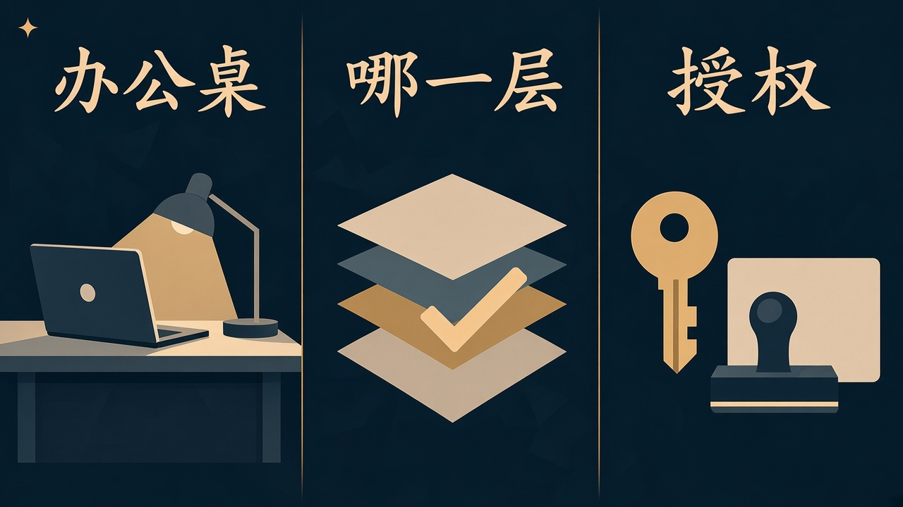

> 先说明一下：素材是我借助 AI 收集整理的，时间都按北京时间。写着「据 X 摘要」的，是 X 平台自动生成的新闻摘要，我暂时没找到一手来源，大家看的时候打个折。每条后面关于行业、公司、赚钱机会的判断都是我个人的看法，不是事实，更不是投资建议。教程视频都是网上公开的，标了「同类操作参考」的，讲的是同一类操作，不是针对这款新产品本身。

## 新能力进了办公桌，先看它接进哪一层、谁来授权

今天最显眼的，不是又多了几个模型名字，而是这些能力已经落到了办公桌上。OpenAI 的 GPT-6.2 Astra 和 Sol 进了 ChatGPT Work 与 Codex，也出现在 Microsoft Foundry、GitHub Copilot、Vercel AI Gateway 和 Amazon Bedrock；微软 Ignite 这一侧，Office 被放进 Copilot 应用，Copilot Home 一般可用，还和 Salesforce 宣布了 Copilotforce，打算把客户上下文和业务动作接到 Copilot、Teams 与 Fabric。我没有把「已经上线」理解成每个人打开就能用，或已经接进了工作流的每一层。能进 ChatGPT Work，不等于企业或教育工作区的管理员已经打开；能在 Copilot 应用里写 Word，不等于销售插件、Autopilot，或浏览器里的智能体浏览也已经同一天、同一套许可证全开。先看它接进哪一层，再看谁来授权、谁来付钱。

个人观点，不构成投资、采购或技术选型建议。数字和能力边界以各条原文为准。

## 今天最值得看的几件事

- **头条：OpenAI 发布 GPT-6.2 Astra 与 GPT-6.2 Sol**——官方署文标题为 “Introducing GPT-6.2 Astra and Sol”，副题 “A new standard for professional work”，News RSS `pubDate` UTC **17:45:00 · 11-17** ≈ 北京 **01:45 · 11-18**。Astra 面向最难的专业项目，Sol 面向日常工作；官方 API 标价须按原文记：Astra 输入/输出较 GPT-6 Astra 低 **20%**，缓存输入再打 **60%** 折扣，标准价为每百万 token 输入 **$8**、缓存输入 **$0.40**、输出 **$40**；Sol 沿用 GPT-6.1 Sol 的 **$2 / $0.10 / $10**。即日起 Plus、Pro、Enterprise 和 Edu 用户可在 ChatGPT Work 与 Codex 中使用；Pro 500 可对两款模型使用 Ultrafast，Ultrafast 首次提供给 Pro 200，先从 Sol 开始；符合条件的 Enterprise / Edu 需工作区管理员开启。开发者调用 ID 为 `gpt-6.2-astra` 与 `gpt-6.2-sol`，发布时即可用 Ultrafast。渠道可用性并入本条，不另开：Microsoft Foundry、GitHub Copilot、Vercel AI Gateway 与 Amazon Bedrock 均写一般可用；Bedrock 的 What's New 未列出具体区域或标价，不要补写。
- **紧随其后：微软 Ignite 把办公桌这一层铺开**——Office in the Copilot app 与 Copilot Home 一般可用，可在 Copilot 应用里直接创建、编辑并与同事合写 Word、Excel 和 PowerPoint；同一波次与 Salesforce 宣布 Copilotforce，Salesforce in Copilot 插件现为公开预览，Sales Cloud in Teams 仍是试点，Data Federation 才是一般可用。Windows Server 2028 是公开预览，本地推理是平台方向，不是已经交到所有用户手里的成品；Copilot+ PC 上的本地上下文、本地操作和本地模型，官方写的是 “coming soon”，不要写成今天已经全量上线。
- **同一场 Ignite 的模型波次：MAI Code 2 / Code 2 Flash、MAI Image 2.7、MAI Realtime 1、MAI Cyber 2 Flash、基于 MAI-Transcribe-2 的 Dragon Copilot Transcribe，以及已转一般可用的 Microsoft-Decision-1.1**——评测和标价一律按官方转述，预览与正式可用要分开写。Perception 一般可用，官方把它写成由红、蓝、绿队智能体按 playbook 运行的安全系统，不是面向个人的扫描器。
- **腾讯混元开放 Hy4 flash 权重**——同时放出 Instruct 模型、FP8 量化版和预训练底座 Hy4 flash-base。模型本身已在 **11-16** 写过，当时官方只写「计划开源」；今天的新闻是权重实际放出，不要把那天的定价或上线名单再写成今日新宣布。许可证是 Tencent Hy License，不要写成 Apache 2.0。社区 GGUF 仓 `AngelSlim/Hy4-flash-GGUF` 不是腾讯官方命名空间。
- **另有：** Gemini 应用 Tasks 对美国、日本、韩国、加拿大、澳大利亚和印度的数亿用户免费推出，使用 Gemini 4 Hydrogen，不要自行加上中国或其他地区；Google 搜索 AI Mode 上线临时对话线程；Vids 个人形象对个人 Google 账号免费开放。Perplexity 发布 Orchestrator API，并在 Computer 上新增高于 Ultra 的 Multiagent 档，两档不要混写，也不要补标价。
- **补录（多则官方署文日期为 11-17，落在今日过夜或上午窗）：** OpenAI 的 ChatGPT for Sales 与 Astra for Law；可灵 Kling Image 4.0 与 HeyGen Avatar 6；商汤 SenseNova Loop-9B 正式版开源；波士顿动力与格罗方德扩大合作，以及 Uber 与 Momenta 在慕尼黑的 Robotaxi 试运营。这些都不是今晚才第一次出现在官方页上，日期以原页为准。

## 模型发布

### 1. OpenAI 发布 GPT-6.2 Astra 与 GPT-6.2 Sol：进了 ChatGPT Work 和 Codex，渠道也铺开了（头条）

官方署文标题为 “Introducing GPT-6.2 Astra and Sol”，副题 “A new standard for professional work”，栏面随 News RSS，`pubDate` UTC **17:45:00 · 11-17** ≈ 北京 **01:45 · 11-18**。@OpenAI 于 UTC **17:54:03** ≈ 北京 **01:54** 发主帖宣布上线，@OpenAIDevs 随后称可在 Codex 与 API 中使用。

稿把 GPT-6.2 Astra 称为面向最难项目的新前沿模型，把 GPT-6.2 Sol 称为面向日常工作的高效通用模型，并写两者都能在更少输出 token 的情况下完成更吃重的任务。API 标价要按原文分列：Astra 的输入和输出较 GPT-6 Astra 低 **20%**，缓存输入再打 **60%** 折扣，标准价为每百万 token 输入 **$8**、缓存输入 **$0.40**、输出 **$40**；Sol 沿用 GPT-6.1 Sol 的每百万 token 输入 **$2**、缓存输入 **$0.10**、输出 **$10**。这是 OpenAI API 的官方标价，不要和下面各渠道的计费方式折成同一句。

可用性才是今晚真正要先看的一层。官方写：即日起 Plus、Pro、Enterprise 和 Edu 用户可在 ChatGPT Work 与 Codex 中使用这两款模型；Pro 500 订阅者可对两款模型使用 Ultrafast；首次把 Ultrafast 提供给 Pro 200 订阅者，先从 GPT-6.2 Sol 开始；符合条件的 Enterprise / Edu 用户，需工作区管理员开启后才能获得同样的访问。开发者可通过 API 调用 `gpt-6.2-astra` 与 `gpt-6.2-sol`，两款模型发布时即可用 Ultrafast。我不会把「Starting today」理解成所有套餐、所有工作区都已经默认打开，更不会把 Pro 200 的 Ultrafast 写成两款模型都能用。

评测数字一律按官方转述，不要外推成普遍工作结论。在 Agents’ Last Exam 上，稿称 Astra 比 GPT-6 Astra 高 **5.2** 分、成本不到其三分之一，比 Claude Fable 5.2 高 **5.5** 分、成本约为其 **5%**，并注明该榜对 Fable 5.2 排除了九项使用了备用模型的任务；在 Terminal-Bench-Science 0.1 上称比 GPT-6 Astra 高 **9** 个百分点、成本不到三分之一。内部 GDPval v2 上，稿称 Astra 领先所测模型，较 GPT-6 Astra 高 **6.2** 个百分点，且少用 **22%** 输出 token，Sol 较 GPT-6.1 Sol 高 **5.3** 分。这些都是官方自述或其所引基准，不是我复核过的第三方总榜。

安全方面，官方写两款模型都达到其 Preparedness Framework 的网络安全 Critical 阈值，以及生物/化学能力 High 阈值；GPT-6.2 Astra 被写成「首个对外发布、达到 AI Self-improvement High 阈值」的模型，并指向配套 [GPT-6.2 system card](https://deploymentsafety.openai.com/gpt-6-2-astra-sol/alignment)。System card 也写明 Sol 未达到这一档。这是实验室按自己框架做的能力分级和配套防护说明，不是已经发生了什么，也不宜写成耸人听闻的标题。

渠道可用性并入本条，不另开。Azure 官方账号称两款模型已在 Microsoft Foundry 一般可用。GitHub Changelog 写它们已在 GitHub Copilot 一般可用，面向 Copilot Pro+、Max、Business 和 Enterprise 用户，可在 VS Code、Visual Studio、Copilot CLI、coding agent、Copilot 应用、github.com、GitHub Mobile、JetBrains、Xcode 和 Eclipse 的模型选择器里选用；并写 rollout 是逐步进行的，Enterprise 和 Business 管理员可通过模型策略管理访问，默认启用新模型，除非管理员关闭了全局默认或明确禁用。计费按提供商标价、走用量计费，具体以 Copilot 的模型与定价页为准。Vercel Changelog 写两款模型已在 AI Gateway 上线。Amazon Bedrock 的 What's New 栏面日期为 **Nov 17, 2026**，写两款模型已一般可用，Astra 含面向低延迟场景的 Ultrafast 模式，可在 Bedrock 控制台或受支持的 API 中使用；区域、接口、功能和价格以 Bedrock 文档为准，这篇 What's New 没有列出具体区域或标价，我不会自行补上。@perplexity_ai 称已在 Perplexity Search 和 Computer 上线，并给出其 WANDR 基准数字：Astra **0.783** / 约每任务 **$12.54**，Sol **0.746** / 约 **$2.65**。这是 Perplexity 自家评测，不是 OpenAI 官方榜，不要并进上面那些分数里。

来源：[OpenAI·Introducing GPT-6.2 Astra and Sol](https://openai.com/index/introducing-gpt-6-2-astra-sol)、[GPT-6.2 system card](https://deploymentsafety.openai.com/gpt-6-2-astra-sol/alignment)、[GitHub Changelog·GPT-6.2 in Copilot](https://github.blog/changelog/2026-11-17-openais-gpt-6-2-astra-and-gpt-6-2-sol-now-available)、[Vercel Changelog·GPT-6.2 on AI Gateway](https://vercel.com/changelog/gpt-6-2-astra-and-sol-now-available-on-ai-gateway)、[AWS What's New·GPT-6.2 on Amazon Bedrock](https://aws.amazon.com/about-aws/whats-new/2026/11/openai-gpt-6-2-astra-sol-amazon-bedrock/)、[X·@OpenAI](https://x.com/OpenAI/status/2122750124543926515)、[X·@OpenAIDevs](https://x.com/OpenAIDevs/status/2122752256923873753)、[X·@Azure](https://x.com/Azure/status/2122779469274378305)、[X·@perplexity_ai](https://x.com/perplexity_ai/status/2122814545639223348)

这是一次已经落到办公桌和开发工具里的模型更新，可受益的是已经在用 ChatGPT Work、Codex、Copilot、Foundry 或 Bedrock 的专业团队和开发者。真正要先问的是：进的是 Work 还是 API，管理员开了没有，自己的套餐能不能用 Ultrafast，以及这条渠道怎么计费。付钱的是把「即日起可用」理解成所有席位默认打开、或把 Perplexity 的 WANDR 数字写成 OpenAI 官方成绩的人。标「Work / Codex 即日起对 Plus、Pro、Enterprise、Edu 开放；Enterprise 与 Edu 需管理员开启；Ultrafast 的档位要按套餐分列；Bedrock 区域和价格以文档为准」。

- 已经在用 ChatGPT Work 或 Codex 的 Plus / Pro 用户：先到产品里看模型是否出现，Pro 200 不要默认两款都能开 Ultrafast。
- 企业或教育工作区的管理员：先核对官方可用性说明，再决定是否为工作区打开，以及哪些成员可以使用。
- 在 GitHub Copilot 里写代码的人：先看自己是否属于 Changelog 所列的 Pro+、Max、Business 或 Enterprise，以及管理员有没有关闭新模型；用量按提供商标价走，不要和 OpenAI API 价目混成一张账单。
- 走 Foundry、Bedrock 或 Vercel AI Gateway 的开发团队：先核对各渠道自己的文档、区域和计费，不要把 OpenAI API 的 **$8 / $0.40 / $40** 直接抄到别的平台上。

教程：以[官方署文](https://openai.com/index/introducing-gpt-6-2-astra-sol)和各渠道说明为准。今晚未核到可跟练的官方操作视频。

### 2. 微软 Ignite 的 MAI 模型波次：编码、图像、实时语音、安全和决策模型要分开看可用范围

总述官方稿为 Microsoft AI 的 “Seven new world class models at scalable price-performance”，栏面日期 **Nov 17, 2026**。@MicrosoftAI 于 UTC **18:41:23 · 11-17** ≈ 北京 **02:41** 发主帖，并再发「七款新模型」帖。评测、标价和可用性一律按官方转述，专项稿和总稿有出入时分开写，不要合成一句更满的话。

MAI Code 2 专项稿写它面向日常企业编码的性价比，并称在 DeepSWE 1.1、Terminal Bench 2.1、SWE-Atlas、FrontierCode 等评测的平均意义上，达到 GPT-6.1 Sol 约 **98%** 的编码质量、价格约为其 **40%**，相对 Claude Opus 5.5 约 **96%** 性能、价格约为其 **5%**；同时写明「尚未针对基础科学研究、超长程智能体等更难问题做调优」。Code 2 与 Code 2 Flash 均已在 GitHub Copilot 一般可用，Code 2 Flash 还在 Microsoft Foundry 有限预览。

MAI Realtime 1 专项稿写这是微软首个语音对语音模型，基础语音价起为每音频分钟 **$0.01**，推理另行按每百万 token 输入 **$1**、输出 **$5** 计；可在 MAI Labs 试用，或登记 Foundry 有限预览，预览客户在公开预览开始前不计费。MAI Cyber 2 Flash 写它将独家进入微软安全产品（含 Codename MDASH），合格客户预计 **12** 月中旬起在 MAI profile 中自动替换现有模型。稿称在 CyberGym-E2E 上 MAI Cyber 2 为 **92.3%**、GPT-6 Astra 为 **91.5%**，单任务成本不到后者的 **2%**；脚注列出 Flash 标价为每百万 token 输入 **$0.10** / 缓存 **$0.01** / 输出 **$0.50**，上下文为 **100** 万 token。这不是面向公众的扫描器，也不要写成今天所有安全客户都已经自动切过去。

Microsoft-Decision-1.1 已在 Microsoft Foundry、OpenRouter 与 Vercel 一般可用。官方 commandline 署文日期 **2026.11.17**，写它自上月公开预览以来已被超过 **4,000** 家客户使用，并新增多模态。总稿称其比 GPT-Sol 6.1 快 **50** 倍、便宜 **79** 倍，用于路由、分类、优先级、校验和工作流控制，这些倍数是官方自述。MAI Image 2.7 见总稿：官方称在 Artificial Analysis 图像编辑榜居首，价格约为 GPT Image 2.6 Sunburst（max）的五分之一；文生图榜列第 **4**；Flash 写高用量场景约每 **1,000** 张 **$10**。两款均可在 Foundry 使用，并已出现在 Vercel AI Gateway changelog。Dragon Copilot Transcribe 建在 MAI-Transcribe-2 上，总稿称已在 Dragon Copilot 上线，覆盖医生—患者对话转写，服务每月 **1,000** 万次就诊，多语言错误率减半，并写已到美国三分之一医师手中。这是官方产品口径，不要外推成普遍临床结论。总稿还宣布 MAI Licensed Weights，可在自有 Azure 环境中定制并运行前沿 MAI 模型。同一总稿提到的 Maia 200，微软 **10-12** 已写过进入生产，今晚不另开硬件条。

同一场 Ignite，Satya 的公司博还写 “Perception is now generally available”：官方把它写成由红、蓝、绿队智能体按 playbook 运行的安全系统，并在授权后自动执行。这不是面向个人的安全扫描器。GitHub 官方博同期介绍 Codename MDASH 试点：六个开源项目（AutoGPT、Caddy、Express、FastMCP、ImageMagick、Netty）最终收到 **99** 份经核验的私下报告；截至 **11 月 15 日**，维护者已修复 **55** 项，其中 **14** 项已进入正式发布。稿写明该试点跑在较早的 MAI Cyber 模型上，今天宣布的是 MAI Cyber 2。不要把这些数字写成今天新发现的漏洞。

来源：[Microsoft AI·Seven new world class models](https://microsoft.ai/news/microsoft-ignite-2026/)、[Microsoft AI·MAI Code 2 and Code 2 Flash](https://microsoft.ai/news/introducing-mai-code-2-and-mai-code-2-flash/)、[Microsoft AI·MAI Realtime 1](https://microsoft.ai/news/introducing-mai-realtime-1/)、[Microsoft AI·MAI Cyber 2 Flash](https://microsoft.ai/news/introducing-mai-cyber-2-flash/)、[Microsoft commandline·Decision-1.1 GA](https://commandline.microsoft.com/microsoft-decision-model-ga/)、[Microsoft Blog·Ignite 2026](https://blogs.microsoft.com/blog/2026/11/17/ignite-2026-building-the-frontier-ecosystem/)、[GitHub Changelog·MAI Code 2 in Copilot](https://github.blog/changelog/2026-11-17-mai-code-2-and-mai-code-2-flash-in-github-copilot)、[GitHub Blog·Maintainers don’t need more AI bug reports](https://github.blog/open-source/maintainers/maintainers-dont-need-more-ai-bug-reports-they-need-fixes/)

这是微软把自己的模型送到 Copilot、Foundry 和部分行业产品里的一波更新。受益的是已经在这些入口里做编码、路由、图像或医疗转写的团队，以及微软安全产品的合格客户。付钱的是把有限预览写成已经全量开放、把 Cyber 模型当成公众扫描器，或把官方评测倍数写成自己业务一定能省下同样比例的人。标「预览与一般可用要分列；评测和标价均为官方自述；Perception 与 Cyber 2 不是面向个人的安全工具」。

- 在 GitHub Copilot 里做日常编码的人：可按 Changelog 查看 Code 2 与 Code 2 Flash 是否已出现，并把官方「尚未针对更难问题做调优」当成边界。
- 做客服语音或联系中心的人：Realtime 1 先看是 MAI Labs 试用还是 Foundry 有限预览，标价把每分钟音频和 token 推理分开记。
- 已在用 Dragon Copilot 的医疗机构：以产品内实际可用范围为准，不要把「美国三分之一医师」理解成自己所在地区已经开通。
- 安全团队：Cyber 2 Flash 和 Perception 都走微软安全产品与授权，先问是不是合格客户、要不要等到 **12** 月中旬的替换窗口。

教程：以各篇官方稿为准。今晚未核到可跟练的官方操作视频。

### 3. 腾讯混元开放 Hy4 flash 权重：今天是权重实际放出，不是模型第一次出现

该模型本身已于 **11-16** 写入此前精选，当时官方中英文博只写「计划开源」与 “plan to release Hy4 flash as an open-weight model”。今天的新闻是权重实际放出，我不会把那天已经写过的定价、WorkIndex 或上线名单再当成今日新宣布。

官方 @TencentHunyuan 主帖时间为 UTC **04:39:34 · 11-18** ≈ 北京 **12:39**，开篇为 “Hy4 flash is now open-weight, including Hy4 flash-FP8 and Hy4 flash-Base.”，并写 “224B (12B active), 1M context, natively multimodal.” 以及 “It's yours now. And stay tuned for Hy4 coming up next!”。Hugging Face 上的 `tencent/Hy4-flash`、`tencent/Hy4-flash-FP8`、`tencent/Hy4-flash-base` 已可打开；ModelScope、GitCode 以及官方 GitHub 仓 [Tencent-Hunyuan/Hy4-flash](https://github.com/Tencent-Hunyuan/Hy4-flash) 今晚也能打开。官方 README 写在 Hugging Face、ModelScope 和 GitCode 开源这三组权重；模型链接表将 Hy4 flash 列为 Instruct 模型、Hy4 flash-FP8 列为 FP8 量化 Instruct 模型、Hy4 flash-base 列为预训练底座，并写明 base 未经过指令微调，对话与推理示例适用于 Hy4 flash 和 Hy4 flash-FP8。

许可证是 **Tencent Hy License, Version 1.0**。LICENSE 开篇写它派生自 Apache License 2.0，但增加了第 **10** 节针对大规模 Model-as-a-Service（MaaS）业务的额外商业条款，并写明 “This License is not the Apache License, Version 2.0”。不要写成 Apache 2.0。

关于规模数字，须分列，不要对账补差。官方 X 主帖与 **11-16** 已录官方博写总参数 **224B**（其中 **64B** Engram）、激活 **12B**、上下文 **1M**；Hugging Face 英文 README 导言另写总参数 **220B**（含 **64B** Engram）、每 token 激活 **12B**，中文导言则写约为 **2200** 亿 / **640** 亿 / 激活约 **120** 亿。中英文规格表又列出 Total Parameters（excluding Engram, ViT, and DFly2）**155.5B**、Engram **63.5B**、ViT **0.43B**、DFly2 **0.85B**、激活为 Text **11.3B** + Vision **0.43B**、上下文 **1,048,576** tokens。这些是官方自己给出的不同口径，今晚不对齐成一个「更准确」的数。官方账号还预告 Hy4 将随后到来，不要写成 Hy4 已经开放权重。

官方 README 与 @TencentHunyuan 还指向社区 GGUF 仓 [AngelSlim/Hy4-flash-GGUF](https://huggingface.co/AngelSlim/Hy4-flash-GGUF)。官方账号给出了链接，但仓名仍是 `AngelSlim/`，不是 `tencent/` 官方命名空间，不要写成腾讯官方仓。

来源：[X·@TencentHunyuan](https://x.com/TencentHunyuan/status/2122912575302119554)、[Hugging Face·tencent/Hy4-flash](https://huggingface.co/tencent/Hy4-flash)、[Hugging Face·tencent/Hy4-flash-FP8](https://huggingface.co/tencent/Hy4-flash-FP8)、[Hugging Face·tencent/Hy4-flash-base](https://huggingface.co/tencent/Hy4-flash-base)、[GitHub·Tencent-Hunyuan/Hy4-flash](https://github.com/Tencent-Hunyuan/Hy4-flash)、[ModelScope·Tencent-Hunyuan/Hy4-flash](https://modelscope.cn/models/Tencent-Hunyuan/Hy4-flash)、[Tencent Hy License](https://huggingface.co/tencent/Hy4-flash/blob/main/LICENSE)、[Hugging Face·AngelSlim/Hy4-flash-GGUF](https://huggingface.co/AngelSlim/Hy4-flash-GGUF)

这是已经规划过的开源落地，受益的是要在自己的环境里部署或微调混元模型的团队。先看清下的是 Instruct、FP8 还是未做指令微调的 base，再看许可证里对大规模 MaaS 的额外条款。付钱的是把社区 GGUF 当成官方仓、把许可证写成 Apache 2.0，或把「Hy4 即将到来」写成已经可下载的人。标「今日是权重放出，不是模型首发；规模数字按官方不同口径分列；GGUF 为社区仓」。

- 要本地或私有化部署的工程团队：先从官方 GitHub 或 `tencent/`、`Tencent-Hunyuan/` 命名空间取权重，并通读 Tencent Hy License 第 **10** 节。
- 做量化或端侧试验的人：社区 GGUF 可以参考，但要标明来源和许可，不要把它写进「官方发布」四个字里。
- 关注后续 Hy4 的人：今晚只有预告，没有权重。

教程：以[官方 GitHub README](https://github.com/Tencent-Hunyuan/Hy4-flash)为准。今晚未核到可跟练的官方操作视频。

## 工具与产品

### 4. Office 进了 Copilot 应用，Copilot Home 一般可用，微软还和 Salesforce 宣布了 Copilotforce

这是 Ignite 里最直接碰到办公桌的一层。三件事放在一起写，是因为它们都在问：新能力到底接进了对话、文档、CRM，还是还停在预览和试点。官方署文日期均为 **Nov 17, 2026**。

Jared Spataro 的 Copilot 博写：Home（把 Chat 与 Cowork 放在一起）和 Office in Copilot 现已一般可用；Code 将在未来几周内一般可用；Copilot Managed Runtime 现已一般可用；Autopilot「今天开始向 Frontier 客户推出」。同一篇写，文件从一开始就继承 Microsoft 365 权限、敏感度标签和合规控制；并称这是「唯一能在不另计用量（without spinning a meter）的情况下创建 PowerPoint 或 Excel、且这些价值已包含在 Copilot 订阅许可中」的 AI 工具。这是官方自己的表述，不要外推到未写明的产品或套餐。

TechCommunity 上 Sumit Chauhan 的稿写得更具体：“Starting today, Office in the Copilot app is generally available.” 可用自然语言提出需求，Word 文档会在对话旁打开，也可用提示词继续改，或自己点进去编辑；Excel 和 PowerPoint 同理；可邀请同事实时合写，并在需要时转到完整的 Office 应用；所有文件保存在 OneDrive，并沿用组织已有的安全与合规控制。同稿还宣布 Copilot for sales（Frontier Public），销售技能可使用已连接的 CRM 数据与 Work IQ，并写可连接到 Zendesk、HubSpot 等工具；面向 PowerPoint 与 Copilot Cowork 的销售技能将放在同一个插件里。Copilot in OneNote、Pages 与 Workspaces 均为 Frontier Public；Today 为 Frontier Private，Spataro 稿写它目前是 Copilot 应用和 Outlook 里的私密预览。这些名字不要和已经一般可用的 Office in the Copilot app、Copilot Home 混成同一天全开。

微软与 Salesforce 在 Microsoft Source 宣布 Copilotforce：把 Salesforce 的客户上下文、业务流程和操作接入 Microsoft Copilot、Teams 与 Fabric。Salesforce in Copilot 插件现为公开预览，带 **38+** 个预置销售技能；Sales Cloud in Teams 现处于试点，开放测试要到今年晚些时候。数据方面，Data Federation 现已一般可用，可在 Salesforce Data 360 内直接查询和分析受支持的 Fabric OneLake 数据；Data 360 shortcut 现为公开预览。写回 CRM 的操作需要用户明确确认，并遵守既有校验规则。Accenture 担任设计与实施合作伙伴，同时也是试点客户。不要把公开预览或试点写成全体客户默认可使用。

同一波次，Edge for Business 也有智能体浏览更新。官方写 Cowork 的 agentic browsing 现已一般可用，但需要启用按使用量计费的 Microsoft 365 Copilot 许可证。Skills recorder 和 Interactive brief 写的是年底前以预览提供，同样需要上述许可证；托管智能体浏览则写为需 Microsoft 365 E5 许可证的预览。Remix 现已一般可用。官方提到的早期内部测试「平均可少用约 **30%** 的 token」同时写了 “It's early”，不要外推到所有站点。把浏览器智能体纳入 Agent 365 与 Entra 日志的表述，官方写成了展望，不要当成已经上线。

来源：[Microsoft Copilot Blog·Copilot at Microsoft Ignite](https://www.microsoft.com/en-us/copilot/blog/2026/11/17/copilot-at-microsoft-ignite-expanding-whats-possible-with-intelligence-built-for-work/)、[TechCommunity·Office at Ignite 2026](https://techcommunity.microsoft.com/blog/microsoft-copilot-blog/office-at-ignite-2026-from-apps-to-agentic-system-of-work/4572226)、[Microsoft Source·Copilotforce](https://news.microsoft.com/source/2026/11/17/microsoft-and-salesforce-announce-copilotforce-bringing-trusted-customer-context-and-action-into-microsoft-ai-experiences/)、[Microsoft Edge Blog·Edge for Business Ignite 2026](https://blogs.windows.com/msedgedev/2026/11/17/edge-for-business-ignite-2026-innovations/)

这是把文档、对话和客户系统往同一张办公桌里收的一波更新。受益的是已经有 Microsoft 365 Copilot 许可、并且 IT 愿意打开相应功能的知识工作者和销售团队。付钱的是把 Frontier Public、公开预览和试点都写成「全员默认可用」，或以为浏览器里的智能体浏览不需要按用量计费许可证的人。标「Office in Copilot 与 Copilot Home 为一般可用；销售、OneNote、Pages、Workspaces、Today 以及 Copilotforce 的各层可用性要分开看」。

- 已经在用 Microsoft 365 和 Copilot 的办公人员：先在 Copilot 应用里确认 Office 是否已出现，文件仍走 OneDrive 和原有权限；不要把 Today 或 Autopilot 当成已经对所有人开放。
- 销售运营和 CRM 管理员：先分清 Salesforce in Copilot 是公开预览、Sales Cloud in Teams 是试点、Data Federation 才是一般可用，写回 CRM 仍需人工确认。
- IT 和安全团队：先核对本组织的 Copilot 许可证类型，再决定是否打开 Edge 里的 agentic browsing；Skills recorder、Interactive brief 和托管浏览还不是一般可用。

教程：以上述官方稿为准。官方稿未给出独立教程视频地址，今晚也不另找替代跟练片。

### 5. Windows Server 2028 公开预览把本地推理写成方向；Copilot+ PC 上的三项本地能力官方写的是「即将到来」

Windows Server 团队官方博 “Windows Server 2028: A trusted foundation for an evolving enterprise” 栏面日期 **Nov 17, 2026**，开篇就写 Windows Server 2028 现已公开预览。长期投入是把 Microsoft Foundry 延伸到本地「token factories」，让客户把推理放在靠近应用和数据、或自己控制的环境里。运行时层，团队博写正在推进对 Foundry Local、Windows ML、vLLM 和 Llama.cpp 的支持。这是平台方向和预览，不是已经一般可用的本地 AI 成品。安全、性能与管理类预览功能可通过 Windows Server Insider Program 使用；混合智能相关能力则只向有限客户提供早期体验，并有硬件要求，不要写成所有预览用户都已能在生产环境部署本地推理。同一篇还写默认启用原生 NVMe，并支持 NVMe over TCP 与 RDMA，以及从 ReFS 启动；Intune 对 Windows Server 的管理现已进入预览。

硬件时间点要分列，不要合成一句。Windows Server 团队博写 AMD 的 Instinct MI350P 卡将从 **2027** 上半年起进入预览，适用已在售、受支持的 Windows Server 以及 Windows Server 2028；Windows Experience Blog 则写 MI350P 预览面向 Windows Server **2025** 及以后版本。同篇 Windows 博还写，NVIDIA DGX Station for Windows 将配备 GB300 Grace Blackwell Ultra Desktop Superchip、最多 **748 GB** 一致性内存，并在 Windows Server 2028 正式可用时提供支持。

同一篇 Windows Experience Blog（RSS `pubDate` UTC **18:20:56 · 11-17** ≈ 北京 **02:20**）还宣布，Copilot+ PC 上的 Copilot 即将迎来三项本地能力：本地上下文、本地操作与本地模型。官方写的是 “coming soon to Copilot+ PCs”，不要写成已经全量向所有 Windows 11 用户开放。官方把第一项写成 local context：在得到许可后，Copilot 可以使用已打开的文件、正在使用的应用和设备当前状态。第二项是 local actions：Copilot 将能够在 Windows 上采取行动，从处理文件到帮助诊断电脑问题，同时由用户保持控制。第三项是 local models：Copilot 将越来越多地使用本机运行的模型，并在任务需要时再转到云端。落地举例方面，官方写可用自然语言查找、整理、移动、复制或重命名文件；Local PC diagnostics 则可对系统做只读扫描，帮助找出错误或性能问题的根因，并举了蓝牙音频不工作、网络变慢这类可用一句话提问的例子。这些都还是「即将到来」的说明，不是今晚已经装到每台 Copilot+ PC 上的开关。

GitHub 在 Ignite 期间也更新了 Copilot，只记关键边界：Evals 进入公开预览，面向 Copilot Individual、Business 和 Enterprise；Copilot 应用对 Azure DevOps 与浏览器使用进入公开预览，云端会话不可用于 Azure DevOps 仓库，浏览器使用默认关闭；GitHub Enterprise Server 支持现已一般可用，需将 Copilot 应用更新到 **1.2.0** 或更高版本，云端会话同样不可用于 GHES。

来源：[Windows Server 团队博·Windows Server 2028](https://techcommunity.microsoft.com/blog/windowsservernewsandbestpractices/windows-server-2028-a-trusted-foundation-for-an-evolving-enterprise/4574112)、[Windows Experience Blog·Building Windows for the next era of work](https://blogs.windows.com/windowsexperience/2026/11/17/microsoft-ignite-2026-building-windows-for-the-next-era-of-work/)、[GitHub Changelog·Copilot Evals](https://github.blog/changelog/2026-11-17-github-copilot-evals-is-now-in-public-preview)、[GitHub Changelog·Copilot app Ignite 更新](https://github.blog/changelog/2026-11-17-github-copilot-app-microsoft-ignite-releases)

这是把本地推理和本地 Copilot 写成方向的一波宣布。受益的是已经在评估 Windows Server 预览、或规划 Copilot+ PC 刷新的基础设施和终端团队。付钱的是把公开预览写成已经可在生产环境全面部署，或把 “coming soon” 写成今天所有 Windows 用户都能用本地诊断的人。标「Windows Server 2028 为公开预览；本地推理是方向，有限客户早期体验；Copilot+ PC 三项本地能力为即将到来」。

- 服务器和平台团队：可按 Insider Program 或 TAP 了解预览，先核对硬件要求和混合智能是否在自己的早期体验范围内。
- 终端和 IT 支持团队：把 Local PC diagnostics 当成即将到来的只读排查能力，而不是今天已经向全员开放的自动修复工具。
- 使用 GitHub Enterprise Server 或 Azure DevOps 的开发团队：先看 Copilot 应用版本和「云端会话不可用」这条边界。

教程：以官方博为准。今晚未核到可跟练的官方操作视频，也不要把第三方演示当成微软官方教程。

### 6. 补录（11-17）：ChatGPT for Sales 上线销售插件，Astra for Law 现可由所有 Enterprise 客户申请

这两则官方署文栏面日期均为 **November 17, 2026**，落在昨日 RSS 尚未收入、今日过夜窗重建后才出现的时段，故作补录，不要写成今晚才第一次宣布。

“Introducing ChatGPT for Sales” 写的是新的 Sales 体验和 Sales 插件，并一次上线超过 **30** 个新的或增强的合作伙伴插件，帮助销售团队覆盖从找对客户到跟进承诺。OpenAI 自有 Sales 插件提供现成工作流，并与 Salesforce、HubSpot、Apollo、Gong、Docusign、Figma、Canva 等合作伙伴插件打通 CRM、外呼、会议记录、报价和合同。开始方式是安装 Sales 插件；ChatGPT Business 与 Enterprise 管理员可在 Admin Console 的 Plugins 里为工作区启用 Sales 插件和相关合作伙伴插件，或为成员默认安装。官方写明：合作伙伴插件与功能可用性随计划、地区和工作区设置而变。不要写成所有个人 Plus 用户默认可用，也不要把插件名单写成已全部在所有地区上线。

“Astra for Law leads in legal intelligence” 把 Astra for Law 写成 GPT-6.2 Astra 面向律师的配置。官方写即日起每个 ChatGPT Enterprise 客户都可以在管理控制台的 Trusted Access Program 里申请；已获权团队在 ChatGPT 中选择 `gpt-6.2-astra-law`；客户也可通过表格申请 API，以便做到自有工具里。评测须按官方口径写：稿称其在 Harvey LAB-AA 上取得领先，并设小节标题 “95% fewer hallucinations per assignment than Claude Opus 5.5”；另称在 Vals AI Legal Research Bench 上表现靠前。这些都是官方自述或其所引基准，不要写成已经向所有个人用户开放，更不要扩写成真实律所办案结论。

来源：[OpenAI·Introducing ChatGPT for Sales](https://openai.com/index/introducing-chatgpt-for-sales)、[OpenAI·Astra for Law leads in legal intelligence](https://openai.com/index/astra-law-6-2)

这是两条已经对准销售和法律办公桌的入口，但授权方式完全不同。Sales 走的是 Business / Enterprise 工作区里的插件开关；Astra for Law 则是 Enterprise 客户通过 Trusted Access Program 申请。付钱的是把这两条理解成 Plus 用户打开就能用，或把法律评测写成可以替代律师意见的人。标「补录 11-17；插件可用性随计划、地区和工作区而变；Astra for Law 需 Enterprise 申请，不是个人默认开通」。

- 销售运营或 RevOps：先让工作区管理员在 Plugins 里核对本地区、本计划能开哪些插件，再决定是否默认安装。
- 律所或企业法务的 IT 负责人：先确认自己是 ChatGPT Enterprise 客户，再按 Trusted Access Program 申请；获权后再使用 `gpt-6.2-astra-law`。
- 律师本人：把官方基准当成厂商自述，办案仍须由专业人员审核来源和结论。

教程：以两篇官方署文为准。今晚未核到可跟练的官方操作视频。

### 7. Google：Gemini 应用 Tasks 在六国免费推出，AI Mode 临时对话和 Vids 个人形象也在同一波

这几则官方署文日期均为 **Nov 17, 2026**，`pubDate` UTC **17:00:00 · 11-17** ≈ 北京 **01:00 · 11-18**，并入一条。

Gemini 应用 Tasks 的署文标题为 “Put Gemini to work for you”。稿写即日起这一更新对美国、日本、韩国、加拿大、澳大利亚和印度的数亿用户免费推出，并使用 Gemini 4 Hydrogen；一套更高级功能则从美国开始。国家名单以官方原文为准，不要自行加上中国或其他地区。使用方式是打开 Gemini，把主屏开关从 Chat 拨到 Task。从美国开始，还可以把邮件转发到 gemini@google.com，或按设置里的 Channels → Text with Gemini 绑定手机号发短信。文中举例包括代打电话并写入日历、在授权后查看公用事业账单、用 Agent Payments Protocol（AP2）购物（稿写正在与 Mastercard、Visa 合作，American Express 为 coming soon，可预先设置支出上限，收据进入 Google Wallet），以及用 RCS 把商品加进 Instacart 订单。Gemini 现在连接超过 **60** 个常用应用。限制须按官方脚注写：通过 Gemini 打电话目前在 Indiana、Louisiana、Minnesota、Montana 和 Nebraska 不可用；须持有符合条件运营商的美国手机号。官方也写，任务会在关键步骤前暂停并征求确认。

Google 搜索的 AI Mode 上线临时对话线程。官方写可在 AI Mode 右上角点临时对话图标；因为会话与账号完全分离，回答不会参考过往偏好，也不会进入历史或影响日后个性化，关闭线程后即消失。该功能正在全球桌面和移动浏览器上线，覆盖 AI Mode 已支持的全部语言。

Google Vids 则把个人形象头像对拥有个人 Google 账号的用户免费开放。稿写可扫二维码生成本人形象并加入视频提示，然后输入要说的话；头像保存在 Vids 项目中，可在各镜头复用。官方写明个人形象与 Google 账号绑定，且仅限账号持有者本人的样貌。试用入口为桌面端 [vids.new](https://vids.new)。

同一天，Google Developers Blog 还介绍了 Antigravity 的 Robotics 插件：配合此前已经发布的 Gemini 4 Hydrogen，把机械臂接入、仿真和控制收进同一工作台。Hydrogen 本身不是今天才第一次发布；本篇重点是插件。安装方式是在 Antigravity 的 Customizations 里搜索 Robotics。Antigravity 面向付费的 Google AI Pro 或 Ultra 订阅者；也可用 Gemini API 调用 `gemini-4-hydrogen`，或在 Google AI Studio 试用。

来源：[blog.google·Put Gemini to work for you](https://blog.google/innovation-and-ai/products/gemini-app/tasks-in-gemini-free-new-features/)、[blog.google·Temporary threads in AI Mode](https://blog.google/products-and-platforms/products/search/temporary-threads-ai-mode/)、[blog.google·Vids personal avatars](https://blog.google/products-and-platforms/products/workspace/vids-personal-avatars-no-cost/)、[Google Developers Blog·Gemini 4 Hydrogen for robotics](https://developers.googleblog.com/gemini-hydrogen-for-robotics/)

这是一组已经碰到个人助手、搜索和视频的更新，但免费范围、高级功能和机器人插件并不在同一层。受益的是上述六国里已经在用 Gemini 应用的人，以及有个人 Google 账号、想在 Vids 里做形象的人；机器人插件则面向已经订阅 Antigravity 的开发者。付钱的是人在名单之外却以为自己也能免费打电话、付账单，或把邮件转发、短信和购物理解成全球同步开放的人。标「Tasks 免费范围为美、日、韩、加、澳、印；打电话另有美国州和运营商限制；临时对话不影响个性化；Vids 仅限账号持有者本人形象」。

- 在上述六国、且已有 Gemini 应用的人：可把主屏开关拨到 Task 试试；打电话、转发邮件和短信这些更高级的入口，先看自己是不是从美国开始的那一组，并核对州和运营商限制。
- 用 Google 搜索 AI Mode 的人：临时对话适合不想写入历史的询问，关掉就消失，也不会按你的旧偏好作答。
- 有个人 Google 账号、想做短视频的人：可到桌面端 vids.new 看个人形象是否已对免费账号开放，注意仅限本人样貌。
- 机器人开发者：先确认自己有 Google AI Pro 或 Ultra，再在 Antigravity 里安装插件；不要把上周已发布的 Hydrogen 当成今天才出现的新模型。

教程：Tasks、临时对话和 Vids 以对应官方说明页为准。今晚未核到可跟练的官方操作视频，也不把旧的 NotebookLM 或 Canvas 教程拿来顶替。

### 8. Perplexity：Orchestrator API 把多模型收进同一接口，Computer 则在 Ultra 之上加了 Multiagent 档

两则官方博客栏面日期均为 **November 17, 2026**，并入一条，但产品和档位要分开写。

“Introducing Orchestrator: One API for frontier and open-weight models” 把这次发布写成向开发者和团队开放其「与模型无关」的技术：一条 API 可以把高频、简单任务放到更便宜的模型上，把更难的工作留给更强的模型，由 Perplexity 负责供应商路由和故障转移。模型覆盖写明包括 OpenAI、Anthropic、Google 和 xAI，以及 GLM、Kimi、DeepSeek 等开源权重模型（开源权重模型由 Perplexity 或推理合作方提供）。兼容格式为 OpenAI Chat Completions、OpenAI Responses 和 Anthropic Messages；起步方式是换 API key 与 base URL，再选模型。计费上，稿写把支持的模型收进同一家供应商和同一张账单，并写 “There's no additional platform fee on top of credits”；也可在 API Console 里按模型、项目、密钥和日期看用量，并做允许名单、用户限制、支出上限和容量申请。Routes（可用 Lower cost / Balanced / Higher quality 配置，或用自然语言描述各模型应处理哪些请求）和 Auto effort（按开发者定义的策略调整下一次推理投入）官方写明仍是预览功能。官方还写其模型层每天路由数以亿计的请求、覆盖 **85+** 模型和十多家供应商；并称在一个月的生产流量里，经 Orchestrator 的 Claude 和 GPT 请求成功率高于所测的任何单一供应商。大流量或承诺用量可发邮件到 api@perplexity.ai 询价。官方没有在这篇博文里给出公开的按 token 标价，今晚也不补。

“Introducing Multiagent for the most complex work” 写的是 Perplexity Computer 的努力程度档位。今年九月已上线四级 effort 控制；此次新增的 Multiagent 档放在 Ultra 之上，面向更复杂的工作，不要把档名写成别的叫法。官方写 Claude Fable 5.2 负责规划任务，并把它分给运行 Claude Opus 5.5、GPT-6.1 Sol 和 Gemini 4 Carbon 的代理；这些代理并行工作、直接交换发现并交叉检查，再由主代理汇总成一份答复。选定 Multiagent 后，主代理最多可指派 **16** 个代理，同时自己也承担一部分工作；默认团队就是上述三款模型。用户可在查询里指定模型；稿写 Fable 5.2 和 GPT-6 Astra 仅在用户要求、或某一部分任务需要时，才作为辅助代理加入。所有 Perplexity Max 订阅者即日起可在网页端使用，入口是 Computer 的 effort 滑块。文中还区分了 Ultra、Multiagent 和 Model Council 的适用场景，不要混用。

来源：[Perplexity Blog·Introducing Orchestrator](https://www.perplexity.ai/hub/blog/introducing-orchestrator)、[Perplexity Blog·Introducing Computer Multiagent](https://www.perplexity.ai/hub/blog/introducing-computer-multiagent)

这是把「选哪个模型、花多少力气」收进同一家入口的更新。Orchestrator 面向开发者和团队的 API 账单；Multiagent 面向已经订阅 Perplexity Max、并在网页端使用 Computer 的人。付钱的是把两条产品写成同一件事，把 Routes / Auto effort 的预览当成已经定死的计费策略，或在没有公开标价的情况下自行补一张价目表的人。标「Orchestrator 为 API；Multiagent 为 Computer 上高于 Ultra 的档位，面向 Max 订阅者；预览功能需单独标明」。

- 已经在用多家模型 API 的开发团队：可按官方 quickstart 换 key 和 base URL 做验证，先看控制台里的允许名单和支出上限；大流量再按官方邮箱询价。
- Perplexity Max 用户：若在网页端用 Computer，可在 effort 滑块里找到 Multiagent，先分清它和 Ultra、Model Council 各自适合什么样的任务。
- 采购或财务：官方写 credits 之上没有额外平台费，但具体模型单价仍以控制台和合同为准。

教程：以两篇官方博文为准。今晚未核到可跟练的官方操作视频。

### 9. 中段简报：Vercel eve 1.0、Google ABFS 与 AI Studio、Cerebras、Devin Bots、Anthropic 关联计费，以及一组 AWS 更新

下面这几则都值得知道，但不逐条铺开。官方署文或 What's New 多落在 **11-17**，其中部分是今日补录。

Vercel 宣布开源智能体框架 eve 1.0 一般可用，并写自六月公开预览以来已累计 **230** 余次发布。这是开源框架，不是「Vercel 自有的写代码产品已经 GA」；起步可用 `npx eve@latest init my-agent`。Google 将 ABFS 开源，仓为 [google/abfs](https://github.com/google/abfs)，官方把一组检出/构建时间对比写在同一云网络、GCE `n2d-standard-64` 上的 Android 流程里；「传统上超过 30 分钟 / 一个多小时」与「约 36 分钟 / 约 80 分钟」是两套表述，不要并成同一组数字。官博页内有视频，今晚未能取出可核验的 YouTube 地址，故不编造。同日 Google AI Studio 现可从一条提示搭建全栈 Android 应用，并写可发到「个人 Google Play 书库」；不要把它写成已经面向全部用户的商店上架，也不要把 “at no cost” 理解成 Firebase 或 Gemini API 一律免费。

Cerebras 宣布已把分离式推理投入生产：GPU 做 prefill，Cerebras 系统做 decode。官方称在 **11 月 14 日** 共享的 GPT-OSS-120B 端点上，相对仅用 CS-3 的基线，每兆瓦吞吐量达到 **5** 倍且生成速度没有损失。这是特定端点上的官方自述，不要写成适用于所有模型或所有数据中心。Cognition 推出 Devin Bots，可接管长期目标并带领多组 Devin 会话并行交付，现已在 [devin.ai/bots](https://devin.ai/bots) 提供；内部案例数字是公司自述，价格与配额本轮未核到公开标价，官方 Vimeo 只作演示、不当作已核验跟练片。Anthropic 在 Claude Platform 推出关联计费（Linked billing）测试版，让终端客户用自己的 Claude 组织支付 API 用量、不再共享密钥。帮助中心写明：只有由 Anthropic 直接计费的组织可以关联；经 Bedrock、Vertex AI 或 Foundry 使用 Claude 的组织，以及 Claude 订阅方案和通过云市场付费的 Console 组织，均不能使用。请求实际运行在平台自己的组织中，因此客户组织的 IP 允许名单、数据保留（包括零数据保留）等设置不适用于这些请求；仍处于测试阶段的应用须设置不超过 **$50** 的支出上限。

AWS 不逐条展开。SageMaker AI 的数据准备能力现已一般可用，包括自动标注、人工核验、合成数据和数据质量评估，源数据仍留在客户自己的 S3；可用区域仅写美国东部（弗吉尼亚北部）和美国西部（俄勒冈）。同波次还有实时端点的 KV cache aware 路由，以及 HyperPod Inference 上的 Managed NVIDIA Dynamo，只记官方已宣布的能力，不补延迟数字。AgentCore Memory 的 What's New 标题写短期记忆最长可保留 **10** 年，以及完整会话摘要，今晚只按标题转述。AgentCore 还宣布每月 **5,000** 次免费网络搜索查询，由组织内所有账户在受支持区域共享并按月重置；可用区域为美国东部（弗吉尼亚北部、俄亥俄）、美国西部（俄勒冈）、欧洲（爱尔兰）、亚太（悉尼）和亚太（东京），不要补写未给出的单价。

来源：[Vercel Blog·eve 1.0](https://vercel.com/blog/eve-is-now-generally-available)、[Google Developers Blog·ABFS](https://developers.googleblog.com/accelerating-development-for-massive-git-repositories/)、[GitHub·google/abfs](https://github.com/google/abfs)、[Google Developers Blog·AI Studio Android apps](https://developers.googleblog.com/build-full-stack-android-apps-with-gemini-in-google-ai-studio/)、[Cerebras·disaggregated inference](https://www.cerebras.ai/blog/cerebras-launches-disaggregated-inference)、[Cognition·Devin Bots](https://devin.ai/blog/introducing-devin-bots)、[Anthropic·Linked billing](https://claude.com/resources/articles/linked-billing-on-claude-platform)、[Claude 帮助中心·第三方应用关联](https://support.claude.com/en/articles/18467148-use-your-claude-platform-account-in-a-third-party-app)、[AWS ML·SageMaker AI data preparation](https://aws.amazon.com/blogs/machine-learning/announcing-ai-data-preparation-capabilities-in-amazon-sagemaker-build-high-quality-datasets-for-model-development-workflows/)、[AWS What's New·AgentCore Memory 十年短期记忆](https://aws.amazon.com/about-aws/whats-new/2026/11/amazon-bedrock-agentcore-memory-10-year-retention)、[AWS What's New·AgentCore 免费网络搜索](https://aws.amazon.com/about-aws/whats-new/2026/11/bedrock-agentcore-free-web-search-queries/)

付钱的是把预览或测试版写成全员默认可用、把个人 Play 书库写成商店上架，或把厂商案例数字当成自己也能得到的结果的人。标「eve 是开源框架；ABFS 对比数字须带测试条件；关联计费为测试版；SageMaker 数据准备仅两个区域」。

- 做智能体应用、构建缓存或第三方 Claude 应用的人：先回到官方仓、帮助中心和计费限制，再决定能不能接进自己的工作流。
- 在 SageMaker 或 Bedrock 上准备数据的人：先看区域是否已经开放。

教程：以各官方页为准。ABFS 官博视频今晚未取出可核验地址；Devin 的 Vimeo 只作官方演示，不当作已核验跟练片。

### 10. 补录（11-17）：可灵上线 Kling Image 4.0，HeyGen 发布 Avatar 6

可灵官方英文博标题为 “Meet Kling Image 4.0 | Stunningly realistic. Sharp. Precise.”，栏面日期写 **Nov 18, 2026**，但 JSON-LD `datePublished` 为 UTC **07:48:53 · 11-17** ≈ 北京 **15:48 · 11-17**，API Updates 也将「Kling Image 4.0 API Now Available with Native 8K」记在 **11/17/2026** 下，故作 **11-17** 补录。官方写该模型已在 Kling Creative Studio 上线，并向企业与开发者提供 API，支持原生 **8K**；还写单图最多可生成 **2,000** 个字符的文字，一次提示最多可生成 **10** 张风格一致的组图。官方博把提示上限写成最多 **15,000** tokens，API 文档则另有按英文/非英文字符数计算的上限，不要把这两组数字写成同一件事。API Updates 写计费现同时覆盖输入参考图与输出图，按张计，输出单价随分辨率变化，并指向定价页；今晚不摘具体标价，也不自行补价格。

HeyGen 发布 Avatar 6，官方称这是其迄今最强的数字人模型，能按台本生成与语义对应的手势，并输出原生 **2K** 视频。新闻稿经 PR Newswire 发出，时间戳为 **Nov 17, 2026, 12:07 ET** ≈ 北京 **01:07 · 11-18**，写即日起可在 HeyGen 平台和 API 使用，现有 Personal Avatars 会自动升级，无需重新录制。关于「像不像真人」的数字须分列：产品页写与真实录像并排比较时，Avatar 6「**84.4%** indistinguishable」，FAQ 解释这是把评测者把该形象认成真人的 **42.2%** 除以 **50%** 后写成「**84.4%** of the way there」；新闻稿则写在 Turing-style 测试中，**84%** 的参与者认为该数字人与本人同样真实。不要把 **84.4%** 写成「84% 的人完全分不出」。创建入口的时长要求也不一致：操作说明写至少录 **15** 秒，FAQ 和新闻稿写 **30** 秒，须分列，不要合成一个门槛。产品 FAQ 写第一个视频免费、无需信用卡，之后消耗积分，方案起价为每月 **$29**、含 **600** 积分。

来源：[Kling AI·Meet Kling Image 4.0](https://kling.ai/blog/kling-image-4-stunningly-realistic-sharp-precise)、[Kling AI·API Updates](https://kling.ai/document-api/updates/api)、[HeyGen·Avatar 6 产品页](https://www.heygen.com/models/heygen-avatar-6)、[PR Newswire·HeyGen Introduces Avatar 6](https://www.prnewswire.com/news-releases/heygen-introduces-avatar-6-an-audio-driven-context-aware-ai-model-that-alleviates-repetitive-or-unnatural-motion-in-ai-generated-video-302942527.html)

这是两条已经进到创作工具里的图像和数字人更新。受益的是已经在用可灵或 HeyGen 的内容、电商和培训团队。付钱的是把官方博与 API 文档的提示上限混成一组，或把 **84.4%** 理解成「已经分不出真假」的人。标「补录 11-17；原生 8K 与原生 2K 均为官方自称；可灵未在本稿摘录单价；HeyGen 的录制时长门槛须分列」。

- 电商和设计团队：可到 Creative Studio 或 API 文档看 8K、组图和长图是否已对当前账户开放，价格回到官方定价页。
- 做培训或营销视频的人：HeyGen 现有个人形象会按官方说明自动升级，但录制门槛和积分方案以产品页和 FAQ 为准。
- 需要本人形象的团队：官方写须由本人或获得明确许可的人制作，不要把它当成可以随便用他人面孔的工具。

教程：以可灵和 HeyGen 的官方页为准。今晚未核到可跟练的官方操作视频。

### 11. 补录：商汤正式发布并开源 SenseNova Loop-9B；云知声与范式智能先按官方页写清边界

商汤官网新闻标题为「SenseNova Loop-9B正式版：让更少的参数走更深的计算路径」，栏面日期 **2026/11/17**。GitHub 仓库 News 写 **2026-11-17** 正式发布，并在 **2026-11-18** 补了 AWQ 与 GGUF 权重下载链接。该模型 Preview 约 **10** 月末已经开源，此次是正式版。官方写总参数量约为 **9B**，通过两次执行共享的中间层，将 **32** 个物理解码层扩展为 **56** 次层计算；支持文本、图像输入和文本输出，上下文长度最高可达 **512K** tokens。评测按官方转述：NL2Repo 得分为 **41.36**，接近 Qwen3.8-27B 的 **44.60**；AIDABench 为 **65.31**，高于后者的 **65.01**。部署数字须分列：官方写 **4bit** 量化后权重仅约 **4.9GB**，并写「部署显存需求低至 10 GB内」；另写采用 4bit 权重量化与 8bit KV 缓存时，**256K** 长上下文推理的显存需求约为 **15 GiB**，不要并成同一组。权重与代码已开放，GitHub 为 [OpenSenseNova/SenseNova-Loop](https://github.com/OpenSenseNova/SenseNova-Loop)，Hugging Face 模型仓为 [sensenova/SenseNova-Loop-9B](https://huggingface.co/sensenova/SenseNova-Loop-9B)，README 写项目采用 Apache License 2.0。

云知声（港交所代号 **9678**）自愿性公告署「中國，北京 / 2026年11月18日」，发布 U2-Flash-1118，称在原有语言基座参数规模不变的基础上新增约 **1B** 参数的视觉模块，并给出相对原版本在总 Token 消耗和调用次数上的对比。公告中的榜单名次按原文看即可，不要外推。官网产品页另写了总参数、上下文和一组分数及标价，这些具体数字未出现在港交所公告正文，须标明出自产品页。今晚未在 Hugging Face 检索到 U2-Flash-1118 公开仓。

范式智能经 Media OutReach 发出的通稿署 **18 Nov 2026 4:45pm HKT**（≈ 北京 **16:45**），发布面向代码与 Agent 的 Phai-A1（**35B** MoE，上下文 **100 万** Token）和有声视频生成模型 Phai-M1。产品站 [phai.phanthy.com](https://phai.phanthy.com/) 现写 Phai-A1「开放权重，下载就能用」，并给出 Hugging Face 与 ModelScope 上 `PhaiModelLab/Phai-A1-35B-1M` 的下载命令；今晚打开这两个仓均可访问，许可证写为 Apache 2.0。但早间财经转载与通稿仍写「计划未来不久开放」Phai-A1 与 Phai-M1 的权重；产品站给出的下载命令也只覆盖 Phai-A1，今晚在 Hugging Face 未检索到 Phai-M1 权重仓，不要把 Phai-M1 写成已经上架开源权重。Hugging Face 模型卡把 `base_model` 列为 `Qwen/Qwen3.6-35B-A3B`，这是模型卡字段，须与通稿「自研模型」的表述分开写，不在这里自行定性二者关系。通稿里「约为 Qwen 27B 的 **8** 至 **10** 倍」是通稿表述，产品站正文今晚未见把该倍率写进去，故分列。

来源：[商汤·SenseNova Loop-9B正式版](https://www.sensetime.com/cn/news/sensenova-loop-9b-20261118-1059)、[GitHub·OpenSenseNova/SenseNova-Loop](https://github.com/OpenSenseNova/SenseNova-Loop)、[Hugging Face·sensenova/SenseNova-Loop-9B](https://huggingface.co/sensenova/SenseNova-Loop-9B)、[港交所·云知声自愿性公告](https://www.hkexnews.hk/listedco/listconews/sehk/2026/1118/2026111800268_c.pdf)、[云知声·U2-Flash-1118 产品页](https://www.unisound.com/u2flash)、[范式·Phai 产品站](https://phai.phanthy.com/)、[Media OutReach 英文通稿](https://www.media-outreach.com/news/china/2026/11/18/502315/phancy-launches-phai-a1-language-model-and-phai-m1-video-generation-model/)、[Hugging Face·Phai-A1-35B-1M](https://huggingface.co/PhaiModelLab/Phai-A1-35B-1M)

这是三条国内模型更新，开放程度并不一样。SenseNova Loop-9B 是正式版权重和代码已经放出；云知声今晚看到的是公告和产品页，没有公开权重仓；范式智能的产品站已经提供 Phai-A1 下载，但 Phai-M1 仍不能写成已经开源。付钱的是把预览版、正式版、产品页分数和公告数字混成一套，或把「计划开放」写成两款都已经可下载的人。标「Loop-9B 为正式版开源；云知声分数和标价须区分公告与产品页；Phai-A1 已有下载入口，Phai-M1 权重未见上架」。

- 想部署小尺寸多模态模型的人：可从商汤官方 GitHub 和 Hugging Face 取 Loop-9B，注意显存那两组官方数字不要混用，许可证为 Apache 2.0。
- 关注云知声的人：先读港交所公告，产品页上的参数和标价单独核对。
- 想试用 Phai-A1 的人：以产品站和 Hugging Face / ModelScope 仓为准；Phai-M1 先按产品说明理解能力，不要默认已经有开源权重。

教程：以各官方页和仓库 README 为准。今晚未核到可跟练的官方操作视频。

### 12. 补录（11-17 / 11-18）：波士顿动力与格罗方德扩大合作；Uber 与 Momenta 在慕尼黑做 Robotaxi 试运营

波士顿动力与格罗方德的官方新闻稿栏面日期为 **November 17, 2026**。双方宣布扩大合作，把 Spot 用于格罗方德全球半导体工厂的自主企业资产管理，部署将扩展到纽约 Malta、佛蒙特 Burlington、德国 Dresden 和新加坡。格罗方德将成为汽车行业以外的首个客户，以早期采用者计划和 skills development workshop 的形式开始测试 Atlas 人形机器人；官方称这是半导体制造领域首个此类计划。Atlas 的现场测试将于 **2027** 年初在格罗方德工厂开始，目标是评估潜在用例、客户就绪与集成需求，并对特定任务展开早期测试和训练；稿未公布将执行的具体任务或参与测试的机器人数量。不要把 **2027** 年初的测试写成已经进厂量产作业。关于已在运营的 Spot，官方转述须分列：格罗方德在 Burlington 工厂部署 Spot 已超过 **4** 年；更近则扩展到新加坡，两台 Spot 自 **4** 月以来在 sub-fab 区域行驶近 **900** 公里、完成超过 **90,000** 次巡检，任务成功率 **99%**。这些是官方给出的厂区案例，不要写成全球各厂的普遍结果。

Momenta 官网新闻标题为「德国Uber平台Robotaxi首秀！Momenta联合Uber开启试运营」，栏面日期 **2026-11-18**。稿写双方联合宣布在慕尼黑启动试运营，并称这是乘客首次能在德国 Uber App 上体验自动驾驶出行服务。试运营初期覆盖慕尼黑北部大部分区域，包括奥林匹克公园周边街区；即日起乘客可在 Uber App 内报名并获取体验资格，在服务区域内呼叫 UberX、Electric 或 Comfort 时将有机会分到自动驾驶车辆。官方写此次试运营全程向乘客免费开放，每趟行程均配备经过专业训练的安全员。这是试运营，不是面向德国全国的 Robotaxi 正式商用。今晚检索未找到与这条同日口径对应的 Uber 官方新闻室新稿，故以 Momenta 官网为准，也不把更早的战略协议写成同一次发布。

来源：[Boston Dynamics 新闻稿](https://bostondynamics.com/news/boston-dynamics-globalfoundries-expand-robotics-collaboration)、[GlobalFoundries 新闻稿](https://gf.com/news-and-events/news/boston-dynamics-and-globalfoundries-expand-robotics-collaboration/)、[Momenta·德国Uber平台Robotaxi首秀](https://www.momenta.cn/article/630.html)

一条是工厂里的机器人和尚未开始的人形测试，一条是带安全员的城市试运营。受益的是相关制造业和出行试点里的人，不是已经可以在任意城市叫一辆无人车。付钱的是把 Atlas 写成已经在晶圆厂产线上岗，或把慕尼黑试运营写成德国全面开通的人。标「Spot 扩展有厂区名单；Atlas 测试在 2027 年初；慕尼黑为免费、配备安全员的试运营」。

- 关注工业巡检或半导体工厂自动化的人：先看官方点名的厂区，以及 Atlas 仍是早期测试计划。
- 人在慕尼黑、想体验这次试运营的乘客：以德国 Uber App 里的报名和派单规则为准，行程免费，车上有安全员。
- 一般读者：今晚没有可以在其他城市直接开通的同类服务入口。

教程：以双方官方新闻稿为准。这不是操作类产品，无需跟练片。

## YC 动态

### 13. 补录 Launch HN：StarSling（YC P25）做给智能体高频提交仓库的自改进 CI；YC 日程仍是晚交 W27、F26 Demo Day 在 12 月 2 日

Launch HN 标题为 “Launch HN: StarSling (YC P25) – Self-improving CI for agent-volume repos”，提交时间为 UTC **19:01:43 · 11-17** ≈ 北京 **03:01 · 11-18**。今晚再次打开该帖，约 **82** 点、**39** 则评论。官网为 [starsling.dev](https://starsling.dev)。公司在帖中自称提供更快的 GitHub Actions runner，并带有会持续改进测试与工作流的智能体；举例称把 Mastra 最慢的工作流从 GitHub 托管 runner 上的 **29 分 56 秒** 降到 StarSling 上的 **5 分 06 秒**（约 **5.87** 倍），以及其智能体在 better-auth 中发现一个已存在约 **11** 个月的性能瓶颈，修复后某测试任务快 **5.4** 倍。帖中还写已支持按秒计费，并上线 StarSling Disks，自称依赖准备速度较 actions/cache 快 **4.9** 倍。上述数字均为公司自称，不要外推到其他仓库。帖中给出的 Disks 演示视频今晚未打开核验，故不当作已核验教程。

YC 申请页今晚仍写正在接受 Winter 2027 批次申请，批次时间为 **January to March**，地点在旧金山。准时截止日期 **November 2** 晚上 **8pm PT** 已过，但仍接受迟交；若在截止日期前递交，会在 **December 11** 前得到决定，截止日期后递交仍会被考虑，但不承诺回复时间。Demo Day 页仍写 **F26** Demo Day 在 **Wednesday, December 2nd** 举行。今晚 Launch YC 栏顶可见 Bystreet 等低票或非本栏主题的项目，均不把它们写成今天的精选条目。

来源：[Launch HN·StarSling](https://news.ycombinator.com/item?id=50536468)、[StarSling](https://starsling.dev)、[YC Apply](https://www.ycombinator.com/apply)、[YC Demo Day](https://www.ycombinator.com/demoday)

StarSling 面向的是已经被智能体高频提交拖住 CI 的工程团队，加速数字要按公司自称来读。YC 日程没有新变化。付钱的是把个别仓库的加速倍数写成普遍结果，或把 Launch YC 栏顶项目当成今天必须关注的产品发布的人。标「StarSling 数字为公司自称；演示视频未核验；W27 为迟交阶段，Demo Day 仍是 12 月 2 日」。

- CI 已经被大量智能体提交拖住的团队：可按官网和 Launch HN 帖了解 runner 与智能体循环，用自己的仓库复核，不要直接套用帖里的倍数。
- 想申请 W27 的人：晚交仍会被考虑，但不保证何时收到回复；准时提交的人看 **12 月 11 日**前后。
- 关注 Demo Day 的投资人或媒体：日期仍是 **12 月 2 日**，以官方页为准。

教程：直接看 Launch HN 帖、StarSling 官网，以及 Apply 与 Demo Day 官方页。Disks 的 YouTube 演示今晚未打开核验，故不列为跟练片。

## 今日机会总结

今天的脊柱不是「又多了两款谁打开都能用的模型」，而是**新能力已经进了办公桌，先看它接进哪一层、谁来授权**。GPT-6.2 Astra 和 Sol 进了 ChatGPT Work、Codex，也到了 Foundry、Copilot、AI Gateway 和 Bedrock，可 Plus / Pro 与需要管理员开启的 Enterprise / Edu 不是同一层，Ultrafast 还要按 Pro 500 和 Pro 200 分列。微软把 Office 放进 Copilot 应用，Copilot Home 一般可用，可 Copilotforce 的插件仍是公开预览，Sales Cloud in Teams 还是试点；Windows Server 2028 只是公开预览，Copilot+ PC 的本地上下文、本地操作和本地模型官方写的是即将到来。混元今天放出的是 Hy4 flash 的权重，不是模型第一次出现，许可证也不是 Apache 2.0。旁边还有六国免费的 Gemini Tasks、AI Mode 的临时对话，以及 Perplexity 把 API 编排和 Computer 的 Multiagent 档分开卖的做法。销售和法律、图像和数字人、开源小模型、工厂机器人和慕尼黑试运营，都要先问：进的是哪一个入口，谁有权打开，谁在付钱。

若只选三条可执行方向：

1. **先核对「进了哪一层、谁来开」：** 对标 ChatGPT Work / Codex 的套餐和管理员开关，以及 Office in Copilot 已经一般可用、但 Autopilot、Today、Copilotforce 插件仍不在同一层。客户是已经在用这些工具的企业和团队，卖的是开通、权限和许可证核对，而不是「全员默认可用」。
2. **把渠道计费和官方 API 价目分开：** 对标 OpenAI API 上 Astra 的 **$8 / $0.40 / $40** 与 Sol 的 **$2 / $0.10 / $10**，以及 Copilot、Foundry、Bedrock 各自的文档。客户是要评估切换成本的开发与采购团队；Bedrock 这篇 What's New 没写区域和标价，就不要补。
3. **把已经能下载、已经能试用，和还在预览、还是试运营的宣布分开：** 对标 Hy4 flash 与 SenseNova Loop-9B 的权重放出，Gemini Tasks 的六国免费范围，以及 Windows Server 2028、Copilot+ PC 本地能力、Atlas **2027** 年初测试和慕尼黑 Robotaxi 试运营。客户是要部署开源权重、或评估试点的团队，卖的是以当前页面为准的可用性。

## 普通人今天就能做的 3 件事

1. **已经在用 ChatGPT Plus / Pro，或负责企业、教育工作区的人：** 先读 [GPT-6.2 署文](https://openai.com/index/introducing-gpt-6-2-astra-sol)，到 ChatGPT Work 或 Codex 里看两款模型是否出现。Pro 用户先分清自己是 Pro 500 还是 Pro 200，不要默认两款都能开 Ultrafast。企业或教育工作区先问管理员是否已经开启。若走 GitHub Copilot、Foundry 或 Bedrock，再核对对应说明，不要把 API 价目直接抄过去。想看安全分级的，可打开配套 [system card](https://deploymentsafety.openai.com/gpt-6-2-astra-sol/alignment)。
2. **已经在用 Microsoft 365 Copilot，或同时用着 Salesforce 的人：** 先到 Copilot 应用里确认 Office 和 Copilot Home 是否已对当前租户开放，文件仍保存在 OneDrive，并沿用原有权限。销售或 CRM 相关能力先分清哪一层是一般可用、哪一层还是公开预览或试点；Edge 里的智能体浏览还要核对本组织的许可证。Copilot+ PC 上的本地诊断不要当成今天已经全量上线。
3. **在美国、日本、韩国、加拿大、澳大利亚或印度、且已有 Gemini 应用的人：** 可按[官方说明](https://blog.google/innovation-and-ai/products/gemini-app/tasks-in-gemini-free-new-features/)把主屏开关从 Chat 拨到 Task 试试；打电话、转发邮件和短信先看是不是从美国开始的那一组，并核对州和运营商限制。人在这些国家之外的，不必寻找并不存在的免费开通承诺。若只是不想把某次搜索写入历史，可按 [AI Mode 临时对话说明](https://blog.google/products-and-platforms/products/search/temporary-threads-ai-mode/)使用临时线程。有个人 Google 账号、想做形象视频的，可到桌面端 [vids.new](https://vids.new) 查看。想部署开源权重的开发者，则先从 [Hy4 flash 官方仓](https://github.com/Tencent-Hunyuan/Hy4-flash)或 [SenseNova Loop-9B](https://github.com/OpenSenseNova/SenseNova-Loop) 按许可证和 README 取用，不要把社区 GGUF 或尚未上架的权重当成官方发布。

