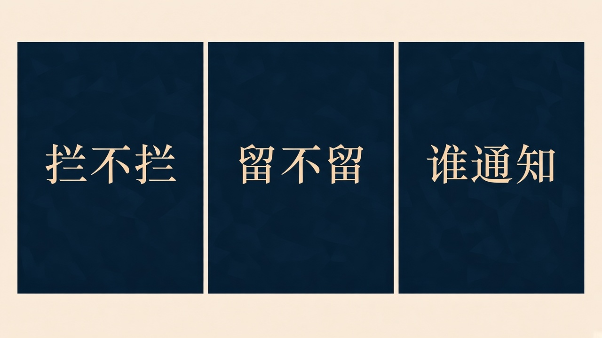

> 先说明一下：素材是我借助 AI 收集整理的，时间都按北京时间。写着「据 X 摘要」的，是 X 平台自动生成的新闻摘要，我暂时没找到一手来源，大家看的时候打个折。每条后面关于行业、公司、赚钱机会的判断都是我个人的看法，不是事实，更不是投资建议。教程视频都是网上公开的，标了「同类操作参考」的，讲的是同一类操作，不是针对这款新产品本身。

## 数据要被读、要过别人的手，先看默认拦不拦、留不留、出了事谁通知你

今天最显眼的，不是又多了一个模型名字，而是数据在被读、也在过别人的手。OpenRouter 在今天的说明里写，和研究者、提供商核实之后，已经把三家提供商移出平台，并从 Zero Data Retention（ZDR）资格里拿掉 **125** 个端点，同时通知了可能受影响的客户；但它也写清楚，这些发现并没有显示 OpenRouter 自己被入侵，或遭到未经授权的访问。文中列出的 Novita、Phala、Together 公告，是他们已经收到的提供商说明，不能直接写成被移出的那三家，而且并非所有受影响的提供商都已公开发布。往前看，Together 写的是今年 **6–7** 月的采样泄露，Phala 的初步报告还是 **11-10** 的，Dragos 的金丝雀实验报告则是 **11-19** 发出的，都不要当成今天才发生的新入侵。另一条线上，Signal 在 **11-20** 更新了 iOS 和 Android 客户端，限制系统级 AI 智能体去读屏幕上的对话；默认拦不拦、能不能由用户关掉，以及 macOS 目前做不到同一套限制，都要按它自己划的范围来看。我没有把「已经通知」理解成每个人都已经收到逐一告知，也没有把「默认拦住」理解成所有系统、所有读取路径都已经堵上。数据要被读、要过别人的手，先看默认拦不拦、留不留、出了事谁通知你。

个人观点，不构成投资、采购或技术选型建议。数字和能力边界以各条原文为准。

## 今天最值得看的几件事

- **头条：OpenRouter 发布推理提供商的数据处理事件说明。** 官方博文 [Data Processing Incidents on Inference Providers](https://openrouter.ai/blog/announcements/data-processing-incidents-on-inference-providers/) 栏面日期 **11/22/2026**。官方写，在与研究人员和提供商核实后，已将三家提供商移出平台，从 ZDR 资格中移除 **125** 个端点（包括研究者标出的提供商，也有作为预防再拿掉的端点），并通知了所有可能受影响的客户；这些发现并未显示 OpenRouter 自身遭到入侵或未经授权访问。文中列出已收到的提供商公告来自 Novita、Phala 和 Together，但列出公告的并不就是被移出的那三家，也并非所有受影响提供商都已公开发布。相关说明要按各自日期分开看，不要写成今天才发生的新泄露。今晚约 **17:51**（北京时间）重新打开时，[HN 50595554](https://news.ycombinator.com/item?id=50595554) 为 **143** 分，[HN 50595816](https://news.ycombinator.com/item?id=50595816)（Together）为 **29** 分，[HN 50596511](https://news.ycombinator.com/item?id=50596511)（Dragos）为 **81** 分。
- **补录 11-20：Signal 限制系统级 AI 智能体读取屏幕上的对话。** 官方博文 [Signal is Serious About Protecting Your Privacy](https://signal.org/blog/protecting-your-privacy/) 由总裁 Meredith Whittaker 撰写，栏面日期 **20 Nov 2026**。官方写，这次是对 iOS **27**，以及在能够检测到 AI 助手试图读取 Signal 屏幕的 Android 版本，采取类似去年在 Windows 上默认阻止 Microsoft Recall 截取消息的限制。帮助中心的版本号是 Android Signal **8.35.1+**，iPhone 为 Signal **8.37+** 且需 iOS **27+**，不要把这些版本写成博文正文里的原句。iPhone 上 “Block Siri AI” 默认打开；Android 上的 Screen security 会在助手第一次尝试读屏时自动打开，也可以在设置里提前打开。想截图的人可以关掉这项保护，但官方写，这样做可能让自己和联系人的内容暴露给这些智能体，并打破其隐私保证。这一补救并不完整，macOS 目前也还做不到同样的限制。
- **中段宜收成一组：** 补录 **11-20**，TikTok 上线可公开使用的核验工具，任何人都可以上传照片或视频，检查其是否由 TikTok 自有 AI 创作功能生成或编辑，即使没有账号也可以用；不要把它写成可检测所有来源、任意模型的深度伪造工具。官网仍写 Chatterfly「限时内测中」，并区分 Android 版与「iOS版（即将发布）」；IT之家约 **14:32:45 · 11-22** 跟进安卓内测，不要把 9 月已有的桌面内测写成今天首发，也不要把「今日上线」写成腾讯官方口径。Pandex 是把欧盟及七个欧洲国家已公布的立法和最高法院裁决汇集起来、供检索和 AI 智能体使用的第三方 API，不是欧盟官方机构的立法平台；无密钥时同一地址每天可试 **50** 次、每分钟 **10** 次，不要写成完全不限次数。

## 数据路径与默认保护

### 1. OpenRouter 说明推理提供商的数据处理事件，相关公告要按各自日期分开看（头条）

[OpenRouter 这篇署文](https://openrouter.ai/blog/announcements/data-processing-incidents-on-inference-providers/)的栏面日期是 **11/22/2026**，是今天同一天的官方主文。它写，本周早些时候安全研究人员报告，部分推理提供商出现数据被窃、或数据政策未被遵守的迹象；OpenRouter 称自己一直在与研究者和提供商协作，以理解这些发现，并推动提供商处理。这里先把范围说清：这些发现**并未**显示 OpenRouter 自身遭到入侵或未经授权访问，测试结果揭示的是特定推理提供商的新情况。

作为客户与模型、提供商之间的运营层，官方写已采取这些行动：根据调查结果，将三家提供商移出 OpenRouter；从 ZDR 资格中移除 **125** 个端点，其中既包括研究者标出的提供商，也有作为预防再拿掉的端点；并通知了所有可能受影响的客户。接下来，他们要把研究者的测试方法纳入持续检查，从技术上核查请求与响应是否被转发到第三方，并要求在恢复任何端点的 ZDR 资格前，先获得相应保证与验证。文末写感谢 [Dragos 的报告](https://www.dragos.com/blog/ai-supply-chain-security-canary-tokens)。

文中列出的已收到提供商安全公告，目前是这三条：[Novita 关于 MiniMax 请求的隐私说明](https://novita.ai/blog/minimax-requests-privacy-notice/)、[Phala 的 11 月初步事件报告](https://phala.com/posts/phala-november-preliminary-incident-report)，以及 [Together 关于 2026 年 6–7 月请求提示词泄露的说明](https://www.together.ai/blog/security-event-prompt-leakage-for-requests-in-june-and-july-of-2026)。官方同时写，并非所有受影响提供商都已公开发布；无论是否有公开说明，他们都已通知受影响用户，并鼓励各提供商写出事件说明、保持这份列表更新。列出公告的这三家，并不能直接写成被移出平台的那三家。

相关说明要按日期分开看，不要折成今天才同时发生的三起新入侵。

[Novita 的说明](https://novita.ai/blog/minimax-requests-privacy-notice/)栏面日期是 **November 22, 2026**。官方写，独立安全研究人员报告后，复核确认部分 MiniMax 请求被转发到了 MiniMax 的官方 API，而不是在 Novita 自有基础设施上处理；原因是一条原本面向特定客户的路由配置被更广地套用。受影响时段为 **2026-05-28 至 2026-11-11**，范围包括直接经 Novita 发出的请求，以及经 OpenRouter 转到 Novita 的请求。官方已暂停受影响模型，并建议若请求中含有有效凭证、API 密钥或其他秘密，应作为预防措施撤销或轮换。文中写，Novita 自身不保留客户提示词或生成结果，也不用于模型训练；正在与 MiniMax 核实是否留存及删除。这是 Novita 自己的说明，并不等于已经确认对方已经删掉。

[Phala 的初步报告](https://phala.com/posts/phala-november-preliminary-incident-report)栏面日期是 **Nov 10, 2026**，不是今天的新发文。官方写，经 OpenRouter 转到 Phala 的 DeepSeek V4 Flash 0731 请求，在 UTC **2026-10-21 00:00 至 2026-11-08 05:35** 窗口内，应把请求内容视为已暴露，并轮换请求里出现过的密钥、令牌或密码；他们写已于 **11 月 8 日** 完成遏制。文中另外写，受影响保密虚拟机（CVM）的租户可能也被接触到应用凭证，或由 Phala KMS 派生的密钥，他们已直接联系相关租户并给出轮换指引。官方还写，完成全平台核查后，除上述系统外，未发现其他模型或产品被入侵的证据。不要把这个窗口写成 Phala 的全部模型或全部产品。

[Together AI 的说明](https://www.together.ai/blog/security-event-prompt-leakage-for-requests-in-june-and-july-of-2026)栏面日期是 **11/21/2026**，作者为 CEO Vipul Ved Prakash。官方写，作为例行软件测试，他们把获授权采样的提示词存在私有 Hugging Face 仓库，样本来自 MiniMax M3、GLM-5.2 与 Kimi K2.6，主要日期为 **6 月 24 日、7 月 4 日、7 月 8 日和 7 月 14 日**；在开发公开 GitHub 仓库 xorl 时，一个 AI 编程智能体提交了可访问该私有仓库的凭证，自动化扫描发现后撤回了提交，但在暴露窗口内，未经授权的一方用该凭证下载了样本，并在其中搜寻、测试其他服务的凭证，其中 **5** 个被测试的凭证是与 Dragos 安全实验相关的金丝雀凭证。今晚打开的官方页写，他们正在审查受影响数据，以确定暴露了什么、哪些客户需要直接通知；目前的复核没有发现这次事件之外还有其他提示词泄露，但对提示词内容的审查仍在进行，以确定是否暴露了敏感个人信息或其他客户数据，并将按需直接联系受影响客户、告知与其相关的发现。不要把「将按需通知」写成已经完成对所有客户的逐一告知，也不要把 **6–7** 月的采样泄露写成今天才发生。事后措施包括：新账户默认开启 ZDR，以及收紧开发流程、凭证和 AI 编程智能体的使用控制；处理敏感提示词的客户，官方仍建议在账户设置里打开 ZDR。

[Dragos 的报告](https://www.dragos.com/blog/ai-supply-chain-security-canary-tokens)栏面日期是 **November 19, 2026**，作者为首席研究官 HD Moore，标题为 “Three breaches, endless leaks: Your AI supply chain needs canaries”，页面路径作 “AI Supply Chain Security: What Canary Tokens Found”。这不是今天新发布的报告。官方写，在 **2026 年 7 月至 11 月** 约五个月里，他们向常用 AI 服务提交了约 **200 万** 条带有唯一 URL 与金丝雀凭证的提示词，并监测其后动向；调查称观察到至少三家 AI 提供商的数据被暴露，且测试提示词随后被用于尝试访问其受控测试系统与金丝雀 AWS 账户。另外两类发现是：推理市场中的多家转售方可在不利用漏洞的情况下，用常规日志能力查看并留存客户提示词；以及多起看似未遵守客户隐私设置或已公布政策的情形，文中举例包括提交给美国提供商的提示词被传到中国 AI 机构、唯一 URL 在单次推理数月后仍被访问、以及一条种子链接最终出现在中国某公司内部聊天中。Dragos 没有点名这些提供商的，这里也就不补名字。

### 2. 补录 11-20：Signal 限制系统级 AI 智能体读取屏幕上的对话

[Signal 这篇署文](https://signal.org/blog/protecting-your-privacy/)的栏面日期是 **20 Nov 2026**，作者为总裁 Meredith Whittaker，标题为 “Signal is Serious About Protecting Your Privacy”。这篇落在昨天各窗之前，当时未常扫 Signal 官方博，今天补录。IT之家和 TechCrunch 是跟进稿，范围以官方博文和帮助中心为准。

官方写，手机操作系统正把智能体能力做进系统层，例如 Android 上的 Gemini Intelligence（Google Gemini）与 iOS 上的 Onscreen Awareness（Siri AI）；这类智能体会扫描屏幕上的信息，再把内容交给本地或远端系统去回答问题或执行操作，从而削弱 Signal 对自己加密与开源代码所承诺的隐私保证。去年已经在 Windows 上用阻止截图的方式，默认防止 Microsoft Recall 截取并保存 Signal 消息；这次是把类似限制延伸到 iOS **27**，以及在能够检测到 AI 助手试图读取 Signal 屏幕的 Android 版本。范围要留在这里：不是所有系统都已经覆盖，也不是已经从根上阻止所有 AI 读取。

[帮助中心条目](https://support.signal.org/hc/en-us/articles/11338514641306-Screen-security-blocking-Siri-AI)写明，功能开启时会阻止应用内截图和录屏，避免 Signal 内容出现在 Android 最近任务或 iPhone App Switcher 中，并阻止设备上的 AI 助手读取屏幕上的 Signal 内容。版本方面，Android 为 Signal **8.35.1** 或更高；iPhone 为 Signal **8.37** 或更高，且需 iOS **27** 或更高。这些版本号在帮助中心，不要写成官方博文正文里的原句。开启方式也不一样：iPhone 上 “Block Siri AI” 默认打开；Android 上的 Screen security 会在 AI 助手第一次尝试读取 Signal 屏幕时自动打开，并弹出说明，用户也可以在设置里提前打开。iPhone 提供开、关，以及关闭 **10** 分钟后自动再打开这三项；Android 则是开或关。想截图的人可以在应用设置里关掉这项保护，但官方博文写，这样做可能让自己和联系人的 Signal 内容暴露给这些 AI 智能体，并打破其隐私保证。

署文同时写，这一补救并不完整：限制截图并不能阻止智能体通过文件系统等其他途径读取设备上已有的内容。由于操作系统没有向开发者提供更合适的限制接口，macOS 版目前无法实现同样的保护。署文注释里给 macOS 27 用户的建议，是先把 Signal 加到系统设置里 Siri 的 Excluded Apps，以减少 Siri AI 主动读取消息内容；这并不是和移动端同一套拦截。帮助中心也写，这项设置只影响截屏和设备上的扫描，并不改变消息的加密方式。不要把这次更新写成加密协议本身的变更。

## 中段产品

### 3. 中段简报：TikTok 的核验工具，Chatterfly 的安卓内测，以及 Pandex

补录 **11-20**。TikTok 新闻室 [More tools to provide clarity and control around AI-generated content](https://newsroom.tiktok.com/more-tools-to-provide-clarity-and-control-around-ai-generated-content) 的 `publishedDate` 为 **2026-11-20**，`firstPublishedDate` 为 UTC **05:00:00 · 11-20**。这篇落在 **11-20** 当天笔记截稿之后，且 TikTok 新闻室未列入常扫源，今天补录。不要把 IT之家所写的「当地时间 11 月 19 日」写成官方栏面日期。

官方写，新的透明度工具现已上线，任何人都可以上传图片或视频，检查其是否由 TikTok 的 AI 创作功能生成或编辑，即使没有 TikTok 账号也可以使用；工具会检查 C2PA Content Credentials，以及 TikTok 专有的隐形水印 VeraDura。工具经 Transparency Centre 提供，专文指向 [Identifying content made with TikTok AI](https://www.tiktok.com/safety/en/transparency/ai-content-identification)。工具页还写，它检查的是 TikTok 自己加上的凭证与水印，不能识别其他平台后来做的修改；未检测到信号，也不等于已经证明「这不是 AI 生成」。不要把它写成可检测所有来源、任意模型的深度伪造工具。官方还自称，迄今已为平台上超过 **50 亿** 条 AI 生成视频添加标识；并称对于违反有害、误导性 AI 生成或经 AI 显著修改内容规则的内容，有超过 **99%** 在有人举报前即被移除。这些是官方自己的数字，不是独立审计结果。另一方面，官方称开始在全球逐步推出可选的 Likeness Detection，帮助符合条件的创作者发现并标记可能未经授权使用其肖像的 AI 生成内容。符合条件的创作者通过受信任的第三方合作伙伴核验身份后即可登记，随后会在工具中收到可能使用其肖像的内容与账号通知，并可直接向安全团队举报。官方写，该工具面向符合条件的创作者和公众人物，包括政府、政治人物或政党账号（GPPPAs）；并称设计上尽量减少数据收集，TikTok 不保留身份证件。这是开始向符合条件的人滚动推出，不是已经对所有创作者全开。

腾讯 Chatterfly 这一侧，今晚打开的[官网](https://chatterfly.tencent.com/)写着「限时内测中，欢迎体验」，并区分 “Android版” 与 “iOS版（即将发布）”。官网还写，这款输入法不只把语音变成文字，还能理解上下文、识别不同意图和场景，并听懂需求、帮用户执行任务。IT之家约 **14:32:45 · 11-22** 的[跟进稿](https://www.ithome.com/1/030/576.htm)称安卓版现已开启内测，并另外列举了语音输入整理成稿、说完自动翻译、按场景润色的表达 Skill，以及用快捷键下达文本创作、翻译或信息提炼等指令；这些细节来自跟进报道，不是今晚能核到的带日期官方新闻稿。需要和更早报道分开：IT之家在 **2026/9/18 18:10:10** 已经报道过桌面端（macOS / Windows）开启内测，当时还写 iOS 与 Android 版显示为即将发布。不要把 9 月已有的桌面内测写成今天的产品首发，也不要把「今日上线」写成腾讯官方口径。官网没有另写地区可用性，也就不补。

补录 Pandex。这是一套面向 AI 智能体、汇集欧洲已公布法律文本的 MCP 服务与 HTTP API，未见带日期的官方新闻稿，时间以 HN 提交和上头条为准。[HN 50593481](https://news.ycombinator.com/item?id=50593481) 由 vasie 于 UTC **20:47:41 · 11-21**（约北京 **04:47 · 11-22**）提交，标题为 “Pandex – Official European Law for AI Agents, over MCP”；今晚约 **17:51**（北京时间）重新打开时为 **90** 分，仍在头条附近。[官网](https://www.pandex.io/)写，这是一套把欧盟及七个欧洲国家的立法与最高法院裁决、直接从发布机构汇集后供检索和 AI 智能体使用的 API，并自称现有 **280 万** 份官方文件、**3700 万** 条已与正文对齐的引用，以及 **41** 个机构中的 **33** 个已收录完整。覆盖范围包括欧盟、法国、德国、荷兰、英国、奥地利、瑞士、卢森堡，以及欧洲人权法院。这些体量数字是公司自称，官网自己的覆盖页也标明部分机构仍是部分收录，不要写成已经收全欧洲全部立法。[文档页](https://api.pandex.io/docs)写，MCP 以 streamable HTTP 提供在 https://api.pandex.io/mcp，共六个只读工具（search、get_document、get_outline、get_citations、get_changes、list_sources）；无密钥时同一地址每天可试 **50** 次、每分钟 **10** 次，亦可在起始页免费申请密钥。提交者在 HN 上写 “no key needed”，与文档中的试用限额并不相同，不要写成完全无需密钥、不限次数。代码仓库在 [pandex-io/pandex-mcp](https://github.com/pandex-io/pandex-mcp)。不要把该服务写成欧盟官方机构发布的立法平台，它是汇集各机构已公布文本的第三方 API。

## YC 动态

### 4. YC 核验：仍是晚交 W27，F26 Demo Day 在 12 月 2 日；无新 Launch 需要展开

今晚约 **17:51**（北京时间）重新打开 `launches.json` 时，按时间倒序栏顶仍是 Morphy（Winter 2026，**10** 票，`created_at` UTC **17:12:25 · 11-20**），其次是已在昨天帖子里写过的 River（Fall 2026，**24** 票，`created_at` UTC **17:00:00 · 11-20**）。Resin Technologies 为 **7** 票，STASIS 为 **6** 票，Oasive 为 **14** 票，FlashDrive 为 **28** 票，仍见栏内。票数都不高，也不写「现居顶」，今晚没有新的 Launch，Morphy 和 River 都不单列展开。

YC 日程核验今晚没有变化。今晚打开的[申请页](https://www.ycombinator.com/apply)仍写正在接受 Winter 2027 批次申请，批次时间为 **January to March**、地点在旧金山；准时截止日期 **November 2** 晚上 **8pm PT** 已过，但仍接受迟交。若在截止日期前递交，会在 **December 11** 前收到决定；截止日期之后提交仍会被考虑，但不能承诺具体回复时间。[Demo Day 页](https://www.ycombinator.com/demoday)仍写 “The F26 Demo Day will be held on Wednesday, December 2nd”，投资者入口仍指向 [demoday.ycombinator.com](https://demoday.ycombinator.com)。

## 今日机会总结

今天的脊柱不是「又发布了一个谁都能点开的模型」，而是**数据要被读、要过别人的手，先看默认拦不拦、留不留、出了事谁通知你**。OpenRouter 把三家提供商移出平台，并拿掉 **125** 个端点的 ZDR 资格，但列出公告的 Novita、Phala、Together 并不能直接写成被移出的那三家，也不是 OpenRouter 自己被入侵。各家窗口、模型范围和通知进度都不一样：Novita 还在与 MiniMax 核实是否留存及删除，Together 仍在审查并按需直接通知，Phala 的初步报告则还是 **11-10** 的。Signal 在 iPhone 上默认打开拦截，在可检测的 Android 版本上遇到读屏再自动打开，但用户可以关掉，macOS 目前也还做不到同样的限制。旁边的 TikTok 核验工具只检查它自己的 AI 创作功能，Pandex 是第三方汇集接口而不是欧盟官方平台，Chatterfly 则是安卓内测、不是今天才第一次出现这款产品。

若只选三条可执行方向：

1. **先问默认拦不拦、资格还在不在：** 对标 OpenRouter 移出提供商、拿掉 ZDR 资格并通知可能受影响客户，以及 Together 事后让新账户默认开启 ZDR、仍建议处理敏感提示词的客户自己打开。客户是已经把请求交给推理路由或市场的团队，卖的是默认留存和资格边界，而不是「只要走了路由，数据就不会被第三方看到」。
2. **再看它过了谁的手、窗口落在哪一段：** 对标 Novita 把部分 MiniMax 请求转到官方 API 的时段，Phala 上 DeepSeek V4 Flash 0731 的暴露窗口，以及 Together 在 **6–7** 月的授权采样泄露。客户是提示词里可能带过密钥或业务内容的开发者和安全团队，卖的是按官方窗口轮换和排查，而不是把列出公告的三家理解成今天同时被入侵。
3. **出了事谁通知你，以及屏幕上的对话默认谁能读：** 对标 OpenRouter「无论是否有公开说明都已通知受影响用户」，Together「将按需直接联系」，以及 Signal 在 iPhone 上默认打开、在 Android 上可检测时再打开、用户仍能关掉的设置。客户是加密通讯用户，以及已经在等提供商通知的调用方，卖的是通知范围和默认保护，而不是「每个人都已经收到逐一告知，或所有系统上的 AI 读屏都已经被堵住」。

## 普通人今天就能做的 3 件事

1. **已经在用 OpenRouter，或把提示词交给推理市场、转售方的开发者和安全人员：** 先看自己有没有收到 OpenRouter 或提供商的通知，再核对这些端点是否还在 ZDR 资格里。若在 **2026-05-28 至 2026-11-11** 经 Novita 或经 OpenRouter 转到 Novita 调过 MiniMax，可按 [Novita 的说明](https://novita.ai/blog/minimax-requests-privacy-notice/)把请求里出现过的有效密钥轮换掉。若在 UTC **2026-10-21 00:00 至 2026-11-08 05:35** 经 OpenRouter 把 DeepSeek V4 Flash 0731 请求打到 Phala，可按 [Phala 的初步报告](https://phala.com/posts/phala-november-preliminary-incident-report)把请求内容视为已暴露并轮换相关凭证；没收到 CVM 租户通知的，不要自行扩大到 Phala 的全部产品。用过 MiniMax M3、GLM-5.2 或 Kimi K2.6、且主要落在今年 **6 月 24 日、7 月 4 日、7 月 8 日或 7 月 14 日** 的，以 [Together 今晚的说明](https://www.together.ai/blog/security-event-prompt-leakage-for-requests-in-june-and-july-of-2026)为准：他们仍在审查，并将按需直接通知，不要假定所有客户都已经收到逐一告知；处理敏感提示词的，可按官方建议在账户设置里打开 ZDR。
2. **在用 Signal 的人，尤其是 iPhone 已经升到 iOS 27，或 Android 上开了系统 AI 助手的用户：** 先按[帮助中心](https://support.signal.org/hc/en-us/articles/11338514641306-Screen-security-blocking-Siri-AI)核对版本：Android 需要 Signal **8.35.1** 或更高，iPhone 需要 Signal **8.37** 或更高，并且是 iOS **27** 或更高。iPhone 上 “Block Siri AI” 默认是开的；Android 上可以等到助手第一次尝试读屏时再自动打开，也可以在设置里提前打开。需要截图时可以关掉，但官方写，这样做可能让自己和联系人的 Signal 内容暴露给这些智能体，并打破其隐私保证。macOS 目前做不到同样的限制，不要以为电脑版已经一并拦住；若在用 macOS 27，可按署文注释把 Signal 加到系统设置里 Siri 的 Excluded Apps。范围以 [Signal 这篇署文](https://signal.org/blog/protecting-your-privacy/)为准，不要把它理解成加密协议本身改了，或所有读取路径都已经堵上。
3. **需要核验网上图片或视频是否由 TikTok 自有 AI 生成的创作者，或要给智能体接欧洲法律文本的人：** 核验可到 [TikTok 的工具页](https://www.tiktok.com/safety/en/transparency/ai-content-identification)上传照片或视频，即便没有账号也可以用；它只检查 TikTok 自有 AI 创作功能留下的 Content Credentials 和 VeraDura 水印，不要当成对所有来源、任意模型都有效的鉴定。符合条件的创作者和公众人物，可按 [新闻室说明](https://newsroom.tiktok.com/more-tools-to-provide-clarity-and-control-around-ai-generated-content)看 Likeness Detection 是否已经轮到自己，身份核验走的是受信任的第三方合作伙伴，官方称不保留证件。要给智能体查欧盟及所列欧洲国家法律的，可按 [Pandex 文档](https://api.pandex.io/docs)使用 MCP 或 HTTP API，无密钥时每天只有 **50** 次试用，不要写成完全不限次数，也不要把它当成欧盟官方平台。想试 Chatterfly 的，以今晚的[官网状态](https://chatterfly.tencent.com/)为准：安卓是限时内测，iOS 仍是即将发布，桌面端更早已经开过内测。本轮没有核验过新的跟练视频，也就不列教程。

